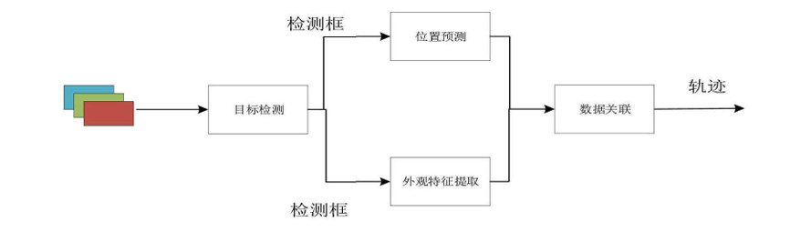

目前，`Tracking-by-detection`成为 `MOT` 任务中最有效的范式。`Tracking-by-detection`包含一个步骤检测步骤，然后是一个跟踪步骤。跟踪步骤通常由2个主要部分组成：

1. 运动模型和状态估计，用于预测后续帧中轨迹的边界框。`卡尔曼滤波器` (KF) 是此任务的主流选择。
2. 将新帧检测与当前轨迹集相关联。

对于步骤2：有2种主要的方法用于处理关联任务：

1. 目标的定位，主要是预测轨迹边界框和检测边界框之间的IoU。
2. 目标的外观模型和解决Re-ID任务。

这2种方法都被量化为距离，并用于将关联任务作为全局分配问题来解决。

# DBT

## Bytetrack
