> https://zhuanlan.zhihu.com/p/685915213
>
> 

# 1：NPL

NLP 相关的基础知识，包括文本预处理、分词、词性标注、命名实体识别、词向量表示等

 Transformer 模型的结构和原理、基于注意力机制的自然语言处理技术

常用 ：[Prompt](https://zhuanlan.zhihu.com/p/626024467)

> 1 
>
> 2 


## NLP任务

实体提取

标签提取


### self attention

> 新的layer实现seq2seq=双向rnn+并行

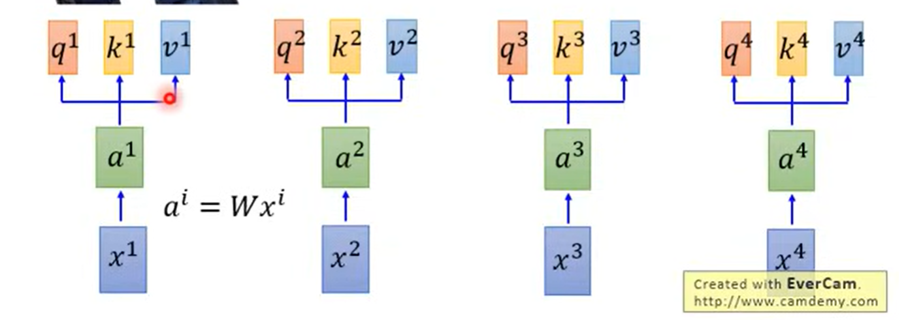

> q:match 其他人k: 每一个q对每一个k做attention
>
> 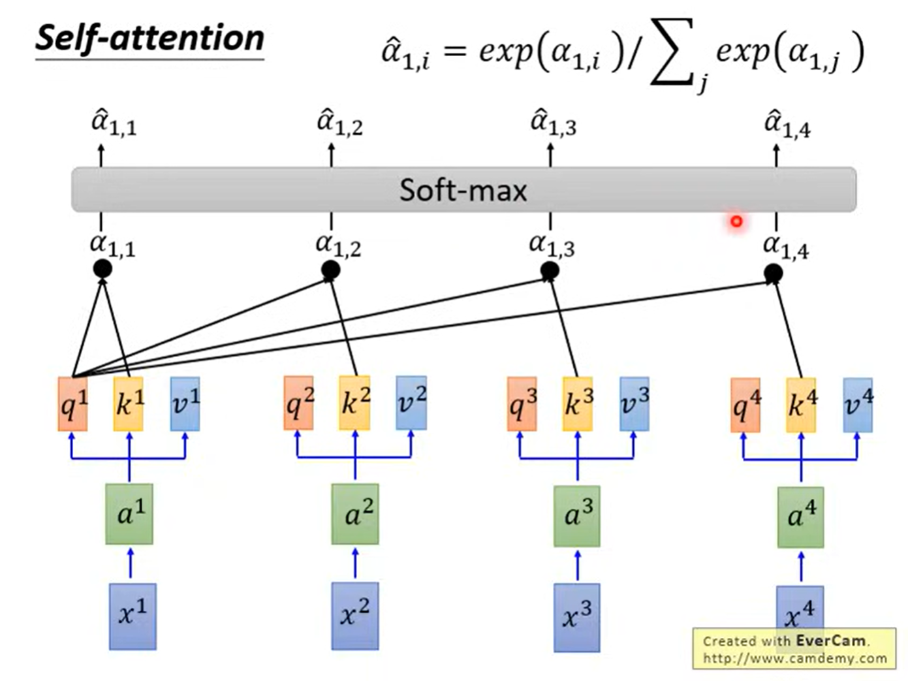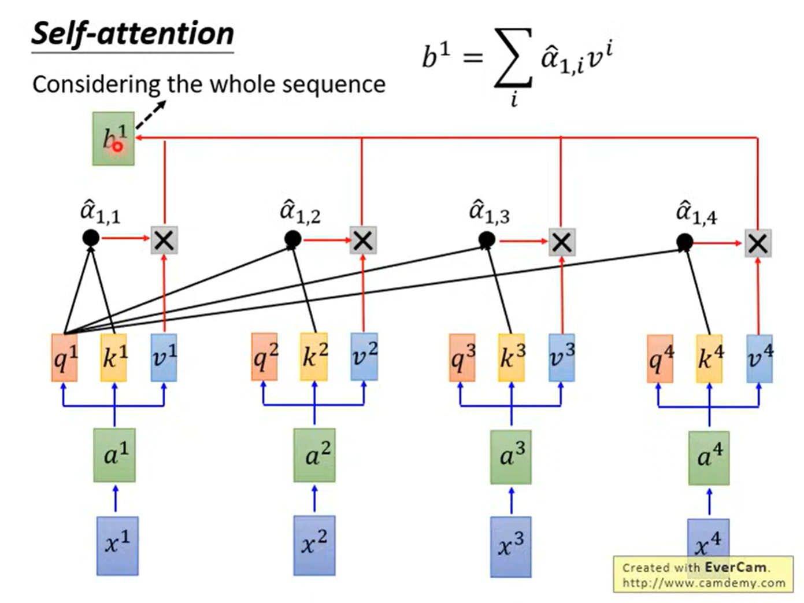
>
>  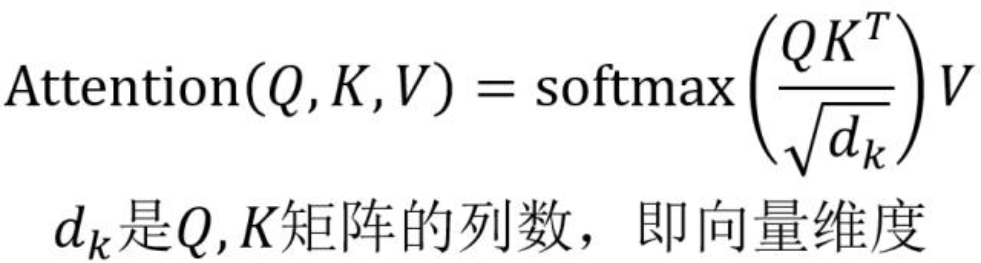d:维度:scale
>
> 生成:b

> 并行:
>
> 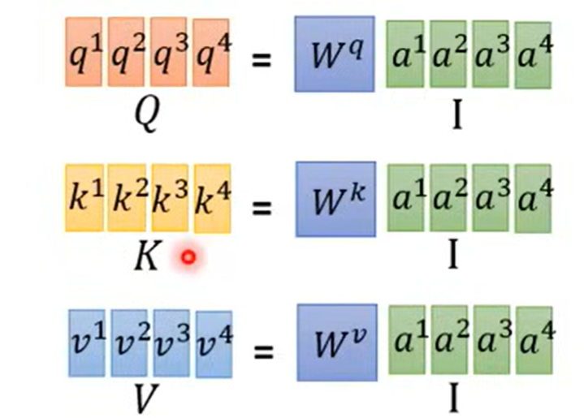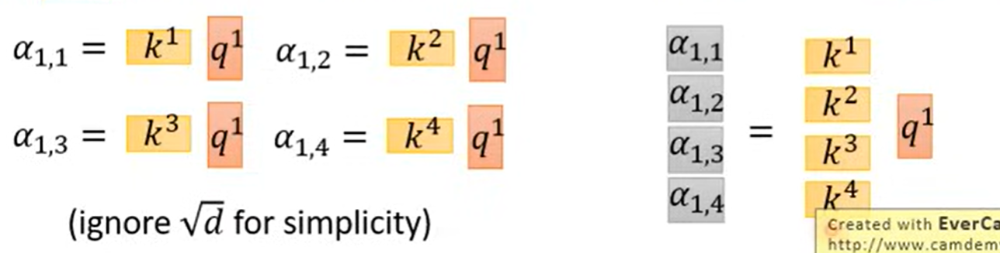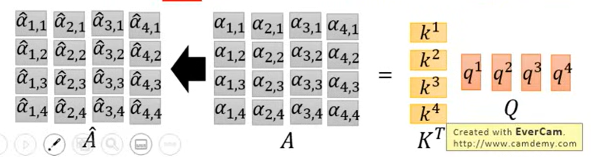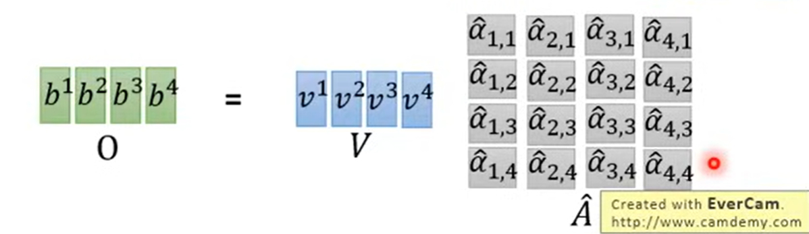


> 多头注意力机制
>
> 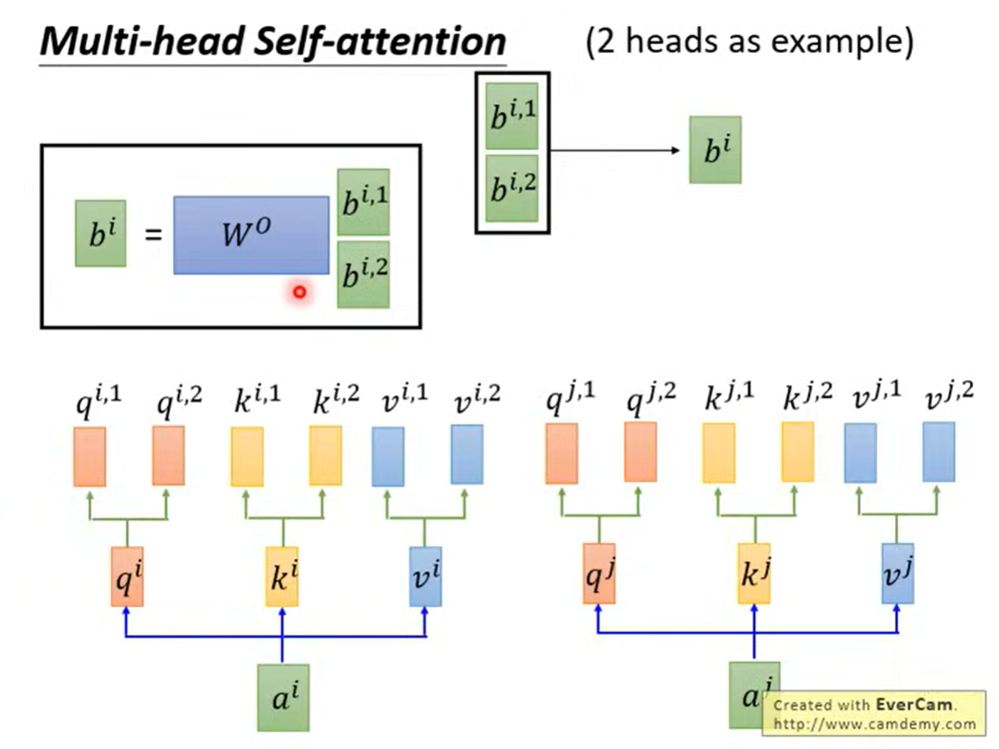 
>
> 不同head关注的点不一样,长短咨询位置

> 位置编码
>
> 似乎位置不重要,都是对邻居和天涯似乎是一样的,v可控制
>
> 为什么直接相加可以呢?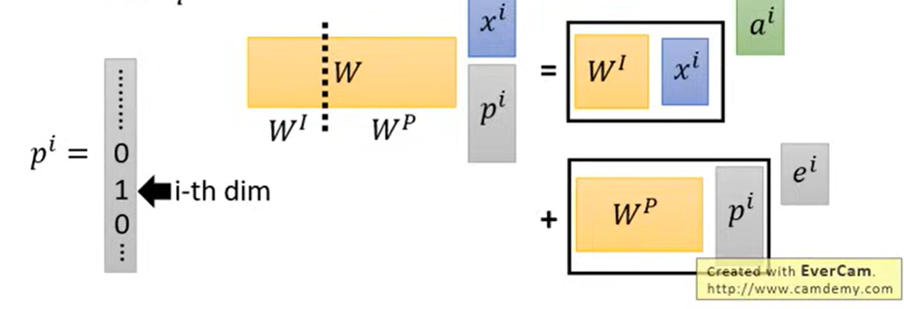


> transformer
>
> 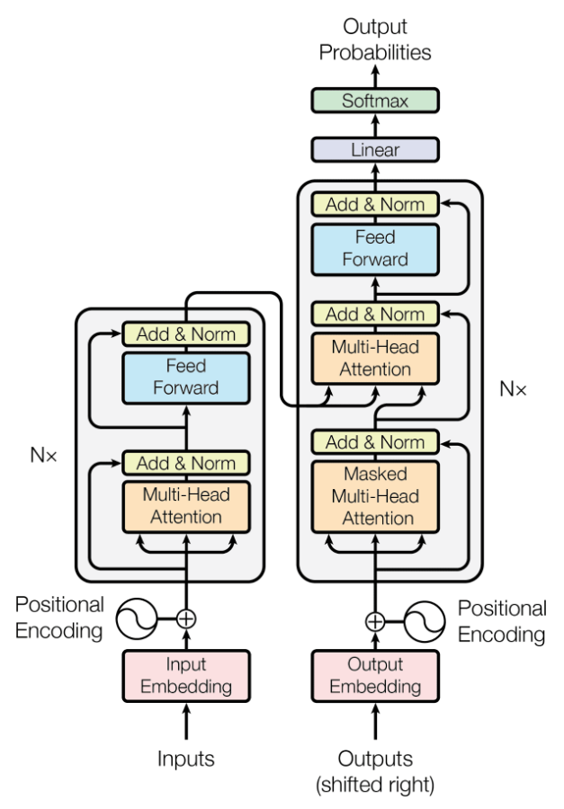 

> masked attention
>
> masked为未产生的东西

# 2：LLM

<details>
<summary>▶ 点击展开 / 折叠</summary>
这里是被折叠的内容，可以放文字、代码、图片等。
- 支持列表
- 支持段落
- 支持 `代码块`


# 3：Finetune

> https://github.com/hiyouga/LLaMA-Factory/tree/main
>
> Integrated methods: (Continuous) pre-training, (multimodal) supervised fine-tuning, reward modeling, PPO, DPO, KTO, ORPO, etc
>
> https://github.com/liguodongiot/llm-action

| 概念                               | 区别                                        |
| ---------------------------------- | ------------------------------------------- |
| **Pretraining（预训练）**          | 在大语料上学习语言建模能力                  |
| **Fine-tuning（微调）**            | 在小数据上定制特定任务能力                  |
| **Instruction tuning（指令微调）** | 在“任务指令+答案”数据上微调                 |
| **RLHF（强化学习人类反馈）**       | 用人类反馈进一步优化行为                    |
| **Alignment（对齐）**              | 让模型行为符合人类意图，包含指令微调 + RLHF |

#### 指令微调的语言模型

> 普通语言模型只学会了“在大语料里续写文本”；
>  指令微调模型进一步学会了：
>
> > “当我说 **请翻译成中文** 时，不是续写‘请翻译成中文’，而是**执行翻译任务**。”
>
> ```json
> {
>   "instruction": "将下列英文翻译为中文。",
>   "input": "How are you?",
>   "output": "你好吗？"
> }
> ```
>
> 

#### **基于人类反馈的强化学习（RLHF，Reinforcement Learning with Human Feedback）**

> https://chatgpt.com/s/t_6870b6c17a5081919a2de618af9c434b

> **RLHF 是一种让语言模型通过人类偏好来“对齐”行为的技术**：
>  它不是仅仅预测下一个词，而是学会“什么样的回答更符合人类预期”。
>
> 预训练语言模型（如 GPT）是通过大量文本数据学习的，它只知道“语言模式”，**不知道什么是“好回答”、“有害内容”或“礼貌回应”**。

> 🔧 **RLHF 的目标**是：
>  在模型已经具备生成能力的基础上，用人类反馈进一步调整模型行为，让它：
>
> - 更有用（helpful）
> - 更无害（harmless）
> - 更真实（honest）
> - 更对齐（aligned）

> #### ✅ RLHF 三阶段工作流程（标准流程）
>
> 这就是 OpenAI 的 InstructGPT / ChatGPT 的训练流程，分为三个阶段：
>
> 🔵 **Step 1：监督微调（Supervised Fine-Tuning, SFT）**
>
> - 用“指令+人类优质响应”对模型做初步微调。
> - 例如：
>
> ```
> textCopyEditUser: 写一首诗描述春天
> Assistant: 春风拂面百花开，柳绿燕归燕剪裁……
> ```
>
> ✅ 模型从“语言模型”变成“跟人类说话的模型”。
>
> ------
>
> 🔵 **Step 2：奖励模型（Reward Model, RM）训练**
>
> - 收集人类对模型多个回答的**偏好排序**数据：
>
>   > 输入一个问题，模型生成多个答案 → 人类打分 → 哪个更好？
>
> - 训练一个 **Reward Model**（通常是 BERT/Bloom 类模型），学会判断“哪个回答更好”。
>
> ```
> textCopyEditPrompt: 你如何看待人工智能？
> → Answer A vs Answer B → 人类更喜欢 A → Reward(A) > Reward(B)
> ```
>
> ✅ 模型能评估回答质量（越像人，reward 分越高）。
>
> ------
>
> 🔵 **Step 3：强化学习（PPO,DPO等）优化原始模型**
>
> - 使用策略优化算法（如 PPO：Proximal Policy Optimization）
> - 目标是让模型生成更高 Reward 的答案
> - 奖励来自 Reward Model，而不是传统“环境”
>
> ```
> 模型生成答案 → Reward Model 打分 → 优化策略 → 再生成
> ```
>
> ✅ 模型行为被“人类价值”引导，而不是语言概率最大。


#### 特征对齐（Feature Alignment）

| 技术                                      | 简介                                                         |
| ----------------------------------------- | ------------------------------------------------------------ |
| **DPO（Direct Preference Optimization）** | 替代 RLHF，直接用人类偏好做梯度优化，更高效                  |
| **Constitutional AI（宪法式对齐）**       | Anthropic 提出，模型通过预设“宪法”规则自我审查和自我学习，无需人工打分 |
| **Self-Reward / Self-Alignment**          | 让模型基于提示自评行为（如 OpenAI 的 Critic 模块）           |
| **多轮互动对齐（Multi-turn alignment）**  | 加强模型在长对话、多轮引导下保持对齐状态                     |
| **Instruction Backchaining**              | 自动生成训练用的指令和行为对，用于自监督对齐                 |


# 4 Agent

## 1：RAG（外挂数据库）

> https://www.langchain.asia/
>
> 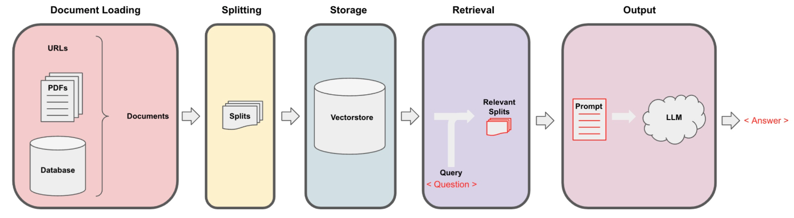


