#

> 主要介绍AI的实现策略


# 1 Agent设计模式

> https://zhuanlan.zhihu.com/p/692971105
>
> https://blog.csdn.net/m0_57081622/article/details/147892638


## **1 ReAct** **模式**

> https://github.com/samwit/langchain-tutorials/blob/main/agents/YT_Exploring_ReAct_on_Langchain.ipynb

**原理**

1. 接收任务：Agent获取来自用户或系统的任务指令。
2. 推理（Thought）：Agent依据当前任务和已有知识展开推理，形成初步的行动计划。
3. 行动（Action）：Agent执行经推理得出的行动。
4. 观察（Observation）：Agent对行动产生的结果进行观察，获取反馈信息。
5. 循环迭代：将观察结果反馈至推理过程，Agent依据新信息重新推理，生成新的行动计划，并持续执行行动与观察，直至任务完成


```python
    def think(self, task):
        # 推理：根据任务生成行动计划
        for location in self.knowledge_base["locations"]:
            yieldf"检查 {location} 是否有胡椒粉"

    def act(self, action):
        # 行动：执行具体的行动
        if action == "检查 台面上 是否有胡椒粉":
            return"台面上没有胡椒粉"
        elif action == "检查 灶台底下抽屉 是否有胡椒粉":
            return"灶台底下抽屉有胡椒粉"
        elif action == "检查 油烟机左边吊柜 是否有胡椒粉":
            return"油烟机左边吊柜没有胡椒粉"

    def observe(self, action_result):
        # 观察：记录行动的结果
        return action_result

```


## 2 **Plan** **and** **solve** **模式**

> 《Plan-and-Solve Prompting: Improving Zero-Shot Chain-of-Thought Reasoning by Large Language Models》
>
> https://github.com/Fosowl/agenticSeek

原理

1. 接收任务：Agent接收来自用户或系统下达的任务指令。

2. 规划（Plan）：Agent基于任务目标生成一个多步骤的详细计划，清晰界定每个步骤的具体内容与执行顺序。
3. 执行（Solve）：Agent依照既定计划，依次执行每个步骤。
4. 观察（Observation）：Agent对执行结果展开观察，判断是否有必要启动重新规划流程。
5. 重新规划（Replan）：若发现计划无法实施，或需要根据实际情况调整，Agent将结合当前状态重新生成计划，并继续执行。


## **3. Reason** **without** **Observation**


1. Planner：负责生成一个相互依赖的“链式计划”，定义每一步所依赖的上一步的输出。
2. Worker：循环遍历每个任务，并将任务输出分配给相应的变量。当调用后续调用时，它还会用变量的结果替换变量。
3. Solver：求解器将所有这些输出整合为最终答案。


## **4. LLMCompiler**

**原理**

变成并行执行

1. 接收任务：Agent 接收到用户或系统的任务指令，任务可能包含多个子任务。

2. 任务分解（Task Decomposition）：Agent 将复杂任务分解为多个子任务，并确定这些子任务之间的依赖关系。
3. 并行执行（Parallel Execution）：Agent 根据子任务之间的依赖关系，将可以并行处理的子任务同时发送给多个执行器进行处理。
4. 结果合并（Result Merging）：各个执行器完成子任务后，Agent 将结果合并，形成最终的输出。
5. 循环迭代（Iteration）：如果任务需要进一步处理或调整，Agent 会根据当前结果重新分解任务，并继续并行执行和结果合并，直到任务完成。


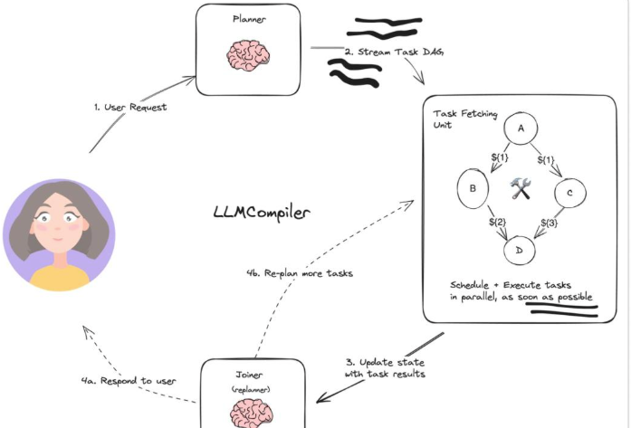


## 5 **生成智能体（Generative Agent）**

> 斯坦福小镇 https://github.com/joonspk-research/generative_agents?tab=readme-ov-file


# 2 设计策略

## 2.1 提示词工程

### 2.1 Cot

**定义**

> 让模型一步一步来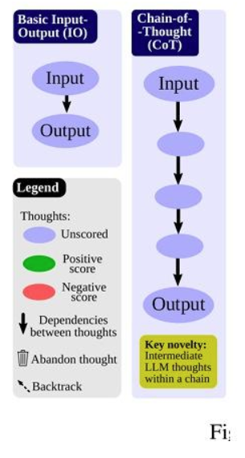

除了model本身的cot还可以是prompt的cot

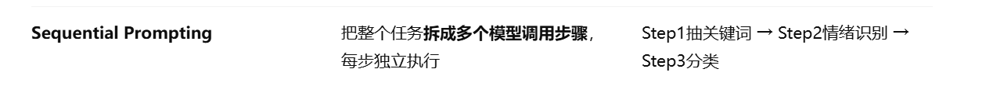


### ToT（Tree of Thought）

一种推理策略，它通过构建多条思维路径（像树一样分叉）并探索、评估每条路径，从而更系统地解决复杂问题。


## 2.2few-shot-{1,3,5,7,error}

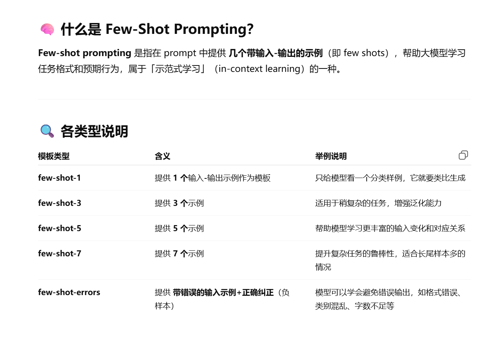

## 2.3 多 prompt-template 路由机制

你提到 **“垂类资源路由到不同的 prompt 模板”**，这是非常前沿的技术，通常涉及：

- 使用一个 **Query Router / Prompt Router**
- 对用户输入先进行分类（如：情感分析 / 法律判断 / 财经摘要）
- 然后调用对应 prompt 模板 + 指定模型


## 2.4sequential prompting


## function call

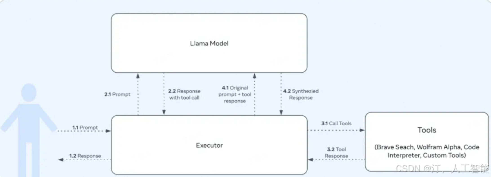

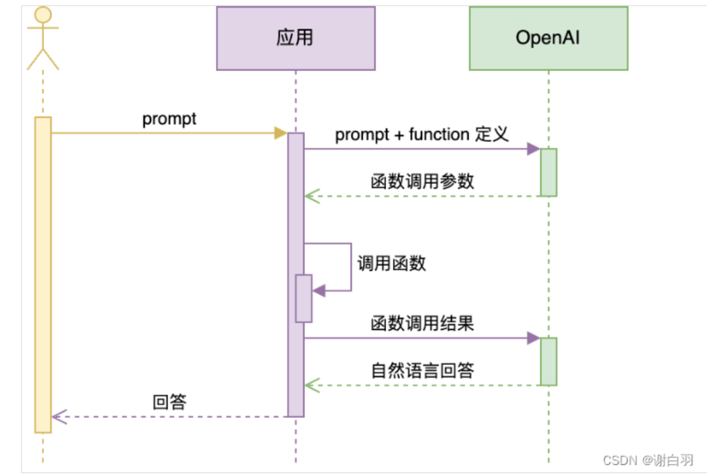


# 3 workflow工作流

什么是workflow

> 接

> 参考:https://www.zhihu.com/question/1913932324036379153

## 3.1 准确率：AI Agent的生命线

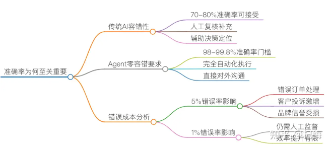

## 3.2 长尾问题: 28原则：聚焦核心场景

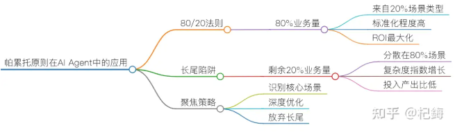


## 3.3 100%防幻觉：沙盒化策略


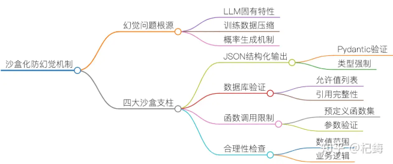


## 3.4 提示工程：从玩具到生产的跨越

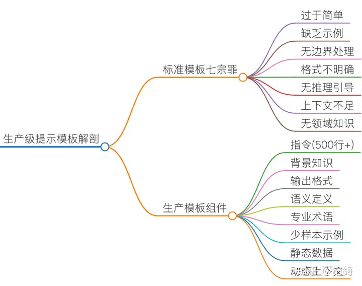

## 3.5 框架选择：要不要用AI框架


# 4 Prompt处理 上下文工程

> https://www.youware.com/project/7529x70z4p


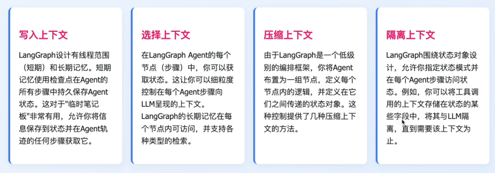

## 4.1 写入

> 持久化


#### 选择

> 选择有用信息 concat


#### 压缩

> 压缩总结


#### 隔离


### 上下文压缩

