# RL

## 引言

监督学习

人类根本就不知道下一步在哪里

也就是标签是不是最好的,

就是收集标注不知道什么是最好的的时候就可以采用RL

> 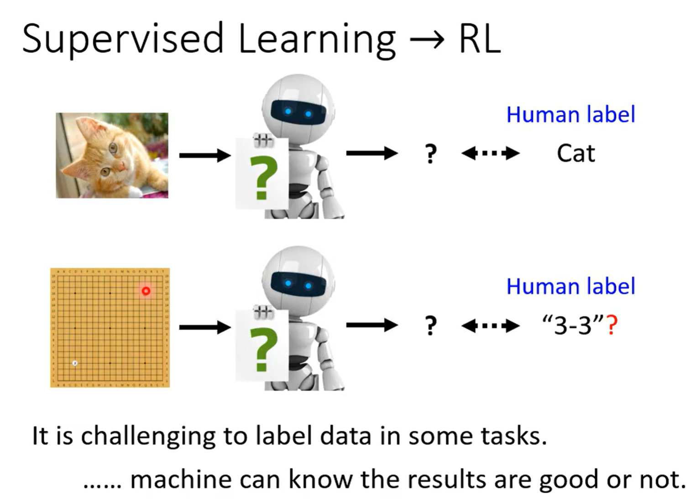

## Define

> 大概流程:  
> 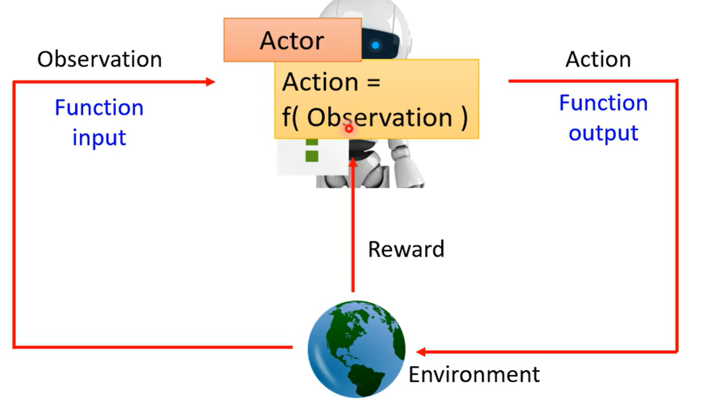

### 1 set a function

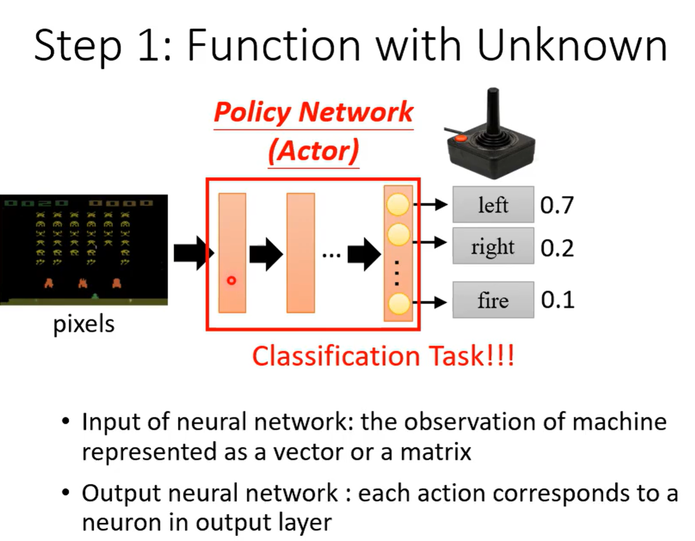

### 2 define loss

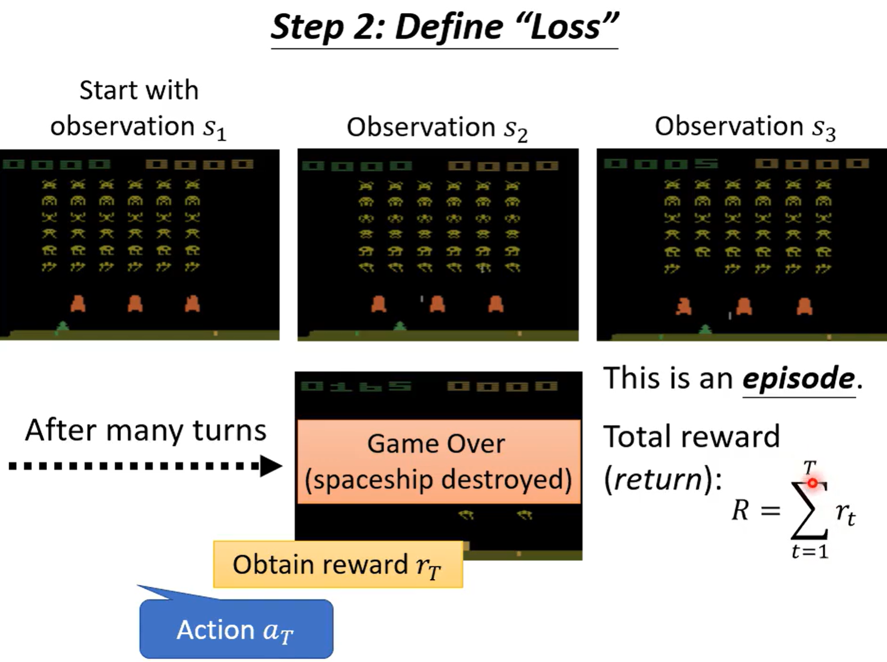

SAMPLE 产生output--> 随机性

### 3 optimization

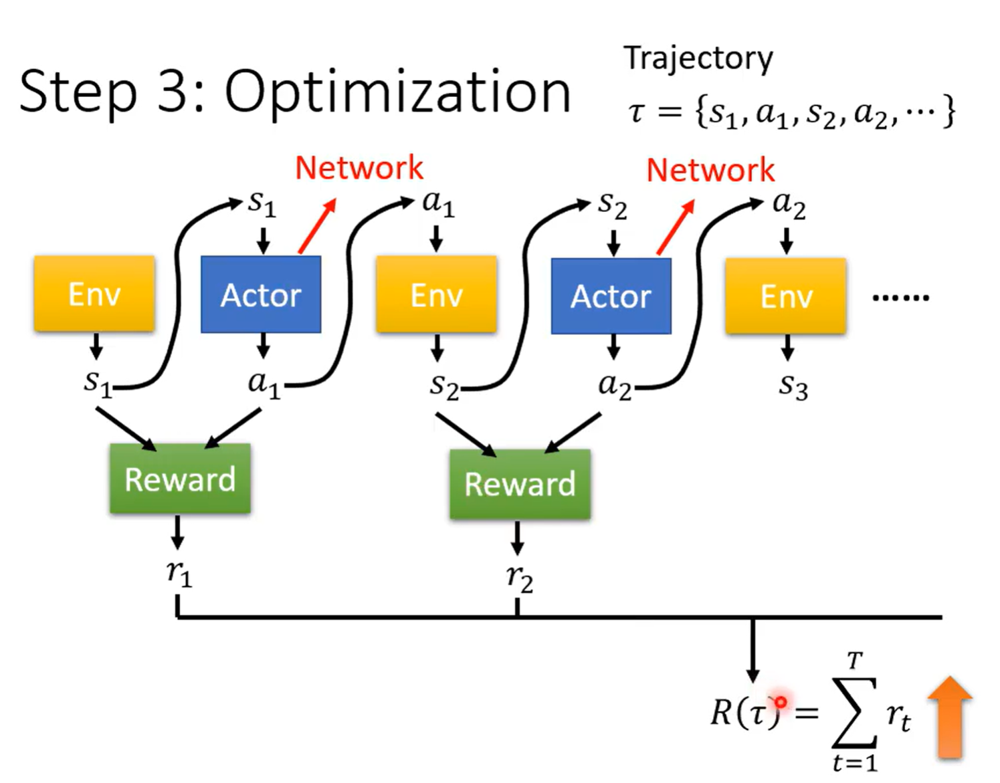

> 1 env的observation产生
>
> 2 reward设计
>
> 3 actor的sample也有随机性:和nn的随机性还不一样,因为output的参数也不就可以复现
>
> 不能用nn的optimization怎么解呢?

## Policy Gradient

### 1 定义

s1的grand true是a1 s2是a2

所以我们的目标是:(要执行和不要执行)

s1 最大化 a1

s2 最小化a2

> 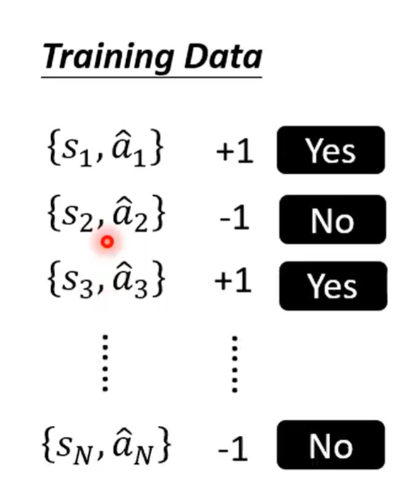

### 2 how

每个action的期待程度不同

> 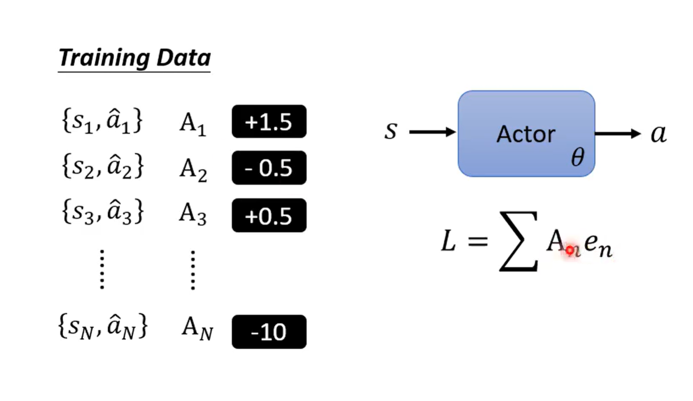

>  如何定义A?
>
> 如何确定s1->a1?

### version 0

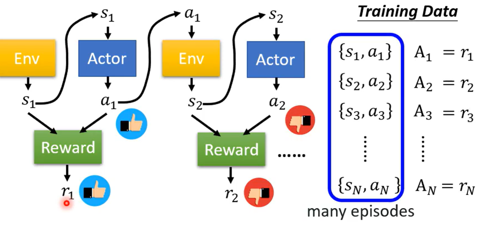

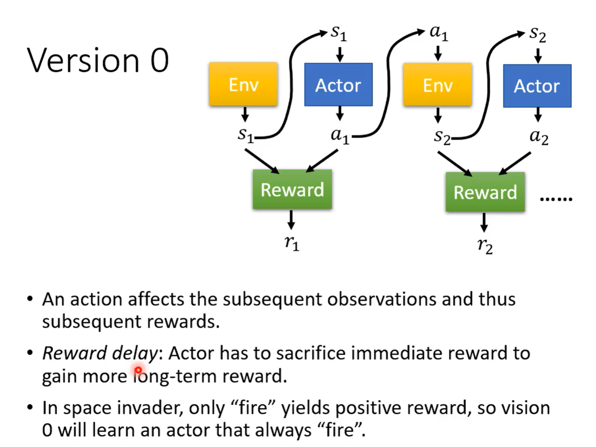

> 只会学到fire是好的
>
> 

Version 115

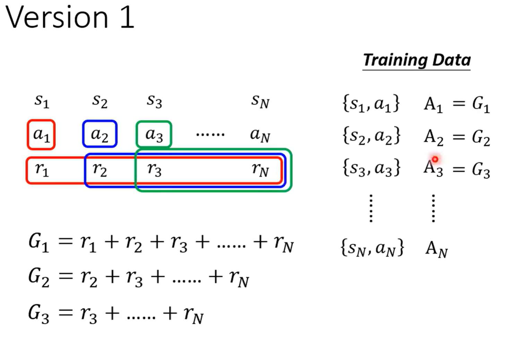

> 累加, 用之后的结果来批判之前的action 是否好快
>
> 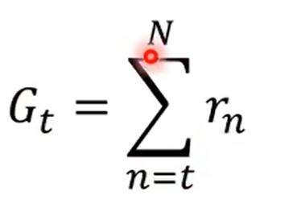 

### Version 2

> 但是如果very long呢?距离参数 
>
> 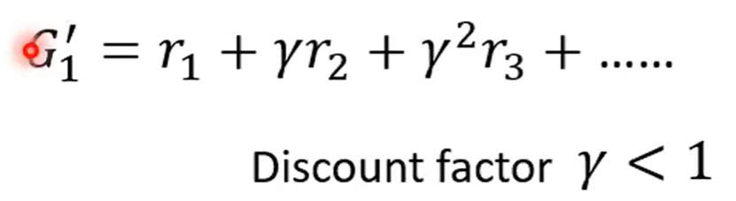

### Version 3

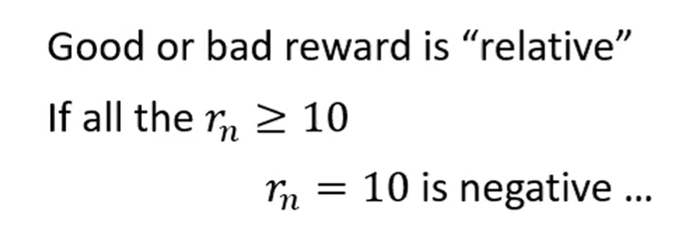

> 相对的100分最高才60?-->标准化
>
> 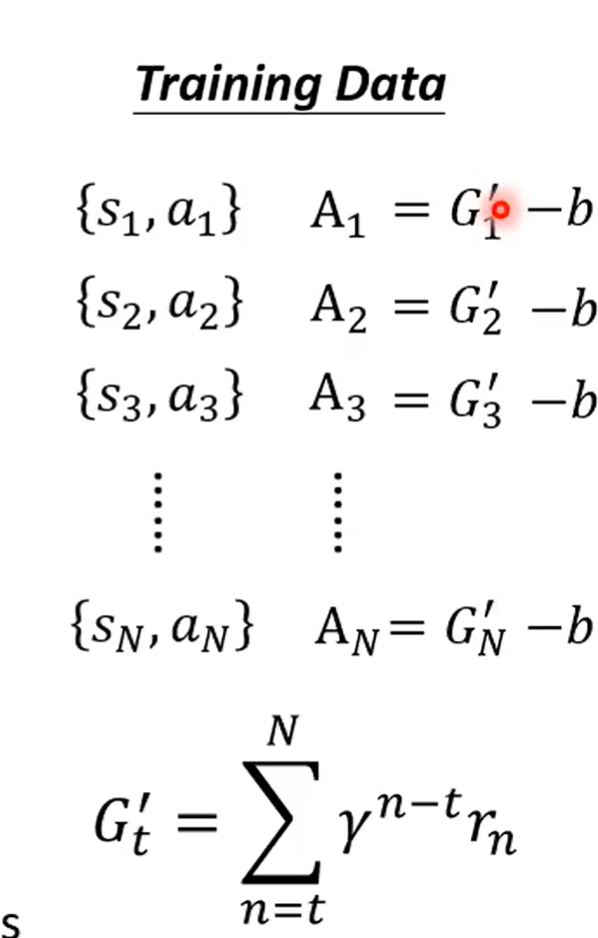 

为什么A实在train里的呢?而且每次都需要重新评估呢?
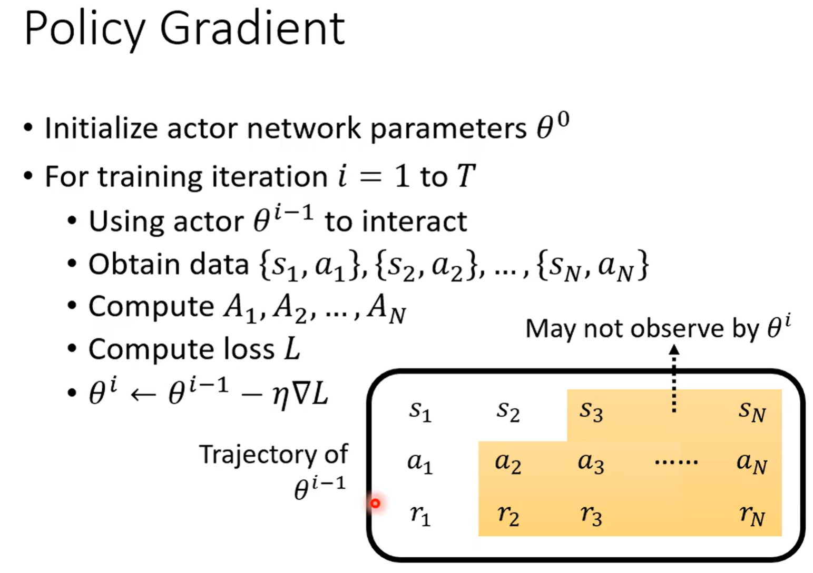 

> 因为对于不同时期, 不用的更为重复的步伐可能比之前的简单步伐更有效哦

随机性->有利于评估行为的好坏

