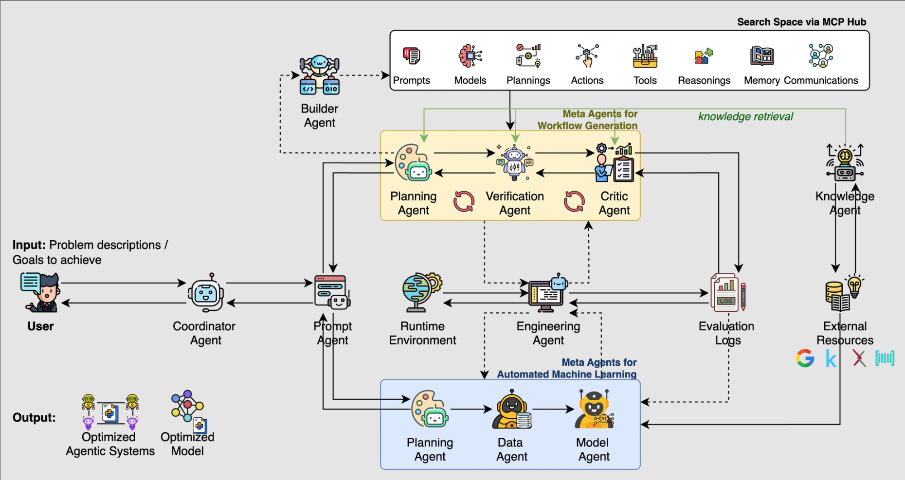
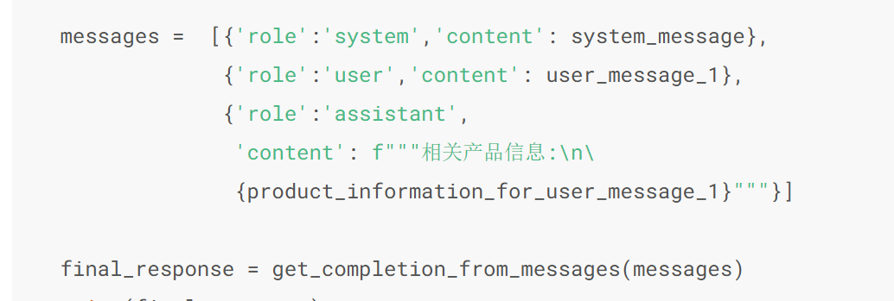
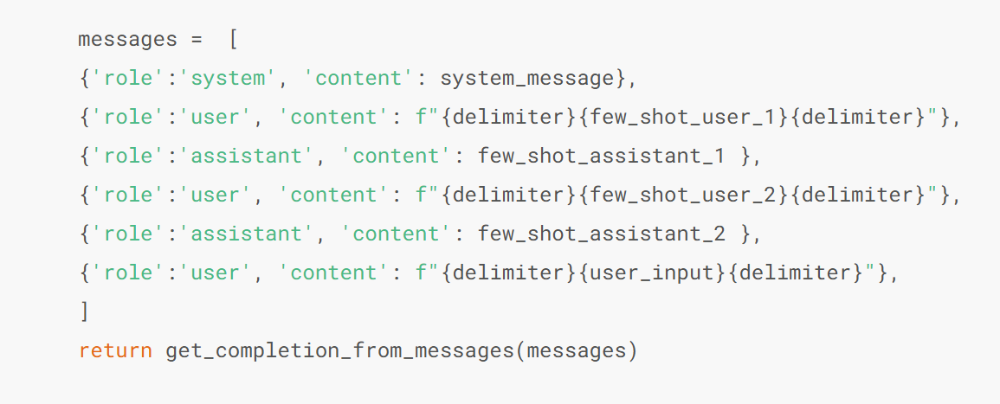
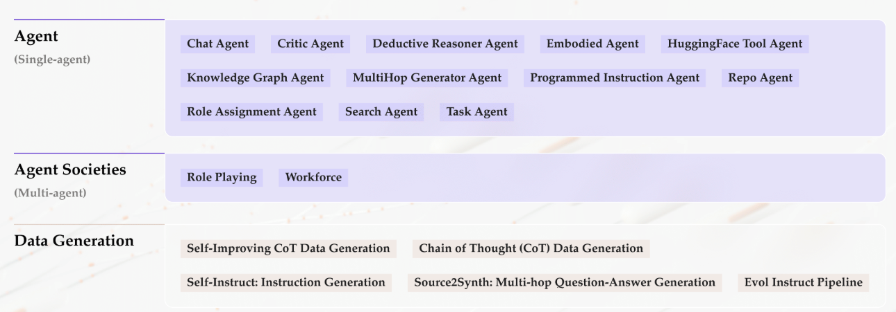
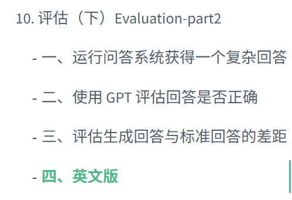

> 主要介绍和AI相关的内容

# 1 agent

## 1.2 Agent介绍






> assistant之后还是assistant

```
# Moderation 是 OpenAI 的内容审核函数，旨在评估并检测文本内容中的潜在风险。
response = openai.Moderation.create(
    input=final_response_to_customer
)
```

  


## 1.2 各式各样的Agent

> https://github.com/camel-ai/camel

> AutoGPT / BabyAGI / AgentGPT等等

> MetaGPT团队

> 



> 

| 系统              | 语言模型 | 有无记忆     | 是否自我反思 | 多 Agent 支持 | 主要用途       |
| ----------------- | -------- | ------------ | ------------ | ------------- | -------------- |
| Generative Agent  | ✅        | ✅ 长短期记忆 | ✅            | ✅             | 社会行为建模   |
| AutoGPT / BabyAGI | ✅        | ✅            | ❌/部分       | ❌/社区实现    | 自动任务执行   |
| LangGraph         | ✅        | ✅            | ✅            | ✅             | 多任务流程控制 |
| CAMEL             | ✅        | ✅            | ✅            | ✅             | 多角色协作     |
| MetaGPT           | ✅        | ✅            | ✅            | ✅             | 软件开发模拟   |
| ReAct             | ✅        | ❌            | ❌            | ❌             | 工具增强型推理 |


# 2 openai API


# 3 开发

## prompt

> https://datawhalechina.github.io/llm-cookbook✅


## function call


## stream


# 4 评估

 


5 
