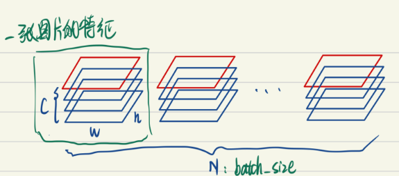
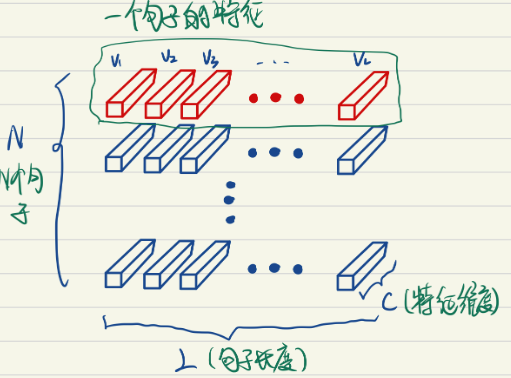

# 激活函数

## 1 基础

**是什么**

1 神经网络计算的本质是:

​    y=w1x+w2x

2 加入激活函数

-  对w1进行非线性变化

3 函数本身是非线性的

> 非线性函数不满足线性叠加原理。线性要求：
>
> f(ax+by)=af(x)+bf(y)

**为什么**

1. 使得能够拟合非线性的复杂函数

**用在哪**

# 归一化

## 1 基础

是什么

为什么

用在哪

## 2 BatchNorm 

是什么

1. 在一个batch内, 对所有样本的同一层通道进行标准化,(红色)

2. 每一个C都有一个可学习的缩放和偏移参数

为什么

稳定每层输入分布、加速训练、允许更大学习率，并有一定正则效果。

1. 让不同图片的的同一通道的相对关系是保留的，即不同图片的**同一通道的特征是可以比较的**(因为同一层C是同一个学习到特征)
2. 同一图片的不同通道的特征则是失去了可比性

用在哪

1. 卷积层

## 3 layerNorm

N L C

**是什么**

1. 对同一个layer里的的C进行标准化和归一化,把一个样本的所有词义向量（如上图红色部分）视为一个分布

**为什么**

**用在哪**
