> https://zhuanlan.zhihu.com/p/1941526646839570865

# DETR

> https://blog.csdn.net/baidu_36913330/article/details/120495817

DEtection TRansformer End-to-End Object Detection with Transformer

总体来说就是, 先通过resnet进行特征提取, 获取 [B, C, W, H] 转化为[B, L, D] 输入到transformer里, (其中, C=L, D由线性映射产生) , 输出的encoder 和 一个 query(不知道是啥, 好像是预设的检测个数[N, D])进行decoder, 最终decoder输出会经过两个线性层, 分别输出class 和 box位置, 


## 1 模型架构

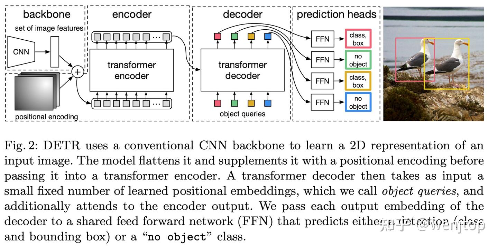

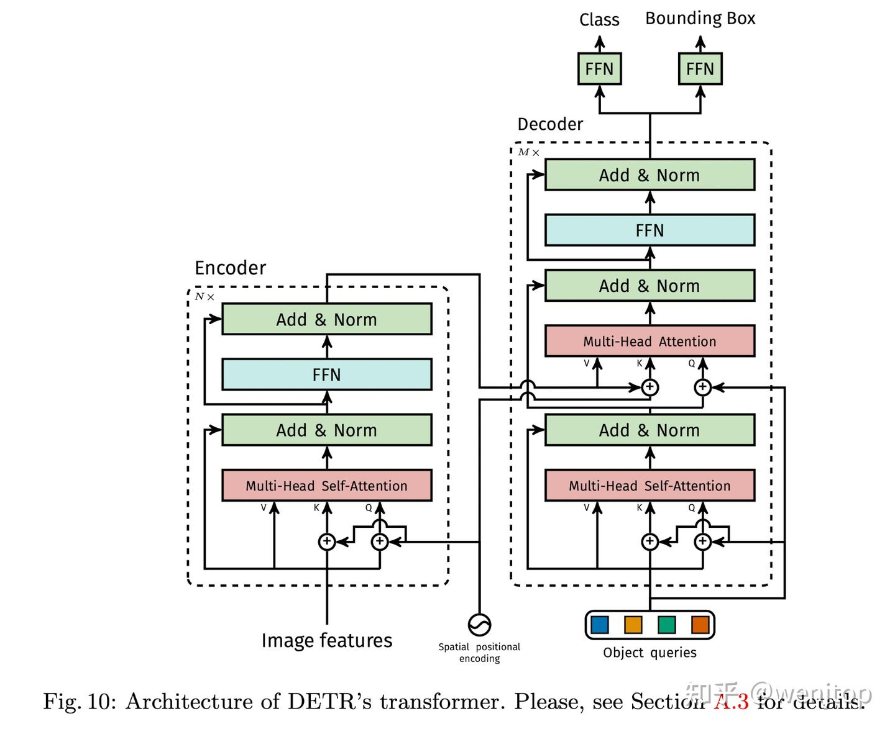

### 1.1 backbone

> 在 2020 年时候，还没有 Swin 这样的可以针对不同分辨率图像输入的 Transformer Backbone。目标检测的图一般比较大，那么直接上 Transformer 计算上吃不消，所以先用 CNN 进行特征提取并缩减尺寸，再使用 Transformer 是常规操作（或者说无奈之举）。

输入图片3×800×1066的一张图片，经过卷积神经网络提取特征，长宽32倍下采样后得到2048×25×34，然后通过一个1×1 Conv进行降维最终得到输出shape为256×25×34


### 1.2 位置编码

分 sin/cos 编码 和可学习编码

为了和特征完全匹配形状也为`256×25×34`，然后和特征进行元素级别的相加后输入到Transformer Encoder

采用xy方向分开的位置编码, 且xy分别各半个通道

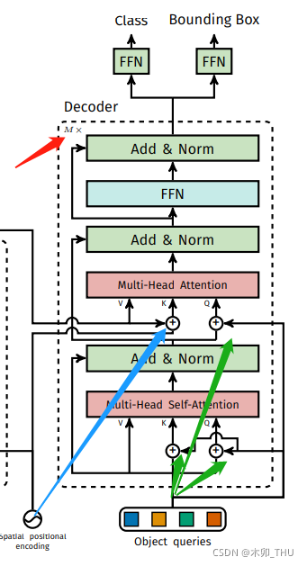


### 1.3 Transformer Encoder

只是pos embed加在了attention前的qk上


### 1.4 Transformer Decoder

1. pos embed加在了attention前的qk上
2. 使用可学习的位置编码 Object Query
3. object queries的维度设置为anchor数量×token维度。


#### Object Query

就是让模型先生成N=100个预测目标框, 最多只能识别100个个体

> n个零向量, +可学习的位置编码


## 2 训练推理

### 2.1 匈牙利算法

防止同一物体可能被多个 query 抢

### 2.2 输出结构

DETR 把检测当成 集合预测：固定输出 N 个 query（比如 100)

- `query_embed`：`num_queries` 个（常 100）
- `class_embed`：`num_classes + 1`（多一类 no-object）
- `bbox_embed`：输出 4 维框


## 3 结论

我看DETR和yolo有点像 都是cnn 作为backbone提取特征, 只是neck不一样, detr用transformer, yolo用级联, 特征融合等等, 最后是分类头

但是**decoder 才是 DETR 的核心**，它不是简单的"neck"，而是一个把"检测"建模成集合预测的模块, 最后用**Query 集合预测 + 匈牙利匹配**


**DETR缺点在于：**

（1）计算复杂度的限制导致不能利用大分辨率特征图，导致**小目标性能差**。

（2）注意力权重矩阵往往都很稀疏，DETR计算全部像素的注意力**导致收敛速率慢**。


# Deformable DETR

> https://blog.csdn.net/qq_38253797/article/details/127668593
>
> https://zhuanlan.zhihu.com/p/372116181

1. 提出多尺度可变形注意力模块, 不需要FPN. 
2. 为了降低计算量, 不需要image的所有位置进行注意力计算,而是只需和部分位置(学习而来的)进行交互. 

**DCN（Deformable Convolution Networks）**：在卷积当中引入了学习空间几何形变的能力，不再是使用常规的领域矩阵卷积，而是让卷积自动的去学习需要需要卷积的周围像素，以此可以适应更加复杂的几何形变任务。

## 1 模型架构

### 1.1 backbone生成多尺度特征

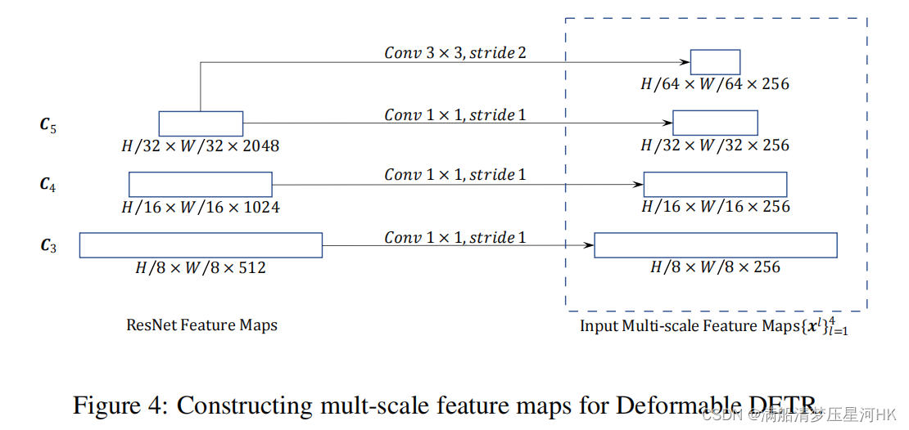

多尺度的特征融合方法则是取了骨干网(ResNet)最后三层的特征图C3，C4，C5，并且用了一个Conv3x3 Stride2的卷积得到了一个C6构成了四层特征图, 并将通道数量统一为256, 最后将这4个不同尺度的特征送入transformer中的encoder中

### 1.2 多尺度位置编码

因为是四张图通level的特征图作为输入, 所以普通位置编码会有冲突, 因此添加了`scale-level embedding `的变量, 就是在原始位置编码的基础上, 计算这个变量, 从而区分位置.


### 1.3 MSDeformAttn

普通 Transformer 的自注意力要让每个 token 和所有 token 两两计算，计算量随 token 数平方增长。多尺度图像有很多 token，这样做代价太高。

可变形注意力的做法是：**每个 token 只在参考点附近采样少量位置**（`n_points=4`），**采样偏移量由网络学习得**到，并且在 4 个尺度上各采样一次。

实现每一个Q和局部位置的K和V进行计算, 而不是全局

因此要解决的问题就是：（1）确定reference point。（2）确定每个reference point的偏移量(offset)。（3）确定注意力权重矩阵


## 2 其他改进策略

pass


# **DINO**

采用了金字塔特征进行transformer的输入, 并使用anchor和可生成Q, 以及一些训练策略加速手链


## 1. 模型结构

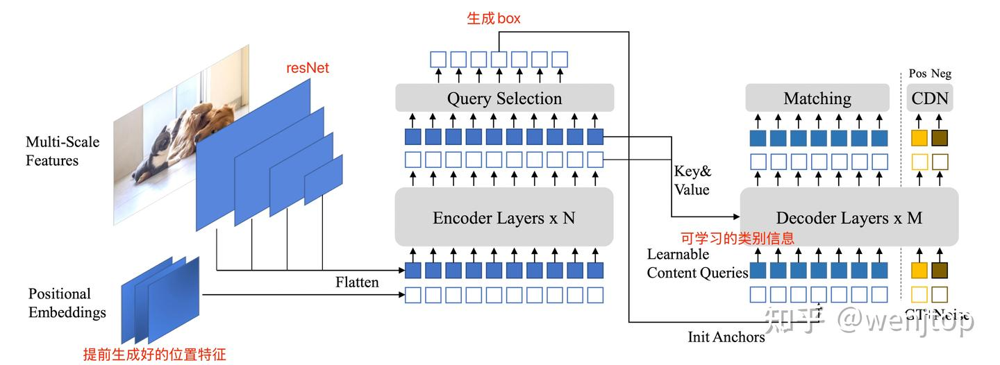


## 2. Query selection

从编码器输出的所有位置里，挑出得分最高的一批位置，把它们作为解码器的初始查询（object query）

原始 DETR 的查询是一组随机初始化、与图像无关的可学习向量，解码器要从零开始学习"该去哪里找目标"，收敛慢。

让编码器先对每个位置做一次粗略的"有没有目标、框在哪"的预测，然后把最可能是目标的位置直接交给解码器，从更好的起点开始。


```
topk_proposals:  (bs, 900)              被选中位置的索引
refpoint_embed:  (bs, 900, 4)           解码器初始参考框（用于位置）
tgt:             (bs, 900, 256)         解码器初始查询内容（来自 tgt_embed）
```

首先 为 5440 (特征图总和)个位置都生成一个框, 不同尺度的框大小不同。对所有的特征输入到一个线性层, 输出由dim->class_num, 并进行topK排序, 从5440中选出900个预选位置 

(bs, 5440, 256) --> (bs, 5440, 91)


## 3. CDN（Contrastive DeNoising，对比去噪训练

在训练时额外加入的一组辅助查询。它不参与推理，只为训练提供更稳定、更直接的监督信号。

思路是：在训练时，直接把真实框加噪声作为输入，让一部分查询去"还原"对应的真实框。这些查询的对应关系是已知的，不需要匹配，因此监督信号更稳定、收敛更快。通过同时添加同一真实标签的正负样本来训练模型，避免模型对同一目标的重复输出（也就是把真实标签重复多组，一组中分为positive和negative两部分）

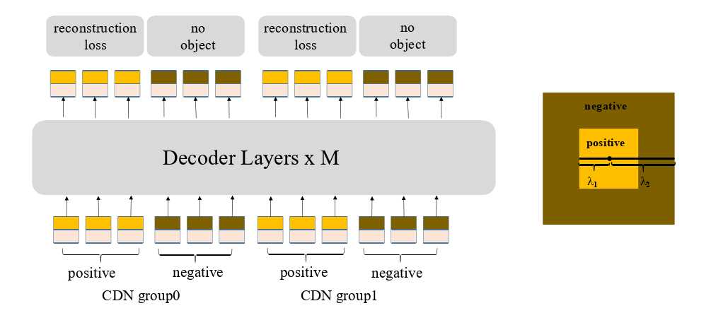

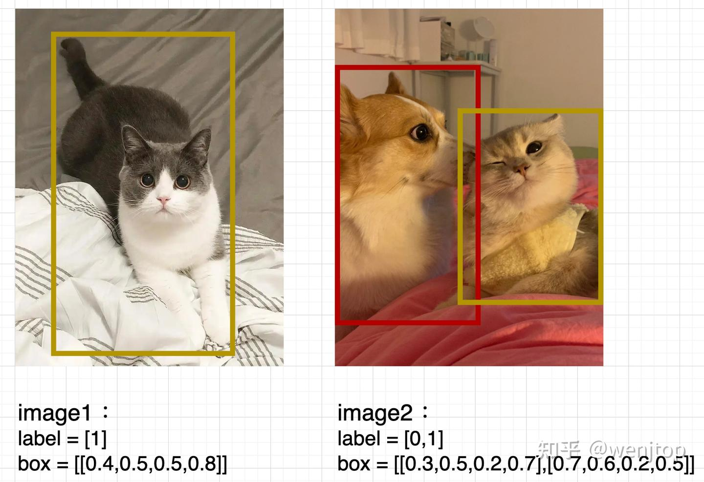


# RT-DETR

> https://blog.csdn.net/weixin_44115575/article/details/155033097

1. 
2. 
3. 


## 1 模型结构

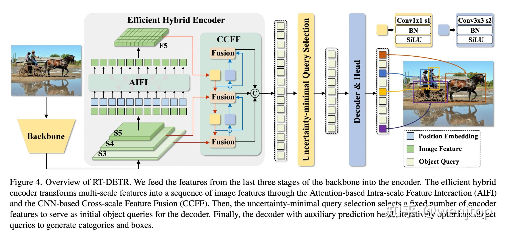

```
大方向对，可以收成这样理解：
**像 YOLO 的部分**
- Backbone + 类 FPN/PAN 的多尺度融合（CCFF）
- 在融合特征上做稠密 class/box（encoder 头）
- 按分数挑候选（top-k ≈ 粗筛）

**不像、多出来的部分**
- 最高层还有 AIFI 做尺度内关系建模（纯 YOLO neck 通常没有这步 Transformer）
- top-k 之后不是直接 NMS 收工，而是进 **Decoder** 用 memory 可变形注意力逐层 refine
- 训练一对一匹配 + VFL 等，推理端到端、一般不用 NMS

一句话：**前端很像 YOLO 式稠密检测管线，后端用 Decoder 把候选收成端到端集合预测；AIFI/CCFF 是中间的特征建模。** 说成「YOLO 式特征与粗检 + DETR 式精修与匹配」就比较贴。
```


### 1.1 **backbone**

backbone 以 ResNet 为例，RT-DETR 会获取最后3个stages， 得到**S3,S4, S5**

假设输入：

```python
x: [B,3,640,640] = [2,3,640,640]
```

输出大致为：

| 名称 | 形状（batch=2）    | stride |
| :--- | :----------------- | :----- |
| S3   | `[2, 512, 80, 80]` | 8      |
| S4   | `[2,1024, 40,40]`  | 16     |
| S5   | `[2,2048, 20,20]`  | 32     |


### 1.2  AIFI （the Attention-based Intra-scale Feature Interaction）

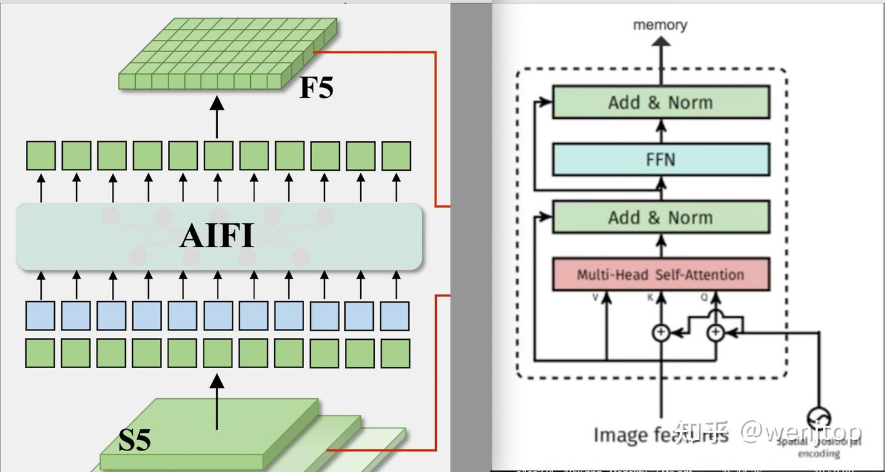

只在最高层做 self-attention 的**轻量化全局建模**

> |          | YOLO SPP/SPPF          | RT-DETR AIFI             |
> | :------- | :--------------------- | :----------------------- |
> | 做法     | 多尺度池化（再拼回去） | 自注意力，位置之间互相看 |
> | 上下文   | 固定核、与内容无关     | 内容相关，谁和谁交互可学 |
> | 归纳偏置 | CNN 式多尺度汇总       | Transformer 式全局关系   |
>
> SPPF 是“用不同大小池化窗把周围信息糊进中心”；AIFI 是“让 S5 上各处特征两两交互、建模物体级关系”。
>
> 都是高层特征增强，SPP/SPPF 是池化扩感受野，AIFI 是注意力建模关系——角色相近，不是同一种模块。


#### 0 在干什么

注意力建模全局特征


#### 1 输入

 S5:  [2,2048,20,20] --> reshape: F5 = [2,256,20,20]


> 为什么只在 S5 做 self-attention？
>
> S5 分辨率小（20×20），算力友好；
>
> 语义强，全局关系在这层建模最有意义；

AIFI尺度内注意力计算，实际上就是把之前的transformer 6层encoding 换成了一层encoding。

Position Embedding只作用于K和Q。最后得到的输出output：[256, 18, 18]。

#### 2 输出

以及 AIFI 更新过的 S5


### **1.3 CCFF （the CNN-based Cross-scale Feature Fusion）**

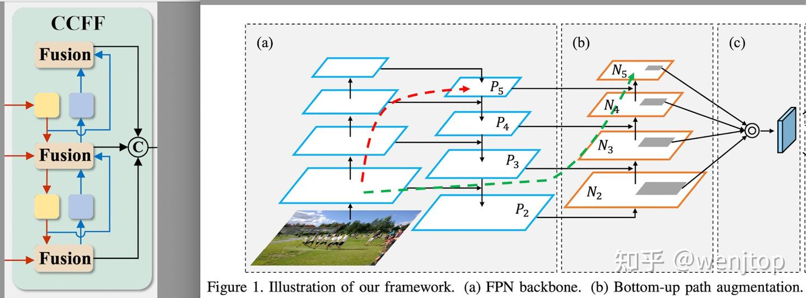

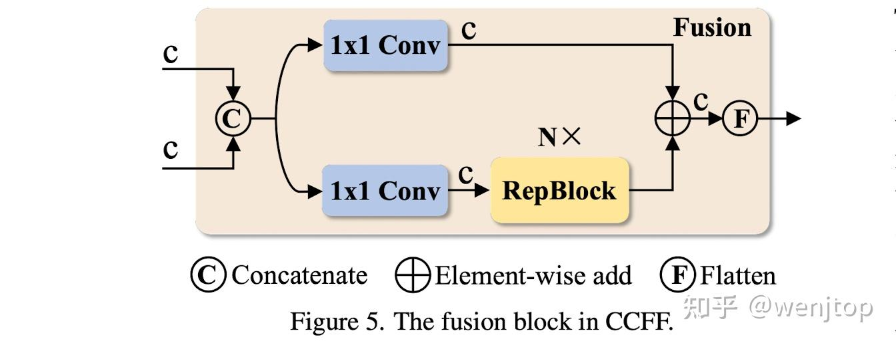

CCFF 的整体结构和PAN结构类似，可以看出两个特征金字塔拼接而成

#### 0 在干什么

1. 混合 encoder 产出多尺度特征图
2. 投影后 按位置展平拼成一条序列（每个格子一个特征向量）
3. 每个位置各自过分类头、回归头 → 得到全图稠密的 class / box
4. 再按分类分 top-k，把这 k 个位置的特征（和对应框）送给 Decoder 当初始查询


#### 1 输入

> 有了：
>
> S3 [2,512,80,80]
>
> S4 [2,1024,40,40]
>
> F5 [2,256,20,20]（AIFI 输出）
>
> 先把 S3/S4 投影到 256 通道，记为：
>
> P3 [2,256,80,80]
>
> P4 [2,256,40,40]
>
> P5' = F5 [2,256,20,20]
>
> CCFF 用 Top-Down FPN + Bottom-Up PAN 结构 + CSPRepLayer(里面用 RepVGG block，可重参数化)。
>
> Top-Down：先 F5→S4 得到 F4，再 F4→S3 得到 F3
>
> Bottom-Up：F3 下采样和 F4 融合 → N4；N4 再下采样和 F5 融合 → N5


#### 2 输出 

CCFF 的多尺度输出：

- N3 `[2,256,80,80]`
- N4 `[2,256,40,40]`
- N5 `[2,256,20,20]`

```
N3: 80×80 = 6400
N4: 40×40 = 1600
N5: 20×20 = 400
L = 6400 + 1600 + 400 = 8400
 
E: [2, 8400, 256]
```


#### **3 接下来要做两件事：**

```
HybridEncoder 的多尺度特征
  → 投影 + flatten
  → 每个位置 class/box（稠密预测）
  → top-k → 候选查询 + 参考框
  → Transformer Decoder 各层
```

1. 把多尺度特征 **flatten** + concat，得到 encoder tokens, 后续做为memory 给decoder的第二个attention输入
2. 在**每个 token 上预测 cls+box，**选出最有把握的一部分 token，当作 Decoder 的 object queries（Q_det）。( class/box 头, 输出**候选位置（queries）+ 参考框（ref_points）**的稠密预测)

**QuerySelector**

TOP-K进行token的初次筛选


### **1.5 decoder **

**和DINO 的 decoding 几乎一样**它负责把：

- 来自 encoder 的候选位置（queries）+ 参考框（ref_points）
- 来自De noisy的候选位置（queries）+ 参考框（ref_points）
- 跨尺度特征（memory）

逐层 refine 成最终的 **分类 + bbox**

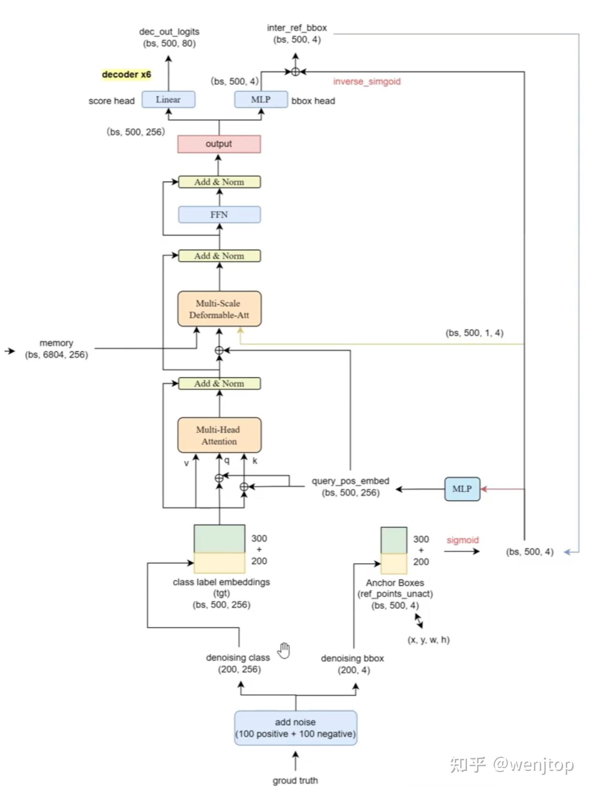

#### 1. DN Queries

给 decoder 一些“带噪 GT”的练习题（训练专有）

> DN queries 的作用：
> **显式教 Decoder “如何把一个差不多的位置/大小的框，修成真正的 GT**
> 极大加速 DETR 系列的收敛。

对每一GT做一些noisy的操作

1. 相对N个GT框进行归一化
2. 重复G组
3. 每个GT框加下噪声(平移缩放),或者label

最终生成
DN queries = [B, **Q_dn**, 256] 和 DN_ref [B, **Q_dn**, 4] 


#### 2. 模型输入

##### 2.1 第一层decoder

| 项目                        | 组成                                                         | 说明                                                         |
| --------------------------- | ------------------------------------------------------------ | ------------------------------------------------------------ |
| **Decoder queries** `Q_all` | `[ Q_dn, Q_det ]`                                            | 前一段为 DN queries，后一段为 Detection queries              |
| **ref_points**              | `[ DN 区域的 noisy box ] + [ Detection 区域从 encoder 预测的 box_logits 中抽取 ]` | DN 部分用加噪 box；Detection 部分从 encoder 的 box_logits 输出中抽取 |
| **encoder memory (E)**      | `[B, 8400, 256]`                                             | 来自 AIFI + CCFF flatten 过后的多尺度特征                    |

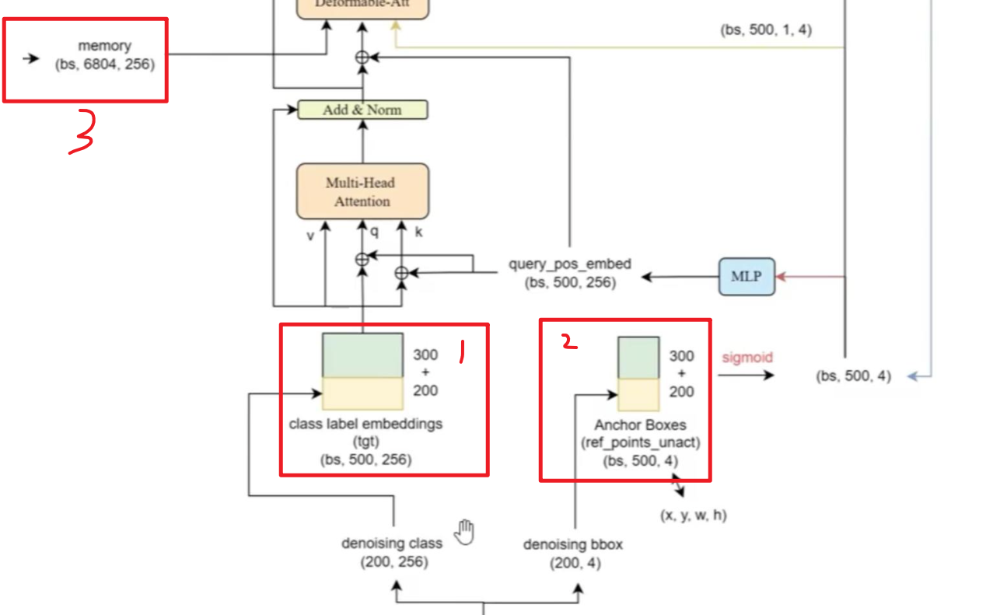 

##### 2.2 第二层输入

| 输入                     | 相对第一层                                                   |
| :----------------------- | :----------------------------------------------------------- |
| 物体查询                 | 换成第一层输出的查询特征                                     |
| 参考框                   | 换成第一层 refine 后的框（训练时对框做 detach，避免框梯度灌进采样位置） |
| 多尺度记忆特征及空间信息 | 不变                                                         |


#### 3. Details

##### 3.1 **可变形注意力**

Query 不再“看全图”，只看 12 个关键点


##### 3.2 残差式框更新：

不是每层都重算框，而是在上一层基础上微调, 预测的是 增量（delta）

> 理解为：
> “上一层已经给我一个大概框了，这一层只负责稍微校正一下。”


##### **3.3 跨层坐标 detach：**

上一层的框会传给下一层
但是**这是只读的，不能改上一层的梯度**


##### 3.4 并行式输出：

每层都是“成品预测”，不是“半成品特征”

原 DETR：
只有最后一层 Decoder 才能输出预测，前面的层只是处理中间特征。

RT-DETR：
每一层 Decoder 都做了损失，可以直接输出分类和边框。

> 理解为：
> “我每层都能给你可用的检测结果，想提前拿哪个随你。”


## 2 Detection Head

6.1 训练阶段：DN loss + Detection loss（匈牙利匹配 ）

### 2.1 DN 部分：无须匈牙利，直接对齐 GT

对 DN 区域：

我们知道每个 DN query 来源于哪个 GT

DN loss 强制 Decoder 学会：

如何把 noisy box → GT box；

如何把类别对齐（有 label 噪声时）。


### 2.2 检测部分

用 **Hungarian 匹配**（类似 DETR）在每张图上构造一对一匹配：

- 某个 GT object ↔ 一个 query
- cost 由分类 cost + L1 cost + GIoU cost 组成

cost 由分类 cost + L1 cost + GIoU cost 组成

计算 detection loss：

loss_det = loss_cls_det + loss_bbox_det + loss_giou_det


所有 decoder 层 + encoder 辅助 head 都会参与 loss（带不同权重）：

反向传播，更新参数。


6.2 推理阶段：只保留检测 queries，取最后一层输出，无 NMS

**不再构造 DN queries**，只用 `Q_det`

计算类别概率（sigmoid），与 IoU/质量一起生成 score


> 总的来说假设一张图只有 3 个 GT，但模型预测输出 300 个 query（预测框）。
> 训练时通过 “匈牙利匹配” 找到 3 个最适合 GT 的 query，其余 297 个都被当作背景（no object）去训练。
> 推理时再根据得分筛选（top-K 或 score 阈值），最终输出的也是 3 个左右的高置信度检测框。


## 3 loss

| 损失              | 权重 | 作用                                                       |
| :---------------- | :--- | :--------------------------------------------------------- |
| Varifocal（分类） | 1    | 正样本用 IoU 当软标签；负样本用 focal 式降权，抑制易分背景 |
| L1 框回归         | 5    | 匹配上的预测框与 GT 的 cxcywh 绝对误差                     |
| GIoU              | 2    | 框重叠质量（含相对位置），补 L1 对尺度不敏感的问题         |

### 3.1 作用在哪些输出上

同一套三项损失会算在：

1. Decoder 最后一层（主输出）
2. Decoder 中间各层（辅助损失，每层先重新匹配再算）
3. Encoder top-k 粗预测（也当一层辅助）
4. 去噪分支各层（若开了 denoising；正样本与 GT 的对应是预设的，不再跑匈牙利）

总 loss = 上述所有项加权求和。


## 


## 4 Deformable Attention

> https://blog.csdn.net/weixin_47748259/article/details/136190664

#### 4.1 可变形卷积


#### 4.2 可变性注意力

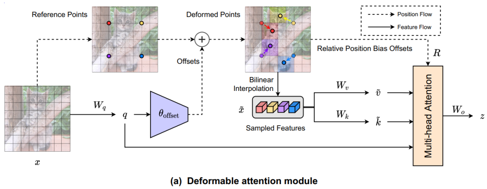

就是: 将特征图作为Q, 训练一个offset网络, 将采样点的offset区域作为KV输入到多头注意力

大体流程如下：

1. 1
2. 2
3. 3
4. 4

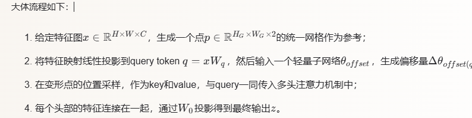

#### 4.2 自注意力

普通注意力要对整图约 8400 个位置算相似度，太贵。
 可变形注意力改成：每个查询只在 参考框附近采少量点（默认每头、每尺度 4 个点），再加权求和。

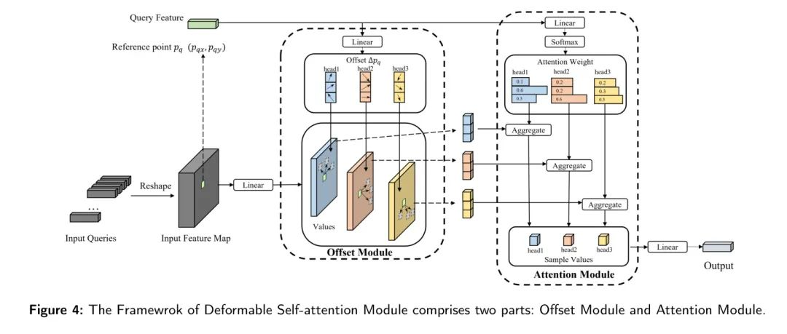

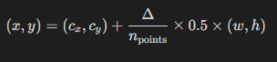

1. 先用每一个Q生成n_heads个可学习的偏移(当前Q对应的box的中心)
2. 将resize的feature map的每个尺度划分, 按heads选出选取出偏移量位置为作为V
3. Qfeature在由linear和softmax生成Attention 和V相乘
4. 最后，对采用后的输出向量进行线性变换，得到最终的输出值

> 1. Deformable的Attention不是用Query和Key矩阵做内积得到的，而是由输入特征直接通过Lienear Transformation得到的。


## 5 匈牙利算法

> https://blog.csdn.net/weixin_44115575/article/details/152044652

### 1. 背景：为什么目标检测需要匹配


### 5.2 

用来做 预测 query 与 GT 的一对一匹配，再在匹配上算分类/框损失。它本身 不反传，只决定“谁对谁算 loss”。

DETR 里的匈牙利算法，用来做 **预测 query 与 GT 的一对一匹配**，再在匹配上算分类/框损失。它本身 **不反传**，只决定“谁对谁算 loss”。

### 为什么需要它

DETR 固定输出 N 个预测（如 100/300 个 query），一张图往往只有几个 GT。  
不能简单按顺序一一对应，也不能多对一随便叠。需要找一个 **全局代价最小的一对一分配**：每个 GT 至多配一个预测，剩下预测当背景。

### 怎么做

对每张图构造代价矩阵 \(C\)，大小约 **[预测数 × GT 数]**。  
每个元素 = 该预测配该 GT 有多“亏”：

$$
C = \lambda_{\text{cls}} C_{\text{cls}} + \lambda_{\text{L1}} C_{\text{L1}} + \lambda_{\text{GIoU}} C_{\text{GIoU}}
$$
RT-DETR 默认权重大致是分类 2、L1 5、GIoU 2。

然后用匈牙利算法（实现里常用 `linear_sum_assignment`）求：

**总代价最小的一对一匹配**。

结果：GT 个匹配对；没匹配上的预测 → 背景（分类里当负样本）。

### 和 loss 的关系

```
预测 (N 个) + GT (M 个)
        ↓
   算代价矩阵 C
        ↓
   匈牙利匹配  →  (pred_i ↔ gt_j)  共 M 对
        ↓
   只在这些对上算：分类损失 + L1 + GIoU
   未匹配预测：分类学“无物体”
```

匹配用的代价和训练 loss 形式相近，但匹配阶段 `@torch.no_grad()`，梯度只从 loss 回传，不从匹配本身回传。

### 小例子

3 个预测、2 个 GT。代价矩阵算完后，匈牙利可能给出：

- pred0 ↔ gt1  
- pred2 ↔ gt0  
- pred1 未匹配 → 背景  

不会出现两个预测同时盯同一个 GT。

### 在 RT-DETR 里多算几次

- Decoder 最后一层：匹配一次 → 主 loss  
- 中间各层 / encoder 粗预测：各自再匹配一次 → aux loss  
- 去噪分支：匹配是预设好的，一般不再跑匈牙利  

一句话：**匈牙利 = 给 DETR 找全局最优的一对一监督对象；有了它才能端到端、不用 NMS 式的多对一分配。**


### 推理不需要 匈牙利。

匈牙利只在训练时对着 GT 算匹配；推理没有 GT。

推理流程大致是：

1. Decoder 输出全部 query 的类别分和框（如 300 个）
2. 后处理：sigmoid/softmax 得到分数，再按分数取 top（配置里常仍是最多 300）
3. 应用时再设置信度阈值，例如 `score > 0.5`，留下几个高分框
4. 一般不再做 NMS（一对一训练已经抑制重复）


## 5 **不确定性最小化查询选择机制**

### 不确定性怎么定义

把某个 encoder 特征的不确定性看成：

定位质量分布 和 分类置信分布 的不一致（差得越大越不确定）。

目标：让被选中的查询既分类高、又定位好，即 最小化这种不一致。

### 实际怎么做

推理时选择方式几乎没变：仍按分类分数 top-k。

关键在 训练：用 Varifocal Loss，正样本的分类软标签用 预测框与 GT 的 IoU，而不是硬 0/1。

效果是逼 encoder（以及后面各层）学到：

- 框准（高 IoU）→ 分类分也该高
- 框差（低 IoU）→ 分类分该低

### 如何选取?

- 选取：还是按分类分数做朴素 top-k。
- 优化：靠 VFL（用 IoU 当正样本软标签）把分类分和定位质量对齐，让 top-k 更容易挑到“分类、框都靠谱”的位置。

没有另写一个“按不确定性公式排序再选”的推理模块。


# D-FINE

**D-FINE：**将 DETR 中的回归任务重新定义为细粒度分布细化。D-FINE重新定义 DETR 模型中的边界框回归任务，实现了卓越的定位精度。D-FINE 包含两个核心组件：**细粒度分布细化（Fine-grained Distribution Refinement, FDR）和全局最优定位自蒸馏（Global Optimal Localization Self-Distillation, GO-LSD）**。FDR 将回归过程从预测固定坐标转变为迭代地细化概率分布，提供了一种细粒度的中间表示，显著提升了定位精度。GO-LSD 是一种双向优化策略，通过自蒸馏将来自精细化分布的定位知识传递到较浅层，同时简化了深层网络的残差预测任务。


## DEIM

通过 **数据增强（mosaic、mixup）** 增加每张图像中的目标数量
