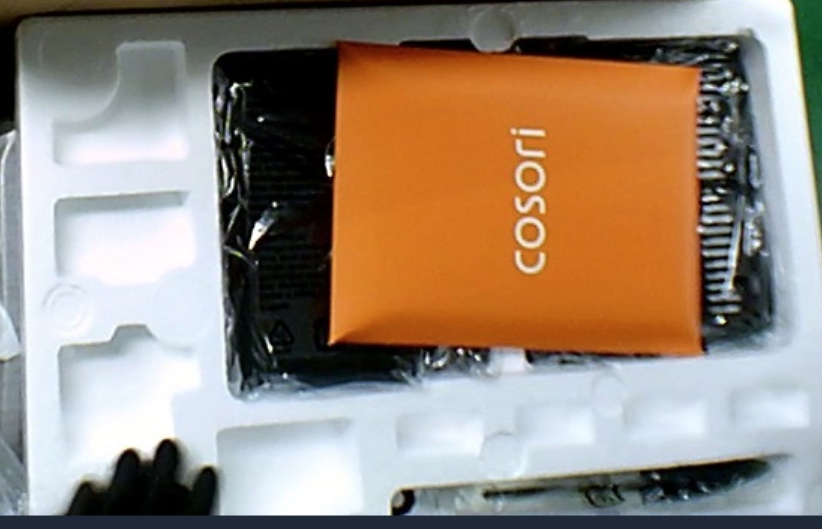

# 1

1. 之前因为因为经常识别不到的问题, 我任务是数据集杂乱的原因造成的, 索性我进行了数据全面的筛查筛选, 结果: 筛查之后的数据集确实识别效果可以, 但是容易误识别, 特别是背景杂乱, 且有相似物干扰的情况下; 这个最后的办法就是直接加NG反例数据 

2. 我减少了数据量 结果yolo26缺识别不出来? 是数据量减少的问题吗? 还是说是模型的问题. 待验证

   > yolov26+500images = ❌
   >
   > yolov11+500images = ❓
   >
   > yolov26+1000images = ❓
   >
   > yolov11+1000images = ❓

3. 遮挡显示只有一半的到底要不要标注呢? 

   
