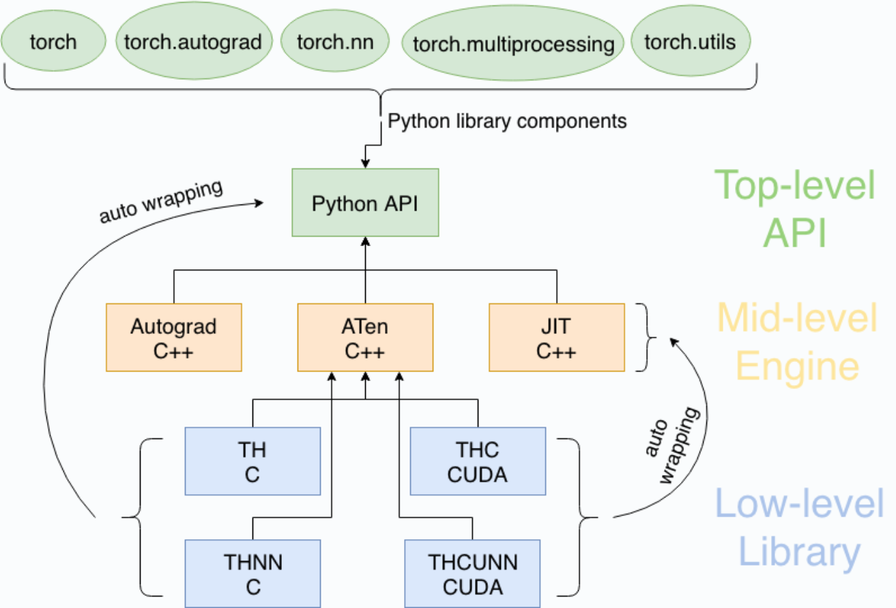

> 1. https://zhuanlan.zhihu.com/p/647001891

# Pytorch

# 1 介绍

PyTorch 是一个开源的深度学习框架，以其灵活性和动态计算图而广受欢迎。

PyTorch 主要有以下几个基础概念：张量（Tensor）、自动求导（Autograd）、神经网络模块（nn.Module）、优化器（optim）等。

- **张量（Tensor）**：PyTorch 的核心数据结构，支持多维数组，并可以在 CPU 或 GPU 上进行加速计算。
- **自动求导（Autograd）**：PyTorch 提供了自动求导功能，可以轻松计算模型的梯度，便于进行反向传播和优化。
- **神经网络（nn.Module）**：PyTorch 提供了简单且强大的 API 来构建神经网络模型，可以方便地进行前向传播和模型定义。
- **优化器（Optimizers）**：使用优化器（如 Adam、SGD 等）来更新模型的参数，使得损失最小化。
- **设备（Device）**：可以将模型和张量移动到 GPU 上以加速计算。

------

## PyTorch 架构总览

PyTorch 采用模块化设计，由多个相互协作的核心组件构成。理解这些组件的作用和相互关系，是掌握 PyTorch 的关键。

### PyTorch 架构图

```
┌─────────────────────────────────────────────────────────────┐
│                    PyTorch 生态系统                          │
├─────────────────────────────────────────────────────────────┤
│  torchvision  │  torchtext  │  torchaudio  │  其他专业库     │
├─────────────────────────────────────────────────────────────┤
│                     PyTorch 核心                            │
├───────────────┬─────────────────┬───────────────────────────┤
│   torch.nn    │   torch.optim   │      torch.utils          │
│   (神经网络)   │   (优化器)      │      (工具函数)           │
├───────────────┼─────────────────┼───────────────────────────┤
│               │                 │   torch.utils.data        │
│  torch 核心   │  autograd       │   (数据加载)              │
│  (张量计算)   │  (自动微分)     │                           │
└───────────────┴─────────────────┴───────────────────────────┘
```

## 1. 分层架构

PyTorch 采用**分层架构**设计，从上层到底层依次为：

**1、Python API（顶层）**

- `torch`：核心张量计算（类似NumPy，支持GPU）。
- `torch.nn`：神经网络层、损失函数等。
- `torch.autograd`：自动微分（反向传播）。
- 开发者直接调用的接口，简单易用。

**2、C++核心（中层）**

- **ATen**：张量运算核心库（400+操作）。
- **JIT**：即时编译优化模型。
- **Autograd引擎**：自动微分的底层实现。
- 高性能计算，连接Python与底层硬件。

**3、基础库（底层）**

- **TH/THNN**：C语言实现的基础张量和神经网络操作。
- **THC/THCUNN**：对应的CUDA（GPU）版本。
- 直接操作硬件（CPU/GPU），极致优化速度。




### 2.PyTorch 的“双层”架构

PyTorch 的设计哲学是：**用 Python 保证易用性，用 C++ 保证高性能。**

- **Python 层（Frontend）：** 也就是我们直接接触的 API。它负责逻辑组织、用户交互和提供灵活的开发体验。
- **C++ 层（Backend）：** 核心库被称为 **LibTorch**。它包含了张量运算（Tensor library）、自动求导引擎（Autograd）以及对硬件（如 CPU、GPU）的底层调用。

### 3. Python 和 C++ 是如何通信的？

PyTorch 使用了像 **pybind11** 这样的工具，在 Python 和 C++ 之间架起了一座桥梁。当你执行 `a + b`（两个张量相加）时：

1. Python 调用指令。
2. 通过桥梁进入底层的 C++ 实现。
3. C++ 调度 CUDA 核心或 CPU 指令完成运算。
4. 结果返回给 Python。

### 4. 什么时候你会接触到 C++ 部分？

普通用户通常不需要碰 C++，但在以下场景中它是必不可少的：

- **部署（Deployment）：** 在嵌入式设备或对延迟要求极高的服务器上，开发者会直接使用 **LibTorch**（PyTorch 的 C++ 版本）来加载模型，完全脱离 Python 环境。
- **自定义算子：** 如果你发明了一种极其复杂的数学运算，且 Python 实现太慢，你可以用 C++ 编写该算子并将其作为插件引入 PyTorch。


# 2 特征

## 1 动态计算图

> import torch
>
> def dynamic_model(x):
>     # 这里的 Python 逻辑直接决定了计算图的结构
>     if x.sum() > 0:
>         out = x * 2  # 动态生成分支 A 的路径
>     else:
>         out = x + 5  # 动态生成分支 B 的路径
>     
>     # 甚至可以用循环，循环多少次，计算图就自动延伸多少个节点
>     for i in range(int(torch.randint(1, 5, (1,)))):
>         out = out + i
>     return out
>
> x = torch.randn(2, 2, requires_grad=True)
> y = dynamic_model(x)
> y.backward(torch.ones_like(y)) # 自动求导引擎会沿着刚才“长”出来的路径反向走回去
