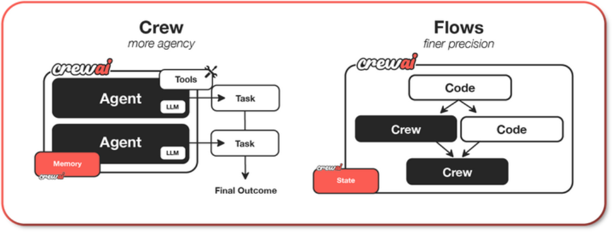

> https://zhuanlan.zhihu.com/p/1960361706967536590

## 1 初步认识



导语

 CrewAI 是一个专为简化和协调基于[大型语言模型](https://zhida.zhihu.com/search?content_id=264056703&content_type=Article&match_order=1&q=大型语言模型&zhida_source=entity)（LLM）的**多个智能体（Multi-Agents）的协作**而设计的框架。通过引**入角色扮演（Role-Playing）、任务分解（Task Decomposition）和流程控制（Process Control）**等概念，CrewAI 使得构建能够协同工作、解决复杂问题的[多智能体系统](https://zhida.zhihu.com/search?content_id=264056703&content_type=Article&match_order=1&q=多智能体系统&zhida_source=entity)变得简单和高效。

1. **什么是 CrewAI？**
2. **安装与快速上手**
3. **架构与核心组件**
4. **深度解析：Agent (智能体)**
5. **深度解析：Task (任务)**
6. **深度解析：Tool (工具)**
7. **深度解析：Crew (团队) 与 Process (流程)**
8. **工作流与内部机制**
9. **与其他框架的比较**
10. **结语**

### **1、什么是 CrewAI ？**

从零开始构建，完全独立于 LangChain 或其他代理框架。它为开发人员提供了高级的简洁性和精确的底层控制，非常适合创建适合任何场景的自主 AI 代理。

- CrewAI Crews：优化自主性和协作智能。
- CrewAI Flows：支持细粒度、事件驱动的控制，单个 LLM 调用精确的任务编排，并原生支持 Crews


### 3、架构与核心组件

CrewAI 让开发者不再需要手动管理智能体之间的状态、消息传递和任务交接，而是通过定义清晰的“角色”（Agents）和“任务”（Tasks），然后将它们组织进一个“团队”（Crew）中，并指定一个“工作流程”（Process），剩下的编排工作全部由框架自动完成。

**3.1 四个核心组件概览**

1) Agent (智能体): 团队中的“成员”。每个 Agent 都有明确的角色、目标和背景故事，可以被赋予特定的工具来执行任务。

2) Task (任务): 需要完成的“工作单元”。每个 Task 都有一份详细的描述和预期输出，并被指派给一个 Agent 来执行。

3) Tool (工具): Agent 用来与外部世界交互的“能力”。这可以是任何函数或 API，例如搜索引擎、代码执行器、数据库查询接口等。

4) Crew (团队): 将 Agents 和 Tasks 组织在一起的“容器”。Crew 负责根据指定的流程（Process）来编排任务的执行，管理智能体之间的协作。

**3.2 整体架构与数据流**

1）开发工作流程：

**定义 Agents -> 定义 Tasks -> 组建 Crew -> 启动 (kickoff) -> 产生结果**

2）数据流向:

- 1）用户通过 crew.kickoff() 启动流程。
- 2）Crew 根据 Process 决定第一个要执行的 Task。
- 3）Crew 将 Task 的描述和可用的上下文（Context）传递给指定的 Agent。

- 4）agent 的 LLM 大脑接收到信息，进行思考（Thought），决定下一步行动（Action），可能是使用某个 Tool，也可能是直接生成最终答案。
- 5）如果使用 Tool，Agent 会执行它并获得观察结果（Observation）。
- 6）Agent 将观察结果融入下一次思考，循环此过程，直到认为任务已完成。
- 7）Agent 生成任务的最终输出。
- 8）该 Task 的输出被存储起来，并作为下一个 Task 的上下文（Context）输入。
- 9）Crew 根据 Process 启动下一个 Task，重复步骤 3-8，直到所有任务完成。
- 10）Crew 返回最终的、经过整合的或最后一个任务的结果。


### 4、深度解析：Agent (智能体)

**class Agent(BaseAgent):**

```python
Agent(
role=『首席财务分析师』,
goal=『分析公司的财务报表，并提供投资建议』,
backstory=(
    「你是一位拥有超过 20 年经验的资深财务分析师，曾在高盛和摩根士丹利任职。」
    「你以对细节的敏锐洞察力和从复杂数据中提取可行动见解的能力而闻名。」
    「你精通财务建模、风险评估，并且总是以数据驱动你的每一个结论。」
),
llm=my_llm_instance, # 例如 ChatOpenAI(model=「gpt-4o」)
tools=[search_tool, financial_data_tool],
verbose=True,
memory=True,
allow_delegation=True
）

```

- role (角色)：这是 Agent 的身份标识。一个清晰的 role (如“高级软件工程师”、“市场营销总监”) 能极大地帮助 LLM 理解其行为边界和沟通风格。这是最重要的参数之一。
- goal (目标)：这是 Agent 的核心使命。它应该是一个清晰、简洁的句子，描述 Agent 存在的最终目的。例如，“开发高质量、可扩展的软件模块”。
- backstory (背景故事)： 这是 CrewAI 的一个精妙设计。backstory 为 Agent 注入了“灵魂”。一段详细的背景故事，包括其经验、技能、个性甚至工作风格，能够极大地提升 Agent 的表现。它通过丰富的上下文“预热”（prime）LLM，使其在后续任务中表现得更像一个真正的专家。
- llm (语言模型)：指定驱动 Agent 的具体 LLM 实例。这使得 CrewAI 具有高度灵活性，可以轻松接入 OpenAI、Google、Anthropic 的模型，甚至是本地运行的 Ollama 模型。
- tools (工具)：一个 Tool 对象的列表。这些是 Agent 可以用来与外部世界交互的武器。没有工具，Agent 就只能依赖其内部知识，无法获取实时信息或执行实际操作。
- verbose (详细模式)： 设置为 True 时，Agent 的完整思考-行动链（ReAct prompt）将被打印到控制台。这对于调试和理解 Agent 的决策过程至关重要。
- memory (记忆功能)：设置为 True 时，Agent 将拥有一个简单的短期记忆。它会记住在当前任务执行过程中的对话和工具使用历史，有助于在复杂的多步任务中保持上下文连贯。
- allow_delegation (允许委托)： 一个非常强大的功能。当设置为 True 时，如果一个 Agent 认为当前任务的某一部分超出了它的能力范围，或者由另一个 Agent 处理更合适，它可以将该子任务委托给团队中的其他 Agent。这在层级流程（Hierarchical Process）中尤其重要。

### 5、深度解析：Task (任务)

**class Task(BaseModel):**

Task 是需要完成的具体工作。它定义了“做什么”和“期望输出什么”，并指定了“谁来做”。

**5.1 Task 的定义与生命周期**

一个 Task 代表了工作流中的一个步骤。它的生命周期很简单：被创建 -> 被分配 -> 被执行 -> 完成并产出结果。这个结果将成为后续任务的重要输入。

**5.2 关键参数详解**

```text
from CrewAI  import Task


market_analysis_task = Task(
   description=(
       「对 {product} 的市场进行全面分析。」
       「识别主要竞争对手、他们的优势和劣势。」
       「评估市场规模和增长潜力，并确定目标客户群体。」
   ),

   expected_output=(
       「一份完整的市场分析报告，格式为 Markdown。」
       「报告应包含以下部分：1. 市场概述 2. 竞争格局分析 」
       「3. 目标客户画像 4. 市场机会与风险总结。」
   ),
   agent=market_researcher_agent, # 将任务指派给特定的 agent
   context=[ competitor_analysis_task ] # 使用其他任务的输出作为上下文
）
```

- **description (描述)**: 这是任务的核心。它应该是一段清晰、无歧义的指令，详细说明了 Agent 需要做什么。可以使用 {placeholder} 语法来动态插入变量，增加了任务的复用性。
- **expected_output (预期输出)**: 这是成功的标尺。它精确地告诉 Agent，任务完成时应该交付什么样的成果，包括格式、结构和关键内容。一个明确的 expected_output 可以极大地提升输出结果的质量和稳定性。 agent (执行者): 指定哪个 Agent 负责执行此任务。
- **context (上下文):** 这是一个 Task 对象的列表。CrewAI 会自动将 context 列表中所有任务的执行结果（result）拼接起来，作为当前任务的附加输入信息。这是实现任务间信息流动的关键机制。例如，一个“撰写博客文章”的任务，可以将一个“收集研究资料”的任务作为其上下文。

### 6、深度解析：Tool (工具)

工具是 Agent 的手和脚，使其能够不仅使用 LLM 的大脑，还可以与真实世界交互。

**6.1 Tool 的重要性**

LLM 的知识是静态的（截止到某个训练日期），并且它无法执行任何外部操作。工具解决了这两个核心问题：

- **获取实时信息**: 如通过搜索引擎查询今天的新闻。
- **与外部系统交互**: 如读写文件、查询数据库、调用 API。
- **执行确定性计算**: 如复杂的数学运算。

**6.2 使用现有工具 (LangChain Tools)**

CrewAI 与 LangChain 生态系统无缝集成。你可以直接使用 langchain_community.tools 中已经封装好的大量工具。

```text
from langchain_community.tools import DuckDuckGoSearchRun

search_tool = DuckDuckGoSearchRun()
然后在 Agent 中使用
researcher = Agent(
...,
tools=[search_tool]
)
```

**6.3 创建自定义工具**

CrewAI 提供了极其简单的方式来创建自定义工具——使用 @tool 装饰器。

```text
from CrewAI _tools import tool

@tool(“计算器工具”) 
def calculator(expression: str) -> str:
    「」「当需要进行数学计算时，使用此工具。输入应该是一个有效的数学表达式。」「」
    try:
       result = eval(expression)
       return f「计算结果是: {result}」
    except Exception as e:
       return f「计算出错: {e}」
# 使用
financial_agent = Agent(
...,
tools=[calculator]
）
```

### 7、深度解析：Crew (团队) 与 Process (流程)

**class Crew(FlowTrackable, BaseModel):**

**class Process(str, Enum):**

Crew 是整个协作系统的指挥中心，它定义了团队的构成和工作方式。

**7.1 Crew：智能体与任务的编排者**

Crew 对象将定义好的 Agent 和 Task 组装起来，并配置协作流程。

```text
from CrewAI  import Crew, Process

my_crew = Crew(
    agents=[researcher, writer],
    tasks=[research_task, writing_task],
    process=Process.sequential,  # 或者 Process.hierarchical
    verbose=2
)
```

- agents: 团队中的所有 Agent 成员列表。
- tasks: 需要完成的所有 Task 列表。
- process: 定义任务执行的流程。
- verbose: 设置详细级别。1 会打印 Agent 的行动和工具使用，2 会打印更详细的调试信息。

**7.2 kickoff(): 启动团队协作**

调用 my_crew.kickoff() 方法将正式启动整个工作流。Crew 会根据设定的 process 开始执行任务，直到所有任务完成，并返回最终结果。

**7.3 Process：定义协作模式**

这是 CrewAI 的核心功能之一，它决定了团队如何协作。

- 顺序流程 (Sequential Process)

这是默认的流程。任务将按照在 tasks 列表中的顺序，一个接一个地被执行。**前一个任务的输出会自动成为下一个任务的上下文。**

- 适用场景: 适用于线性的、有明确步骤依赖关系的工作流。例如：第一步调研 -> 第二步写初稿 -> 第三步润色。
- 层级流程 (Hierarchical Process)

这是一个更高级、更强大的流程。它会动态地创建一个**“管理者 Agent”**来协调整个工作流程。

- 工作方式: 管理者 Agent 会审视所有待完成的任务，然后智能地决定执行顺序，甚至可以将复杂的任务分解并委托给合适的“员工 Agent”去执行。所有员工 Agent 完成任务后，会将结果汇报给管理者，由管理者进行汇总、提炼，最终形成一个高质量的综合性输出。
- 适用场景: 适用于复杂的、非结构化的问题，需要规划、决策和综合分析的场景。例如，制定一份完整的商业计划书，需要市场分析、产品规划、财务预测等多个方面的协作

### **8、工作流与内部机制**

**8.1 ReAct 框架：CrewAI 的思考-行动循环**

CrewAI 的 Agent 底层采用了 ReAct (Reasoning and Acting) 框架。

1. 1）Thought (思考): Agent 首先会思考它需要做什么，以及如何去完成。它会分析当前的目标和已有的信息。
2. 2）Action (行动): 基于思考，Agent 决定一个行动。这个行动可能是：
   使用某个 Tool，并指定输入参数。 将任务委托给另一个 Agent (如果 allow_delegation=True)。 认为任务已完成，输出最终答案 (Final Answer)。
3. 3）Observation (观察): 如果行动是使用 Tool，Agent 会得到一个执行结果，这就是“观察”。
4. 4）循环: Agent 将“观察”到的新信息融入到下一次的“思考”中，重复这个循环，直到它认为已经收集到足够的信息来完成任务。

这个过程可以在 verbose=True 时清晰地看到，是 CrewAI 实现智能的关键。

**8.2 上下文（Context）传递机制**

CrewAI 通过 Task 的 context 参数和 Process 的设计，实现了上下文管理。

- 显式传递: 通过在 Task 定义中指定 **context=[task_A, task_B]**，可以精确控制信息流。
- 隐式传递 (顺序流程): 在顺序流程中，**上一个任务的结果会自动成为下一个任务可用的上下文，无需手动指定。**

**8.3 委托（Delegation）机制的实现**

当 Agent 的 allow_delegation 为 True 且流程为层级模式时，Agent 的可用工具列表中会自动增加一个 delegate_work 工具。**当 Agent 在其思考过程中认为需要委托时，它会调用这个工具，并将子任务的描述和指定的接收 Agent 作为参数传入。**这个机制使得动态的任务分配和协作成为可能。

### 9、与其他框架的比较

9.1 CrewAI vs. Autogen

- Autogen (Microsoft): 更加关注于 Agent 之间的对话和交互模式（Conversation Patterns）。它非常灵活，但需要开发者更多地关注对话管理的细节。
- CrewAI : 更加关注于工作流和任务编排（Orchestration）。它通过 Agent, Task, Process 的抽象，提供了一个更高层次、更结构化的编程范式，使得构建目标导向的团队协作流程更为直观。

9.2 CrewAI vs. LangGraph]

- LangGraph: 是一个基于图（Graph）的框架，将多智能体系统建模为状态图。它提供了极高的灵活性和控制力，可以构建任意复杂的循环、分支和并发流程，但学习曲线也更陡峭。
- CrewAI : 可以看作是 LangGraph 的一种高度抽象和特定应用。它预设了顺序和层级这两种最常见的协作模式，牺牲了一部分 LangGraph 的灵活性，换来了无与伦比的开发速度和易用性。对于大多数应用场景，CrewAI 的抽象已经足够强大。


## 2 委托模式深入


### 
