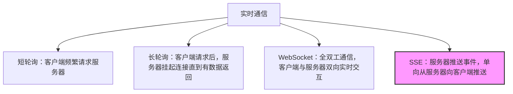
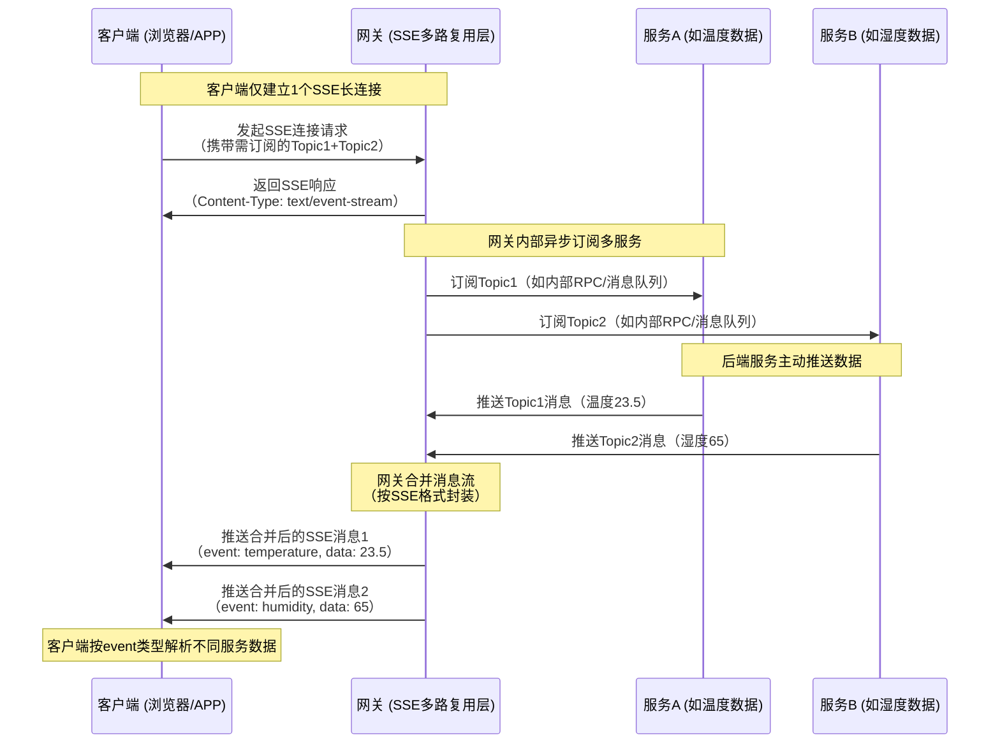

# SSE

> https://zhuanlan.zhihu.com/p/1903527326400094395



| 技术      | 协议 | 方向性                | 复杂度 | 延迟 | 适用场景        |
| --------- | ---- | --------------------- | ------ | ---- | --------------- |
| 短轮询    | HTTP | 双向（伪）            | 低     | 高   | 简单状态检测    |
| 长轮询    | HTTP | 双向（伪）            | 中     | 中   | 即时消息        |
| WebSocket | WS   | 全双工                | 高     | 低   | 游戏/高频交易   |
| SSE       | HTTP | 单向（服务端→客户端） | 低     | 低   | 实时通知/日志流 |

| 技术类型              | 是否基于标准 HTTP 协议 | 是否需要额外握手 | 核心细节                                                     |
| --------------------- | ---------------------- | ---------------- | ------------------------------------------------------------ |
| 短轮询                | ✅ 是                   | ❌                | 本质就是普通 HTTP GET/POST 请**求，客户端定时发 HTTP 请求，服务器即时响应**，每次都是独立的 HTTP 握手，无额外步骤。 |
| 长轮询                | ✅ 是                   | ❌                | 仍是标准 HTTP 请求，仅服务器会挂起连接（几秒到几十秒），有数据时才响应，全程只有 HTTP 本身的一次握手，无额外协商。 |
| SSE（服务器推送事件） | ✅ 是（HTTP/1.1+）      | ❌                | 基于 HTTP 的`text/event-stream`响应头，客户端发起一次 HTTP GET 请求后，服务器持续推送数据，仅一次 HTTP 握手，无额外升级步骤，完全兼容 HTTP 标准。 |
| WebSocket             | ❌ 否（基于 TCP）       | ✅                | 先发起 HTTP 请求（携带`Upgrade: websocket`等头），服务器返回 101 状态码完成 “协议升级”，这是额外的握手步骤；升级后脱离 HTTP，使用自定义的 WebSocket 帧通信。 |

### 1.2 SSE的核心优势


## 二、SSE协议深度解析

### 2.1 协议规范详解

#### 2.1.1 响应头要求

| 响应头字段        | 值                            | 是否强制 | 核心作用与要求                                               |
| ----------------- | ----------------------------- | -------- | ------------------------------------------------------------ |
| `HTTP/1.1 200 OK` | 状态码 200                    | 是       | 表示服务器成功处理了 SSE 请求；**不能用 204/3xx/4xx/5xx**，否则客户端会终止连接。 |
| `Content-Type`    | `text/event-stream`           | 是       | 核心标识：告诉客户端这是 SSE 流式响应，**客户端（浏览器）会触发 `EventSource` 解析逻辑；**⚠️ 必须严格匹配，大小写敏感（如 `Text/Event-Stream` 会失效）。 |
| `Cache-Control`   | `no-cache`（推荐 `no-store`） | 是       | 禁止客户端 / 代理缓存 SSE 响应内容；如果缺失，代理 / 浏览器可能缓存推送的事件，导致客户端收到旧数据。 |
| `Connection`      | `keep-alive`                  | 是       | 强制保持 TCP 连接不关闭，让服务器可以持续推送数据；HTTP/1.1 虽默认长连接，但显式声明可兼容低版本客户端 / 代理。 |

### 2.1.2 事件数据格式

```text
event: status
id: 42
data: {"temperature": 23.5, "humidity": 65}

retry: 3000  # 重连间隔（毫秒）
```


## 三 服务端实现

```python
class StreamingResponse(Response):
    def __init__(
        self,
        content: ContentStream,
        status_code: int = 200,
        headers: typing.Mapping[str, str] | None = None,
        media_type: str | None = None,
        background: BackgroundTask | None = None,
    ) -> None:
```

## 四 客户端实现

```javascript
const eventSource = new EventSource('/stream');

// 通用消息处理
eventSource.onmessage = (e) => {
    console.log('Message:', e.data);
};

// 自定义事件处理
eventSource.addEventListener('alert', (e) => {
    showNotification(JSON.parse(e.data));
});

// 错误处理
eventSource.onerror = (err) => {
    console.error('SSE Error:', err);
    eventSource.close();
};
```


### 5.2 多路复用架构




## 六 性能优化与安全

| 优化方向 | 具体措施             | 预期效果            |
| -------- | -------------------- | ------------------- |
| 连接管理 | 心跳保持（25s间隔）  | 防止[Nginx]超时断开 |
| 数据压缩 | gzip/brotli压缩      | 带宽减少70%         |
| 分片策略 | 按业务维度拆分数据流 | 提升处理效率        |


```

```

# Websocket

> https://zhuanlan.zhihu.com/p/690282564

### 一、简介（优化版）

#### 1.1 什么是 WebSocket

WebSocket 是一种基于 **TCP 协议** 的全双工通信协议（RFC 6455 标准），用于在 Web 应用与服务器之间建立持久化、双向的实时通信连接。

- 它先通过 HTTP 协议完成 “协议升级” 握手，成功后脱离 HTTP 协议，在单一 TCP 长连接上实现客户端↔服务器的双向数据传输；
- 区别于 HTTP 的 “请求 - 响应” 单向模型，**WebSocket 允许服务器主动推送数据**，无需客户端轮询；

#### 1.2 WebSocket 的优势和劣势（补充完整）

##### 优势（补充落地视角）

1. **极致实时性**：持久化 TCP 连接无需重复建立 / 断开，数据传输延迟可低至毫秒级，远优于轮询（短轮询 / 长轮询）的秒级延迟；
2. **全双工通信**：客户端和服务器可同时、独立地发送数据（如聊天场景中双方实时发消息，无需等待对方请求）；
3. 大幅降低网络开销：
   - 仅 1 次握手即可建立持久连接，避免 HTTP 轮询的重复请求头（如 Cookie、User-Agent 等）开销；
   - 数据帧体积小（最小帧仅 2 字节），比 HTTP 文本传输更高效；
4. **兼容 Web 生态**：握手阶段基于 HTTP，可穿透大部分防火墙 / 代理服务器，无需额外配置；
5. **轻量易用**：浏览器原生提供 `WebSocket` API，服务端主流框架（Node.js/Java/Python）均有成熟库支持。

##### 劣势（补充实际痛点）

1. 兼容性限制：
2. 服务器资源开销：
   - 每个客户端需维护一个长连接，高并发场景（如百万级在线）会占用大量服务器文件描述符和内存；
   - 需额外处理连接保活、断线重连、心跳检测等逻辑，增加服务端开发复杂度；
3. 安全风险：
   - 无内置身份校验机制，需业务层实现鉴权（如 Token 验证），否则易被伪造连接；
   - 存在 “WebSocket 劫持” 风险（跨站请求伪造），需通过 Origin 校验、Token 绑定等方式防范；
4. 调试难度高：
   - 不同于 HTTP 请求可直接在浏览器 Network 面板查看，WebSocket 帧需专用工具（如 Wireshark、浏览器 DevTools 的 WebSocket 面板）调试；
   - 断线后的数据重传、断点续传需业务层自行实现，无原生机制支持。


## 二 详解

### **2.2 WebSocket的[生命周期]**

WebSocket 生命周期描述了 WebSocket 连接从创建到关闭的过程。一个 WebSocket 连接包含以下四个主要阶段：

- **连接建立阶段（Connection Establishment）：** 在这个阶段，客户端和服务器之间的 WebSocket 连接被建立。客户端发送一个 WebSocket 握手请求，服务器响应一个握手响应，然后连接就被建立了。
- **连接开放阶段（Connection Open）：** 在这个阶段，WebSocket 连接已经建立并开放，客户端和服务器可以在连接上互相发送数据。
- **连接关闭阶段（Connection Closing）：** 在这个阶段，一个 WebSocket 连接即将被关闭。它可以被客户端或服务器发起，通过发送一个关闭帧来关闭连接。
- **连接关闭完成阶段（Connection Closed）：** 在这个阶段，WebSocket 连接已经完全关闭。客户端和服务器之间的任何交互都将无效。

### **2.3 WebSocket的消息格式**

WebSocket 的消息格式与 HTTP 请求和响应的消息格式有所不同。WebSocket 的**消息格式可以是文本或二进制数据**，并且 WebSocket 消息的传输是在一个已经建立的连接上进行的

WebSocket 消息格式由两个部分组成：消息头和消息体。

消息头包含以下信息：

- **FIN：** 表示这是一条完整的消息，一般情况下都是1。
- **RSV1、RSV2、RSV3：** 暂时没有使用，一般都是0。
- **Opcode：** 表示消息的类型，包括文本消息、二进制消息等。
- **Mask：** 表示消息是否加密。
- **Payload length：** 表示消息体的长度。
- **Masking key：** 仅在消息需要加密时出现，用于对消息进行解密。

消息体就是实际传输的数据，可以是文本或二进制数据。

### **2.4 WebSocket的[API]**

WebSocket API 是用于在 Web 应用程序中创建和管理 WebSocket 连接的接口集合。WebSocket API 由浏览器原生支持，无需使用额外的 JavaScript 库或框架，可以直接在 JavaScript 中使用。

下面是一些常用的 WebSocket API：

**WebSocket 构造函数：** WebSocket 构造函数用于创建 WebSocket 对象。它接受一个 URL 作为参数，表示要连接的 WebSocket 服务器的地址。例如：

```text
let ws = new WebSocket('ws://example.com/ws');
```

**WebSocket.send() 方法：** `WebSocket.send()` 方法用于向服务器发送数据。它接受一个参数，表示要发送的数据。数据可以是字符串、Blob 对象或 ArrayBuffer 对象。例如：

```text
ws.send('Hello, server!');
```

**WebSocket.onopen 事件：** `WebSocket.onopen` 事件在 WebSocket 连接成功建立时触发。例如：

```text
ws.onopen = function() {
  console.log('WebSocket 连接已经建立。');
};
```

**WebSocket.onmessage 事件：** `WebSocket.onmessage` 事件在**接收到服务器发送的消息时触发**。它的 event 对象包含一个 data 属性，表示接收到的数据。例如：

```text
ws.onmessage = function(event) {
  console.log('收到服务器消息：', event.data);
};
```

**WebSocket.onerror 事件：** `WebSocket.onerror` 事件在 WebSocket 连接出现错误时触发。例如：

```text
ws.onerror = function(event) {
  console.error('WebSocket 连接出现错误：', event);
};
```

**WebSocket.onclose 事件：** `WebSocket.onclose` 事件在 WebSocket 连接**被关闭时触**发。例如：

```text
ws.onclose = function() {
  console.log('WebSocket 连接已经关闭。');
};
```


## 三 服务端实现


## 四 客户端实现


## 五

二进制消息可以是任意类型的数据，包括图像、音频、视频等。
