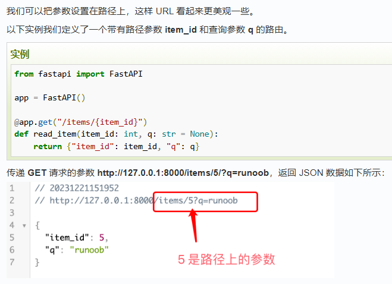
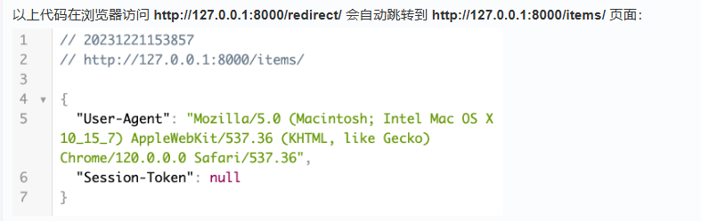
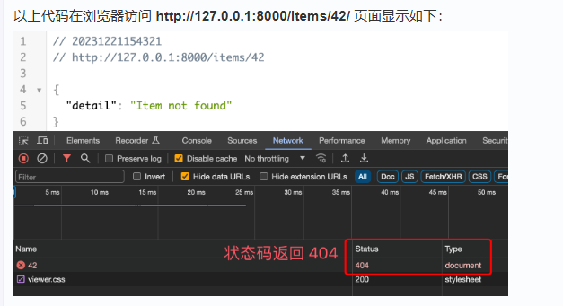

### 路径参数



### 返回 Pydantic 模型

路由处理函数返回一个 Pydantic 模型实例，FastAPI 将自动将其转换为 JSON 格式，并作为响应发送给客户端：

### 请求头和 Cookie

使用 Header 和 Cookie 类型注解获取请求头和 Cookie 数据。

```
from fastapi import Header, Cookie
from fastapi import FastAPI

app = FastAPI()

@app.get("/items/")
def read_item(user_agent: str = Header(None), session_token: str = Cookie(None)):
    return {"User-Agent": user_agent, "Session-Token": session_token}
```


### 重定向和状态码

使用 **RedirectResponse** 实现重定向，将客户端重定向到 **/items/** 路由。

```
from fastapi import Header, Cookie
from fastapi import FastAPI
from fastapi.responses import RedirectResponse

app = FastAPI()

@app.get("/items/")
def read_item(user_agent: str = Header(None), session_token: str = Cookie(None)):
    return {"User-Agent": user_agent, "Session-Token": session_token}

@app.get("/redirect")
def redirect():
    return RedirectResponse(url="/items/")
```




**状态码**

```
from fastapi import HTTPException

app = FastAPI()

@app.get("/items/{item_id}")
def read_item(item_id: int):
    if item_id == 42:
        raise HTTPException(status_code=404, detail="Item not found")
    return {"item_id": item_id}
```




## 1、依赖项（Dependencies）/

### Depends

- **预处理（Before）依赖项：** 在路由操作函数执行前运行，用于预处理输入数据，验证请求等。
- **后处理（After）依赖项：** 在路由操作函数执行后运行，用于执行一些后处理逻辑，如日志记录、清理等。

```python
from fastapi import Depends

# 路由操作函数
@app.get("/items/")
async def read_items(commons: dict = Depends(common_parameters)):
    return commons
```

```python
om fastapi import Depends, FastAPI, HTTPException
from typing import Optional
import asyncio

app = FastAPI()

# 异步依赖项函数
async def get_token():
    # 模拟异步操作
    await asyncio.sleep(2)
    return "fake-token"

# 异步路由操作函数
@app.get("/items/")
async def read_items(token: Optional[str] = Depends(get_token)):
    return {"token": token} 后处理（After）
```

## 安全认证：[JWT](https://zhida.zhihu.com/search?content_id=268061528&content_type=Article&match_order=1&q=JWT&zhida_source=entity) 与 [OAuth2](https://zhida.zhihu.com/search?content_id=268061528&content_type=Article&match_order=1&q=OAuth2&zhida_source=entity) 集成


## 高级特性：后台任务与 WebSocket

**异步后台任务**：在 Web 应用中，有些任务可能比较耗时，如发送邮件、记录日志、处理文件等，如果在请求处理过程中同步执行这些任务，会导致响应延迟，影响用户体验。FastAPI 提供了`BackgroundTasks`来处理这类异步后台任务，让请求能够快速响应，同时在后台执行这些非阻塞任务。

```python
def send_email(to: str, subject: str, message: str):
    # 这里实现发送邮件的逻辑，例如使用smtplib库
    print(f"Sending email to {to} with subject: {subject} and message: {message}")


@app.post("/send-email")
async def send_email_endpoint(request: EmailRequest, background_tasks: BackgroundTasks):
    background_tasks.add_task(send_email, request.to, request.subject, request.message)
    return {"status": "Email sending task added to background", "details": request.dict()}
```

**WebSocket 实时通信**：WebSocket 是一种在单个 TCP 连接上进行全双工通信的协议，它允许服务器和客户端之间进行实时双向通信。FastAPI 对 WebSocket 提供了良好的支持，使得我们可以方便地开发实时应用，如实时聊天、监控数据推送等。

```python
@app.websocket("/ws/{client_id}")
async def websocket_endpoint(websocket: WebSocket, client_id: int):
    await manager.connect(websocket)
    try:
        while True:
            data = await websocket.receive_text()
            await manager.send_message(f"Client {client_id} sent: {data}", websocket)
            await manager.broadcast(f"Client {client_id} says: {data}")
    except WebSocketDisconnect:
        manager.disconnect(websocket)
        await manager.broadcast(f"Client {client_id} disconnected")			
```

