> s

# 向量数据库

## 0 为什么要专门的向量数据库 


如果用 MySQL 这类**传统数据库存储向量**（比如把向量存成字符串 / 数组），会遇到两个无法解决的痛点：

> #### 1. 检索速度极慢（暴力计算，无法扩展）
>
> 要找相似向量，传统数据库只能做 “暴力遍历”：
>
> - 对每一个存储的向量，计算它和查询向量的 “距离”（比如余弦相似度）；
> - 如果有 100 万个 768 维向量，就要做 100 万次高维距离计算，单查询可能要几秒甚至几十秒，完全无法满足实时需求（比如用户输入后要快速返回结果）。
>
> #### 2. 无法处理高维数据的 “维度灾难”
>
> 向量的维度越高（比如 1000 维以上），传统的索引方式（B + 树、哈希等）完全失效：
>
> - 高维空间中，“距离” 的意义会变得模糊（所有向量之间的距离都差不多）；
> - 传统数据库没有针对高维向量的优化，存储和计算效率会断崖式下降。
>
> #### 3. 功能缺失
>
> 传统数据库没有针对向量的专用功能：比如动态添加 / 删除向量、按相似度排序、批量嵌入、数据持久化优化等，需要自己手写大量代码实现，且效率极低。

**向量数据库的核心价值就是 “高效处理相似性检索”，主要体现在：**

> #### 1. 优化的索引算法（核心）
>
> 向量数据库内置了专门的**近似最近邻（ANN）算法**（比如 HNSW、FAISS、IVF 等），能把 “暴力遍历” 的时间复杂度从 `O(n)` 降到 `O(log n)`：
>
> - 比如 100 万个向量的检索，从几秒缩短到**毫秒级**；
> - 牺牲极少量的精度（可配置），换取极致的速度，完全满足实时场景。
>
> #### 2. 针对高维向量的存储优化
>
> - 对向量进行压缩、量化（比如把 32 位浮点数转成 8 位整数），大幅减少存储空间；
> - 优化内存布局，让向量计算更贴合 CPU/GPU 的缓存机制，提升计算效率。
>
> #### 3. 专为向量场景设计的功能
>
> - 支持批量嵌入（自动把文本转向量并存入）；
> - 支持元数据过滤（比如检索 “水果相关” 且相似度高的向量）；
> - 支持增量更新（动态添加 / 删除向量，无需重建整个索引）；
> - 支持分布式部署（处理亿级向量的大规模场景）。

### **常见向量数据库**

> | 数据库       | 类型            | 开源 | 性能 | 运维 | 适用场景               |
> | ------------ | --------------- | ---- | ---- | ---- | ---------------------- |
> | **Milvus**   | 分布式向量库    | ✅    | 极高 | 中   | 大规模生产、企业级     |
> | **Qdrant**   | 轻量向量库      | ✅    | 高   | 低   | 中小型、边缘、快速开发 |
> | **Weaviate** | 向量 + 图       | ✅    | 中高 | 中   | 语义搜索、知识图谱     |
> | **Chroma**   | 轻量嵌入式      | ✅    | 中   | 极低 | 原型、学习、小项目     |
> | **Pinecone** | 云托管          | ❌    | 高   | 极低 | 零运维、快速上线       |
> | **Pgvector** | PostgreSQL 扩展 | ✅    | 中   | 低   | 复用 PG 栈、混合查询   |
> | **RedisVL**  | Redis 扩展      | ✅    | 极高 | 低   | 实时、低延迟、缓存     |
> | **FAISS**    | 算法库          | ✅    | 极高 | 高   | 科研、离线、底层优化   |

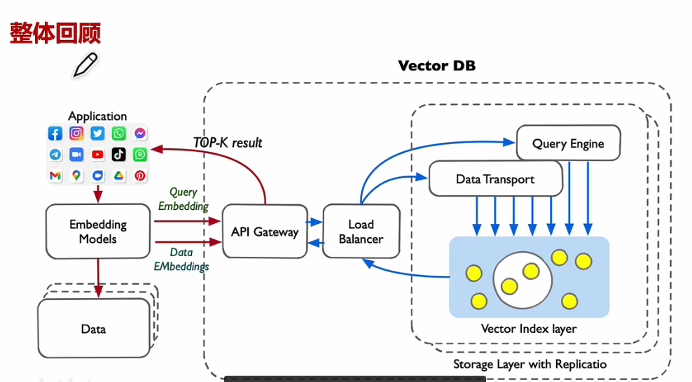

## 1 向量

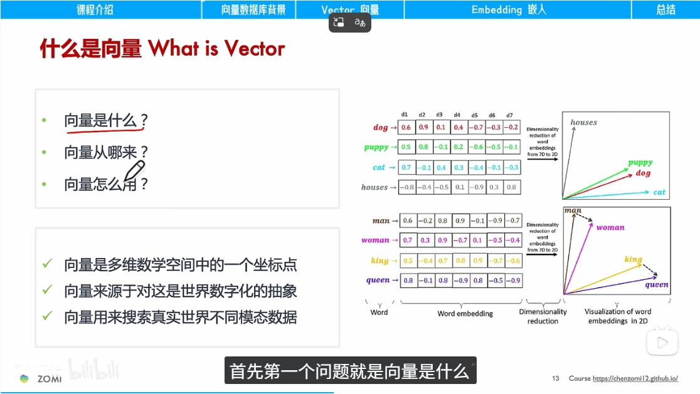

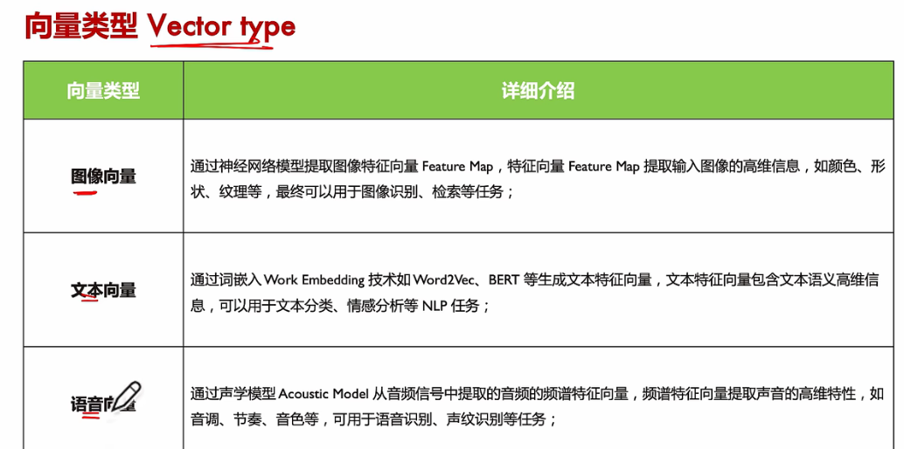

###  embedding

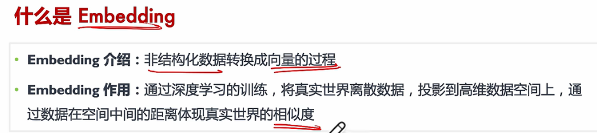

高维向量= 多个特征


## 2 数据库

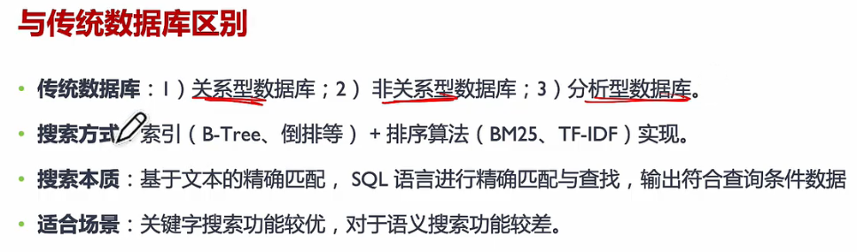

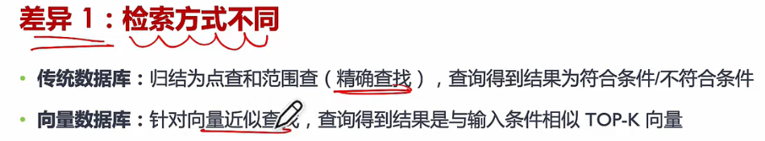

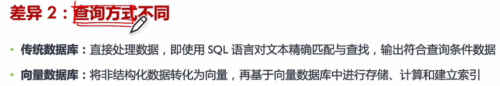


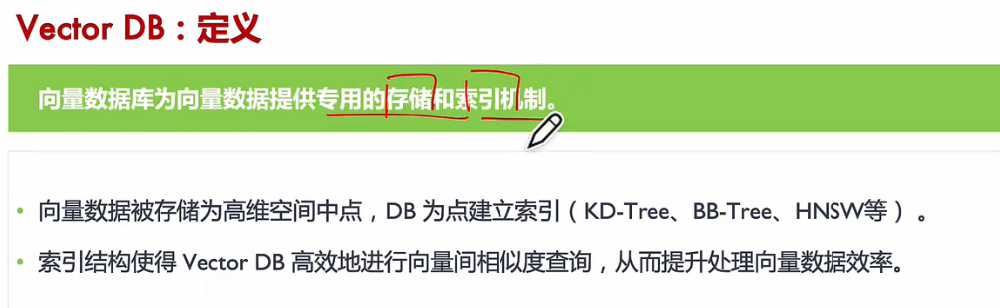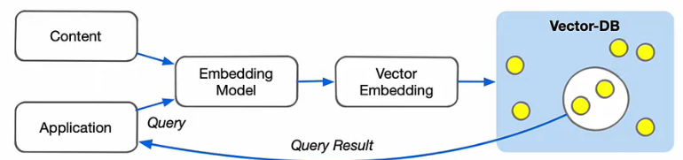

### 作用

1. 相似搜索
2. 提升性能

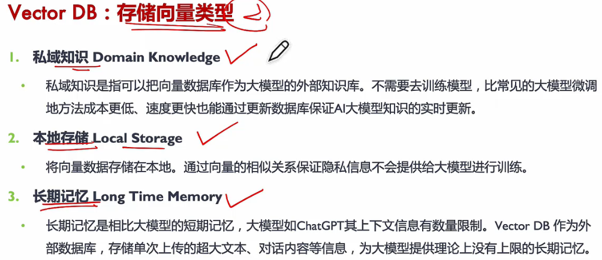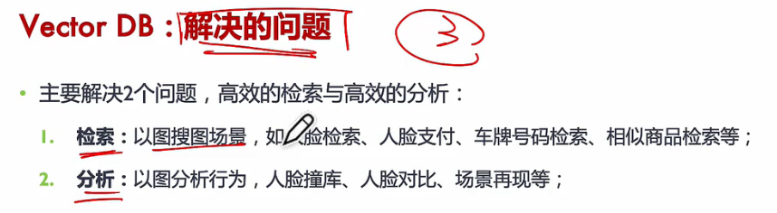

### 评价指标

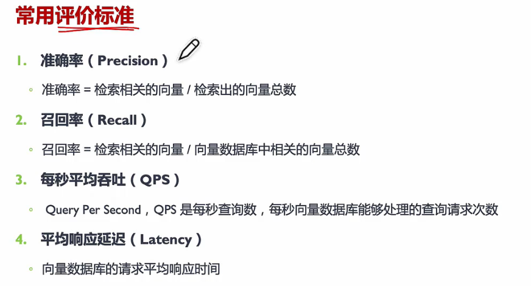

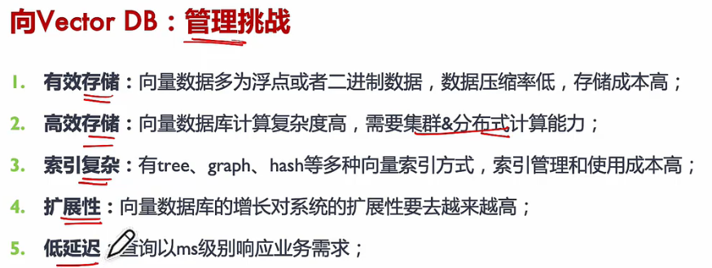

## 3 应用场景


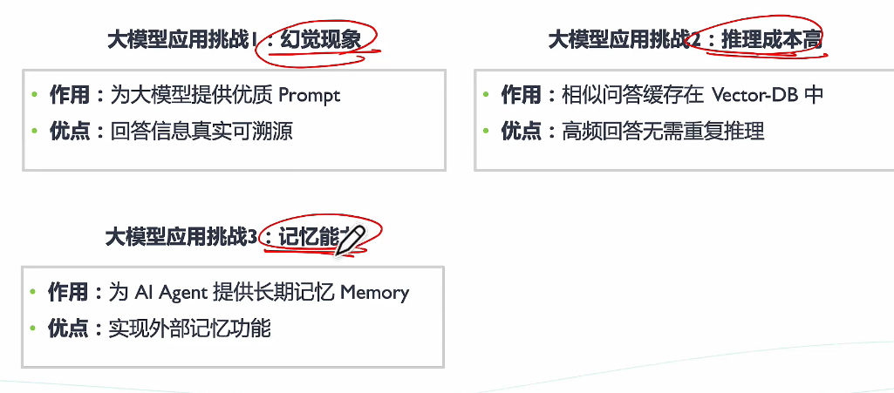


## 4 搜索(相似性搜索)

### 距离

1. 点几

2. 余弦相似度

   1. 高维空间里，**方向差异明显 → 余弦距离特别好用*

      > 语义 embedding 的特点：
      >
      > - 向量**长度不代表语义**，只代表 “强度”
      > - 真正决定意思相不相近的是**方向**
      >
      > 比如：
      >
      > - “我喜欢苹果”
      > - “我真的超级超级喜欢苹果”
      >
      > 两句语义几乎一样，但向量**长度可能差很多**：
      >
      > - 余弦距离：**很小（相似）**
      > - 欧氏距离：**很大（不相似）**
      >
      > 👉 **余弦会忽略长度，只看语义方向，更符合人的判断。**

   2. 地球表面积有限，但你能画出**无限多不同的点**。

      > ##### 1. 数学上：方向确实无限
      >
      > 在 **d 维实数空间**（比如 768 维）：
      >
      > - 方向由单位向量决定
      > - 单位向量有 无限多个→ 所以方向无限多
      >
      > 你随便转一点点角度，就是一个新方向。
      >
      > ------
      >
      > ##### 2. 但模型的语义空间：不是真・无限
      >
      > 模型 embedding 是**浮点数**，有精度限制：
      >
      > - float32 只有 2^32 种可能的数值
      > - 768 维向量的**不同方向数量是巨大、有限、但远超你能用的**
      >
      > 可以理解成：
      >
      > **不是数学无限，但对人类工程来说 = 无限够用。**

> ### 余弦距离 vs 欧氏距离（点积距离）
>
> #### 1. 欧氏距离（你说的 “点几距离”）
>
> 衡量**两个点在空间里的直线远近**。
>
> - 关心：**绝对位置、长度大小**
> - 公式：两点直线距离
> - 特点：**数值大小很重要**，模长不一样，距离就会差很多
>
> #### 2. 余弦距离
>
> 衡量**两个向量方向的差异**，不管长度。
>
> - 关心：**方向、趋势、相似度**
> - 公式：1 - 余弦相似度
> - 特点：**只看方向，不看长度**，模长不影响结果
>
> ------
>
> ### 一句话区别
>
> - **欧氏距离：看你离我多远。**
> - **余弦距离：看咱俩方向一不一样。**
>
> ------
>
> ### 举个最直观的例子
>
> 用户 A：[1, 2]
>
> 用户 B：[2, 4]
>
> 用户 C：[3, 1]
>
> - **欧氏距离**：A 和 B 很远，因为数值差一倍。
> - **余弦距离**：A 和 B **完全一样**，因为方向完全相同。

#### 什么时候用哪个？

- **文本、embedding、推荐、相似度** → 用 **余弦距离**
- **坐标、位置、聚类、物理距离** → 用 **欧氏距离**


### 混合搜索

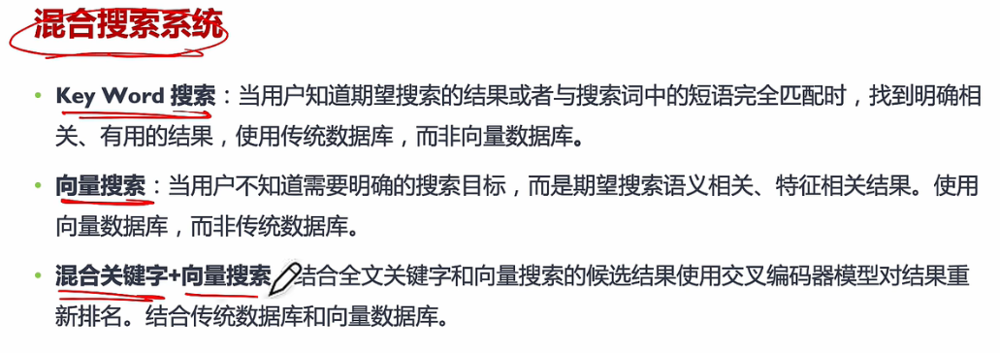

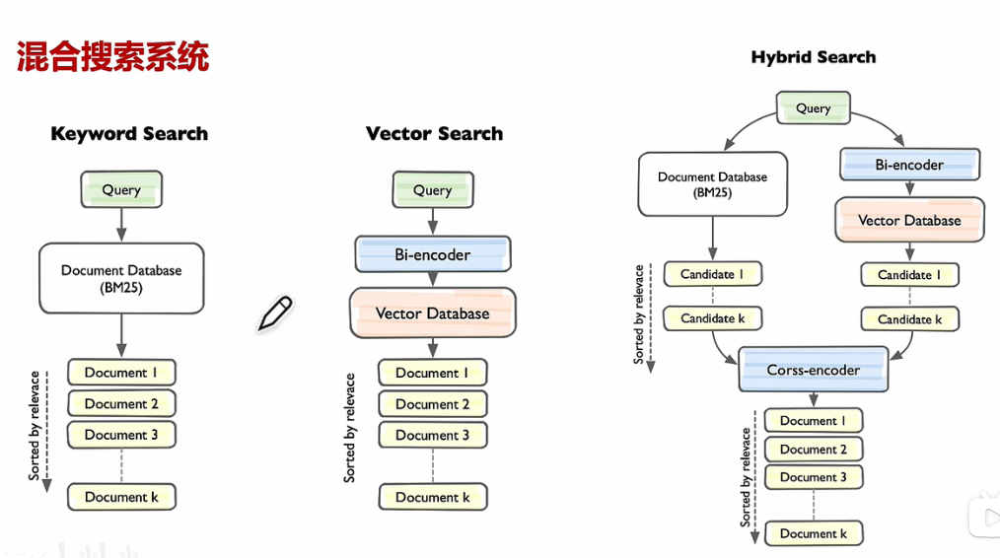

#### 关键词搜索: 

做法：

1. - 把每条电影的 title/director/plot/genre 等字段写入搜索引擎
2. - 建倒排索引（分词）
3. - query 做分词后跑 BM25，返回 topK

```python
queries = [
    "监狱逃脱的经典电影",
    "弗兰克·达拉邦特 拍的电影",
    "无厘头喜剧 功夫打斗",
    "海绵宝宝",
]
index = BM25Index(fields={"title": 2.0, "plot": 1.0, "director": 3.0, "genre": 1.0})
# print(movies)
index.add_documents(movies, id_key="dvdid")  # movies_example.json 里是 dvdid

# 2) 关键词检索：导演意图（等值过滤）
for q in queries:
    hits = index.search(
    query= q,
    top_k=10,
    # filter_eq={"director": "弗蘭克·達拉邦特"},
)
    print("query:", q)
    for h in hits:
        print(h.score, h.doc.get("title"), h.doc.get("director"))
```

>  

#### 混合检索（最实用）：关键词召回 + 向量重排（或反过来）


```cmd
query: 监狱逃脱的经典电影
8.217518413066625 越狱协议！真实事件改编！从华尔街精英到监狱囚徒的救赎！ 马库斯·高勒
6.233823286878385 功夫！周星驰巅峰之作！无厘头与武侠的完美结合！笑中带泪的经典传奇！ 周星馳
5.785495712647374 绿里奇迹！弗兰克·达拉邦特经典之作！关于人性、慈悲与奇迹的深刻寓言！ 弗蘭克·達拉邦特
3.6703058496265872 赌圣！周星驰成名之作！无厘头喜剧开山之作！爆笑又经典！ 周星馳、劉鎮偉
1.3657808880264422 海绵宝宝！永恒童年经典！治愈全世界的快乐小海绵！ 史蒂芬·希倫伯格
1.3340229817409925 E.T.外星人！最温柔的科幻经典！跨越星际的纯真友情！ 史蒂文·斯皮爾伯格
1.0478153318395904 狮子王！迪士尼永恒经典！勇气与成长的史诗童话！ 罗杰·阿勒斯
1.0186852729162292 侏罗纪公园！科幻冒险开山之作！恐龙世界的震撼经典！ 史蒂文·斯皮爾伯格
0.9670372743711524 美丽人生！奥斯卡经典！父爱与勇气的最美赞歌！笑着流泪的神作！ 羅貝托·貝尼尼
0.9670372743711524 心灵捕手！治愈无数人的励志经典！天才与自我救赎的成长之路！ 格斯·范·桑特
query: 弗兰克·达拉邦特 拍的电影
59.802190761471635 绿里奇迹！弗兰克·达拉邦特经典之作！关于人性、慈悲与奇迹的深刻寓言！ 弗蘭克·達拉邦特
21.868479864137754 肖申克的救贖！經典紀念版！希望與自由的故事！只要堅持信念，即使身處監獄也能找到屬於自己的救贖！ 弗蘭克·達拉邦特
7.799911547034155 她！未来式爱情神作！写给现代人的孤独治愈诗！ 斯派克·琼斯
query: 无厘头喜剧 功夫打斗
29.926343267198604 功夫！周星驰巅峰之作！无厘头与武侠的完美结合！笑中带泪的经典传奇！ 周星馳
28.292612614974527 赌圣！周星驰成名之作！无厘头喜剧开山之作！爆笑又经典！ 周星馳、劉鎮偉
27.776460176092158 少林足球！周星驰经典喜剧！功夫与足球的梦幻结合！坚持梦想终会发光！ 周星馳
2.0508644717722775 美食总动员！皮克斯暖心动画！一只小老鼠的顶级厨师梦！ 布拉德·伯德
2.0508644717722775 海绵宝宝！永恒童年经典！治愈全世界的快乐小海绵！ 史蒂芬·希倫伯格
query: 海绵宝宝
33.88108631247046 海绵宝宝！永恒童年经典！治愈全世界的快乐小海绵！ 史蒂芬·希倫伯格


```


### 索引

给点进行索引(产生数据结构:图表...)

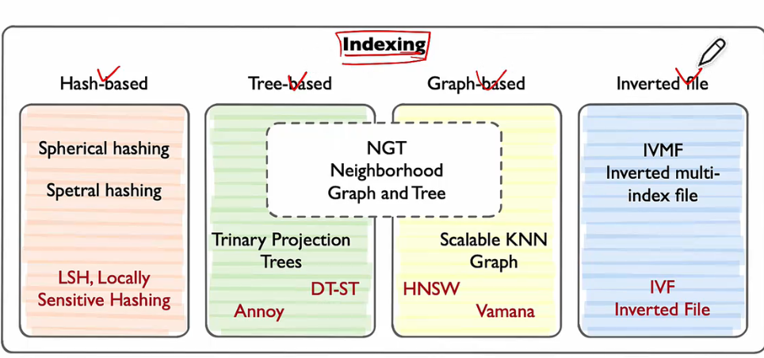

#### 1 哈希

尽量产生冲突的哈希

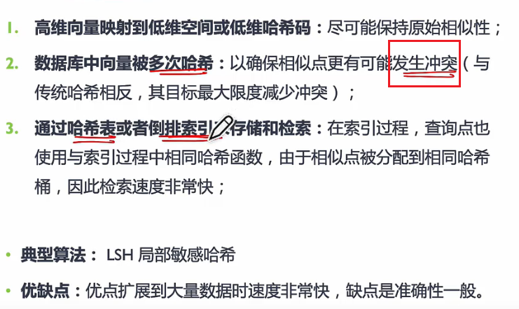


#### 2 树

建树

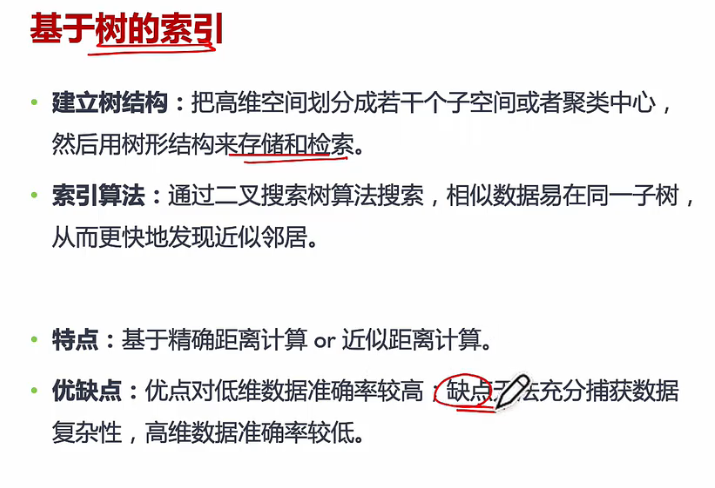

#### 3 图(主要)

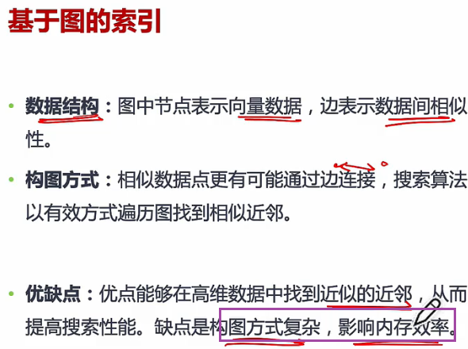

#### 4 倒排文件IVF

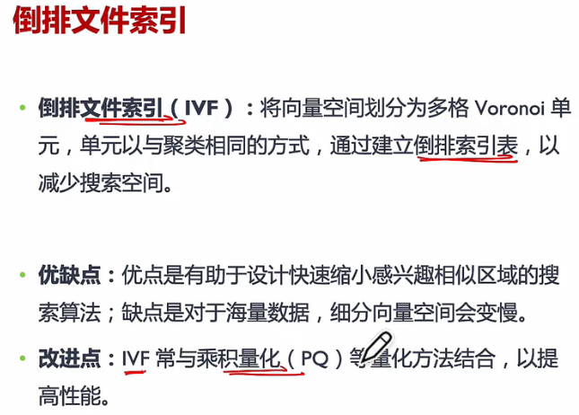

### 量化压缩

#### 1 Flat

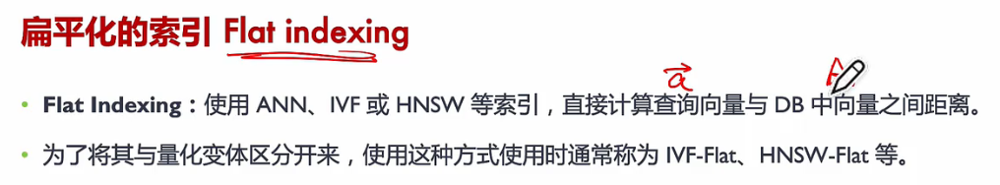

#### 2 Quantized

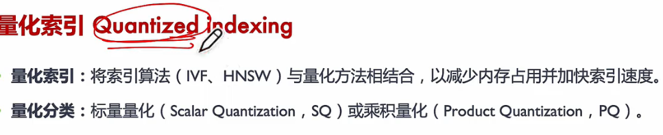

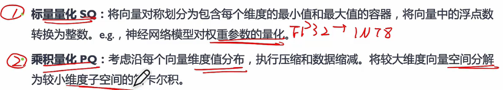

### 算法

#### ANN

#### IVF

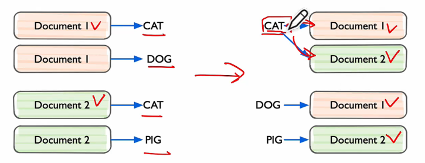

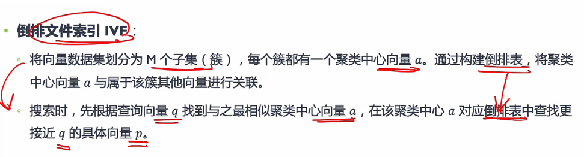

#### HNSW图

小世界

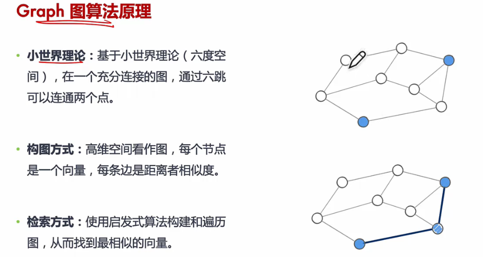

#### LSH哈希

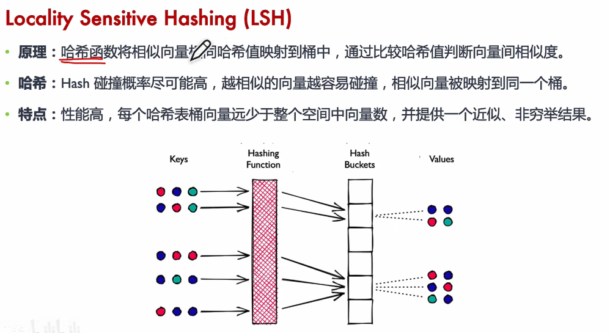

#### PQ压缩

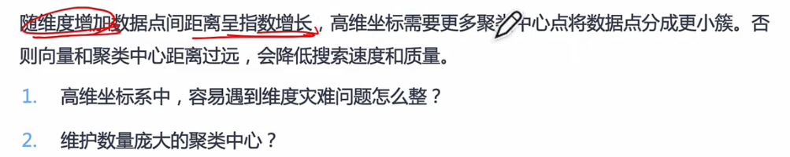

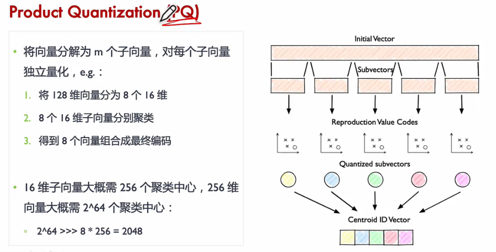

#### IVF+PQ

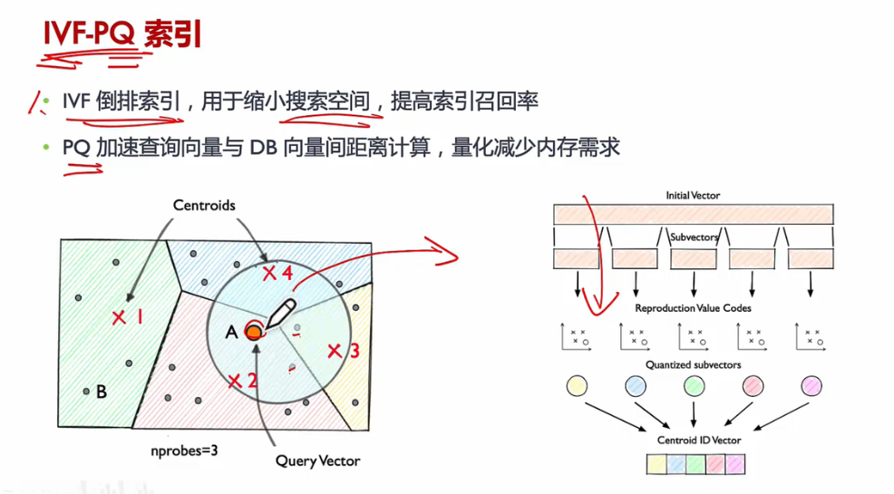

### 算法问题

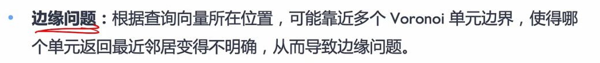

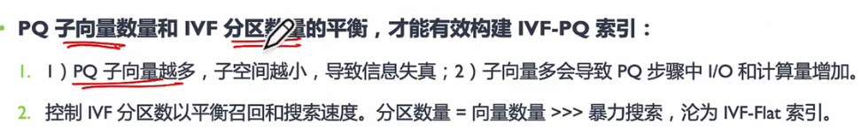

### 相似性度量

两两对比

#### 过滤

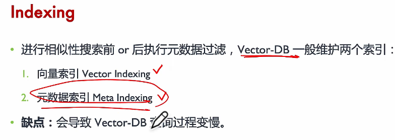

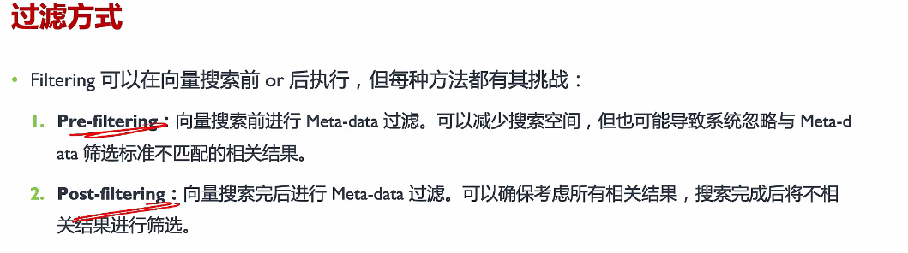


## 


## 

> |      |      |      |      |      |      |
> | ---- | ---- | ---- | ---- | ---- | ---- |
> |      |      |      |      |      |      |
> |      |      |      |      |      |      |
> |      |      |      |      |      |      |
> |      |      |      |      |      |      |
> |      |      |      |      |      |      |
> |      |      |      |      |      |      |
> |      |      |      |      |      |      |
> |      |      |      |      |      |      |


# Milvus


# Chroma

## 介绍

> https://zhuanlan.zhihu.com/p/665715823

```
import chromadb
chroma_client = chromadb.Client()

collection = chroma_client.create_collection(name="my_collection")

collection.add(
    documents=["This is a document about engineer", "This is a document about steak"],
    metadatas=[{"source": "doc1"}, {"source": "doc2"}],
    ids=["id1", "id2"]
)

results = collection.query(
    query_texts=["Which food is the best?"],
    n_results=2
)

print(results)
```

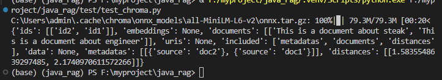

我们向Chroma提交了两个文档（简单起见，是两个字符串），一个是This is a document about engineer，一个是This is a document about steak。若在add方法没有传入embedding参数，则会使用**Chroma默认的all-MiniLM-L6-v2方式进行embedding**。

随后，我们对数据集进行query，要求返回两个最相关的结果。

提问内容为：Which food is the best?

```json
{
 'ids': [
  ['id2', 'id1']
 ],
 'distances': [
  [1.5835548639297485, 2.1740970611572266]
 ],
 'metadatas': [
  [{
   'source': 'doc2'
  }, {
   'source': 'doc1'
  }]
 ],
 'embeddings': None,
 'documents': [
  ['This is a document about steak', 'This is a document about engineer']
 ]
}
```

**解析**

`distances` : 数值越小表示文档和查询文本的相似度越高，结果按相似度从高到低排序

### **数据持久化**

Chroma一般是直接作为内存数据库使用，但是也可以进行持久化存储。

在初始化Chroma Client时，使用PersistentClient：

```text
client = chromadb.PersistentClient(path="/Users/yourname/xxxx")
```

这样在运行代码后，在你指定的位置会新建一个

#### **sqlite3解析**


### **数据集（Collection）**

collection是Chroma中一个重要的概念，下面的代码和注释简单介绍了**collection的主要功能和使用方法。**

```python
collection = client.get_collection(name="test") # Get a collection object from an existing collection, by name. Will raise an exception if it's not found.
collection = client.get_or_create_collection(name="test") # Get a collection object from an existing collection, by name. If it doesn't exist, create it.
client.delete_collection(name="my_collection") # Delete a collection and all associated embeddings, documents, and metadata. ⚠️ This is destructive and not reversible
collection.peek() # returns a list of the first 10 items in the collection
collection.count() # returns the number of items in the collection
collection.modify(name="new_name") # Rename the collection
```


collection支持传入一些**自身的元数据**metadata：

collection允许用户自行**切换距离计算函数**，方法是通过设置cellection的metadata中的“hnsw:space”：

```python
collection = client.create_collection(
    name="collection_name",
    metadata={"hnsw:space": "cosine"} # l2 is the default
)
```

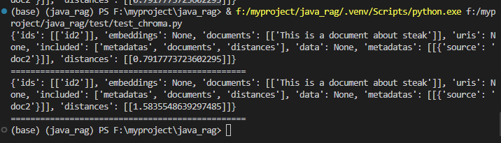

> | 参数名 (parameter) | 中文全称         | 英文全称          | 核心含义                                                     | 计算公式                    | 数值解读                                                     | 典型适用场景                          |
> | ------------------ | ---------------- | ----------------- | ------------------------------------------------------------ | --------------------------- | ------------------------------------------------------------ | ------------------------------------- |
> | `l2`               | 平方欧几里得距离 | Squared L2        | 计算两个向量在多维空间中的直线距离（平方形式），关注数值绝对差异 | d=∑(Ai−Bi)2                 | 值越小，向量越相似范围：0→+∞                                 | 数值特征匹配（价格 / 销量）、通用检索 |
> | `ip`               | 内积（点积）     | Inner Product     | 计算向量投影重叠程度，未归一化，受向量长度影响显著           | d=1.0−∑(Ai×Bi)              | 值越小，向量越相似范围：−∞→+∞（转换后）                      | 特定推荐系统、向量未归一化场景        |
> | `cosine`           | 余弦相似度       | Cosine Similarity | 计算向量夹角余弦值，归一化后仅关注方向，忽略长度差异         | d=1.0−∑(Ai2)⋅∑(Bi2)∑(Ai×Bi) | 原始余弦值：值越大越相似（−1→1）ChromaDB 返回值：值越小越相似 | 文本语义相似度、NLP 问答、通用检索    |
>
> - `l2`：像在地图上测量两个点的直线距离，距离越近越像；
> - `cosine`：像判断两个箭头的指向是否一致，方向越一致越像（不管箭头长短）。

### **文档（Document）**


### **简单查询**

`collection.query`

输入文档内的文本进行相似性查询，可以使用query方法

```text
collection.query(
    query_embeddings=[[11.1, 12.1, 13.1],[1.1, 2.3, 3.2], ...],
    n_results=10,
    where={"metadata_field": "is_equal_to_this"},
    where_document={"$contains":"search_string"}
)
```

若想要通过**id查找**，可以使用get方法

```text
collection.get(
    ids=["id1", "id2", "id3", ...],
    where={"style": "style1"}
)
```

与此同时，你可以**定制`include`返回结果包含的数据**

```text
# Only get documents and ids
collection.get({
    include: [ "documents" ]
})
```

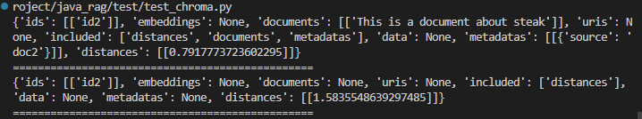

### 条件查询

`where = {"source": "doc2"}`

```
where = {"source": "doc2"}
results_l2_where = collection_l2.query(
    query_texts=["Which food is the best?"],
    n_results=2,
    include=["distances", "documents", "metadatas"],
    where=where
)
print(results_l2_where)
print("================================================")
```

### 其他

`collection.update`

`collection.delete`

## 实战

https://docs.langchain.com/oss/python/langchain/overview?highlight=chroma
