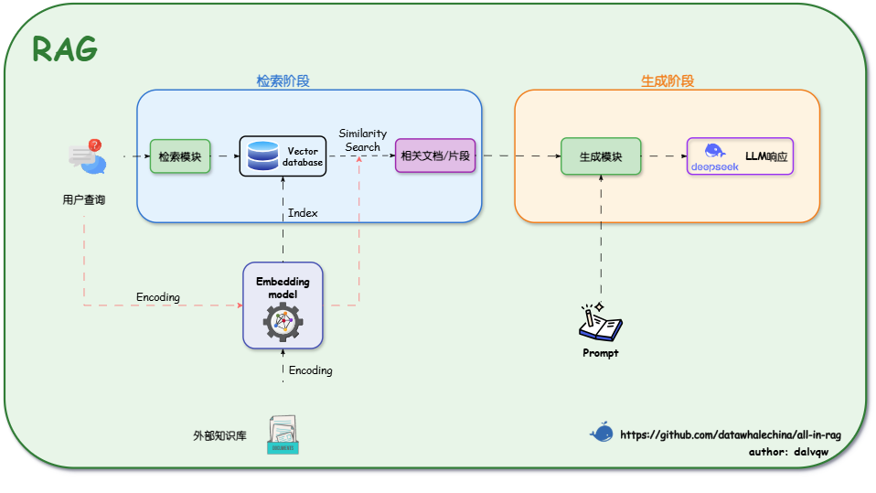
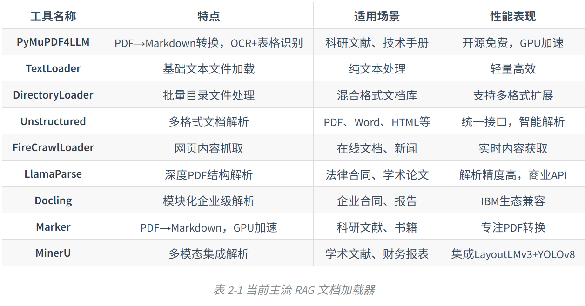
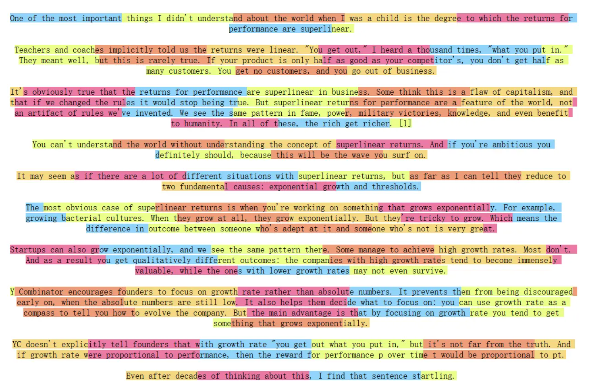
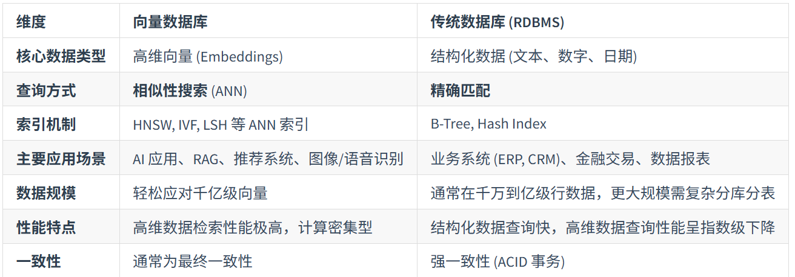
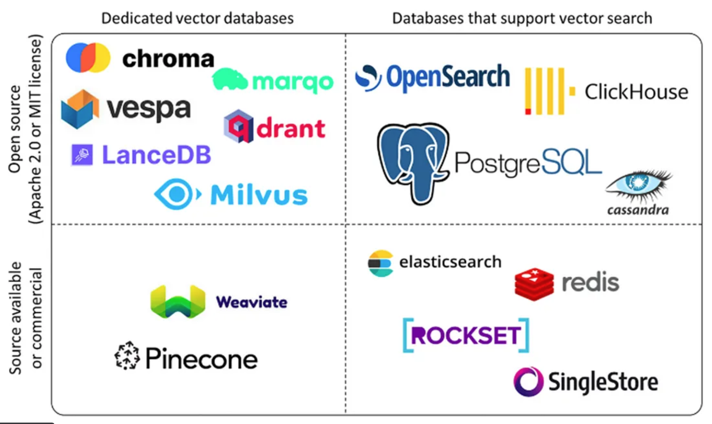
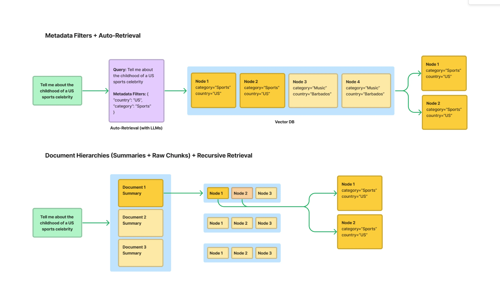
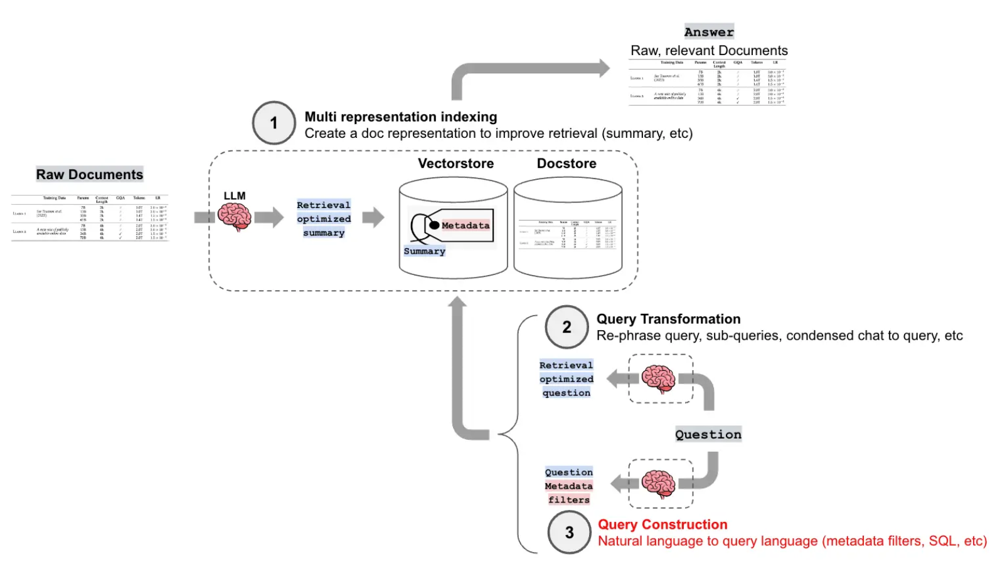
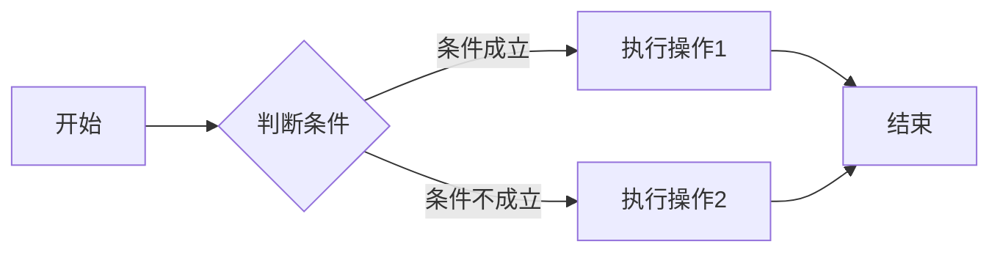
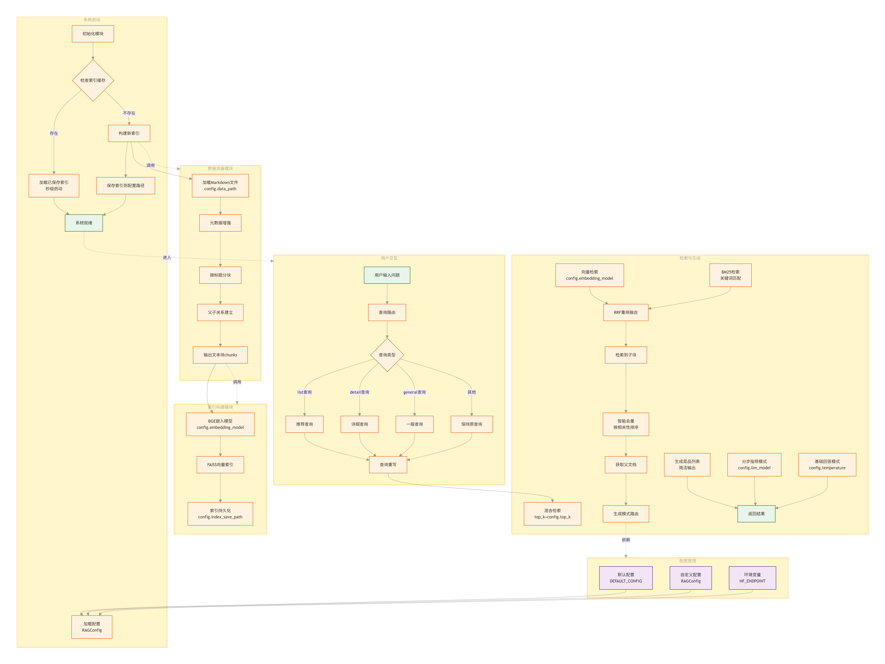

> 


# All in RAG




# 一、RAG？

### 2.1 技术选型：RAG vs. 微调


### 3.1 基础工具链选择

构建 RAG 系统通常涉及几个关键环节的选型。在**开发模式**上，我们可以利用 **LangChain** 或 **LlamaIndex** 等成熟框架快速集成，**也可以选择不依赖框架的原生开发**，以获得对系统流程更精细的控制力（在 AI 编程辅助下这并非难事）。而在**记忆载体**（向量数据库）方面，既有 **Milvus**、**Pinecone** 等适合大规模数据的方案，也有 **FAISS**、**Chroma** 等轻量级或本地化的选择，需根据具体业务规模灵活决定。后期为了量化效果，还可以引入 **RAGAS** 或 **TruLens** 等自动化**评估工具**。

### **评估维度与挑战**

业界通常会从几个维度进行量化评估，

首先是**检索相关性**（找到的内容是否包含答案），

其次是**生成质量**，这又可以细分为**语义准确性**（回答的意思是否正确）和**词汇匹配度**（专业术语是否使用得当）。

### **优化方向与架构演进**

在**性能层面**，可以通过**索引分层**（对高频数据启用缓存）和**多模态扩展**（支持图像/表格检索）来提升效率和能力边界。而在**架构层面**，简单的线性流程正在被更复杂的**设计模式**所取代。

例如，系统可以通过**分支模式**并行处理多路检索，或通过**循环模式**进行自我修正，这些灵活的架构是通往更智能 RAG 的必由之路。


# 二 数据

## 1 文档加载

文档加载器负责将各种格式的非结构化文档（如PDF、Word、Markdown、HTML等）转换为程序可以处理的结构化数据。

### 1.1 主流RAG文档加载器



### 1.2 **Unstructured**

```
unstructured
```


## 2 文本分块

文本分块（Text Chunking)



### 2.1 满足模型上下文限制

将文本**分块的首要原因**，是为了适应 RAG 系统中两个核心组件的硬性限制：

- **嵌入模型 (Embedding Model)**: 负责将文本块转换为向量。许多常用的嵌入模型（如 `bge-base-zh-v1.5`）的上下文窗口为512个token。任何超出此限制的文本块在输入时都会被截断，导致信息丢失，生成的向量也无法完整代表原文的语义。因此，文本块的大小**必须**小于等于嵌入模型的上下文窗口。
- **大语言模型 (LLM)**: 负责根据检索到的上下文生成答案。LLM同样有上下文窗口限制（尽管通常比嵌入模型大得多，从几千到上百万token不等）。检索到的所有文本块，连同用户问题和提示词，都必须能被放入这个窗口中。如果单个块过大，可能会导致只能容纳少数几个相关的块，限制了LLM回答问题时可参考的信息广度。

### 2.2 嵌入过程中的信息损失

大多数嵌入模型都基于 Transformer 编码器。其工作流程大致如下：

- **分词 (Tokenization)**: 将输入的文本块分解成一个个 token。
- **向量化 (Vectorization)**: Transformer 为**每个 token** 生成一个高维向量表示。
- **池化 (Pooling)**: 通过某种方法（如取 `[CLS]` 位的向量、对所有token向量求平均 `mean pooling` 等），将所有 token 的向量**压缩**成一个**单一的向量**，这个向量代表了整个文本块的语义。

> `[CLS]` 是BERT等Transformer模型在输入文本开头添加的特殊标记，它通过自注意力机制动态聚合整个序列的上下文信息，其最终向量被训练用作代表全局语义的嵌入。

在这个`压缩`过程中，信息损失是不可避免的。一个768维的向量需要概括整个文本块的所有信息。**文本块越长，包含的语义点越多，这个单一向量所承载的信息就越稀释**，**导致其表示变得笼统，关键细节被模糊化，从而降低了检索的精度。**

> 假设有一个关于《王者荣耀》英雄鲁班七号的攻略文档。
>
> - **糟糕的分块策略**：将“技能介绍”、“推荐出装”和“背景故事”这三个完全不同主题的内容，全部放在一个巨大的文本块里。
>   - 当玩家查询“鲁班七号怎么出装？”时，这个大块虽然包含了出装信息，但由于被技能说明和英雄故事等无关主题严重稀释，其整体的检索相关性得分可能会很低，导致无法被召回。
> - **优秀的分块策略**：将“技能”、“出装”和“故事”分别切分为三个独立的、主题聚焦的块。
>   - 当玩家再次查询时，“推荐出装”这个块会因为与查询高度相关而获得极高的分数，从而被精准地检索出来。


## 2.3  分块策略

### 1 固定分块

根据LangChain源码，这种方法的工作原理分为两个主要阶段：

（1）**按段落分割**：`CharacterTextSplitter` 采用默认**分隔符** `"\n\n"`，使用正则表达式将文本按段落进行分割，通过 `_split_text_with_regex` 函数处理。

（2）**智能合并**：调用继承自父类的 `_merge_splits` 方法，将分割后的段落依次合并。该方法会监控**累积长度**，当超过 `chunk_size` 时形成新块，并通过重叠机制（`chunk_overlap`）保持上下文连续性，同时在必要时发出超长块的警告。

> 需要注意，`CharacterTextSplitter` 实际实现的并非严格的固定大小分块。根据 `_merge_splits` 源码逻辑，这种方法会：
>
> - **优先保持段落完整性**：只有当添加新段落会导致总长度超过 `chunk_size` 时，才会结束当前块
> - **处理超长段落**：如果单个段落超过 `chunk_size`，系统会发出警告但仍将其作为完整块保留
> - **应用重叠机制**：通过 `chunk_overlap` 参数在块之间保持内容重叠，确保上下文连续性


### 2 递归字符分块

`RecursiveCharacterTextSplitter` 的实现。这种分块器通过**分隔符层级**递归处理，相对与固定大小分块，改善了超长文本的处理效果。

**算法流程**： 

（1）**寻找有效分隔符**: 从分隔符列表中从前到后遍历，找到第一个在当前文本中**存在**的分隔符。如果都不存在，使用最后一个分隔符（通常是空字符串 `""`）。

（2）**切分与分类处理**: 使用选定的分隔符切分文本，然后遍历所有片段：

- **如果片段不超过块大小**: 暂存到 `_good_splits` 中，准备合并
- 如果片段超过块大小:
  - 首先，将暂存的合格片段通过 `_merge_splits` 合并成块
  - 然后，检查是否还有剩余分隔符：
    - **有剩余分隔符**: 递归调用 `_split_text` 继续分割
    - **无剩余分隔符**: 直接保留为超长块

（3）**最终处理**: 将剩余的暂存片段合并成最后的块

**实现细节**：

- **批处理机制**: 先收集所有合格片段（`_good_splits`），遇到超长片段时才触发合并操作。
- **递归终止条件**: 关键在于 `if not new_separators` 判断。当分隔符用尽时（`new_separators` 为空），停止递归，直接保留超长片段。确保算法不会无限递归。

**与固定大小分块的关键差异**：

- 固定大小分块遇到超长段落时只能发出警告并保留。
- 递归分块会继续使用更细粒度的分隔符（句子→单词→字符）直到满足大小要求。


### 3 语义分块

据文本的语义内涵来切分。

**实现原理**

`SemanticChunker` 的工作流程可以概括为以下几个步骤：

（1）**句子分割 (Sentence Splitting)**：首先，使用标准的句子分割规则（例如，基于句号、问号、感叹号）将输入文本拆分成一个句子列表。

（2）**上下文感知嵌入 (Context-Aware Embedding)**：这是 `SemanticChunker` 的一个关键设计。该分块器不是对每个句子独立进行嵌入，而是通过 `buffer_size` 参数（默认为1）来捕捉上下文信息。对于列表中的每一个句子，这种方法会将其与前后各 `buffer_size` 个句子组合起来，然后对这个临时的、更长的组合文本进行嵌入。这样，每个句子最终得到的嵌入向量就融入了其上下文的语义。

（3）**计算语义距离 (Distance Calculation)\**：计算每对\**相邻**句子的嵌入向量之间的余弦距离。这个距离值量化了两个句子之间的语义差异——距离越大，表示语义关联越弱，跳跃越明显。

（4）**识别断点 (Breakpoint Identification)**：`SemanticChunker` 会分析所有计算出的距离值，并根据一个统计方法（默认为 `percentile`）来确定一个动态阈值。例如，它可能会将所有距离中第95百分位的值作为切分阈值。所有距离大于此阈值的点，都被识别为语义上的“断点”。

（5）**合并成块 (Merging into Chunks)**：最后，根据识别出的所有断点位置，将原始的句子序列进行切分，并将每个切分后的部分内的所有句子合并起来，形成一个最终的、语义连贯的文本块。


**断点识别方法 (`breakpoint_threshold_type`)**

如何定义“显著的语义跳跃”是语义分块的关键。`SemanticChunker` 提供了几种基于统计的方法来识别断点：

> - `percentile` (百分位法 - **默认方法**):
>   - **逻辑**: 计算所有相邻句子的语义差异值，并将这些差异值进行排序。当一个差异值超过某个百分位阈值时，就认为该差异值是一个断点。
>   - **参数**: `breakpoint_threshold_amount` (默认为 `95`)，表示使用第95个百分位作为阈值。这意味着，只有最显著的5%的语义差异点会被选为切分点。
> - `standard_deviation` (标准差法):
>   - **逻辑**: 计算所有差异值的平均值和标准差。当一个差异值超过“平均值 + N * 标准差”时，被视为异常高的跳跃，即断点。
>   - **参数**: `breakpoint_threshold_amount` (默认为 `3`)，表示使用3倍标准差作为阈值。
> - `interquartile` (四分位距法):
>   - **逻辑**: 使用统计学中的四分位距（IQR）来识别异常值。当一个差异值超过 `Q3 + N * IQR` 时，被视为断点。
>   - **参数**: `breakpoint_threshold_amount` (默认为 `1.5`)，表示使用1.5倍的IQR。
> - `gradient` (梯度法):
>   - **逻辑**: 这是一种更复杂的方法。它首先计算差异值的变化率（梯度），然后对梯度应用百分位法。对于那些句子间语义联系紧密、差异值普遍较低的文本（如法律、医疗文档）特别有效，因为这种方法能更好地捕捉到语义变化的“拐点”。
>   - **参数**: `breakpoint_threshold_amount` (默认为 `95`)。


### 4 基于文档结构的分块

`MarkdownHeaderTextSplitter`


## 2.4ChunkViz：简易的可视化分块工具


# 三 索引


## 1 向量空间的语义表示

- 关键度量：我们通常使用以下数学方法来衡量向量间的“距离”或“相似度”：

  - **余弦相似度 (Cosine Similarity)** ：计算两个向量夹角的余弦值。值越接近 1，代表方向越一致，语义越相似。这是最常用的度量方式。
  - **点积 (Dot Product)** ：计算两个向量的乘积和。在向量归一化后，点积等价于余弦相似度。
  - **欧氏距离 (Euclidean Distance)** ：计算两个向量在空间中的直线距离。距离越小，语义越相似。


### 1.2 通用流程如下： 

（1）**离线索引构建**：将知识库内文档切分后，使用 Embedding 模型将每个文档块（Chunk）转换为向量，存入专门的向量数据库中。

（2）**在线查询检索**：当用户提出问题时，使用**同一个** Embedding 模型将用户的问题也转换为一个向量。

（3）**相似度计算**：在向量数据库中，计算“问题向量”与所有“文档块向量”的相似度。

（4）**召回上下文**：选取相似度最高的 Top-K 个文档块，作为补充的上下文信息，与原始问题一同送给大语言模型（LLM）生成最终答案。


## 2 模型

### [2.1 静态词嵌入：上下文无关的表示](https://datawhalechina.github.io/all-in-rag/#/chapter3/06_vector_embedding?id=_21-静态词嵌入：上下文无关的表示)

- **代表模型**：Word2Vec (2013), GloVe (2014)
- **主要原理**：为词汇表中的每个单词生成一个固定的、与上下文无关的向量。例如，`Word2Vec` 通过 Skip-gram 和 CBOW 架构，利用局部上下文窗口学习词向量，并验证了**向量运算**的语义能力（如 `国王 - 男人 + 女人 ≈ 王后`）。`GloVe` 则融合了全局词-词共现矩阵的统计信息。
- **局限性**：无法处理一词多义问题。在“苹果公司发布了新手机”和“我吃了一个苹果”中，“苹果”的词向量是完全相同的，这限制了其在复杂语境下的语义表达能力。

### [2.2 动态上下文嵌入](https://datawhalechina.github.io/all-in-rag/#/chapter3/06_vector_embedding?id=_22-动态上下文嵌入)

- 2017年，`Transformer` 架构的诞生带来了自注意力机制（Self-Attention），它允许模型在生成一个词的向量时，**动态地考虑句子中所有其他词的影响**。基于此，
- 2018年 `BERT` 模型利用 `Transformer` 的编码器，通过掩码语言模型（MLM）等自监督任务进行预训练，生成了深度上下文相关的嵌入。同一个词**在不同语境中会生成不同的向量**，这有效解决了静态嵌入的一词多义难题。

### [2.3 RAG 对嵌入技术的新要求](https://datawhalechina.github.io/all-in-rag/#/chapter3/06_vector_embedding?id=_23-rag-对嵌入技术的新要求)

 RAG 的兴起对嵌入技术提出了更高、更具体的要求：

- **领域自适应能力**：通用的嵌入模型在专业领域（如法律、医疗）往往表现不佳，这就要求**嵌入模型具备领域自适应的能力**，能够通过微调或使用指令（如 INSTRUCTOR 模型）来适应特定领域的术语和语义。
- **多粒度与多模态支持**：RAG 系统需要处理的不仅仅是短句，还可能包括长文档、代码，甚至是图像和表格。这就要求嵌入模型能够处理不同长度和类型的输入数据。
- **检索效率与混合检索**：嵌入**向量的维度和模型大小直接影响存储成本和检索速度**。同时，为了结合语义相似性（密集检索）和关键词匹配（稀疏检索）的优点，支持混合检索的嵌入模型（如 BGE-M3）应运而生，在某些任务中成为提升召回率的关键。

## 3、嵌入模型训练原理

BERT 的成功很大程度上归功于 **自监督学习** 策略，它允许模型从海量的、无标注的文本数据中学习知识。

### [任务一：掩码语言模型 (Masked Language Model, MLM)](https://datawhalechina.github.io/all-in-rag/#/chapter3/06_vector_embedding?id=任务一：掩码语言模型-masked-language-model-mlm)

- 过程：
  - 随机地将输入句子中 15% 的词元（Token）替换为一个特殊的 `[MASK]` 标记。
  - 让模型去预测这些被遮盖住的原始词元是什么。
- **目标**：通过这个任务，模型被迫学习每个词元与其上下文之间的关系，从而掌握深层次的语境语义。

### [任务二：下一句预测 (Next Sentence Prediction, NSP)](https://datawhalechina.github.io/all-in-rag/#/chapter3/06_vector_embedding?id=任务二：下一句预测-next-sentence-prediction-nsp)

- 过程：
  - 构造训练样本，每个样本包含两个句子 A 和 B。
  - 其中 50% 的样本，B 是 A 的真实下一句（IsNext）；另外 50% 的样本，B 是从语料库中随机抽取的句子（NotNext）。
  - 让模型判断 B 是否是 A 的下一句。
- **目标**：这个任务让模型学习句子与句子之间的逻辑关系、连贯性和主题相关性。
- **重要说明**：后续的研究（如 RoBERTa）发现[2](https://datawhalechina.github.io/all-in-rag/#fn-2)，NSP 任务可能过于简单，甚至会损害模型性能。因此，许多现代的预训练模型（如 RoBERTa、SBERT）在预训练阶段移除了 NSP。

> 更多细节可查看 [BERT 架构及应用](https://github.com/datawhalechina/base-nlp/blob/main/docs/chapter5/13_Bert.md)

[3.2 效果增强策略](https://datawhalechina.github.io/all-in-rag/#/chapter3/06_vector_embedding?id=_32-效果增强策略)

虽然 MLM 和 NSP 赋予了模型强大的基础语义理解能力，但为了在检索任务中表现更佳，现代嵌入模型通常会引入更具针对性的训练策略。

- **度量学习 (Metric Learning)** ：
  - **思想**：直接以“相似度”作为优化目标。
  - **方法**：收集大量相关的文本对（例如，（问题，答案）、（新闻标题，正文））。训练的目标是优化向量空间中的**相对距离**：让“正例对”的向量表示在空间中被“拉近”，而“负例对”的向量表示被“推远”。关键在于优化排序关系，而非追求绝对的相似度值（如 1 或 0），因为过度追求极端值可能导致模型过拟合。
- **对比学习 (Contrastive Learning)** ：
  - **思想**：在向量空间中，将相似的样本“拉近”，将不相似的样本“推远”。
  - **方法**：构建一个三元组（Anchor, Positive, Negative）。其中，Anchor 和 Positive 是相关的（例如，同一个问题的两种不同问法），Anchor 和 Negative 是不相关的。训练的目标是让 `distance(Anchor, Positive)` 尽可能小，同时让 `distance(Anchor, Negative)` 尽可能大。

## 4 多模态

### 4.1 CLIP 模型浅析


## 5 向量数据库

高效处理海量高维向量的能力。

- **高效的相似性搜索**：这是向量数据库最重要的功能。它利用专门的索引技术（如 HNSW, IVF），能够在数十亿级别的向量中实现**毫秒级的近似最近邻（ANN）查询，快速找到与给定查询最相似的数据。**
- **高维数据存储与管理**：专门为存储高维向量（通常维度成百上千）而**优化**，支持对向量数据进行增、删、改、查等基本操作。
- **丰富的查询能力**：除了基本的相似性搜索，还支持按**标量字段过滤查询**（例如，在搜索相似图片的同时，指定`年份 > 2023`）、范围查询和聚类分析等，满足复杂业务需求。
- **可扩展与高可用**：现代向量数据库通常采用分布式架构，具备良好的水平扩展能力和容错性，能够通过增加节点来应对数据量的增长，并确保服务的稳定可靠。
- **数据与模型生态集成**：与主流的 AI 框架（如 LangChain, LlamaIndex）和机器学习工作流无缝集成，简化了从模型训练到向量检索的应用开发流程。

向量数据库与传统数据库的主要差异如下：



### 主流数据库




## 6 Milvus介绍


## 7 索引优化

### 7.1 上下文扩展

：使用小块文本进行检索可以获得更高的精确度，但小块文本缺乏足够的上下文，可能导致大语言模型（LLM）无法生成高质量的答案；而使用大块文本虽然上下文丰富，却容易引入噪音，降低检索的相关性。

#### 1 主要思路

句子窗口检索的思想可以概括为：**为检索精确性而索引小块，为上下文丰富性而检索大块**。

其工作流程如下：

（1）**索引阶段**：在构建索引时，文档被分割成**单个句子**。每个句子都作为一个独立的“节点（Node）”存入向量数据库。同时，每个句子节点都会在元数据（metadata）中存储其**上下文窗口**，即该句子原文中的**前N个和后N个句子**。这个窗口内的文本不会被索引，仅仅是作为元数据存储。

（2）**检索阶段**：当用户发起查询时，系统会在所有**单一句子节点**上执行相似度搜索。因为句子是表达完整语义的最小单位，所以这种方式可以非常精确地定位到与用户问题最相关的核心信息。

（3）**后处理阶段**：在检索到最相关的句子节点后，系统会使用一个名为 `MetadataReplacementPostProcessor` 的后处理模块。该模块会读取到检索到的句子节点的元数据，并用元数据中存储的**完整上下文窗口**来替换节点中原来的单一句子内容。

（4）**生成阶段**：最后，这些被替换了内容的、包含丰富上下文的节点被传递给LLM，用于生成最终的答案。


### 7.2 结构化索引

知识库的规模不断扩大（例如，包含数百个PDF文件），传统的RAG方法（即对所有文本块进行top-k相似度搜索）会遇到瓶颈。

查询可能只与其中一两个文档相关时，在整个文档库中进行无差别的向量搜索，不仅效率低下，还容易被不相关的文本块干扰，导致检索结果不精确。

有效的方法是利用**结构化索引**。其原理是在索引文本块的同时，为其**附加结构化的元数据（Metadata）**。这些元数据可以是任何有助于筛选和定位信息的标签，例如：

- 文件名
- 文档创建日期
- 章节标题
- 作者
- 任何自定义的分类标签




# 四 索引优化

## 1 混合索引

混合检索（Hybrid Search）是一种结合了 **稀疏向量（Sparse Vectors）** 和 **密集向量（Dense Vectors）**

### 1.1 **稀疏向量 和 **密集向量

- 稀疏向量，也常被称为“词法向量”，是基于词频统计的传统信息检索方法的数学表示。它通常是一个维度极高（与词汇表大小相当）但绝大多数元素为零的向量。

  - 优点是可解释性极强（**每个维度都代表一个确切的词**），无需训练，能够实现关键词的精确匹配，对于专业术语和特定名词的检索效果好。
  - 缺点是**无法理解语义**，例如它无法识别“汽车”和“轿车”是同义词，存在“词汇鸿沟”。

- 密集向量，也常被称为“语义向量”，是通过深度学习模型学习到的数据（如文本、图像）的低维、稠密的浮点数表示。这些向量旨在将原始数据映射到一个连续的、充满意义的“语义空间”中来捕捉“语义”或“概念”。

  - 主要优点是能够**理解同义词、近义词和上下文关系**，泛化能力强，在语义搜索任务中表现卓越。

  - 缺点也同样明显：可解释性差（向量中的每个维度通常没有具体的物理意义），需要大量数据和算力进行模型训练，且对于**未登录词（OOV**）的处理相对困难。

    > **OOV（Out-of-Vocabulary）未登录词**：指在模型训练时没有出现在词汇表中，但在实际使用时遇到的新词汇。例如，如果模型训练时词汇表中没有"ChatGPT"这个词，那么在实际应用中遇到它时就是OOV。传统的稀疏向量方法（如BM25）对OOV词汇会完全忽略，而现代的密集向量方法通过子词分割（如BPE、WordPiece）可以更好地处理OOV问题。
    >
    > 以下是我处理 “不认识” 的词的具体机制：
    >
    > ### 1. 核心原理：基于 “子词” 而非 “整词”
    >
    > 我和 GPT、BERT 等现代 Transformer 模型一样，使用 **Byte-level BPE（字节级别的子词分词）** 作为底层编码方式。
    >
    > - **传统模型**：词汇表是固定的几万到几十万个 “整词”。遇到新词（如 “栓 Q”、“绝绝子”），直接标记为 `<UNK>`（未知），信息丢失。
    > - 我（及同类大模型）：词汇表包含常见的词、词根、词缀，甚至单个字符 / 字节。
    >   - 遇到新词时，我会把它**拆分成已知的子词或字符**。
    >   - 例如：遇到一个生僻的名字 “𰻞𰻞面”，或者一个新造词 “AI 爆改”，我不会把它当成一个整体扔掉，而是拆分成模型认识的基础单元，然后通过上下文去理解它的语义。
    >
    > **结论**：我**不会**把新词变成 `<UNK>`，而是通过拆解，保留了绝大部分语义信息。
    >
    > ### 2. 如何理解 “新词” 和 “专有名词”？
    >
    > 虽然我能编码新词，但 “能不能理解” 取决于**上下文学习能力**和**训练数据**：
    >
    > 1. **新词 / 网络热词**：
    >
    >    - 如果这个词（如 “YYDS”、“挖呀挖”）在我的训练语料中大量出现，我就像认识 “你好” 一样认识它。
    >    - 如果是**2025 年之后**才流行的新词（我的训练数据截止时间之前未普及），我虽然能 “看见” 这个词（不会丢），但可能无法准确理解其网络含义，只能从字面或语境推断。
    >
    >    
    >
    > 2. **专有名词（人名、地名、品牌）**：
    >
    >    - 对于知名实体（如 “马斯克”、“故宫”），训练数据充足，理解准确。
    >    - 对于小众实体（如你的名字、一个冷门公司名），我不认识它，但我知道它是一个 “名词 / 实体”，并能根据上下文进行合理的互动（比如复述、询问、围绕它进行创作），而不是直接说 “我不懂”。
    >
    > ### 3. 我的 “OOV” 处理流程
    >
    > 当你输入一个我从未见过的词（比如一个新的网络梗或生僻字）时，我的处理步骤是：
    >
    > 1. **分词**：将新词切分为子词序列（如 "AI 爆改" -> ["AI", "爆", "改"]）。
    >
    > 2. **编码**：将子词转为向量，输入模型。
    >
    > 3. 推理：利用强大的
    >
    >    上下文语义理解能力
    >
    >    ，结合周围的文字，推断这个新词的含义、词性和作用。
    >
    >    - *例子*：即使我没见过 “挖呀挖”，但在 “在小小的花园里挖呀挖呀挖” 这句话中，我能推断出它是一个表示动作的、有节奏感的语气词。
    >
    >    
    >
    > ### 总结
    >
    > - **传统 OOV 问题**：对我**基本不存在**，因为我用子词编码，不会丢失信息。
    > - **真正的挑战**：不是 “看不见”，而是 “认不出”。对于训练数据中**从未出现过**的全新概念，我只能依赖上下文推理，可能会出现理解偏差。

### 1.2 混合索引实现

#### 1 倒排序

其思想是：一个文档在**不同检索系统**中的排名越靠前，它的最终得分就越高。

#### 2 加权线性组合

这种方法需要先将不同检索系统的得分进行归一化（例如，统一到 0-1 区间），然后通过一个权重参数 `α` 来进行线性组合。

#### 1.3  代码实现


## 2 查询构建

在实际应用中，我们常常需要处理更加复杂和多样化的数据，包括结构化数据（如SQL数据库）、半结构化数据（如带有元数据的文档）以及图数据。

用户的查询也可能不仅仅是简单的语义匹配，而是包含复杂**的过滤条件、聚合操作或关系查询**。

将用户的**自然语言查询“翻译”成针对特定数据源的结构化查询语言或带有过滤条件的请求**。这使得RAG系统能够无缝地连接和利用各种类型的数据，从而极大地扩展了其应用场景和能力。



### 2.1 文本到元数据过滤器

#### **自查询检索器（Self-Query Retriever）**

> 类似 skills

它的工作流程如下：

1. **定义元数据结构**：首先，需要向LLM清晰地描述文档内容和每个元数据字段的含义及类型。

2. 查询解析：当用户输入一个自然语言查询时，自查询检索器会调用LLM，将查询分解为两部分：

   - **查询字符串（Query String）**：用于进行语义搜索的部分。
   - **元数据过滤器（Metadata Filter）**：从查询中提取出的结构化过滤条件。
   
3. **执行查询**：检索器将解析出的查询字符串和元数据过滤器发送给向量数据库，执行一次同时包含语义搜索和元数据过滤的查询。


### 2.2 文本到Cypher

Cypher 是**图数据库**（如 Neo4j）中最常用的查询语言，其地位类似于 SQL 之于关系数据库。

它采用一种直观的方式来匹配图中的模式和关系，例如 `(:Person {name:"Tomaz"})-[:LIVES_IN]->(:Country {name:"Slovenia"})` 描述了一个人和一个国家以及他们之间的“居住在”关系。


与“文本到元数据过滤器”类似，“文本到Cypher”技术利用大语言模型（LLM）将用户的自然语言问题直接翻译成一句精准的 Cypher 查询语句。

####  `GraphCypherQAChain`

其工作流程通常是：

1. 接收用户的自然语言问题。
2. LLM 根据预先提供的图谱模式（Schema），将问题转换为 Cypher 查询。
3. 在图数据库上执行该查询，获取精确的结构化数据。
4. (可选)将查询结果再次交由 LLM，生成通顺的自然语言答案。


## 3 Text2SQL

利用大语言模型（LLM）将用户的自然语言问题，直接翻译成可以在数据库上执行的SQL查询语句。

### 3.1 业务挑战

- **“幻觉”问题✅**：LLM 可能会“想象”出数据库中**不存在的表或字段**，导致生成的SQL语句无效。
- **对数据库结构理解不足**✅：LLM 需要准确理解表的结构、字段的含义以及表与表之间的关联关系，才能生成正确的 `JOIN` 和 `WHERE` 子句。
- **处理用户输入的模糊性✅**：用户的提问可能存在拼写**错误\模糊或不规范的表达**（例如，“上个月的销售冠军是谁？”），模型需要具备一定的容错和推理能力。

### 3.2 优化策略

1. **提供精确的数据库模式**✅：这是最基础也是最关键的一步。我们需要向LLM提供数据库中相关表的 `CREATE TABLE` 语句。这就像是给了LLM一张地图，让它了解数据库的结构，包括表名、列名、数据类型和外键关系。
2. **提供少量高质量的示例**✅：在提示（Prompt）中加入一些**“问题-SQL”的示例**对，可以极大地提升LLM生成查询的准确性。这相当于给了LLM几个范例，让它学习如何根据相似的问题构建查询。
3. **利用RAG增强上下文**：这是更进一步的策略。我们可以像RAGFlow一样，为数据库构建一个专门的“知识库”, 其中不仅包含表的DDL（数据定义语言），还可以包含：
   - **表和字段的详细描述**✅：用自然语言解释每个表是做什么的，每个字段代表什么业务含义。
   - **同义词和业务术语**✅：例如，将用户的**“花费”映射到数据库的 `cost` 字段**。
   - **复杂的查询示例**：提供一些包含 `JOIN`、`GROUP BY` 或子查询的复杂问答对。 当用户提问时，系统首先从**这个知识库中检索最相关的信息（如相关的表结构、字段描述、相似的Q&A），然后将这些信息和用户的问题一起组合成一个内容更丰富的提示，交给LLM生成最终的SQL查询。**这种方式极大地降低了“幻觉”的风险，提高了查询的准确度。
4. **错误修正与反思 (Error Correction and Reflection)**✅：在生成SQL后，系统会尝试执行它。如果**数据库返回错误，可以将错误信息反馈给LLM，让它“反思”并修正SQL语句，然后重试**。这个迭代过程可以显著提高查询的成功率。


### 3.3 [实现一个简单的Text2SQL框架](https://datawhalechina.github.io/all-in-rag/#/chapter4/13_text2sql?id=三、实现一个简单的text2sql框架)to-do📋


## 4 重构和分发

在检索之前对用户的查询进行“预处理”

> 类似skills?


### [4.2 多查询分解 (Multi-query)](https://datawhalechina.github.io/all-in-rag/#/chapter4/14_query_rewriting?id=_12-多查询分解-multi-query)

当用户提出一个复杂的问题时，直接用整个问题去检索可能效果不佳，因为它可能包含多个子主题或意图。分解技术的核心思想是将这个复杂问题拆分成多个更简单、更具体的子问题。然后，系统分别对每个子问题进行检索，最后将所有检索到的结果合并、去重，形成一个更全面的上下文，再交给 LLM 生成最终答案。


### [4.3 退步提示（Step-Back Prompting）](https://datawhalechina.github.io/all-in-rag/#/chapter4/14_query_rewriting?id=_13-退步提示（step-back-prompting）)

退步提示是由 Google DeepMind 团队提出的一种旨在提升大语言模型推理能力的提示工程技巧[2](https://datawhalechina.github.io/all-in-rag/#fn-2)。当面对一个细节繁多或过于具体的问题时，模型直接作答（即便是使用思维链）也容易出错。退步提示通过引导模型“退后一步”来解决这个问题。

其核心流程分为两步：

（1）**抽象化**：首先，引导 LLM 从用户的原始具体问题中，生成一个更高层次、更概括的“退步问题”（Step-back Question）。这个退步问题旨在探寻原始问题背后的通用原理或核心概念。

（2）**推理**：接着，系统会先获取“退步问题”的答案（例如，一个物理定律、一段历史背景等），然后将这个通用原理作为上下文，再结合原始的具体问题，进行推理并生成最终答案。


### [4.4 假设性文档嵌入 (HyDE)](https://datawhalechina.github.io/all-in-rag/#/chapter4/14_query_rewriting?id=_14-假设性文档嵌入-hyde)

用户的查询（Query）通常简短、关键词有限，而数据库中存储的文档则内容详实、上下文丰富，两者在语义向量空间中可能存在“鸿沟”，导致直接用查询向量进行搜索效果不佳。不直接使用用户的原始查询，而是先利用一个生成式大语言模型（LLM）来生成一个“假设性”的、能够完美回答该查询的文档。

分为三个步骤：

（1）**生成**：当接收到用户查询时，首先调用一个生成式 LLM（例如，GPT-3.5）。提示该模型根据查询生成一个详细的、可能是理想答案的文档。这个文档不必完全符合事实，但它必须在语义上与一个好的答案高度相关。

（2）**编码**：将上一步生成的假设性文档输入到一个对比编码器（如 Contriever）中，将其转换为一个高维向量嵌入。这个向量在语义上代表了一个“理想答案”的位置。

（3）**检索**：使用这个假设性文档的向量，在向量数据库中执行相似性搜索，找出与这个“理想答案”最接近的真实文档。这些被检索出的文档将作为最终的上下文信息。

通过这种方式，HyDE 将困难的“查询到文档”的匹配问题，转化为了一个相对容易的“文档到文档”的匹配问题，从而提升检索的准确率。


### [4.5 查询路由](https://datawhalechina.github.io/all-in-rag/#/chapter4/14_query_rewriting?id=二、查询路由)

**查询路由（Query Routing）** 是用于优化复杂 RAG 系统的一项关键技术。当系统接入了多个不同的数据源或具备多种处理能力时，就需要一个“智能调度中心”来分析用户的查询，并动态选择最合适的处理路径。

1. **数据源路由**：这是最常见的场景。根据查询意图，将其路由到不同的知识库。例如：
   - 查询“最新的 iPhone 有什么功能？” -> 路由到**产品文档向量数据库**。
   - 查询“我上次订购了什么？” -> 路由到**用户历史SQL数据库**（执行Text-to-SQL）。
   - 查询“A公司和B公司的投资关系是怎样的？” -> 路由到**企业知识图谱数据库**。
2. **组件路由**：根据问题的复杂性，将其分配给不同的处理组件，以平衡成本和效果。
   - 简单FAQ → 直接进行向量检索，速度快、成本低。
   - 复杂操作或需要与外部API交互 → 调用 Agent 来执行任务。
3. **提示模板路由**：为不同类型的任务动态选择最优的提示词模板，以优化生成效果。
   - 数学问题 → 选用包含分步思考（Step-by-Step）逻辑的提示模板。
   - 代码生成 → 选用专门为代码优化过的提示模板。


### [2.2 实现方法](https://datawhalechina.github.io/all-in-rag/#/chapter4/14_query_rewriting?id=_22-实现方法)📋


## 5 其他❌ pass

# 五 格式化输出❌ pass


# 六 RAG评估

## [1、RAG评估三元组](https://datawhalechina.github.io/all-in-rag/#/chapter6/18_system_evaluation?id=一、rag评估三元组)

该架构包含以下三个维度，并在 **TruLens** [1](https://datawhalechina.github.io/all-in-rag/#fn-1)等工具中有深入的应用：

（1）**上下文相关性 (Context Relevance)**

- **评估目标：** **检索器（Retriever）的性能。**
- **核心问题：** 检索到的上下文内容，是否与用户的查询（Query）高度相关？
- **重要性：** 检索是RAG应用在响应用户查询时的第一步。如果检索回来的上下文充满了噪声或无关信息，那么无论后续的生成模型多么强大，都没法做出正确答案。

（2）**忠实度 / 可信度 (Faithfulness / Groundedness)**

- **评估目标：** 生成器的可靠性。
- **核心问题：** 生成的**答案是否完全基于所提供的上下文信息**？
- **重要性：** 这个维度主要在于量化LLM的“幻觉”程度。一个高忠实度的回答意味着模型严格遵守了上下文，没有捏造或歪曲事实。如果忠实度得分低，说明LLM在回答时“自由发挥”过度，引入了外部知识或不实信息。

（3）**答案相关性 (Answer Relevance)**

- **评估目标：** 系统的端到端（End-to-End）表现。
- **核心问题：** **最终生成的答案是否直接、完整且有效地回答了用户的原始问题？**
- **重要性：** 这是用户最直观的感受。一个答案可能完全基于上下文（高忠实度），但如果它答非所问，或者只回答了问题的一部分，那么这个答案的相关性就很低。例如，当用户问“法国在哪里，首都是哪里？”，如果答案只是“法国在西欧”，那么虽然忠实度高，但答案相关性很低。

## [2 检索评估指标](https://datawhalechina.github.io/all-in-rag/#/chapter6/18_system_evaluation?id=_21-检索评估)

这项评估借鉴了信息检索领域的多个经典指标：


## 3 [响应评估](https://datawhalechina.github.io/all-in-rag/#/chapter6/18_system_evaluation?id=_22-响应评估)


## 4 [核心评估指标](https://datawhalechina.github.io/all-in-rag/#/chapter7/20_kg_rag?id=_41-核心评估指标)

GraphRAG 的评估体系是多维度的，主要涵盖三个方面。

**检索质量**：

- 传统：精确率（Precision）、召回率（Recall）、F1、命中率（Hit Rate@K）。
- RAG特有：
  - 上下文精确率（Context Precision）= 检索到的上下文中“真正相关”的比例；
  - 上下文召回率（Context Recall）= 所有应当支持答案的“金标准证据”被检回的比例；
  - 引用/归因准确率（Citation/Attribution）= 生成答案中的关键断言是否被检索证据正确支撑。

**生成质量**：

- 问答：精确匹配（EM）、F1；
- 摘要：ROUGE；
- 事实一致性/忠实度（Faithfulness）：断言与证据的一致性，可配合“逐句打标+归因检查”。

**系统性能**：

推理延迟（Latency）是从接收查询到返回最终答案所需的总时间，是衡量系统响应速度的核心指标。吞吐量（Throughput）指系统在单位时间内能处理的查询数量（QPS）。成本（Cost）包括API调用次数、计算资源（GPU/CPU）和内存消耗等。

# 七 [基于知识图谱的RAG](https://datawhalechina.github.io/all-in-rag/#/chapter7/20_kg_rag?id=第一节：基于知识图谱的rag)❌ pass

 将非结构化文本转化为包含实体、关系的知识图谱，以图结构组织知识，实现多跳推理与全局语义理解，核心创新如下：

1. **知识表示革新**：从传统 RAG 的文本块向量检索，升级为实体 - 关系的图结构表示，显式捕捉知识关联与领域层级。
2. **检索机制升级**：融合图遍历、图神经网络（GNNs）等技术，支持多跳推理，能挖掘文本间深层关联，而非仅依赖语义相似度。
3. **结构引导搜索**：通过图结构优化检索路径，提升大规模语料下的检索效率与准确性，同时增强答案可解释性。


# 八 基于HowToCook项目的菜谱数据，构建一个智能的食谱问答系统

用户可以：

- 询问具体菜品的制作方法："宫保鸡丁怎么做？"
- 寻求菜品推荐："推荐几个简单的素菜"
- 获取食材信息："红烧肉需要什么食材？"


## 整体框架






```text
code/C8/
├── config.py                   # 配置管理
├── main.py                     # 主程序入口
├── requirements.txt            # 依赖列表
├── rag_modules/               # 核心模块
│   ├── __init__.py
│   ├── data_preparation.py    # 数据准备模块
│   ├── index_construction.py  # 索引构建模块
│   ├── retrieval_optimization.py # 检索优化模块
│   └── generation_integration.py # 生成集成模块
└── vector_index/              # 向量索引缓存（自动生成）
```

