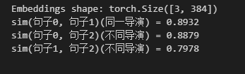
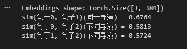

> 1


### tokenizer 在这里干了什么事？

针对这段代码：

```python
encoded_input = tokenizer(sentences, padding=True, truncation=True, return_tensors='pt')
print("encoded_input:",encoded_input)
print("encoded_input['attention_mask']:",encoded_input['attention_mask'])
print("encoded_input['input_ids']:",encoded_input['input_ids'])
print("encoded_input['token_type_ids']:",encoded_input['token_type_ids'])
```

**tokenizer 的工作可以分成 4 步：**

- **1. 文本 → token（分词+子词切分）**
  - 把原始句子：
    - `"我想看弗蘭克·達拉邦特的电影"`
    - `"推荐弗蘭克·達拉邦特导演的作品"`
  - 按模型的词表规则拆成一串 token（子词），比如类似：`[CLS] 我 想 看 弗 蘭 克 · … [SEP]`。

- **2. token → id（映射到词表索引）**
  - 每个 token 对应词表中的一个整数编号，形成 `input_ids`：
    - `encoded_input["input_ids"]` 是一个二维张量：`[batch_size, seq_len]`。

- **3. 生成 attention_mask（哪些位置是真实内容，哪些是 padding）**
  - 由于你设置了 `padding=True`，不同长度的句子会填充到同样的 `seq_len`。
  - `attention_mask` 用 1/0 标记：
    - 1：真实 token 位置
    - 0：补上的 padding 位置
  - 后面在 `mean_pooling` 里就是用这个 mask 来“只对真实 token 求平均”。

- **4. 生成 token_type_ids（区分句子 A/B，用于部分模型）**
  - 对于单句输入，通常全 0；
  - 对于句对任务（如句子对分类），可以用 0/1 区分哪部分是第一句、哪部分是第二句。
  - 你这里只是单句列表，所以主要是兼容模型接口，实际不会特别用到它。

总结一句话：  
**tokenizer 把原始中文句子变成模型能吃的“数字化输入”（`input_ids` + `attention_mask` + `token_type_ids`），然后模型再基于这些数字算出每个 token 的向量，最后你用 `mean_pooling` 把它们汇成句向量。**


#### 结果分析

> ### 结论：**这个结果“有点问题”，但不一定是代码错了**
>
> 按直觉你期望：同一导演的两句话更相似，即 `sim(0,1)` 应该最大。  
> 但你跑出来是：
>
> - `sim(0,1)=0.6989`
> - `sim(0,2)=0.7166`（反而更高）
> - `sim(1,2)=0.3476`
>
> 这说明：**句子0（“我想看X的电影”）对“我想看周星驰的电影”也很像**，因为它们的句式几乎相同，模型把“我想看…的电影”这个意图/模板当成了主要语义；人名差异被弱化了。
>
> 所以问题更像是：**测试样例不够“区分模板 vs 实体”**，而不是 embedding 流程错误。
>
> ---
>
> ### 为什么会这样（关键原因）
>
> - 句子0 和 句子2 的结构完全一致：`我想看 + [人名] + 的电影`  
>   对很多通用句向量模型来说，“我想看…电影”这个意图信号很强。
> - `paraphrase-multilingual-MiniLM-L12-v2` 这类通用模型，未必把“人名实体”当成最强特征（尤其在短句里）。
>
> ---
>
> ### 接下来怎么验证才更靠谱（你该测试什么）
>
> 把句子改成**只保留实体对比**或**减少模板重复**，比如：
>
> - A：`"导演：弗蘭克·達拉邦特"`
> - B：`"弗蘭克·達拉邦特 导演"`
> - C：`"导演：周星驰"`
>
> 或者：
>
> - A：`"弗蘭克·達拉邦特 导演的电影有哪些"`
> - B：`"推荐一些达拉邦特导演作品"`
> - C：`"周星驰 导演的电影有哪些"`
>
> 这类句子会让“导演名”成为更主要的信号，通常就会看到 `sim(A,B) > sim(A,C)`。
>
> ---
>
> ### 对你的 RAG 设计意味着什么
>
> 这也解释了为什么我前面建议你把电影 chunk 组织成中文标签文本（如“导演：xxx”）——  
> 当 query 写“导演：弗蘭克·達拉邦特”或“弗蘭克·達拉邦特 导演”，和 chunk 中的“导演：xxx”匹配会更稳定；同时你也可以在应用层做一点轻量 query 规范化（比如把“导演”关键词显式加进去），进一步提高导演类检索准确率。****

#### 测试样例不够“区分模板 vs 实体”

#### 句子0 和 句子2 的结构完全一致：`我想看 + [人名] + 的电影` 

#### 在短句里

`paraphrase-multilingual-MiniLM-L12-v2` 这类通用模型，未必把“人名实体”当成最强特征（尤其在短句里）

> ### 不是“模型坏了”，更像是**测试方式在考它不擅长的东西**
>
> 你这组测试里，`sentenceC = "周星驰"` **太短、信息太少**，对句向量模型来说往往会变成一个很“模糊/泛化”的点；而 `sentenceA/B` 带了“导演”这种职业词，模型可能把它们都拉到“人物/影视相关”的语义区域里，导致 **不同名字之间也可能很近**，出现 `sim(A,C)` 反而更高的情况。
>
> 这类 **通用 paraphrase 句向量模型**（`paraphrase-multilingual-MiniLM-L12-v2`）通常更擅长：
> - 句子意图、语义改写相似（paraphrase）
> 而不擅长：
> - 仅靠**人名实体**做“同名更近、不同名更远”的严格聚类（这更像实体检索/字面匹配任务）。
>
> 所以：**这个结果不足以证明模型有问题**，只能说明“用它做纯人名相似度判断不稳定”。
>
> ---
>
> ### 你该怎么测才更合理（建议你立刻换这两类测试）
>
> #### A. 控制变量：两边都用同样模板、只换导演名
> 这样能避免“短句太模糊”的问题：
>
> - A：`"导演：弗蘭克·達拉邦特"`
> - B：`"导演：周星驰"`
> - C：`"导演：克里斯托弗·诺兰"`
>
> 你希望看到的是：A 跟 B/C **不要都很高**（至少不要出现反直觉的极端高相似）。
>
> #### B. 贴近你真实 RAG：让 query/文档都包含“导演标签 + 电影语境”
> 比如：
>
> - Query：`"我想看 导演：弗蘭克·達拉邦特 的电影"`
> - Doc1：`"标题：…\n导演：弗蘭克·達拉邦特\n剧情：…"`
> - Doc2：`"标题：…\n导演：周星驰\n剧情：…"`
>
> 这才是你系统真正会发生的匹配形态。
>
> ---
>
> ### 实战建议（很重要）
>
> 如果你的需求是“按导演找电影”，**最佳实践不是完全依赖向量相似度**，而是：
>
> - **把 `director` 存为 metadata**（你已经有这个字段）
> - 查询时：
>   - 先做一个**简单的导演名抽取/匹配**（甚至就是字符串包含）
>   - 用 metadata 过滤候选集（director == X）
>   - 再用向量检索对剧情/类型做排序
>
> 这样“导演类查询”会稳定得多，也更符合用户预期。
>
> 如果你愿意，我可以下一步直接帮你在检索逻辑里加一个小的“导演过滤”分支：当 query 里出现“导演/导演：”时，优先走 metadata 过滤 + 向量排序的混合检索。

##### 我进行了长自然语言的测试，

 这样相似度也高很多， 似乎就是和你说的结构一样的原因吗？所以是不是 这个模型其实不适合我这个系统（因为我的数据都是json转出的）

```python
SENTENCE_A = '''
作品编号：HUNTC-001影片标题：肖申克的救赎！经典纪念版！希望与自由的故事！只要坚持信念，即使身处监狱也能找到属于自己的救赎！系列名称：肖申克的救赎！导演：弗兰克・达拉邦特片长：220 分钟制作公司：Castle Rock Entertainment发行公司：华纳兄弟发行日期：2023-11-10类型标签：励志、经典电影、监狱题材、友情、希望、逃狱、高画质
剧情简介：1947 年，银行家安迪・杜弗伦因涉嫌谋杀妻子及其情人被判无期徒刑，进入肖申克州立监狱服刑。他在狱中结识了资深囚犯瑞德，两人逐渐成为挚友。安迪利用自己的金融才能帮助监狱人员，同时默默坚持内心的希望与自由梦想，面对残酷的监狱环境与腐败制度，他一步步策划属于自己的救赎之路。最终，这部经典作品传达出『希望是件好事，也许是人间至善』的深刻主题。
'''

SENTENCE_B = '''
作品编号：FRANK-002影片标题：绿里奇迹！弗兰克・达拉邦特经典之作！关于人性、慈悲与奇迹的深刻寓言！系列名称：绿里奇迹导演：弗兰克・达拉邦特片长：185 分钟制作公司：Castle Rock Entertainment发行公司：华纳兄弟发行日期：2023-12-05类型标签：剧情、奇幻、人性、救赎、经典、监狱
剧情简介：1932 年，冷山监狱死囚区的狱长保罗，遇到了拥有神秘治愈能力的大块头黑人约翰・科菲。他虽被指控犯下残忍罪行，内心却善良纯净。在死囚区的日子里，约翰用奇迹般的力量温暖了身边的人，也让保罗开始重新思考生命、罪恶与救赎。影片以温柔又沉重的方式，探讨人性善恶与世间的无奈与慈悲。
'''

SENTENCE_C = '''
作品编号：STEPHEN-001影片标题：功夫！周星驰巅峰之作！无厘头与武侠的完美结合！笑中带泪的经典传奇！系列名称：功夫导演：周星驰片长：100 分钟制作公司：星辉海外有限公司发行公司：华纳兄弟发行日期：2024-01-15类型标签：喜剧、动作、武侠、无厘头、经典、励志
剧情简介：街头小混混星仔一心想加入斧头帮，却阴差阳错闯入了藏龙卧虎的猪龙城寨。这里看似平凡的居民，个个都是隐世高手。星仔在一次次闹剧与危机中，逐渐认清善恶，找回内心的正义，最终领悟武学真谛，成为真正的绝世高手，用功夫守护身边的人。影片将无厘头喜剧与武侠精神完美融合，成为经典。
'''
```




> ### 是的，主要就是“结构相似”在主导相似度
>
> 你这三段长文本（A/B/C）都有大量相同结构与共同词汇，比如：
>
> - 固定模板字段：`作品编号/影片标题/系列名称/导演/片长/制作公司/发行公司/发行日期/类型标签/剧情简介`
> - 大量共有概念词：`经典、监狱、救赎、剧情简介…`
> - 甚至 A/B/C 都出现了“华纳兄弟”等一致信息
>
> 在句向量模型里，这会让三段文本的整体语义非常接近，所以：
>
> - `sim(A,B)` 很高（同导演 + 同题材更高）
> - 但 `sim(A,C)` 也会很高（模板 + 电影领域词汇大量重叠），**导演不同并不会把它们拉开太多**
>
> 这不是你代码的问题，而是“把一条电影记录变成一大段模板化文本”时的典型现象。
>
> ---
>
> ### 这是否说明模型不适合你的系统？
>
> **不等于不适合。**  
> 它更准确地说明：你需要把“相似度要表达的重点”设计出来，而不是让模板噪音占主导。
>
> 你的数据来自 JSON 并不天然有问题，问题在于你把 JSON 转成 text 时：
>
> - 如果把太多**结构化字段**（发行公司、编号、时长、日期、模板标签）都塞进 embedding text  
>   → 会让向量主要表达“这是一段电影条目信息”，而不是“这部电影的独特内容”。
>
> ---
>
> ### 对你这种电影 RAG，推荐怎么做（最关键的改法）
>
> - **embedding text 只放“能区分电影内容”的字段**：
>   - `title`
>   - `plot`（核心）
>   - `genre`（适量）
>   - 可选：`director` / `serial`（如果你确实要靠语义检索导演/系列）
> - **其它字段做 metadata，不进 embedding**：
>   - `publish_date、duration、producer、publisher、url、cover、编号…`
>
> 这样向量会更“内容化”，不同电影之间相似度会拉开。
>
> ---
>
> ### 导演检索的最佳实践（补一刀很实用）
>
> 如果你的 query 经常是“我想看某某导演的电影”，**不要只靠向量相似度**，而是：
>
> - `director` 存 metadata
> - query 里识别出导演名后：
>   - **先 metadata 过滤 director==X**
>   - 再用向量对 `plot/title/genre` 做排序
>
> 这样导演查询会非常稳，而且不受“模板相似度”干扰。
>
> ---
>
> 如果你愿意，我可以下一步直接帮你改一处关键代码：在索引时构造 embedding 文本时**只使用 title/plot/genre/director**（其余进 metadata），并给你一组“导演查询”和“剧情查询”的对比测试。

###### **需要把“相似度要表达的重点”设计**

```python
SENTENCE_A = '''
肖申克的救贖！經典紀念版！希望與自由的故事！只要堅持信念，即使身處監獄也能找到屬於自己的救贖！1947 年，銀行家安迪被冤入獄，在肖申克監獄中憑藉智慧與堅韌，堅守希望，最終完成自我救贖，詮釋「希望是人間至善」。
'''

SENTENCE_B = '''
绿里奇迹！弗蘭克・達拉邦特經典之作！關於人性、慈悲與奇蹟的深刻寓言！1932 年死囚監獄中，擁有神奇治癒能力的黑人科菲，用善良與奇蹟感化眾人，探討生命、罪惡與慈悲。'''

SENTENCE_C = '''
功夫！周星馳巔峰之作！無厘頭與武俠的完美結合！笑中帶淚的經典傳奇！小混混星仔陰差陽錯闖入臥虎藏龍的豬籠城寨，在經歷成長後找回正義，成為絕世高手守護身邊之人。
'''

```



> 

### 结构数据写成metadata 

```
doc = {
  "id": "HUNTC-001",
  "text": "标题：...\n导演：...\n类型：...\n剧情：...",
  "metadata": {
    "dvdid": "HUNTC-001",
    "director": "弗蘭克·達拉邦特",
    "genre": ["励志","经典电影","监狱题材"],
    "publish_date": "2023-11-10",
    "duration": 220,
    "serial": "肖申克的救赎",
    "site": "__merged__",
    "url": None,
    "cover": "https://..."
  }
}
```


# Milvus 

> ### 建议在 milvus.ipynb 顶部加一个“环境初始化”cell
>
> 放在所有 from src... 导入之前，内容类似：
>
> import sys
>
> from pathlib import Path
>
> \# 项目根目录（按你的实际路径修改）
>
> PROJECT_ROOT = Path(r"F:\myproject\java_rag")
>
> \# 切到项目根目录（可选，但推荐）
>
> %cd $PROJECT_ROOT
>
> \# 把项目根目录加入 sys.path，确保可以 import src.*
>
> if str(PROJECT_ROOT) not in sys.path:
>
>   sys.path.insert(0, str(PROJECT_ROOT))
>
> print("cwd:", Path.cwd())
>
> print("sys.path[0]:", sys.path[0])
>


### 为什么会报 collection not loaded？

Milvus（尤其是连接到服务模式时）集合创建/插入 ≠ 集合已加载到内存。

如果集合没 load，直接 search 就会报你看到的错误：

- failed to search: collection not loaded


> ### 为什么会报 index not found，导致 load 失败？
>
> 你现在连的是 Milvus 服务端（Docker 里的 2.6.12）。在这种模式下，load_collection 通常要求集合的向量字段已经有索引；但我们创建 collection 时只是建了 schema，没有创建向量索引，所以服务端直接报：
>
> - MilvusException (code=700): index not found[collection=movies]
>
> 这不是连接失败，是 集合没 index → 不能 load → 后续 search 也会失败。
>
> ------
>
> ### 我已经在项目里修复：自动创建向量索引再 load
>
> 我在 src/utils/milvus_store.py 增加了 _ensure_index()，并在：
>
> - 创建集合后 load 前
>
> - 已存在集合 load 前
>
> - insert 后 load 前
>
> - search 前兜底 load 前
>
> 都会先调用 _ensure_index()，确保至少对 vector 字段建了 AUTOINDEX + COSINE 索引。
>
> 你现在重新跑 notebook 时，流程会变成：
>
> 1. create_collection(schema)
>
> 1. create_index(field="vector")
>
> 1. load_collection()
>
> 1. insert / search 就能正常跑

### query 文本里“肖申克的救贖”是繁体

你 query 明确提到“肖申克的救赎”，所以 HUNTC-001 更应该靠前。出现 FRANK-002 更靠前的原因常见有两种：

1) query 文本里“肖申克的救贖”是繁体，而 HUNTC-001 标题里也是繁体，但 BERT 类模型对“特定片名”的区分不一定强；
2) 两部片都有“经典/达拉邦特/监狱/救赎”等强特征，且你的 query 还带了“经典纪念版电影”这种泛化词，可能把检索偏向“达拉邦特经典作品”而不是“精确片名”。


#### Milvus 打印出来的“相似度 > 1”

- 这其实是 distance（距离） 的典型范围（COSINE distance 通常在 0~2），所以出现 1.1294 并不奇怪。

- 越小越相近，不是越大越相近。


## 长度限制

###  1024和2048有什么区别

- 存储与内存开销

  - 上限越大，Milvus 为该列预留/管理的空间、以及 segment/缓存相关开销通常越高。

  - 但注意：只有当你实际写入的字符串更长时，整体数据量才会明显增加；如果大多数 title 仍很短，差异不一定很明显。

- 写入/查询传输成本

  - 返回结果里如果包含这个字段，字符串更长会让网络传输更大，序列化/反序列化更慢。

  - 这对“只做向量检索、只需要 id/少量元数据”的场景是纯负担。

- 检索相关能力

  - max_length 变大不会提升向量召回效果；向量检索主要看 embedding 与向量索引。

  - 只有当你需要在 Milvus 里做基于该字段的过滤/输出展示时，才有意义。


## 因为 query 太短?

> ### Query 语义不足
>
> 用户输入：
>
> ```
> school
> ```
>
> 系统不知道用户想找：
>
> - school romance
> - school horror
> - school documentary
> - school drama
>
> 所以：
>
> **召回会比较泛**。
>
> 解决方法有 3 种。
>
> ------
>
> # 5 方法一（最推荐）：Query Rewrite
>
> 先让 LLM 扩展 query。
>
> 例如：
>
> ```
> school and students
> ```
>
> rewrite 成：
>
> ```
> movies about school life, students, classroom, teachers, and high school environment
> ```
>
> 再 embedding。
>
> RAG 中很常见：
>
> ```
> Query → Rewrite → Embedding → Vector search
> ```
>
> ------
>
> # 6 方法二：Hybrid Search
>
> 结合：
>
> ```
> vector search
> +
> keyword search
> ```
>
> 例如：
>
> ```
> school AND student
> ```
>
> 然后 rerank。
>
> 很多系统：
>
> - OpenAI retrieval
> - Cohere reranker
>
> 都是这样做。
>
> ------
>
> # 7 方法三：Reranker（工业级方案）
>
> 先：
>
> ```
> Milvus Top 50
> ```
>
> 然后：
>
> ```
> CrossEncoder rerank
> ```
>
> 例如模型：
>
> - bge-reranker-large
> - ms-marco-MiniLM-L-12-v2
>
> 流程：
>
> ```
> query
>    ↓
> embedding
>    ↓
> Milvus top50
>    ↓
> reranker
>    ↓
> top5
> ```
>
> 效果会好很多。


## 可以把插入改成 upsert

（如果你当前 pymilvus 版本支持）或先按 ident 删除再插入。


# RAG 

## 数据利用

| 字段    | 用途        |
| ------- | ----------- |
| title   | keyword搜索 |
| genre   | filter      |
| plot    | RAG展示     |
| rewrite | embedding   |


## 查询方式

### 1 向量化直接查询(title+plot ) ❌

queries = [

  "监狱逃脱的经典电影",

  "弗兰克·达拉邦特 拍的电影",

  "无厘头喜剧 功夫打斗",

  "看完很感动 想哭的电影",

]

**结果分析:** 

```bash
查询结果

Query: 监狱逃脱的经典电影
  score=0.647, title=越狱协议！真实事件改编！从华尔街精英到监狱囚徒的救赎！, director=马库斯·高勒
  score=0.644, title=肖申克的救贖！經典紀念版！希望與自由的故事！只要堅持信念，即使身處監獄也能找到屬於自己的救贖！, director=弗蘭克·達拉邦特
  score=0.624, title=绿里奇迹！弗兰克·达拉邦特经典之作！关于人性、慈悲与奇迹的深刻寓言！, director=弗蘭克·達拉邦特
  score=0.591, title=记忆碎片！诺兰封神之作！全程反转不停的烧脑悬疑神片！, director=克里斯托弗·诺兰
  score=0.577, title=未知死亡！全程反转动作神作！燃到炸裂的复仇与救赎！, director=A.R.目虏古多斯
------------------------------------------------------------
Query: 弗兰克·达拉邦特 拍的电影
  score=0.573, title=前目的地！极致烧脑神作！反转到最后一秒的时空悬疑大片！, director=迈克尔·斯派瑞
  score=0.511, title=乌云背后的幸福线！治愈系爱情！在破碎人生中彼此照亮！, director=大卫·O·拉塞尔
  score=0.503, title=拯救大兵瑞恩！影史最强战争片！真实残酷战场与人性光辉！, director=史蒂文·斯皮尔伯格
  score=0.502, title=巴比伦！好莱坞黄金时代史诗！极致浪漫与疯狂的追梦故事！, director=达米恩·查泽雷
  score=0.485, title=黑客帝国！科幻片里程碑！影响一个时代的神级大作！, director=沃卓斯基姐妹
------------------------------------------------------------
Query: 无厘头喜剧 功夫打斗
  score=0.619, title=小丑！封神级神作！深刻揭露社会与人性的黑暗神片！, director=托德·菲利普斯
  score=0.528, title=赌圣！周星驰成名之作！无厘头喜剧开山之作！爆笑又经典！, director=周星馳、劉鎮偉
  score=0.500, title=夏洛特的网！治愈所有人的童话！友谊与生命的最美赞歌！, director=盖瑞·温尼克
  score=0.495, title=V字仇杀队！震撼灵魂的科幻神作！为自由与人性而战！, director=詹姆斯·麥提格
  score=0.491, title=阿甘正传！影史第一神作！人生就像一盒巧克力，永远充满希望！, director=羅伯特·澤米吉斯
------------------------------------------------------------
Query: 看完很感动 想哭的电影
  score=0.535, title=机器人总动员！零台词却看哭无数人！最治愈的科幻动画神作！, director=安德鲁·斯坦顿
  score=0.519, title=美丽人生！奥斯卡经典！父爱与勇气的最美赞歌！笑着流泪的神作！, director=羅貝托·貝尼尼
  score=0.499, title=心灵捕手！治愈无数人的励志经典！天才与自我救赎的成长之路！, director=格斯·范·桑特
  score=0.493, title=V字仇杀队！震撼灵魂的科幻神作！为自由与人性而战！, director=詹姆斯·麥提格
  score=0.479, title=未知死亡！全程反转动作神作！燃到炸裂的复仇与救赎！, director=A.R.目虏古多斯
------------------------------------------------------------
```

> # 逐 Query 分析
>
> ## 1）Query：监狱逃脱的经典电影
>
> **结果：**
>
> - ✅ 正确：
>
>   - 肖申克的救赎（监狱、逃脱、经典）
>   - 越狱协议（监狱、救赎）
>   - 绿里奇迹（监狱、人性，但**无逃脱**）
>
>   
>
> - ❌ 错误：
>
>   - 记忆碎片、未知死亡：**完全不沾边**
>
> **问题：**
>
> - 把「救赎」和「逃脱」绑定太死
> - 没有过滤**监狱 / 逃脱**强意图
> - 绿里奇迹分数偏高，不合理
>
> ------
>
> ## 2）Query：弗兰克・达拉邦特 拍的电影
>
> **结果：全错**
>
> 一条他的电影都没返回。
>
> **问题（非常严重）：**
>
> - **导演字段完全没参与检索 / 过滤**
> - 系统只做语义泛化，不做实体匹配
> - 直接导致该意图**100% 失效**
>
> ------
>
> ## 3）Query：无厘头喜剧 功夫打斗
>
> **结果：**
>
> - ✅ 正确：
>   - 赌圣（周星驰无厘头）
> - ❌ 严重错误：
>   - 小丑排第一（完全不是喜剧、无功夫）
>   - 夏洛特的网、V 字仇杀队、阿甘正传：**全不匹配**
>
> **问题：**
>
> - 「无厘头」「功夫」**语义理解极弱**
> - 把情绪、主题、动作混在一起算分
> - 没有对「周星驰 + 无厘头 + 功夫」做强化
>
> ------
>
> ## 4）Query：看完很感动 想哭的电影
>
> **结果：整体最准**
>
> - ✅ 正确：
>   - 机器人总动员
>   - 美丽人生
>   - 心灵捕手
> - ⚠️ 勉强：V 字仇杀队、未知死亡（偏燃 / 震撼，不算催泪）
>
> **问题：**
>
> - 「感动想哭」这种**情感意图**识别最好
> - 但仍混入偏动作 / 悬疑的片


### 2 基于 metadata 先过滤导演，再做向量检索


### 3 混合索引 ✔️

倒排序+向量查询

- 用关键词引擎（BM25）召回 topN（例如 200）

- 重排（Rerank）：

- 再用向量相似度 / cross-encoder / LLM rerank 把 topN 排序成 topK

实现

- 多字段加权索引（比如 title 权重更高）

- 简单 metadata 过滤（等值/包含/自定义函数）

- 默认 tokenizer：


## 结果测试与改进措施

1. 向量结果不理想
2. 倒排序还行

从之前的测试来看：

- 纯向量搜索效果差 → 因为 embedding 质量低 + 噪声多。
- BM25 在 title 上很强。
- Hybrid 目前拉跨 → 很大概率是因为 embedding（title+plot）质量不高，导致向量分数拖累了 BM25 的好信号。

### 1 针对embedd

>  title + plot 简单拼接（甚至不加分隔符）容易出现以下问题：
>
> - **噪声干扰**：JAV title 极长、重复、堆砌色情词；plot 也很啰嗦、重复标题内容。模型容易把注意力分散到无关高频词（busty、creampie、virgin 等）上，而不是核心主题（“定額挿れ放題 + school”）。
> - **长度问题**：很多 embedding 模型有上下文长度限制（e.g. 512 tokens），长拼接可能被截断。

尝试使用除了title + plot 的其他组合, 但是效果一般, 除了带gene有提升

#### 1.0 更换embed模型  ✔️ 

之前的模型对语义理解不好更换: 


#### 1.1 vector过长?  ❌

并没有. 只有一条数据, 过长而已, 更换策略有未出现该问题

```bat
Token indices sequence length is longer than the specified maximum sequence length for this model (2016 > 512). Running this sequence through the model will result in indexing errors
```


#### 1.2 **用LLM 生成专用 embedding 文本**： ✔️ 

> - 输入：title + plot + genre 等
> - 输出：一段**简洁、去噪、突出主题**的自然语言描述，例如 “定額挿れ放題系列 学校版 男学生可以无限制插入班上女学生和女教师 10人大规模拍摄 中出 多P 高清”

##### 结果

**使用llm生成预览,避免噪声**, 效果好


#### 1.3 **内容特化处理 **❌

> 构建一个**主题ontology**（unlimited-fixed-price系列、teacher-student、school-life等），做query **rewriting**或分类路由。

这种其实没必要, 可以采用关键词搜索, 不需要再向量搜索里使用


#### 1.4 多向量（Multi-vector）策略 ✔️ 

：在 Milvus 中存两个向量

> - 一个 embed(title + serial)
> - 一个 embed(plot summary)
> - 查询时做 multi-vector hybrid search

把 Milvus collection schema 扩展成 两个向量字段（比如 vector_title_genre 和 vector_plot），并把 add_movies/search 支持指定字段（或一次写入两套向量）。

效果比较好, 虽然可能增加延迟, 但是增加了准确性

##### 结果

1. 初步看是有提升的, 至少q4现在能查询到
2. 但是还有有些不足, 比如第一名分数不是很相关
3. **title效果, 似乎真的比plot好用**

#### 1.5 无关信息污染 ✔️

营销标题污染, 

#### 1.6 语义漂移

query: 通过智慧越狱

 在捕捉 “智慧”

> 输出:
>
> ```
> 赌圣
> plot: 用智慧与赌术对抗邪恶势力
> ```


#### 1.7 最终 Embed 格式参考

**核心原则**：

- 高信息密度 ✔️ 
- 突出系列名 +  ~~核心角色关系 +关键标签~~  (核心角色关系+标签句子总结)
- 严格控制长度，去除营销废话 ✔️ 
- 使用 /分隔，让模型更容易理解结构 ✔️ 

##### 结果

1. 初步看是有提升的, 至少q4现在能查询到

**为什么这个格式更好？**

- **信息密度高**：把最重要的信号（系列、角色关系、标签）放在最前面。
- **噪声极低**：去掉了 rating、aroma、dripping wet 等**营销废话**。
- **结构清晰**： 分隔让模型更容易学习不同部分的重要性。
- **对 Query Rewriting 友好**：当你 rewrite 成 教師 生徒 性交 男教師 女學生 时，能和文档向量更好地对齐。


### 2 针对rewriting

# TODO 2.1 llm 对用户query扩充语义

> ### 
>

#### 2.2  rewrite embed

> ### 最终版 Embedding 文本格式（强烈建议采用）
>
> 使用一个小 LLM（甚至 7B~14B 的本地模型即可）把每条数据处理成下面这种**简洁、高信息密度**的格式：
>
> text
>
> ```
> 定額挿れ放題系列 学校版 男学生可无限制插入女学生和女教师 10人大规模拍摄 中出 滥交 高清
> 
> 乱伦 姐弟 兄妹浴室洗澡 秘密性关系 从小一起洗澡 长大后发生性行为 高清
> 
> NTR 按摩 药媚 婚前情侣 女友被隔壁按摩师中出 男友被迫观看 单向镜 巨乳按摩师 生中出 高清
> ```
>
> ### 具体 Prompt（可直接使用）
>
> Python
>
> ```
> prompt = """
> 你是一个专业的 JAV 视频元数据提炼专家。请将以下信息浓缩成**一句话**的 embedding 文本。
> 要求：
> - 优先保留系列名（如定額挿れ放題、Magic Mirror、Hunter等）
> - 突出核心玩法、关系、场景（学校、教师、学生、乱伦、NTR、按摩、浴室等）
> - 必须包含主要标签（中出、滥交、单体、药媚、出轨、高清等）
> - 语言精炼，总长度控制在 80~150 字以内
> - 使用中文和日文混合，关键词尽量靠前
> - 不要加入任何评价、评分、营销词
> 
> genre: {genre}
> title: {title}
> plot: {plot}
> 
> 请直接输出提炼后的一行文本，不要加任何解释：
> """
> ```
>
> ### 实际处理后的推荐示例（按你的三条数据）
>
> **第1条（推荐输出）：**
>
> text
>
> ```
> 定額挿れ放題系列 学校版 男学生无限制插入女学生和女教师 10人大规模 中出 滥交 多P 高清
> ```
>
> **第2条（推荐输出）：**
>
> text
>
> ```
> 乱伦 兄妹 姐弟浴室洗澡 从小一起洗澡 长大后秘密性交 近亲相奸 高清
> ```
>
> **第3条（推荐输出）：**
>
> text
>
> ```
> Magic Mirror NTR 按摩 药媚 婚前情侣 女友被隔壁中出 男友单向镜被迫观看 巨乳按摩师 生中出 高清
> ```
>
> ------
>
> ### 实施建议
>
> 1. **立刻用上面 Prompt** 对全量数据重新生成 embedding 文本。
> 2. 把生成的结果存到一个新字段，例如 embed_text。
> 3. 用这个 embed_text 字段去生成向量（而不是原始 title+plot）。
> 4. 重新入库后，再跑一次你之前的 4 个 queries 测试 hybrid search。


#### 2.2.1 为什么拆分成一个个关键信息点?

> **向量嵌入（embedding）确实是基于“语义”的，但“语义”并不是你想象中那种“越长越自然越好”的完整段落。** 这正是很多人对 embedding 的最大误解。
>
> 让我用最直白的方式解释**为什么我们要把文本“拆分成一个个关键信息点”（或结构化、精炼成短句/关键词列表），而不是直接扔整段长文本**：
>
> ### 1. 向量模型的实际工作原理（不是魔法）
>
> - Embedding 模型（如你现在用的那个）会把输入文本**切成 token**（词或子词），然后计算每个 token 的重要性，并生成一个固定维度的向量。
>
> - 它的目标是：**让语义相近的内容在向量空间里距离更近**。
>
> - 但模型
>
>   注意力是有限的
>
>   （尤其是上下文长度限制在 512~8192 token 的模型）。如果输入文本又臭又长、充满重复和废话，它就会：
>
>   - 把注意力分散到无关的高频词上（比如“dripping wet”“musky aroma”“4.47 rating”“guaranteed to find the perfect”等营销废话）。
>   - 核心语义（“学校”“女学生”“女教師”“无限制插入”“定額挿れ放題”）被稀释，导致向量不够“尖锐”。
>
> 结果就是：**两个真正相关的 JAV 作品，向量相似度反而低**；而一些标题里堆了很多通用色情词的无关作品，反而分数更高。


### 3  针对metadata

#### 3.1 添加metadata查询✔️

效果不错, 过滤 导演 后准确率提升很多

#### 3.2 先metadata过滤再vector search ✔️

#### 3.3 metadata用于bm25查询 ✔️


### 4 Re-ranker

#### 4.1 加入 Re-ranker

召回 top 30~50 后，用 cross-encoder reranker 重新打分排序。 这通常能把最相关的学校版直接顶到 Top 1~3。

#### 4.2 为什么要用重排

向量检索有一个问题：

```
召回能力强
但排序能力弱
```

> 例如：
>
> query:
>
> ```
> 通过智慧越狱的电影
> ```
>
> 向量召回：
>
> ```
> 1 金蝉脱壳
> 2 监狱风云
> 3 肖申克的救赎
> 4 战争片
> 5 爱情片
> ```
>
> **Reranker 会重新排序**
>
> ```
> 1 肖申克的救赎
> 2 金蝉脱壳
> 3 监狱风云
> ```

# TODO 4.3 加入后效果


### 5 关键词搜索

#### 5.1 支持短语查询 

>  让 BM25 支持 "fixed price""unlimited sex" 等短语匹配，进一步提升精度。

#### 5.2 加入 genre / tags 过滤  ✔️

> 如果你的数据里有 genre 或 tags 字段（如 "school", "teacher"），可以增加 filter_eq 或 boost。

已经实现, 效果也不错


### 6 模型原因 

> 1. **Embedding 模型本身较弱**（最主要原因） 当前 embedder 对**细粒度剧情语义**（尤其是角色关系：teacher ↔ student sex）理解能力差。在 JAV 这个标题极度模板化、噪声极大的领域，表现尤其糟糕。
>
>    > ✔️ 已经有能力的提升, 目前对关键词搜索还可以; 但是还有待测试语义
>
> 2. **Embedding 文本构造极差** 你目前用的 genre + title 长文本，让模型学到了太多无关噪声，几乎无法突出 “教師與學生性交” 这个关键语义。
>
> 3. **缺少强信号字段** 你的数据里有 serial（系列名）、director、plot，但 embedding 时几乎8

向量模型**根本没有理解 “teacher sex with students” 这个特定禁忌关系**，而是把查询粗暴拆解成了 **“high school” + “sex” + “students”** 这几个高频词，然后匹配了任何带“高中/学校/学生”标签的作品。

#### 6.1 向量模型根本没有理解✔️

更换模型有确实有一定的提升, 

至少在文本匹配上, `定额`的成功率上升了. 效果明显

#### 6.2  Embedding 模型对特定语义的适配较弱❌

 大部分通用 embedding 模型（尤其是英文为主的）对 教師生徒性交、定額挿れ放題 这类高度特定、禁忌、公式化的日文 JAV 语义理解能力有限。


### 7 query

#### 7.1 query问题 

举个最直观的例子（用你关心的两个查询对比）：

- **Query A**： "Unlimited sex with anyone for a fixed price school students teachers" → 这句话关键词很明确，**BM25 能打得很准**，向量优势不大。
- **Query B**： "我想看老师和女学生偷偷在学校做爱的片子" 或 "A movie about high school teacher sex with his students" → 这时候**BM25 很容易失效**（因为标题里很少同时出现 “teacher sex with students” 这种精确组合），而**好的向量**能通过语义理解把“教师×学生性爱”这个隐含意图匹配出来。

#### 7.2 query rewrite ♾️


### 8 merge策略

#### 8.1 是什么

在**多路召回（Multi-Recall）**中，`Merge` 是：

> **把多个 Retriever 返回的候选结果融合成一个统一候选集合，并生成一个排序依据。**

####  8.2 merge策略

#### 最简单的：Union Merge（并集合并）

```
vector_docs + keyword_docs + sql_docs
```


#### Score Merge（分数融合）

把多个检索器的 score 加权。

公式：

```
score = α * vector_score + β * bm25_score
```

| doc  | vector | bm25 | final |
| ---- | ------ | ---- | ----- |
| A    | 0.8    | 2.1  | 1.2   |
| B    | 0.6    | 3.0  | 1.4   |

#### Rank Fusion（排序融合）

不使用 score，而是使用 **检索器中的排名**。

**Reciprocal Rank Fusion（RRF）**

公式：

```
score(d) = Σ 1 / (k + rank_i(d))
rank_i(d) = 文档在第 i 个检索器中的排名
```

| doc  | vector rank | bm25 rank | score |
| ---- | ----------- | --------- | ----- |
| A    | 1           | 5         | 高    |
| B    | 3           | 1         | 高    |
| C    | 10          | 2         | 中    |

#### Weighted Rank Fusion

RRF 的加权版本。

#### Interleaving（交叉合并）

轮流取结果。

#### Learning-to-Rank Merge（高级）

训练一个模型学习融合。


# 2026年4月14日

## query1:   \# 1. Theme/Plot category (testing semantic understanding)

### 1 写策略出现问题

首先是翻译的问题。

> "title": "Enjoy unlimited drinking with anyone for a fixed price!\"\n\nThis phrase, often used humorously, translates to: \"Unlimited sex with anyone for a fixed price!\"\n\nHere's a more natural-sounding translation of the original Japanese text:\n\n\"Even the most studious girls in my class, after their first drinking experience, become addicted to it! Thanks to my parents, who work and travel frequently, I, a student from ● High School, enjoy a carefree lifestyle while living alone. One day, after a test, I overheard rumors from some of the girls in my class about...",

> "title": "Unlimited sex with anyone for a fixed price! Having a hot, large-breasted older sister and cheating on her with 4 other women! We fight over each other's pussy while wearing sexy lingerie! I'm forced to have a relationship with my older sister because of irresistible attraction. And I'm doing it with 4 people at the same time!",

1. llm翻译冗余
2. llm翻译不出敏感词
3. llm prompt问题, 强制带了Unlimited sex with anyone for a fixed price!  


### 2 其次是rewrite验证错误

> "rewrite": "Unlimited sex with anyone for a fixed price, party, drunk student, classmates, multiple partners, uniform."

```

```


### 3 漏了HUNTA-878

> query :   "story of unlimited creampie with all female students and teachers after paying student council fee",
>
> HUNTA-878"rewrite": "School-wide unlimited sex with any female student or teacher for a fixed monthly fee, featuring harem and multiple partners in a school setting."


### 4 plot 参差不齐

> === vector_plot === 
>
> ------------------------------------------------------------
>
> ident: HSODA-034, similarity=0.6173, cosine_distance=0.3827 title: Implantation Organ: Aoi Nakajo genre: ["口交", "單體作品", "幻想", "水手服", "多P", "高中女生", "DMM獨家", "高畫質"] serial: None rewrite: Implantation Organ: Aoi Nakajo, near-future Japan, creampie sex, multiple partners, high school girls in sailor制服, Creampie Duty Law, high definition. plot: In near-future Japan, the country has become a super-aged society with drastically declining birth rates. To combat this, a Sex Education Committee establishes the "Creampie Duty Law" to promote procreation among students who've lost interest in sex! Selected as model cases, these girls become official sexual outlets for their education, learning the pleasures of internal ejaculation! They satisfy the desires of students and male teachers alike, taking endless loads morning, noon, and after school in relentless breeding gangbangs! A school life consumed by waves of furious creampie sex!
>
>  ------------------------------------------------------------ 
>
> ident: HUNTA-878, similarity=0.5951, cosine_distance=0.4049 title: Unlimited sex with anyone for a fixed price! As long as you pay a monthly fixed fee, you can have sex with any female students or female teachers within the school! genre: ["校服", "4小時以上作品", "學校作品", "高中女生", "中出", "ハーレム", "DMM獨家", "高畫質"] serial: だれとでも定額挿れ放題！ rewrite: School-wide unlimited sex with any female student or teacher for a fixed monthly fee, featuring harem and multiple partners in a school setting. plot: "Unlimited sex with anyone for a fixed price!" has been added to the new option: 'Unlimited Sex'! I heard about this from urban legends. There are actually schools that have systems like this... But I never thought it would be in *my* school! 'Unlimited Sex' is truly a dream system! As long as you pay a monthly fixed fee to the student council, you can have unlimited sex with any female student, or even that cute girl, or that super beautiful teacher, within the school! I'm so excited! I can't stop getting hard! 
>
> ------------------------------------------------------------

1. plot理解不足
2. rewrite有效果
3. 

### 5. rewrite分数偏差大

query: hospital fantasy where nurses and female patients can be fucked after payment 

```
=== vector_rewrite ===
------------------------------------------------------------
ident: HUNTB-063, similarity=0.6107, cosine_distance=0.3893
title: Unlimited sex with anyone for a fixed price! Hospital edition 2: As long as you pay a monthly fixed fee, you can have sex with any female staff, female patients, or anyone working in the hospital!
genre: ["高畫質", "DMM獨家", "女醫生", "护士", "女上位", "病院・クリニック", "企畫"]
serial: だれとでも定額挿れ放題！
rewrite: Hospital clinic unlimited sex service, paying monthly fee to have sex with any female staff, nurses, or patients, ejaculation inside.
plot: "Unlimited sex with anyone for a fixed price!" Hospital Edition Part 2 is finally here! We would like to inform all patients currently hospitalized at our clini ...
------------------------------------------------------------
ident: SDDE-316, similarity=0.6050, cosine_distance=0.3950
title: "Today, I can have 4P sex with a nurse from noon!" A hospital that grants patients' wishes once a month.
genre: ["高畫質", "护士", "企畫", "打手槍", "多P"]
serial: None
rewrite: Hospital granting patients' wishes once a month, 4P sex with nurse.
plot:  ...
------------------------------------------------------------
ident: HUNTA-939, similarity=0.6041, cosine_distance=0.3959
title: Unlimited sex with anyone for a fixed price! As long as you pay a monthly fixed fee, you can have sex with any female staff working in the hospital! You can also have it up and down! Patients who are admitted to our hospital…
genre: ["高畫質", "DMM獨家", "中出", "口交", "护士", "打手槍", "女醫生"]
serial: だれとでも定額挿れ放題！
rewrite: Hospital staff unlimited sex, patients can have vaginal ejaculation and oral sex with any nurse or doctor for a fixed monthly fee.
plot: We are offering a "pay-per-use" service for patients admitted to our hospital's internal medicine ward. This service allows patients to have unlimited sexual ac ...
------------------------------------------------------------
ident: SDDE-299, similarity=0.5644, cosine_distance=0.4356
title: (Behind the scenes) Hand-cooch clinic - Complete Edition - Sex clinic fan appreciation festival 2012 - Ultra luxurious! Special edition for the end of the year
genre: ["高畫質", "护士", "企畫", "打手槍"]
serial: （裏）手コキクリニック
rewrite: Nurse and patient engage in shotgun ejaculation in clinic, luxurious special edition for end of year
plot:  ...
------------------------------------------------------------
ident: SDDE-129, similarity=0.5596, cosine_distance=0.4404
title: (Back) Hand-Kuki Clinic – Complete Version – Sex Clinic Special
genre: ["女上位", "數位馬賽克", "护士", "打手槍", "合集"]
serial: （裏）手コキクリニック
rewrite: Nurse and women on top engage in shotgun sex in a clinic.
plot:  ...
```

正确应该是: HUNTB-063+ HUNTA-939

但都正确返回医院相关的, 基本能力可以

#### vector_plot  效果反而更好?

感觉是匹配的问题

```
=== vector_plot ===
------------------------------------------------------------
ident: HUNTB-063, similarity=0.6201, cosine_distance=0.3799
title: Unlimited sex with anyone for a fixed price! Hospital edition 2: As long as you pay a monthly fixed fee, you can have sex with any female staff, female patients, or anyone working in the hospital!
genre: ["高畫質", "DMM獨家", "女醫生", "护士", "女上位", "病院・クリニック", "企畫"]
serial: だれとでも定額挿れ放題！
rewrite: Hospital clinic unlimited sex service, paying monthly fee to have sex with any female staff, nurses, or patients, ejaculation inside.
plot: "Unlimited sex with anyone for a fixed price!" Hospital Edition Part 2 is finally here! We would like to inform all patients currently hospitalized at our clini ...
------------------------------------------------------------
ident: HUNTA-939, similarity=0.5953, cosine_distance=0.4047
title: Unlimited sex with anyone for a fixed price! As long as you pay a monthly fixed fee, you can have sex with any female staff working in the hospital! You can also have it up and down! Patients who are admitted to our hospital…
genre: ["高畫質", "DMM獨家", "中出", "口交", "护士", "打手槍", "女醫生"]
serial: だれとでも定額挿れ放題！
rewrite: Hospital staff unlimited sex, patients can have vaginal ejaculation and oral sex with any nurse or doctor for a fixed monthly fee.
plot: We are offering a "pay-per-use" service for patients admitted to our hospital's internal medicine ward. This service allows patients to have unlimited sexual ac ...
------------------------------------------------------------
ident: HUNTB-476, similarity=0.5658, cosine_distance=0.4342
title: Having sex with unsatisfied nurses and multiple orgasms with them! A way for busy nurses to relax, featuring the ultimate "C" and "P" experience. Surrounded by nurses, daily "harems" with hand and finger stimulation.
genre: ["濫交", "中出", "ハーレム", "口交", "花癡", "DMM獨家", "高畫質"]
serial: None
rewrite: Nurses in hospital engage in group sex harem with multiple orgasms and oral sex, surrounded by sexual nurses harassing patients.
plot: I thought being in the hospital would be the most boring and awful experience ever. But that was before I actually ended up there. See, when I was in the hospit ...
------------------------------------------------------------
ident: HUNTB-742, similarity=0.5474, cosine_distance=0.4526
title: 20 or more times! If you get admitted, you'll become incredibly popular and have everyone wanting to have sex with you, leading to endless orgasms! Dedicated nurses visit your room constantly, leaving you no time to rest...
genre: ["高畫質", "DMM獨家", "濫交", "护士", "中出", "ハーレム"]
serial: 献身的な看護師たちがボクの病室を訪れて休む暇なく数珠繋ぎ
rewrite: Multiple nurses in hospital room engage in intense sexual activity with male patient, featuring over 20 ejaculations and harem-style interactions.
plot: Rude nurses come and go, visiting male patients and engaging in endless sexual activity. This is the second installment of a series featuring 6 nurses, one more ...
------------------------------------------------------------
ident: HUNTC-129, similarity=0.5201, cosine_distance=0.4799
title: Unlimited sex with anyone for a fixed price! Hotel Edition: Finally, a subscription hotel service where you can have as many nights and as many times as you want for a fixed monthly fee! Hotel staff, guests…
genre: ["女上位", "制服", "濫交", "口交", "多P", "DMM獨家", "高畫質"]
serial: だれとでも定額挿れ放題！
rewrite: Hotel subscription service allows unlimited sex with any staff or guest, featuring group sex, oral sex, and multiple partners in uniformed hotel setting.
plot: Sister… There's been an incident!! My workplace, the hotel, is being swept up in the times, and the number of subscribers using the subscription service has inc ...
====================
```


## 2026年4月14日 汇总

| Query 強度                            | 召回質量 | 主要偏差方向                 |
| ------------------------------------- | -------- | ---------------------------- |
| male teacher brutally rapes crying... | 極差     | 完全反轉為女教師/女學生主動  |
| teacher sex with female student...    | 較差     | 仍大幅偏向女教師或女學生主動 |
| 定額挿れ放題學校版                    | 優秀     | 精準命中系列作品             |


## 总结

```
                         User Query
                             │
                             ▼
                      Query Preprocess
                (clean / normalize / detect)
                             │
                             ▼
                     Query Understanding
             (intent detect / rewrite / expand)
                             │
                ┌────────────┼────────────┐
                │            │            │
                ▼            ▼            ▼
          Vector Query   Keyword Query   SQL Query
                │            │            │
                ▼            ▼            ▼

      ┌──────────────────────────────────────────┐
      │              Multi Recall                │
      │                                          │
      │  Vector Retriever   Keyword Retriever    │
      │  (Embedding)        (BM25 / Inverted)    │
      │                                          │
      │  SQL Retriever      Metadata Retriever   │
      │  (DB / Schema)      (tag / filter)       │
      └───────────────┬───────────────┬──────────┘
                      │               │
                      ▼               ▼
               Candidate Docs    Structured Data
                              │
                              ▼
                             Merge
                    (union / RRF / deduplicate)
                              │
                              ▼
                         Top-K Candidates
                              │
                              ▼
                           Reranker
                 (Cross Encoder / BGE Reranker)
                              │
                              ▼
                         Top-N Results
                              │
                              ▼
                     Context Compression
              (chunk select / summarization)
                              │
                              ▼
                        Prompt Builder
                   (system + context + query)
                              │
                              ▼
                             LLM
                              │
                              ▼
                            Answer
```


## 测试数据集

### 1. 怎么选?

| 维度         | 为什么重要                                                 | 怎么选                                                       |
| :----------- | :--------------------------------------------------------- | :----------------------------------------------------------- |
| 标题形态     | 你很多 `title` 带大量营销句，BM25/向量行为与「短标题」不同 | 长标题若干 + `serial` 很短若干 + 中英混排（若有）            |
| 实体可辨度   | 同导演多部、同类型同主题易混                               | 同一 `director` 至少 2～3 部；主题相近（如都带「監獄」「救贖」）各 1～2 部 |
| 类型覆盖     | 向量与关键词对不同 genre 敏感度不同                        | `genre` 里主类型尽量铺开（剧情/喜剧/动作/…），避免 80% 都是一种 |
| 文本长度     | `plot` 极短 vs 很长影响截断、chunk、BM25 字段长度          | 最短、最长各若干条                                           |
| 时间         | `publish_date` 分布若偏新或偏旧，过滤/排序可能偏置         | 按年份或季度分桶，每桶至少 1 部                              |
| 稀缺 vs 头部 | 冷门片检索更难；热门片易被相似片淹没                       | 各若干（不必严格比例，但两类都要有）                         |
| 数据干净度   | `plot` 空/极短、`genre` 空、字段异常                       | 若有，单独做「脏数据桶」各 1～2 条，看系统是否优雅降级       |

------

> queries = [
>
>  # 1. 主题/剧情类（测试语义理解）
>
> ​    "越狱的剧情",
> ​    "关于父爱和救赎的电影",
> ​    "讲末日灾难人类求生的故事",
> ​    "少年成长冒险的治愈动画",
> ​    "高智商犯罪反转的悬疑片",
>
>  # 2. 类型/风格类（测试 genre 匹配）
>
> ​    "推荐经典动作大片",
> ​    "搞笑解压的喜剧电影",
> ​    "适合全家看的治愈动画",
> ​    "紧张刺激的惊悚悬疑片",
> ​    "热血励志的运动电影",
>
>  # 3. 实体/导演/IP类（测试实体召回）
>
> ​    "宫崎骏有哪些好看的动画",
> ​    "周星驰的无厘头喜剧",
> ​    "漫威超级英雄系列",
> ​    "香港经典警匪电影",
> ​    "诺兰导演的科幻片",
>
>  # 4. 短标题/关键词类（测试 BM25）
>
> ​    "肖申克",
> ​    "千与千寻",
> ​    "无间道",
> ​    "速度与激情",
> ​    "哈利波特",
>
>  # 5. 长句自然query（测试向量语义）
>
> ​    "有没有讲监狱里人性和希望的电影",
> ​    "适合心情不好看的温暖治愈电影",
> ​    "特效震撼的怪兽科幻大片",
> ​    "反转很多结局猜不到的悬疑片",
> ​    "关于青春校园爱情的电影",
>
>  # 6. 泛化/模糊查询（测试泛化能力）
>
> ​    "好看的经典电影",
> ​    "高分必看动画",
> ​    "催泪感人的片子",
> ​    "硬核烧脑电影",
> ​    "江湖武侠动作片"
> ]
