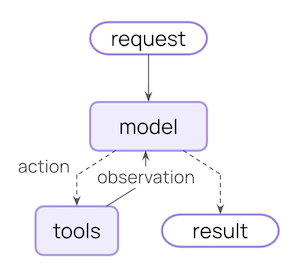
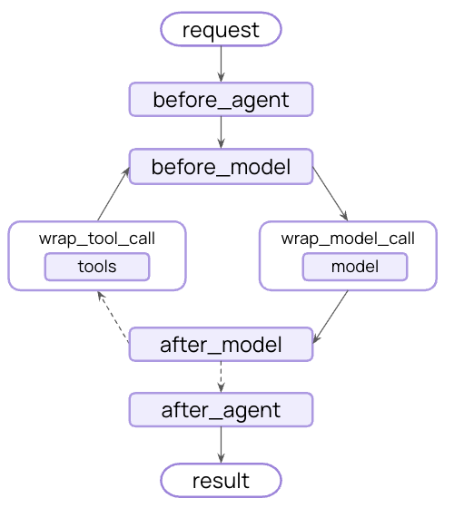
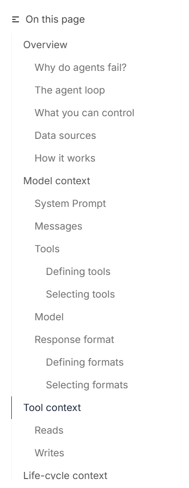

> 1

# 1 core

## 1 Agents


## 2 Models


### 2.5 with_structured_output

```python
from pydantic import BaseModel, Field

class Movie(BaseModel):
    """A movie with details."""
    title: str = Field(description="The title of the movie")
    year: int = Field(description="The year the movie was released")
    director: str = Field(description="The director of the movie")
    rating: float = Field(description="The movie's rating out of 10")

model_with_structure = model.with_structured_output(Movie)
response = model_with_structure.invoke("Provide details about the movie Inception")
print(response)  # Movie(title="Inception", year=2010, director="Christopher Nolan", rating=8.8)
```


## 3 Messages


### 3.3 如何使用

#### 1 Text prompts

```
response = model.invoke("Write a haiku about spring")
```

#### 2 Message prompts

```python
from langchain.messages import SystemMessage, HumanMessage, AIMessage

messages = [
    SystemMessage("You are a poetry expert"),
    HumanMessage("Write a haiku about spring"),
    AIMessage("Cherry blossoms bloom...")
]
response = model.invoke(messages)
```

#### 3 Dictionary format

```python
messages = [
    {"role": "system", "content": "You are a poetry expert"},
    {"role": "user", "content": "Write a haiku about spring"},
    {"role": "assistant", "content": "Cherry blossoms bloom..."}
]
response = model.invoke(messages)
```


### 3.4 TYPE

#### AI message

#####  Tool calls

####  Tool message

For models that support [tool calling](https://docs.langchain.com/oss/python/langchain/models#tool-calling), AI messages can contain tool calls. Tool messages are used to **pass the results of a single tool execution back** to the model.


### 3.5 LangChain content_blocks

LangChain为了统一不同模型格式，引入

#### 为什么有 content_blocks

因为不同模型格式完全不同：

OpenAI：

```
image_url
```

Anthropic：

```
image
```

Gemini：

```
inline_data
```

LangChain统一成：

```
content_blocks
```

然后自动转换。


## 4 TOOLS

### 4.3  Create tools

```python
@tool("calculator", description="Performs arithmetic calculations. Use this for any math problems.")
def calc(expression: str) -> str:
    """Evaluate mathematical expressions."""
    return str(eval(expression))
```


`tools.name`

`@tool(args_schema=WeatherInput)`


####  Tool return values

You can choose different return values for your tools:

- Return a `string` for human-readable results.
- Return an `object` for structured results the model should parse.
- Return a `Command` with optional message when you need to write to state.


### 4.4  [`ToolRuntime`](https://reference.langchain.com/python/langchain/tools/#langchain.tools.ToolRuntime)

#### 1 是什么

Context = Agent 运行时共享的数据

| Component         | Description                                                  | Use case                                            |
| :---------------- | :----------------------------------------------------------- | :-------------------------------------------------- |
| **State**         | Short-term memory - mutable data that exists for the current conversation (messages, counters, custom fields) | Access conversation history, track tool call counts |
| **Context**       | Immutable configuration passed at invocation time (user IDs, session info) | Personalize responses based on user identity        |
| **Store**         | Long-term memory - persistent data that survives across conversations | Save user preferences, maintain knowledge base      |
| **Stream Writer** | Emit real-time updates during tool execution                 | Show progress for long-running operations           |
| **Config**        | [`RunnableConfig`](https://reference.langchain.com/python/langchain-core/runnables/config/RunnableConfig) for the execution | Access callbacks, tags, and metadata                |
| **Tool Call ID**  | Unique identifier for the current tool invocation            | Correlate tool calls for logs and model invocations |

#### 2 为什么

很多时候 Tool 需要 **系统信息**，但这些信息 **不应该给 LLM**。

例如：

| 信息         | 应该给LLM吗 |
| ------------ | ----------- |
| 用户ID       | ❌           |
| 数据库连接   | ❌           |
| 权限信息     | ❌           |
| 请求trace_id | ❌           |
| 缓存对象     | ❌           |

但 Tool 又需要这些。

所以 LangChain 提供：

```
context
```

专门传 **运行时数据**。

#### 3 怎么做

##### 3.1 例子


```python
@tool
def query_orders(sql: str, runtime: ToolRuntime):	
    user_id = runtime.context["user_id"]

    sql = f"""
    SELECT *
    FROM orders
    WHERE user_id = {user_id}
    """

    return db.query(sql)
```

\# Access custom state fields

##### 3.2  (State)

```python
@tool
def get_user_preference(
    pref_name: str,
    runtime: ToolRuntime
) -> str:
    """Get a user preference value."""
    preferences = runtime.state.get("user_preferences", {})
    return preferences.get(pref_name, "Not set")
```

##### 3.3 Command: **`Update state`**

```python
from langgraph.types import Command
from langchain.tools import tool

@tool
def set_user_name(new_name: str) -> Command:
    """Set the user's name in the conversation state."""
    return Command(update={"user_name": new_name})
```


### 4.5 ToolNode

```python
# Create the ToolNode with your tools
tool_node = ToolNode([search, calculator])

# Use in a graph
builder = StateGraph(MessagesState)
builder.add_node("tools", tool_node)
```


#####  `tools_condition` 


## 5 Short-term memory

#### 1 执行流程

当你执行：

```
agent.invoke(
    {"messages": "hi"},
    config={"configurable": {"thread_id": "1"}}
)
```

LangGraph 的流程是：

```
1 读取 checkpoint
2 恢复 AgentState
3 执行 graph
4 更新 AgentState
5 写入 checkpoint
```

流程图：

```
invoke
 ↓
load checkpoint
 ↓
AgentState
 ↓
graph nodes
 ↓
new AgentState
 ↓
save checkpoint
```


### 5.3  Usage

> LangChain’s agent manages short-term memory as a part of your agent’s state.By storing these in the graph’s state, the agent can access the full context for a given conversation while maintaining separation between different threads.State is persisted to a database (or memory) using a checkpointer so the thread can be resumed at any time.Short-term **memory updates when the agent is invoked or a step (like a tool call) is completed,** and the state is read at the start of each step.

###  


### 5.4  Customizing agent memory

### 5.5  Common patterns

#### 1 为什么要 `RemoveMessage`

```
@before_model
def trim_messages(state: AgentState, runtime: Runtime) -> dict[str, Any] | None:
    """Keep only the last few messages to fit context window."""
    messages = state["messages"]

    if len(messages) <= 3:
        return None  # No changes needed

    first_msg = messages[0]
    recent_messages = messages[-3:] if len(messages) % 2 == 0 else messages[-4:]
    new_messages = [first_msg] + recent_messages

    return {
        "messages": [
            RemoveMessage(id=REMOVE_ALL_MESSAGES),
            *new_messages
        ]
    }
```

> ### 1 先理解 LangGraph 的 state 更新方式
>
> 在 **LangGraph** 里，节点函数 **不是直接替换 state**。
>
> 也就是说，你返回的不是：
>
> ```
> state = 新state
> ```
>
> 而是：
>
> ```
> 对 state 做哪些修改
> ```
>
> 可以理解为：
>
> ```
> patch / diff
> ```
>
> 就像 Git 的 patch。
>
> ------
>
> #### 2 一个简单例子
>
> 假设当前 state 是：
>
> ```
> messages = [
>   Human: hi
>   AI: hello
>   Human: how are you
> ]
> ```
>
> 如果你的函数返回：
>
> ```
> return {
>   "messages": [
>      Human: hi
>   ]
> }
> ```
>
> LangGraph 会理解为：
>
> ```
> 把这个 message 加到 messages 里
> ```
>
> 结果变成：
>
> ```
> messages = [
>   Human: hi
>   AI: hello
>   Human: how are you
>   Human: hi
> ]
> ```
>
> 注意：
>
> ```
> 旧消息不会被删除
> ```
>
> 因为：
>
> ```
> LangGraph 默认是 append
> ```
>
> ------
>
> #### 3 那怎么删除旧消息？
>
> LangGraph提供一个 **特殊指令 message**：
>
> ```
> RemoveMessage
> ```
>
> 例如：
>
> ```
> RemoveMessage(id=REMOVE_ALL_MESSAGES)
> ```
>
> 意思是：
>
> ```
> 先删除所有 messages
> ```

>  **Checkpoint** 和 **AgentState**。
>  其实它们的关系非常简单，可以一句话理解：
>
> > **AgentState = 当前运行状态**
> > **Checkpoint = AgentState 的持久化快照**
> >
> > **长期记忆放 store。**

### Before model

Access short term memory (state) in [`@before_model`](https://reference.langchain.com/python/langchain/agents/middleware/types/before_model) middleware to process messages before model calls.

> memory control

### After model

Access short term memory (state) in [`@after_model`](https://reference.langchain.com/python/langchain/agents/middleware/types/after_model) middleware to process messages after model calls.

> Remove messages containing sensitive words.

 # Routes to "tools" or END

# 2 Middleware






### 

## Wrap-style 本质：函数包装

### 1 是什么

核心思想其实是：

```
result = model(request)
```

变成：

```
result = middleware(model)(request)
```

也就是：

```
middleware
    ↓
调用 handler
    ↓
真正调用 model
```

LangChain 在执行 Agent 时，会把所有 middleware **嵌套包装**：

```
middleware1(
    middleware2(
        middleware3(
            model_call
        )
    )
)
```


### 2 为什么

#### 1 为什么要有 `request`

```
request: ModelRequest
```

`ModelRequest` 是 **模型调用的上下文对象**。

里面包含：

```
request.messages
request.model
request.temperature
request.stop
request.stream
```

例如：

```
print(request.messages[-1].content)
```

可以读取用户输入。

甚至可以修改：

```
request.temperature = 0.1
```

或者：

```
request.model = fast_model
```

所以 `request` 是 **模型调用的参数容器**。


#### 2 为什么要有 `handler`

> Callable[[ModelRequest]

```
handler: Callable[[ModelRequest], ModelResponse]
```

**`handler` 其实就是：**

```
下一层 middleware 或者真实模型
```

调用它就会继续执行。

结构是：

```
你的 hook
   ↓
handler(request)
   ↓
下一层 middleware
   ↓
最终 model
```

所以：

```
response = handler(request)
```

等价于：

```
真正执行模型调用
```


#### 3 为什么要return response 

把 middleware 想成 **洋葱结构**：

```
A
 └─ B
     └─ C
         └─ model
```

调用：

```
剥进去
A → B → C → model
```

返回：

```
再一层层出来
model → C → B → A
```


### 3 怎么用

| 能力         | Node-style | Wrap-style |
| ------------ | ---------- | ---------- |
| 日志         | ✔          | ✔          |
| 修改 state   | ✔          | ✔          |
| **retry**    | ✘          | ✔          |
| **缓存**     | ✘          | ✔          |
| **fallback** | ✘          | ✔          |
| **短路返回** | ✘          | ✔          |

#### 3.1 example

```
@wrap_model_call
def retry_model(request, handler):
    for attempt in range(3):
        try:
            return handler(request)
        except Exception:
            print("retry")
```


#### 3.2 agent 

```
from typing import Callable
import time

from langchain_openai import ChatOpenAI
from langchain_core.messages import HumanMessage
from langchain.agents import create_agent
from langchain.middleware import wrap_model_call
from langchain.schema.runnable import ModelRequest, ModelResponse


# ====================== middleware 1：日志 ======================
@wrap_model_call
def logging_middleware(request: ModelRequest, handler: Callable[[ModelRequest], ModelResponse]):
    print("LOGGING: before model call")
    print("User input:", request.messages[-1].content)

    response = handler(request)

    print("LOGGING: after model call")
    print("Model output:", response.output_text)

    return response


# ====================== middleware 2：计时 ======================
@wrap_model_call
def timer_middleware(request: ModelRequest, handler: Callable[[ModelRequest], ModelResponse]):
    print("TIMER: start")

    start = time.time()

    response = handler(request)

    duration = time.time() - start

    print(f"TIMER: model call took {duration:.3f}s")

    return response


# ====================== 初始化模型 ======================
model = ChatOpenAI(
    model="gpt-4o-mini",
    api_key="YOUR_API_KEY"
)

# ====================== 创建Agent ======================
agent = create_agent(
    model=model,
    tools=[],
    middleware=[
        logging_middleware,
        timer_middleware
    ]
)

# ====================== 调用 ======================
if __name__ == "__main__":
    result = agent.invoke(
        {"messages": [HumanMessage(content="LangChain middleware 是什么？")]}
    )

    print("\n最终返回：")
    print(result["messages"][-1].content)
```


# 3 


## 2 Runtime

LangGraph exposes a [`Runtime`](https://reference.langchain.com/python/langgraph/runtime/Runtime) object with the following information:

1. **Context**: static information like user id, db connections, or other dependencies for an agent invocation
2. **Store**: a [BaseStore](https://reference.langchain.com/python/langchain-core/stores/BaseStore) instance used for [long-term memory](https://docs.langchain.com/oss/python/langchain/long-term-memory)
3. **Stream writer**: an object used for streaming information via the `"custom"` stream mode

https://docs.langchain.com/oss/python/langchain/runtime

```
User question
     │
     ▼
Agent Run
     │
     └── Runtime (1个)
            │
            ├── ModelRequest #1
            │
            ├── Tool call
            │
            └── ModelRequest #2
```


### 2.1 Runtime[Context] 是什么

agent.invoke(...)
      │
      └── Runtime 创建
             │
             ├── context
             ├── store
             ├── stream_writer
             └── config

me

```python
from dataclasses import dataclass
from langchain.tools import tool, ToolRuntime  

@dataclass
class Context:
    user_id: str

@tool
def fetch_user_email_preferences(runtime: ToolRuntime[Context]) -> str:
    """Fetch the user's email preferences from the store."""
    user_id = runtime.context.user_id  

    preferences: str = "The user prefers you to write a brief and polite email."
    if runtime.store:
        if memory := runtime.store.get(("users",), user_id):
            preferences = memory.value["preferences"]

    return preferences
```

### 

### 2.2 ModelRequest 是什么

ModelRequest
   ├── messages
   ├── tools
   ├── model
   ├── temperature
   └── metadata
   └── runtime  ← 引用 Runtime

```python
from dataclasses import dataclass

from langchain.messages import AnyMessage
from langchain.agents import create_agent, AgentState
from langchain.agents.middleware import dynamic_prompt, ModelRequest, before_model, after_model
from langgraph.runtime import Runtime


@dataclass
class Context:
    user_name: str

# Dynamic prompts
@dynamic_prompt
def dynamic_system_prompt(request: ModelRequest) -> str:
    user_name = request.runtime.context.user_name  
    system_prompt = f"You are a helpful assistant. Address the user as {user_name}."
    return system_prompt

# Before model hook
@before_model
def log_before_model(state: AgentState, runtime: Runtime[Context]) -> dict | None:
    print(f"Processing request for user: {runtime.context.user_name}")
    return None

# After model hook
@after_model
def log_after_model(state: AgentState, runtime: Runtime[Context]) -> dict | None:
    print(f"Completed request for user: {runtime.context.user_name}")
    return None

agent = create_agent(
    model="gpt-5-nano",
    tools=[...],
    middleware=[dynamic_system_prompt, log_before_model, log_after_model],
    context_schema=Context
)

agent.invoke(
    {"messages": [{"role": "user", "content": "What's my name?"}]},
    context=Context(user_name="John Smith")
)
```


### 2.3 ToolRuntime是什么


## 3 Context engineering in agents

**Data sources**

Throughout this process, your agent accesses (reads / writes) different sources of data:

| Data Source         | Also Known As        | Scope               | Examples                                                     |
| :------------------ | :------------------- | :------------------ | :----------------------------------------------------------- |
| **Runtime Context** | Static configuration | Conversation-scoped | User ID, API keys, database connections, permissions, environment settings |
| **State**           | Short-term memory    | Conversation-scoped | Current messages, uploaded files, authentication status, tool results |
| **Store**           | Long-term memory     | Cross-conversation  | User preferences, extracted insights, memories, historical data |




## 5 Multi-agent ×


### 5.1 Why multi-agent?

When developers say they need “multi-agent,” they’re usually looking for one or more of these capabilities:

-  **Context management**: Provide specialized knowledge without overwhelming the model’s context window. If context were infinite and latency zero, you could dump all knowledge into a single prompt—but since it’s not, you need patterns to selectively surface relevant information.
-  **Distributed development**: Allow different teams to develop and maintain capabilities independently, composing them into a larger system with clear boundaries.
-  **Parallelization**: Spawn specialized workers for subtasks and execute them concurrently for faster results.


####  Patterns

Here are the main patterns for building multi-agent systems, each suited to different use cases:

| Pattern                                                      | How it works                                                 |
| :----------------------------------------------------------- | :----------------------------------------------------------- |
| [**Subagents**](https://docs.langchain.com/oss/python/langchain/multi-agent/subagents) | A main agent coordinates subagents as tools. All routing passes through the main agent, which decides when and how to invoke each subagent. |
| [**Handoffs**](https://docs.langchain.com/oss/python/langchain/multi-agent/handoffs) | Behavior changes dynamically based on state. Tool calls update a state variable that triggers routing or configuration changes, switching agents or adjusting the current agent’s tools and prompt. |
| [**Skills**](https://docs.langchain.com/oss/python/langchain/multi-agent/skills) | Specialized prompts and knowledge loaded on-demand. A single agent stays in control while loading context from skills as needed. |
| [**Router**](https://docs.langchain.com/oss/python/langchain/multi-agent/router) | A routing step classifies input and directs it to one or more specialized agents. Results are synthesized into a combined response. |
| [**Custom workflow**](https://docs.langchain.com/oss/python/langchain/multi-agent/custom-workflow) | Build bespoke execution flows with [LangGraph](https://docs.langchain.com/oss/python/langgraph/overview), mixing deterministic logic and agentic behavior. Embed other patterns as nodes in your workflow. |

> ### Subagents 架构
>
> ```
> User
>  ↓
> MainAgent
>  ↓
> Tool (SubAgent)
>  ↓
> MainAgent
>  ↓
> User
> ```
>
> 用户始终只和 **MainAgent** 说话。
>
> SubAgent只是工具。
>
> 
>
> ### handoff 架构
>
> ```
> User
>  ↓
> Agent A
>  ↓
> handoff
>  ↓
> Agent B
>  ↓
> User
> ```
>
> Agent B **接管对话**。
>
> 用户直接和 Agent B 聊。


### 5.3 Handoff 


```
# -----------------------------
# Handoff Tool
# -----------------------------
@tool
def transfer_to_refund() -> Command:
    """Transfer the conversation to the refund specialist."""
    
    return Command(
        goto="refund_agent",   # 切换 agent
    )
```


## 6 Retrieval


## 7 Long-term memory
