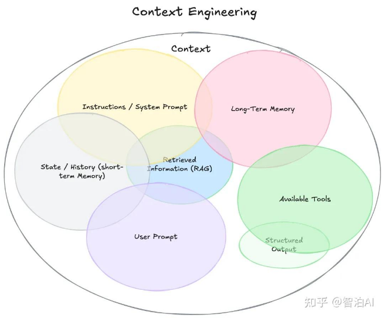
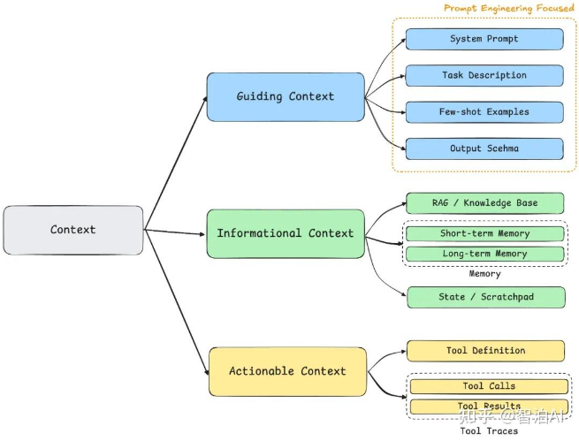
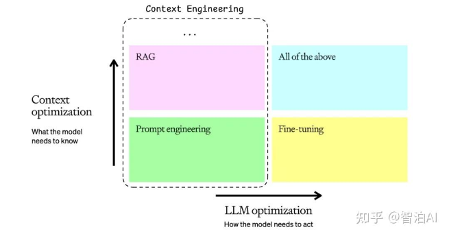
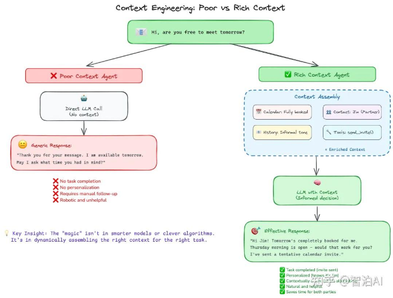
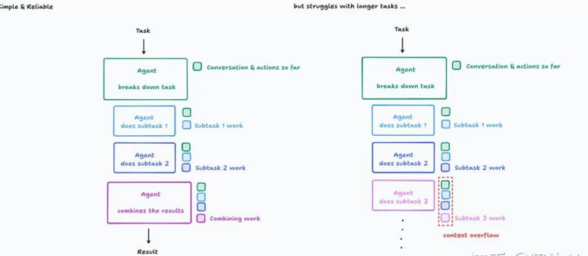
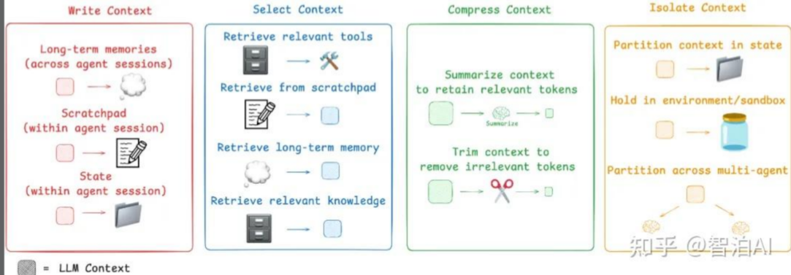
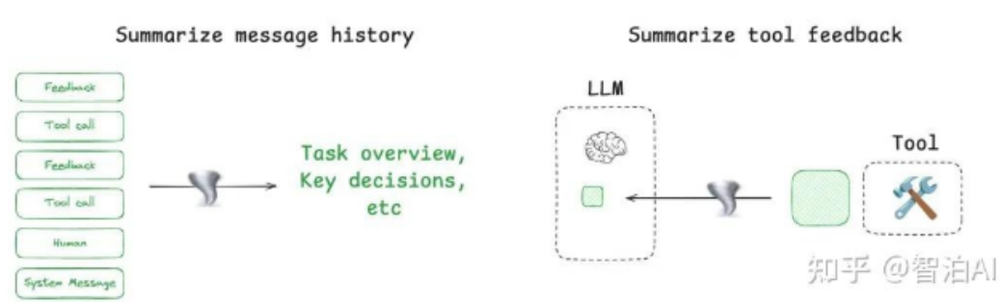

> 1

> 

## Context Engineering

> https://news.qq.com/rain/a/20260226A076NP00

> 模型出错往往不是因为理解不了指令，而是因为看到了太多不相关的信息、相互矛盾的数据，或者缺失了关键事实。

Context engineering 把上下文当作一条动态管道来处理，而非一段静态提示词：

1. 选对文档而不是全量灌入；
2. 将长文档压缩为面向任务的摘要；
3. 在检索之前重新表述模糊的用户查询；
4. 跨会话注入记忆和用户状态；
5. 用实时工具和数据锚定答案；组织所有输入，让模型知道什么最重要。

#### 0 层次化布局：结构本身就在传达重要性

> ```bash
>  [System Rules]  
> You are a precise financial research assistant.  
> Answer only from provided context.  
> If information is missing, say "I don't have that information."  
> Never make assumptions about numerical data.
> 
> [Task]  
> Goal: Answer user question using context below.  
> Output format: Start with direct answer, then provide supporting details.  
> 
> [User Profile / Memory]  
> - Risk tolerance: Low  
> - Investment horizon: 5-10 years  
> - Region: India  
> - Previous sessions: Asked about HDFC Bank 3 times, showed interest in banking sector  
> - Preferences: Conservative investments, dividend-paying stocks  
> 
> [Retrieved Context]  
> DOC 1: HDFC Bank Q4 2024 earnings report  
> - Revenue: ₹45,000 crores (up 15% YoY)  
> - Net profit: ₹12,000 crores (up 18% YoY)  
> - NPA ratio: 1.2% (improved from 1.5%)  
> DOC 2: Competitor analysis Q4 2024  
> - ICICI Bank revenue growth: 12% YoY  
> - SBI profit growth: 10% YoY  
> - HDFC Bank leading in digital banking adoption  
> 
> [Tool Outputs]  
> - live_price("HDFCBANK"): ₹1,842.50 (updated 2 minutes ago)  
> - news_summary("HDFCBANK"): "Announced dividend of ₹19 per share for FY2024. Ex-dividend date March 15, 2025."  
> - sector_analysis("Banking"): "Banking sector up 8% this month due to positive earnings"  
> 
> [Question]  
>  User: What's the latest on HDFC Bank?
> ```
>
> 


#### 1 选对文档而不是全量灌入；

> 1. 相关性重排：初始搜索基于向量相似度或关键词匹配返回前50个结果，但相似不等于相关。交叉编码器会把查询和每个文档放在一起联合阅读，重新排序。速度慢一些准确度高得多，重排之后只保留前5个。
> 2. 冗余消除：同一个概念在文档库里出现在多个地方是常态，比如营销材料、技术规格、FAQ都可能提到同一功能。用 Embedding 对相似文本块做聚类，余弦相似度超过0.9的基本就是重复内容删掉一个即可。模型不需要看同一个事实10遍。
> 3. 任务感知过滤：利用元数据做筛选。每个文档都应打上标签：文档类型、最后更新日期、产品版本、地区、部门。查询进来时按相关维度过滤。

#### 2 将长文档压缩为面向任务的摘要；

> 把长文档放进上下文之前，将其压缩成面向当前任务的密集摘要：不是通用摘要，而是针对当前查询定制的摘要。
>
> 三种压缩策略各有侧重。
>
> - 带约束的LLM摘要：不要只说"总结这个文档"，而是说"总结这个文档，只保留2025年1月之后关于定价变更的事实"。约束条件指明了保留什么、丢弃什么。每个检索到的文档根据查询生成各自的约束。产出从3000个 Token 缩减到5–10个要点。
> - 句子级评分：用较小的模型（如**BERT变体**）为每个句子计算与查询的相关性分数，按分数排序后只保留前20%。这种方法叫Context-Preserving Compression，速度快，效果好，自动留下最相关的信息。
> - 层次化摘要：适合非常长的文档。先按章节分块每个章节独立生成摘要，再把这些摘要归纳成一个元摘要。最终形成三级结构，完整文档 → 章节摘要 → 最终摘要。根据上下文预算选用合适的层级。


#### 3 在检索之前重新表述模糊的用户查询

> 三种可行的模式。
>
> 澄清优先（适用于智能体场景），与其猜用户什么意思不如直接问。智能体回复："要比较业绩表现，需要明确几个信息——哪个时间段？包含哪些竞争对手？最关注哪些指标（收入、利润还是市场份额）？"用户给出具体条件后，检索随之变得精确。这种策略只适用于多轮对话的智能体，单次问答系统用不上。但在智能体场景下效果很好——用户并不介意回答两三个澄清问题，如果换来的是更准确的答案。
>
> HyDE（Hypothetical Document Embeddings）用户问"产品最新的改进有哪些"，不直接用这个问题去搜索，而是让LLM先生成一段假答案："最新的产品改进包括重新设计的仪表板、40%的加载速度提升、新增的协作功能和增强的移动端应用。"把这段假答案做 Embedding 后用于检索。为什么有效？因为假答案的措辞和实际文档的措辞一致。文档里不会写"最新的改进是什么"，而会写"重新设计了仪表板""加载时间缩短了40%"。假答案的 Embedding 比原始问题的 Embedding 更贴近真实文档。
>
> 多查询扩展，对原始查询生成3–5个改写版本。"最新产品改进"可以展开为"最近的产品更新""本季度发布的新功能""产品增强变更日志""2.0版本有什么新内容"。每个查询分别检索，合并去重。这种方式能覆盖语义变体和不同的表述习惯。

举个实际例子。用户问"上季度的表现与竞争对手相比如何"。

这个问题里缺了太多信息：哪些竞争对手？哪一年的上季度？衡量什么指标——收入、利润、市场份额还是用户增长？

LLM将其**重写为"比较2024年第四季度（2024年10月至12月）公司X与竞争对手A、B、C在内部财务报告中的收入增长和利润率"。**注意具体程度——精确的时间段、精确的竞争对手、精确的指标、明确的数据来源。检索时还会结合记忆中已知的竞争对手名单（层次化布局的用户档案部分记录了该用户之前多次查询过竞争对手A和B）。

最终上下文对齐的是用户的意图，而非用户键入的字面内容。LLM拿到的是精确数据，不是模糊相关的内容。

实现模式如下：

```
 User query  
     ↓  
 LLM rewriter: "Expand this into a precise search query.   
 Add time ranges, entity names, and specific metrics."  
     ↓  
 Rewritten query  
     ↓  
 Retrieval
```


#### 4 记忆与状态：保留的是关系，不只是事实

> 每轮对话结束后做一次LLM摘要——"用户问了什么？提供了什么？用户表达了哪些偏好或需求？"——将摘要与 Embedding 一起存入向量数据库。每轮对话开始前，用当前查询在历史情景摘要库中做向量搜索，取回最相关的3条，再从另一张表加载稳定偏好（这些不需要向量搜索，每次都带上），全部插入层次化布局的 [User Profile / Memory] 区块。

> 三种记忆类型各有分工。
>
> 1. **情景记忆**，即过去对话的摘要。例如："**上次会话**讨论了为法律文档构建RAG系统，用户关心的是如何处理100多页的合同，最终决定采用512 Token 块配合50 Token 重叠的语义分块策略。"注意，这不是完整的对话记录，而是一份200 Token 左右的摘要，只保留了关键内容。
> 2. **语义记忆**，存储在**向量数据**库中的过去交互记录。例如："用户**3周前**问过关于HDFC的类似问题，当时问的是季度收益，当前查询是关于股息公告，两者都涉及HDFC的财务表现，可以复用之前查询中关于公司基本面的上下文。"语义记忆的价值在于发现模式：用户依次问了HDFC的收益、竞争对手、风险因素，可以判断他正在对HDFC做深度研究，从而主动推送相关信息。
> 3. **偏好记忆**，很少变化的稳定事实。"用户是初学投资者""偏好TypeScript""风险承受能力低""在医疗保健领域工作""位于孟买时区"。这些事实影响每一次交互——初学者得到更简洁的解释，低风险用户和高风险用户收到的建议完全不同。


#### 5 实时工具


## Context Engineering

> https://zhuanlan.zhihu.com/p/1945173424726058681


### **1. What is Context Engineering?**






### **2. Why Context Engineering?**

#### 2.1 优化 LLM **的二维思维模型**

当 agenticsystem 或单次 LLM 调用的输出不及预期时，问题的根源往往可以归结为两个方面:



#### **2.2 两个简单的示例**

##### 示例一: 缺失上下文的代价



> **第二种的上下文:**
>
> 信息性上下文(Informational):
>
> [Calendar Data]: 检索你的日历，发现明天日程已满。
>
> [Contact Data]: 识别发件人 Jim 是重要合作伙伴。
>
> [Email History]: 分析过往邮件，确定沟通应采用非正式语气。
>
> 行动性上下文(Actionable):
>
> [Tool Definition]: 提供
>
> send_calendar_invite 工具的描述
>
> 基于这个完整的上下文，它能生成一个真正高效的回应
>
> “Hi Jim! 我明天日程完全满了。周四上午有空，你看方便吗?我发了一个暂定邀请，如果时间合适请确认。

##### 示例二: 上下文退化的挑战



> 一种朴素的策略: 为了保证模型“无所不知"，系统将每一次交互都记录下来——每一条用户指令、文件读取、编译错误、成功的工具调用--并将这整段历史作为上下文，在每次调用 Agent 时都完整地传递给LLM.
>
> **必然出现的失败级联**
>
> 1.**性能下降**: 首先，性能会悄然下降。早期任务中1无关紧要的细节(例如一次已解决的语法错误)会不断稀释当前步骤所需的核心信息，造成上下文干扰(Context Distraction)
>
> 2.**成本与延迟激增**: 随着上下文线性增长，每次API调用的 Token 数量急剧膨胀，导致成本失控和更高的延迟。
>
> 3.**最终崩溃**: 最终，系统将撞上架构限制--上下文溢出(Context Overflow)。当累积的信息总量超过模型的上下文窗口上限(无论是 200K还是1M tokens)，API调用将直接失败，可能导致任务中断，或因信息截断而引向错误的结果。

### **3.How? The Best Practice of Context Engineering**


#### **3.2 上下文工程的最佳实践**



**写入(Write)**

写入主要是将上下文持续久化，超越上下文窗口的限制在未来按需取用。通常情况下分为:

1. 会话内写入(Session-levelWrite): Agent 将**中间思考**、计划或临时数据写入一个会话内的**草稿纸(Scratchpads)**。这是一种轻量级的、非持久化的写入，用于管理当前任务的复杂性。
2. 持久化写入(Persistent Write): 系统将具有长期价值的信息(如用户偏好总结、关键事实)写入外部的记忆(Memory)系统，如向量数据库或知识图谱。

这实现了跨会话的知识积累。例如，ChatGPT和Cursor等应用通过这种方式，让 Agent在与用户的持续交互中“学习"和“成长"，用户在解决某些问题时无需手动引入上下文。

Anthropic也曾在博客中建议，Subagent output to a filesystem to minimize the 'game of telephone. 通过把 subagent 的输出写到文件以避免无意义的上下文传递，上下文窗口占用等。

**选取(Select)**

选取的目的，是在每次 LLM 调用前，从所有可用的信息源中，动态地拉取与当前子任务最相关的信息。这是保证上下文信噪比的关键。

上下文工程中的选取包括三类:

1. **确定性选取(Deterministic Select)**: 指根据预设规则加载上下文。例如，编码 Agent 在启动时，**固定加载项目根目录下的CLAUDE.md**文件，这是一种简单高效的**先验知识**注入。
2. **模型驱动选取(Model-driven Select)**: 当可用信息源**过多时(如海量工具或文档)，可以利用模型自身的能力进行筛选**。
3. **检索式选取(Retrieval-based Select)**: 这是最主流的方式，其核心范式是通过**相似度检索**，从记忆、草稿纸或外部知识库中选取信息。因此，选取操作的成败，在很大程度上依赖于底层检索系统的质量。

**压缩（Compress)**

压缩的目的，是在信息进入上下文窗口之前，对其进行有损或无损的压缩，用更少的 Token 承载最核心的信号。这是在上下文窗口容量有限的情况下，容纳更多有效信息的直接手段。



当上下文窗口即将达到容量上限时，这些系统通常会启动"auto-compact"机制

1. 历史内容压缩（如图左侧所示）
2. 工具调用链压缩
3. 采用经过专门调优的"上下文压缩大语言模型"来实现信息压缩，
4. 另有修剪策略: 如**硬截断超限历史**，代价是失去部分语境。

