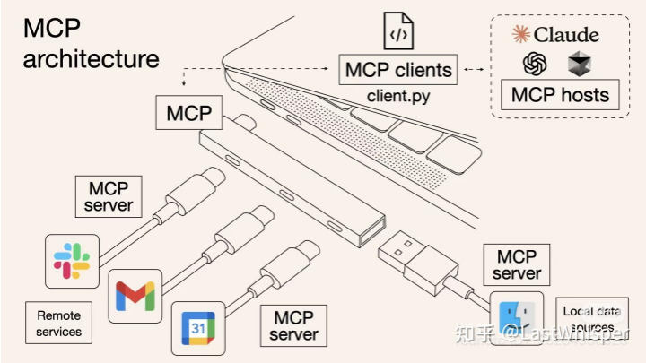
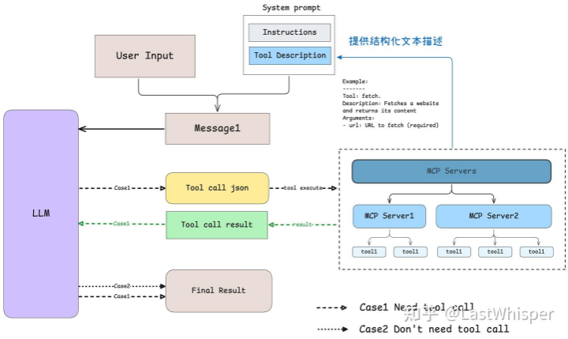
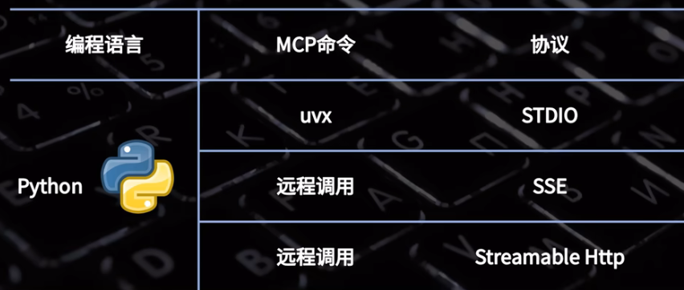
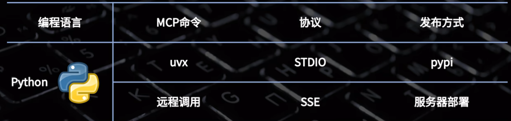

> https://zhuanlan.zhihu.com/p/29001189476

## 介绍

### What

**模型上下文协议:** 定义了应用程序和 AI 模型之间交换上下文信息的方式。

这使得开发者能够**以一致的方式将各种数据源、工具和功能连接到 AI 模型**（一个中间协议层），就像 USB-C 让不同设备能够通过相同的接口连接一样。




### Why

**function call 平台依赖性强**，不同 LLM 平台的 function call API 实现差异较大。例如，OpenAI 的函数调用方式与 Google 的不兼容，开发者在切换模型时需要重写代码，增加了适配成本。

> 官方也提供了非常多现成的 MCP Servers，你只需要选择你希望接入的工具，然后接入即可。
>
> - [Awesome MCP Servers](https://link.zhihu.com/?target=https%3A//github.com/punkpeye/awesome-mcp-servers)
> - [MCP Servers Website](https://link.zhihu.com/?target=https%3A//mcpservers.org/)
> - [Official MCP Servers](https://link.zhihu.com/?target=https%3A//github.com/modelcontextprotocol/servers)

### How

> 其实就是把tool变成工具集...



**MCP 的核心就三样东西：**

Server：对外暴露工具的服务端，本质上是一个 Python 脚本，声明"这些函数可以被 LLM 调用"，跑起来之后就在监听请求。

Tool：希望 LLM 使用的函数，可以是任何东西：查天气、查数据库)、发邮件。这跟写普通 Python 函数没什么区别，加个装饰器剩下的交给 MCP。

Client：连接 Server 并调用工具的客户端。生产环境里一般就是 LLM 应用本身。测试阶段可以用 FastMCP 自带的客户端，开箱即用。


## 快速实现: 

### 1 集成手写agent

```python
# fast_mcp_demo.py

from fastmcp import FastMCP  
# Initialize the server with a name  
mcp = FastMCP("my-first-server")  

# Define a tool using the @mcp.tool decorator  
@mcp.tool  
def get_weather(city: str) -> dict:  
    """Get the current weather for a city."""  
    # In production, you'd call a real weather API  
    # For now, we'll return mock data  
    weather_data = {  
        "new york": {"temp": 72, "condition": "sunny"},  
        "london": {"temp": 59, "condition": "cloudy"},  
        "tokyo": {"temp": 68, "condition": "rainy"},
        "beijing": {"temp": 10, "condition": "sunny"},
    }  
      
    city_lower = city.lower()  
    if city_lower in weather_data:  
        return {"city": city, **weather_data[city_lower]}  
    else:  
        return {"city": city, "temp": 70, "condition": "unknown"}  

# Run the server  
if __name__ == "__main__":  
     mcp.run(transport="stdio")
```


```python
# test_client_agent.py
import asyncio  
from fastmcp import Client  
from openai import OpenAI
import os
from dotenv import load_dotenv

load_dotenv()
KIMI_API_KEY=os.getenv("KIMI_API_KEY")
KIMI_API_URL=os.getenv("KIMI_API_URL")
KIMI_MODEL_NAME=os.getenv("KIMI_MODEL_NAME")
async def main():  
    # Point the client at your server file  
    client = Client("fast_mcp_demo.py")  
      
    # Connect to the server  
    async with client:  
        # List available tools  
        tools = await client.list_tools()  
        print("Available tools:")  
        for tool in tools:  
            print(f"  - {tool.name}: {tool.description}")  
            print(tool.inputSchema)
          
        print("\n" + "="*50 + "\n")  
          
        # Call the weather tool  
        result = await client.call_tool(  
            "get_weather",   
            {"city": "Tokyo"}  
        )  
        print(f"Weather result: {result}")  

        print("Kimi API Call")
        ai_client = OpenAI(api_key=KIMI_API_KEY, base_url=KIMI_API_URL)
        
        # 修正: 按照 OpenAI/Kimi 的标准格式构造 tools
        formatted_tools = [
            {
                "type": "function",  # 必须指定类型为 function
                "function": {
                    "name": tool.name,
                    "description": tool.description,
                    "parameters": tool.inputSchema  # 注意这里是 parameters
                }
            } for tool in tools
        ]

        response = ai_client.chat.completions.create(
            model=KIMI_MODEL_NAME,
            messages=[{"role": "user", "content": "weather in beijing"}],
            tools=formatted_tools,
            tool_choice="auto"  # 建议显式加上
        )
        
        # 打印响应结果
        message = response.choices[0].message
        if message.tool_calls:
            print(f"Kimi 想要调用工具: {message.tool_calls[0].function.name}")
            print(f"参数: {message.tool_calls[0].function.arguments}")
        else:
            print(f"Kimi API Response: {message.content}")
if __name__ == "__main__":  
     asyncio.run(main())
```


### 2 集成ai软件





```
"I5idlklcOPSxz09p-Hxjw": {
      "name": "MCP 服务器",
      "description": "pip install wkl-mcp-demo",
      "baseUrl": "",
      "command": "uvx",
      "args": [
        "wkl-mcp-demo"
      ],
      "env": {},
      "isActive": true,
      "type": "stdio",
      "registryUrl": ""
    },
```

