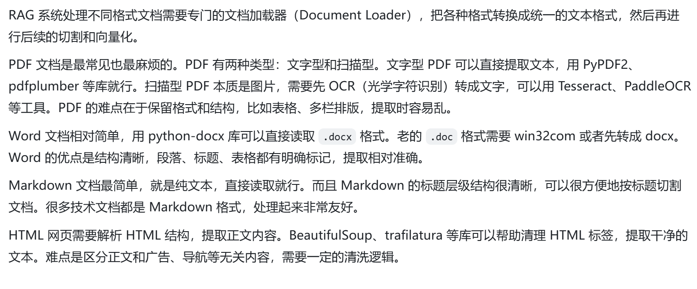
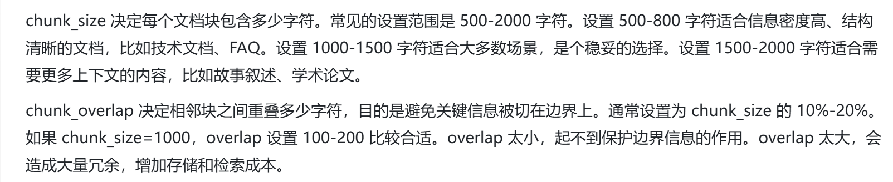
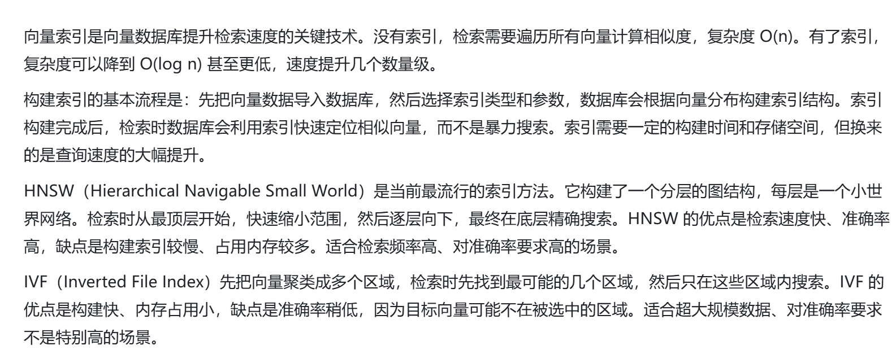
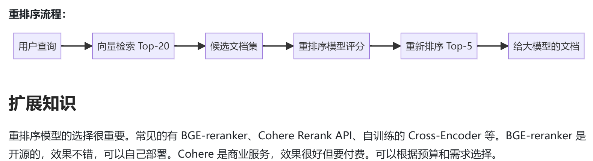
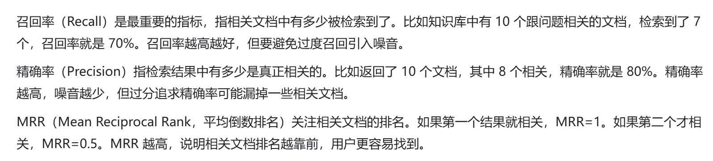

处理 PDF、Word、Markdown 等不同格式文档？



## chunk size



## 向量索引



## 混合


## 检索失败


## 重排序








## 可选处理方案（不改代码，只给方案）

### 方案 A：把合并区域“展开填充”（推荐做数据分析时用）

目标：让合并块里的每个格子都有同样的值（不管是左右合并还是上下合并）。

- 做法

  （

  ```
  .xlsx
  ```

  ）：用

   

  ```
  openpyxl
  ```

   

  读取工作表，拿到

   

  ```
  ws.merged_cells.ranges
  ```

  ，对每个 range：

  - 取左上角值 `top_left = ws.cell(min_row, min_col).value`
  - 遍历 range 覆盖到的所有单元格，把空的都填成 `top_left`

- 优点：输出表格更“规整”，后续转 dict/JSON、做筛选聚合更省心

- 缺点：会“造值”（把原来空白格填上），严格意义上不再是原始表的逐格值

> 变体：只做“向下填充/向右填充”，但合并是二维区域，本质还是按 merged range 处理最准确。

### 方案 B：保留合并结构（值不展开，但返回合并元数据）

目标：不篡改值，同时让调用方知道哪些位置属于同一个合并块。

- 做法

  ：在返回结果里额外加一个字段，例如每个 sheet 返回：

  - `merged_ranges`: `["A1:C1", "D2:D5", ...]`
  - 或者更结构化：`[{min_row, min_col, max_row, max_col, value}, ...]`

- 优点：不丢结构；适合做“还原表格视觉布局”、渲染、或需要精确保真

- 缺点：消费端要自己决定怎么解释这些合并块（是否展开/怎么展示）

### 方案 C：同时做 A + B（最通用）

- 返回 展开后的二维表数据（便于分析） + 合并元数据（便于追溯/展示/审计）。
- 成本更高，但兼容性最好。

### 方案 D：按“真实二维网格”读取（不用 pandas 表头推断）

如果你的 Excel 不是标准“数据表”（表头多行、分组表头大量合并），pandas 的 `header=` 机制本来就很容易错。

- 做法：直接按单元格坐标读出一个二维数组（例如 `values[row][col]`），再由你定义表头解析规则；合并同样用 A/B/C 处理。
- 优点：适合复杂报表
- 缺点：工程量最大
