# 前言

相机延迟高, 怎么优化


# 前置知识

## 1 TFLOPS

> **FP32（单精度，常说的理论算力）**：≈ **12.7 TFLOPS**
>
> “12.7 TFLOPS” ≈ 每秒 **12.7 万亿次浮点运算**
>
> **Tensor Core（AI训练常用）**：
>
> - FP16 / Tensor TFLOPS：约 **50~100+ TFLOPS（视稀疏性和模式）**
>
> | Model                                                        | size (pixels) | mAPval 50-95 | Speed CPU ONNX (ms) | Speed T4 TensorRT10 (ms) | params (M) | FLOPs (B)  |
> | :----------------------------------------------------------- | :------------ | :----------- | :------------------ | :----------------------- | :--------- | :--------- |
> | [YOLO11n](https://github.com/ultralytics/assets/releases/download/v8.4.0/yolo11n.pt) | 640           | 39.5         | 56.1 ± 0.8          | 1.5 ± 0.0                | 2.6        | 6.5GFLOPs  |
> | [YOLO11s](https://github.com/ultralytics/assets/releases/download/v8.4.0/yolo11s.pt) | 640           | 47.0         | 90.0 ± 1.2          | 2.5 ± 0.0                | 9.4        | 21.5GFLOPs |
>
> 实际可能: 
>
> ```
> 4 TFLOPs effective
> ```
>
> ```
> 4 / 0.0215 ≈ 186 FPS
> ```
>
> 在 3060 上：
>
> | 情况                    | FPS        |
> | ----------------------- | ---------- |
> | PyTorch 未优化          | 30–60 FPS  |
> | TensorRT / ONNX         | 60–120 FPS |
> | 极致优化（FP16 + fuse） | 100–150 FP |


**AI 里真正速度还取决于：**

- CUDA 核心利用率
- 显存带宽（3060 是 192-bit）
- Tensor Core 是否启用（混合精度


### FPS≈模型计算量GPU算力

例如：

- GPU：12 TFLOPS
- 模型：120 GFLOPs/帧

那么理论：

FPS≈12×1012120×109=100FPS\approx\frac{12\times10^{12}}{120\times10^{9}}=100FPS≈120×10912×1012=100

理论上约：

- 100 FPS


### FLOPs ≠ 实际速度

有些模型：

- FLOPs 很低
- 但 FPS 不高

因为：

- 内存访问特别碎
- depthwise conv 很多
- 小 kernel 太多
- GPU 利用率低

例如：

| 模型         | FLOPs低     | 但速度   |
| ------------ | ----------- | -------- |
| MobileNet    | ✅           | 不一定快 |
| EfficientNet | ✅           | 经常偏慢 |
| YOLO         | FLOPs不算低 | 但非常快 |

#### 推理时间真正近似公式

更接近：

推理时间= 计算时间 + 显存访问时间 + 调度开销 + 数据传输时间推理时间


## 2 模型计算量

### 怎么知道模型计算量


### 模型预热


# 参数量 vs FLOPs

很多人会混淆。

## Params（参数量）

表示：

- 模型大小
- 占多少显存

例如：

- 7M 参数
   ≈ 28MB FP32

------

## FLOPs（计算量）

表示：

- 推理需要算多少次

决定：

- 推理耗时
- GPU压力


# 问题分析

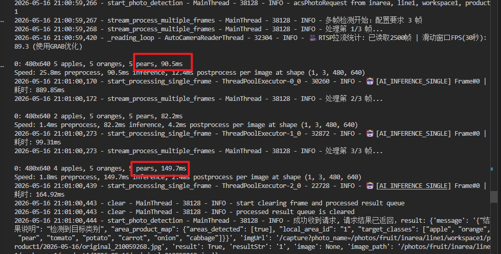

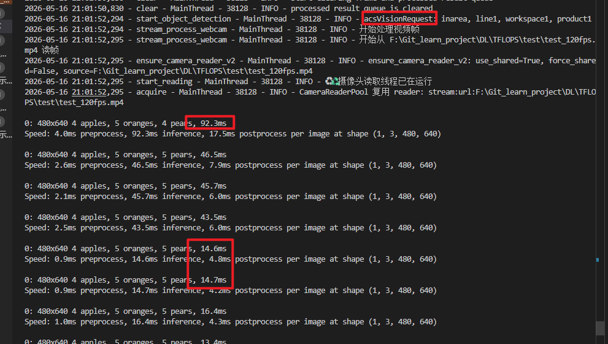


结论可以分三块说：**你们在比的不是同一个计时范围**、**拍照路径和执行线程和视频不一样**、**前几帧变慢是正常现象**。

---

## 1. 为什么 `[AI_INFERENCE_SINGLE]` 比 Ultralytics 的 `Speed:` 大很多？

`[AI_INFERENCE_SINGLE]` 包的是**整段** `process_frame` + `_apply_fps_overlay`，而日志里 Ultralytics 的  
`Speed: … preprocess … inference … postprocess` 一般指 **`model(...)`（predict）内部**拆的三段。

以 `FruitInAreaFrameProcessor` 为例，YOLO 打完成绩之后你还有一大段工作在**同一次计时里**：

```194:217:f:\_Work\opencv-detection\app\companies\fruit\processor.py
        # 1. 推理
        yolo_result = self.model(frame, conf=self.conf, device=self.device, verbose=True)
        
        # 2. 检查区域
        self._areas_detected = DetectUtils.check_yolo_result_in_areas(yolo_result, self.area_lists, self.target_classes)
        ...
        # 4. 画框
        result_frame = yolo_result[0].plot()
        from app.core.utils.drawing_utils import DrawingUtils
        result_frame = DrawingUtils.draw_area(result_frame, self.area_lists, (0, 255, 0))
        cv2.putText(result_frame, message, (10, 70), cv2.FONT_HERSHEY_SIMPLEX, 0.5, (0, 0, 255), 2)
```

你日志里是 `480x640`、多类、十多颗水果，**分割模型**在 `results[0].plot()` 里要把每个实例的 mask 叠到图上，多半是**纯 CPU/OpenCV**，很容易比 predict 本身的几十毫秒再长出一大截。**所以 889ms vs 里外合计约 129ms：差的主要是「YOLO predict 之外的 plot/画框/叠加」**，而不是表格里那一行 inference 变慢了。

外层还有 `start_processing_single_frame` 里对 **`_apply_fps_overlay`**（若 `settings.ai_draw_fps` 为真则会 `copy` + `addWeighted`）等，也都在同一计时窗里。

---

## 2. 为什么「拍照多帧检测」和视频流里看到的延迟感觉差很多？

**拍照路径**：`stream_process_multiple_frames` 里**每一帧**都是**「新建一个线程池 → 扔一次 `start_processing_single_frame` → shutdown**」：

```760:766:f:\_Work\opencv-detection\app\core\stream\detector.py
                with ThreadPoolExecutor(max_workers=1) as executor:
                    future = executor.submit(
                        self.processor.start_processing_single_frame,
                        frame_data, self.debug, processed_photo_path if i == frame_count - 1 else ""
                    )
                    try:
                        future.result(timeout=timeout_seconds)
```

你贴的日志里也印证了这一点：第 1/2/3 帧分别是 **`ThreadPoolExecutor-0_0`**、**`-1_0`**、**`-2_0`**，也就是每轮都是**不同的 worker 上下文**。再配合上面说的「predict 只占一部分」以及首帧预处理在 Ultralytics 里也会偏高（见你第一帧 `preprocess 25.8ms` vs 后面的 `~0.9ms`），体感就会和「稳定在 ~14ms inference」的那段视频日志差很远。

**视频连续检测**：走的是 `start_processing` 的那种**长期循环**，同一条链路反复跑，`model`/`plot`/`cuDNN`/缓存都更容易进入稳态；你在 `test_120fps.mp4` 那一段里看到的 **`~13–16ms inference`**，就是这类稳态。

> 1. 不要使用三个线程

---

## 3. 为什么视频前几帧也很大、后面突然变小？

这和你日志里的曲线一致：**第 1 帧 ~92ms → 中间的 ~43–46ms → 再往后的 ~13–16ms**。常见原因包括：

- **CUDA / cuDNN** 首轮选算法、建缓存、allocator 铺开；
- **Ultralytics 内部**预处理/后处理在第一两次路径上会触发的初始化（你已有「首帧 preprocess 明显更高」的现象）；
- 若当时是**刚拉起读流/刚切源**，还有可能叠上 **解码/缓冲区**尚未稳定。

所以「前几张大、后面稳定在十几毫秒」是预期行为，不是问题特有的异常。

---

**若要验证**：在同一个 `process_frame` 里用 `time.perf_counter()` 分别包住 `model(...)`、`plot()`、`draw_area`，你会很快看到_gap 主要是在哪一段；结构上也可以考虑拍照路径**不要每帧新开 `ThreadPoolExecutor`**（复用线程池或直接在当前线程推理），能减少线程与调度带来的不确定性。


## 4. 占用细节

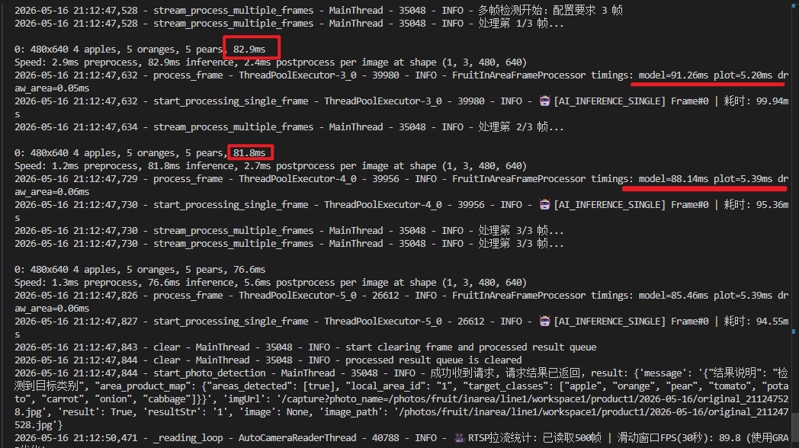

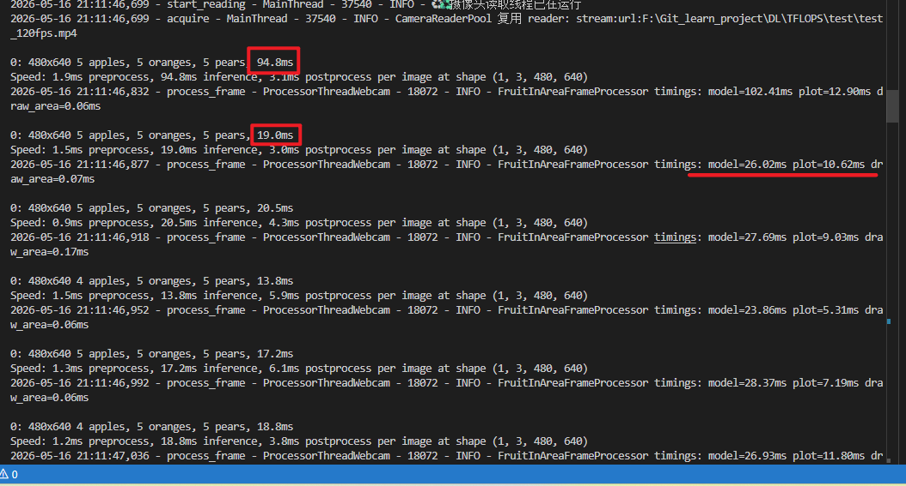


### 1）拍照多帧（`ThreadPoolExecutor-3_0 / 4_0 / 5_0`，约 21:12:47）

| 指标                         | 情况                                                         |
| ---------------------------- | ------------------------------------------------------------ |
| **Ultralytics**              | 每帧 `preprocess + inference + postprocess` ≈ **86～88 ms**  |
| **`model=`（perf_counter）** | **85～91 ms**，和 Ultralytics 同一量级                       |
| **`plot`**                   | **≈5 ms**                                                    |
| **`draw_area`**              | **≈0.05 ms**，可忽略                                         |
| **`[AI_INFERENCE_SINGLE]`**  | **～95～100 ms**，比 `model+plot+draw` 多出一截（约 **3～10 ms**：`putText`、区域校验、`_apply_fps_overlay` 若为开、线程调度等都算在内） |

说明：**这轮请求时 GPU/CUDA 已经热好**，首帧没有再出现 **`model≈1248 ms`**；差异主要来自整条 `process_frame` 里 **`model(...)`**，不是 `plot`/`draw_area`。

---

### 2）本地视频、`ProcessorThreadWebcam`（约 21:11:46）

| 帧序     | Ultralytics inference | **`model=` 墙钟** | **`plot`**     |
| -------- | --------------------- | ----------------- | -------------- |
| 第 1 帧  | **94.8 ms**           | **102 ms**        | **12.9 ms**    |
| 之后几帧 | **～13～20 ms**       | **～24～29 ms**   | **～5～12 ms** |

- **warmup**：第 1 帧 GPU/CUDA、cudnn、缓存等最重，和你们之前「视频前几帧慢」一致。
- **为什么 `model=` 常比 Ultralytics 的 `inference` 再高 ~10 ms？**  
  `perf_counter` 包住的是**整段** `model(...)` 返回：里面除了「纯 kernel 推理」，往往还有同步、解码型后处理等在 Python/C++ 边界上的墙钟开销；Ultralytics 打在日志里的那一段 **不见得等于**你在 Python 侧量的整段耗时，所以会看到 **Ultra ~14–20 ms、你却量到 ~23–29 ms**，这是正常现象。
- **`plot`** 仍会占几毫秒～十几毫秒，仍远小于 **`model`。**

---

### 3）两段合在一起说明什么？

- **同一次进程里**：若先有「冷线程 / 首次 CUDA」路径，会出现 **`model` 一秒钟级** spike（你更早那次的 **1248 ms**）；**同一进程稍后**再在 `ThreadPoolExecutor` 里跑，`model` 就只 **～90 ms**。  
  本质是 **谁在什么线程上、第几次碰 GPU**，不是 `plot`。  
- **固定 `ProcessorThreadWebcam` 线程**持续跑：**首帧大一点，后面 `model` 明显低于拍照路径里重复的 ~80 ms**，是因为 Ultralytics 内部计时和你们外层墙钟口径不同 + 流水线是否持续喂帧；你这两段里都说明 **瓶颈仍在 `model(...)`**。  

若要**压掉拍照首帧 ~1 s**：在应用启动或首次检测前，**在同一个最终用于推理的线程上做一次 warmup**，或 **`stream_process_multiple_frames` 里复用单个 `ThreadPoolExecutor`/`ProcessPoolExecutor`**，避免每次都是「从未跑过 CUDA 的工作线程」。需要的话可以再改 detector 那一段具体代码方案。


> 1. 全局模型warm up
> 2. 线程专属的模型warm up(因为已经load一次模型了)
> 3. 复用单一线程
> 4. 单针plot似乎压力更小? 少5ms


# 拍照使用同一个线程使用

## 1 问题

旧的

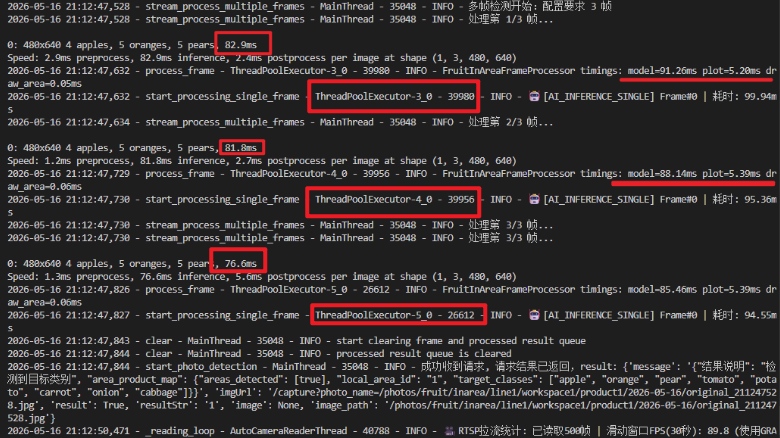

新的

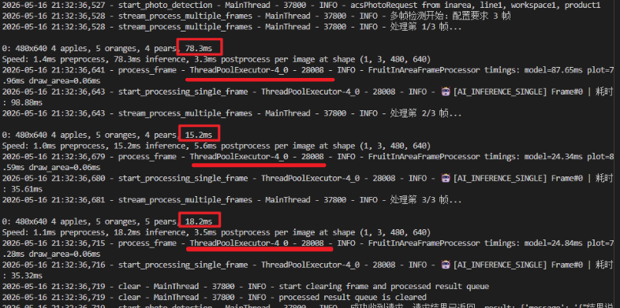


**with ThreadPoolExecutor(max_workers=1) as inference_executor:**


# 推理线程长期存在

## 问题: 线程内首帧延迟高

**非模型预热问题**

旧: 

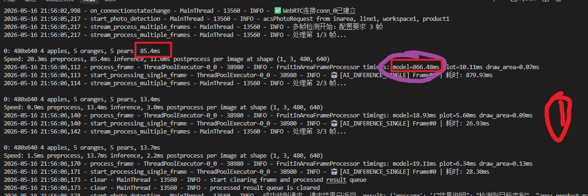

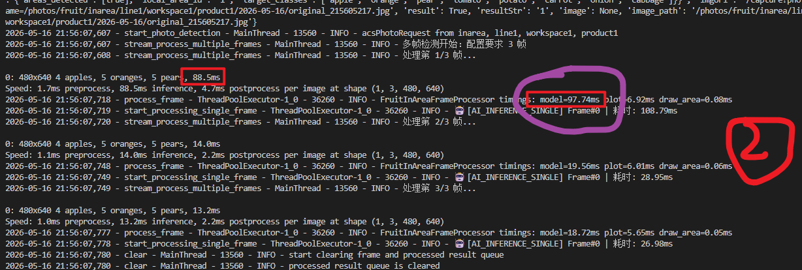

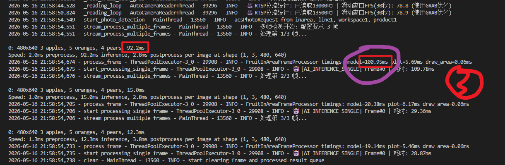


## 线程复用

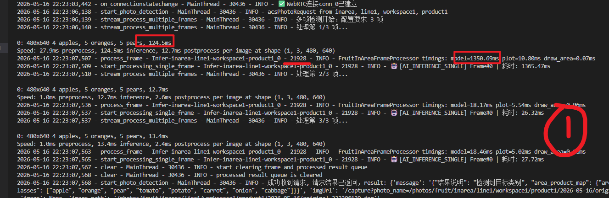

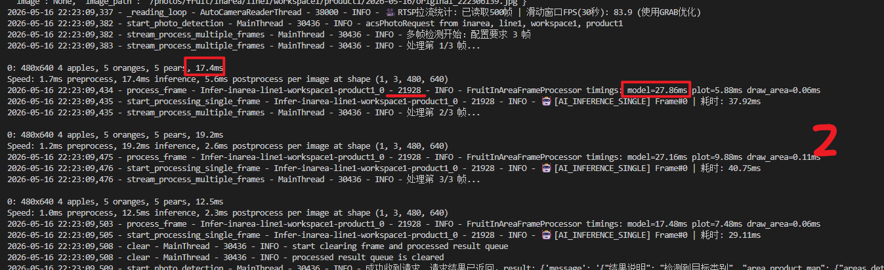

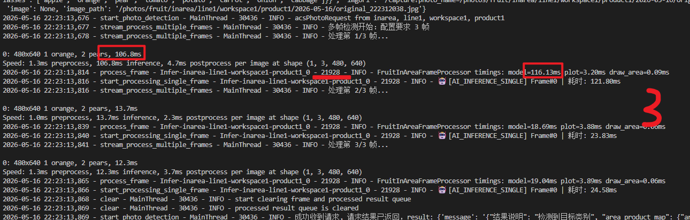

1min after...

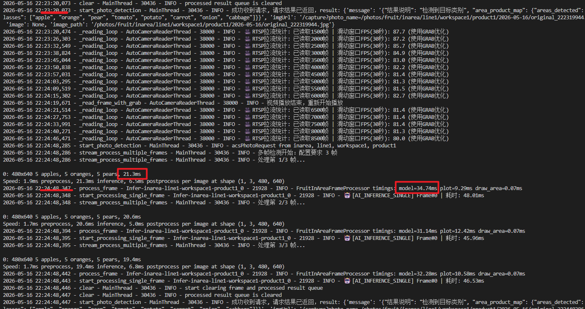

5min after

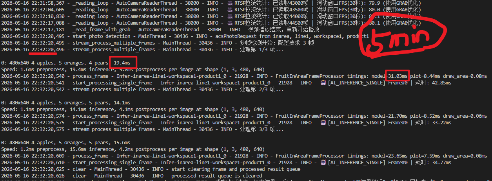

30min after

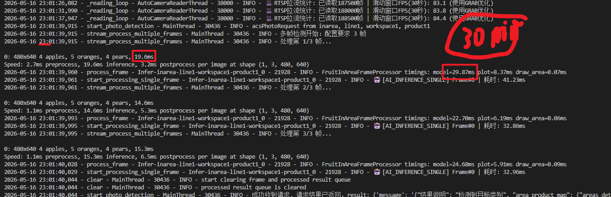


**「1 = 全局第一次推理的典型冷启动；2、3 = 已在同一进程内热过 GPU，首帧只剩「单次会话级」 warmup，所以会小一个数量级」。**


# 多个线程同一个模型

## 问题

第一个

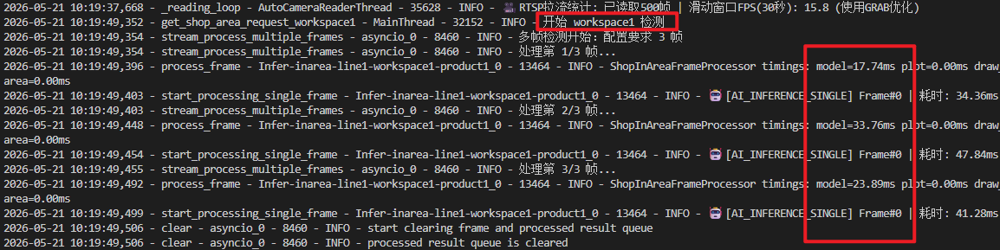

第二个

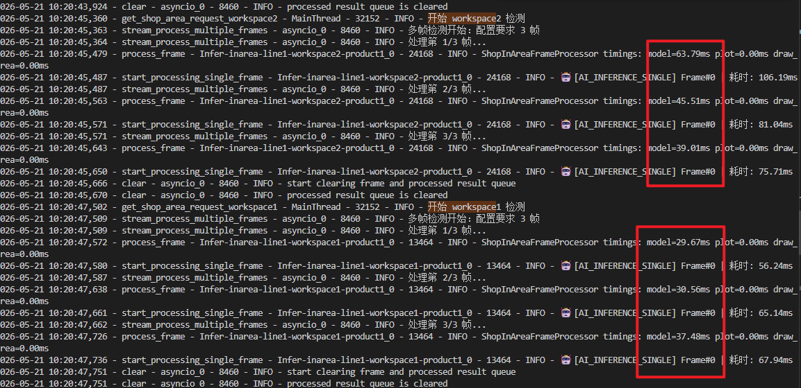

> wsp1的延迟变高了12ms
>
> 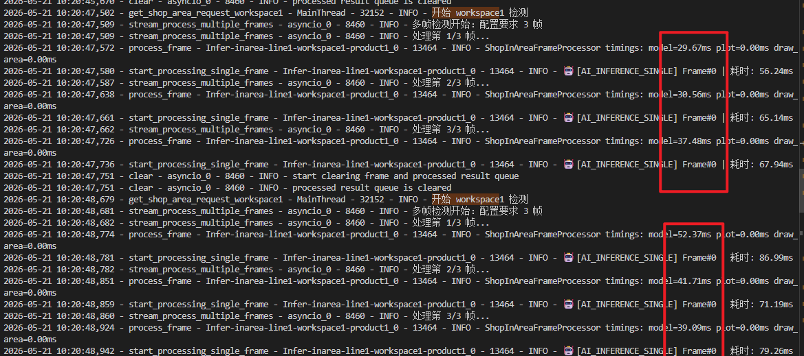 

### 

## detector复用

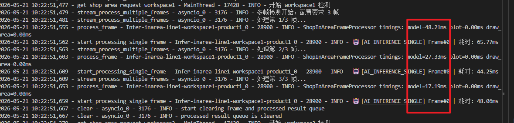

第二个

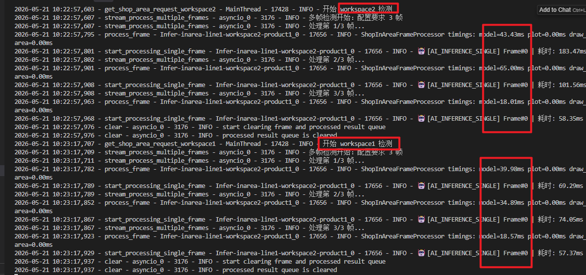

> wsp1 基本还是维持在和原来的20mns左右
>
> 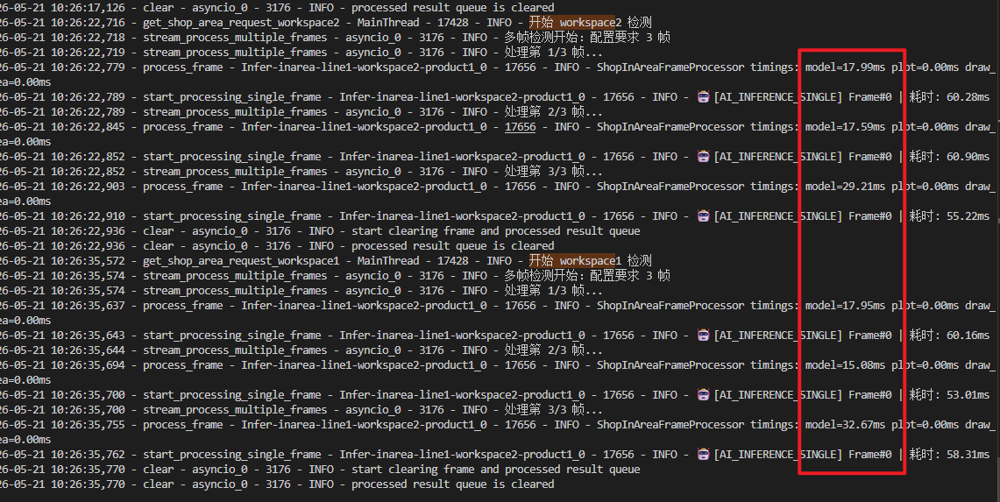 


## 模型复用

第一个

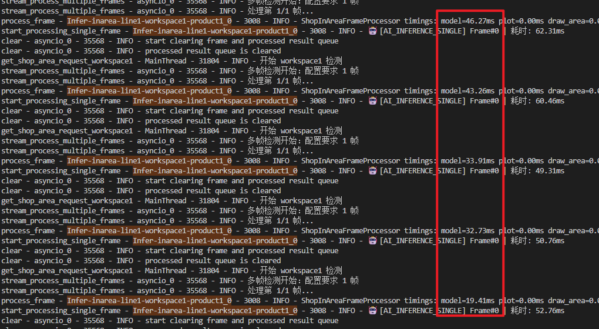

第二个

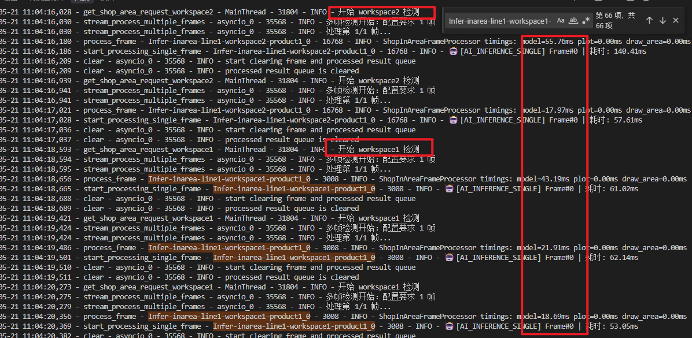


### 使用复用

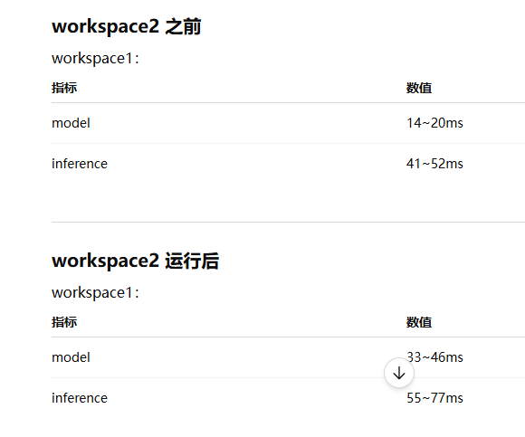 

### 不用复用


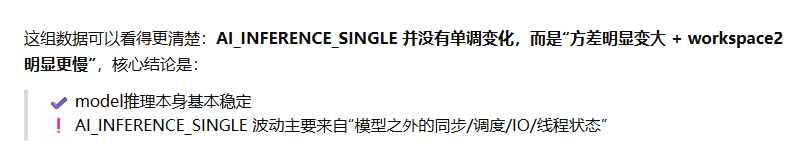


### 总结

1 共享model大约减少10ms推理延迟(一帧)

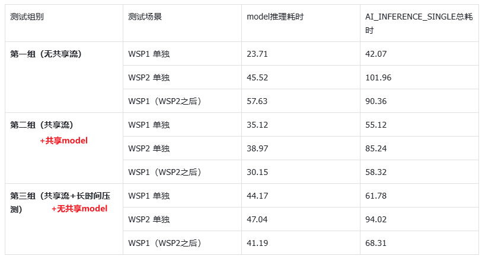

| 测试组别 | 运行阶段 | 运行对象 | 耗时区间 (ms) | 平均耗时 (ms) | 核心特征                       |
| -------- | -------- | -------- | ------------- | ------------- | ------------------------------ |
| 第1组    | 空载前置 | W1       | 32~49         | 41            | 三组里空载最优，延迟最低       |
| 第1组    | 稳态运行 | W2       | 61~108        | 85            | 首帧 147ms，预热后快速收敛稳定 |
| 第1组    | 后置回归 | W1       | 47~68         | 57            | 降速幅度最小，恢复性最好       |
| 第2组    | 空载前置 | W1       | 43~64         | 50            | 性能平稳，资源充足             |
| 第2组    | 稳态运行 | W2       | 56~122        | 100           | 初始化极端卡顿，整体耗时更高   |
| 第2组    | 后置回归 | W1       | 64~111        | 85            | 延迟大幅抬升，稳定性变差       |


2 减少模型预热时间

| 组别    | 模式   | workspace | 冷启动 (ms) | 热启动 (ms) | 提升倍数    |
| ------- | ------ | --------- | ----------- | ----------- | ----------- |
| 第 1 组 | 共享流 | wk1       | 936.17      | 42.48       | **22 倍**   |
| 第 1 组 | 共享流 | wk2       | 163.17      | 85.21       | **1.9 倍**  |
| 第 1 组 | 共享流 | wk3       | 236.28      | 121.76      | **1.9 倍**  |
| ---     | ---    | ---       | ---         | ---         | ---         |
| 第 2 组 | 独立流 | wk1       | 928.42      | 75.65       | **12 倍**   |
| 第 2 组 | 独立流 | wk2       | 612.52      | 63.94       | **9.6 倍**  |
| 第 2 组 | 独立流 | wk3       | 1109.33     | 239.68      | **4.6 倍**  |
| ---     | ---    | ---       | ---         | ---         | ---         |
| 第 3 组 | 独立流 | wk1       | 366.76      | 187.96      | **2.0 倍**  |
| 第 3 组 | 独立流 | wk2       | 263.21      | 115.09      | **2.3 倍**  |
| 第 3 组 | 独立流 | wk3       | 942.00      | 79.93       | **11.8 倍** |
| ---     | ---    | ---       | ---         | ---         | ---         |
| 第 4 组 | 共享流 | wk1       | 870.81      | 48.76       | **17.9 倍** |
| 第 4 组 | 共享流 | wk2       | 146.99      | 83.51       | **1.8 倍**  |
| 第 4 组 | 共享流 | wk3       | 224.31      | 123.87      | **1.8 倍**  |


3 虽然手动单独了复用

但是同一进程稍后GPU似乎本来就会复用? 所以降低不是很多


# 目标数量

## 问题:检测目标多的时候, plot时间长

少

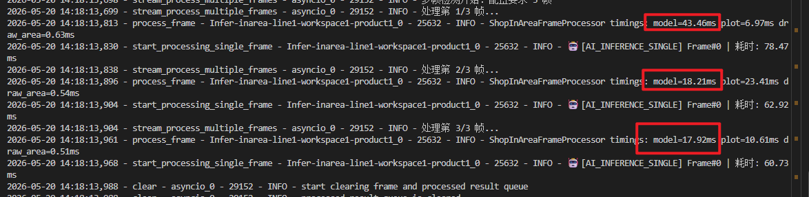


多


## 总结

生产环境不plot
