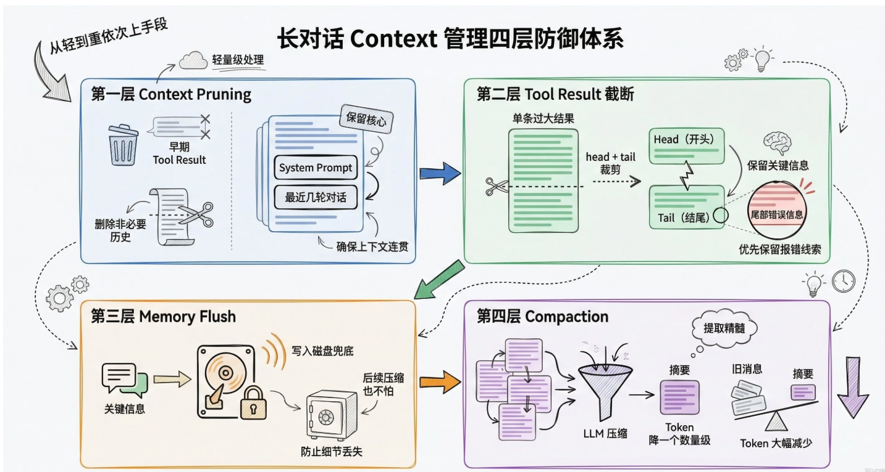
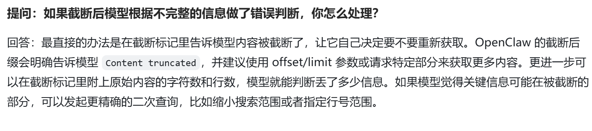
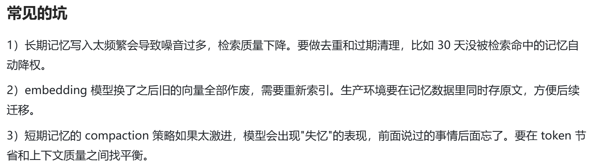
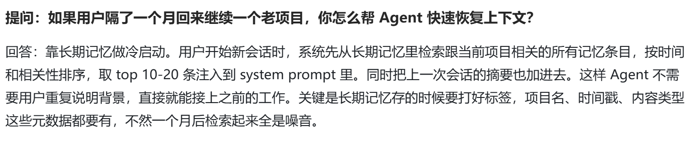
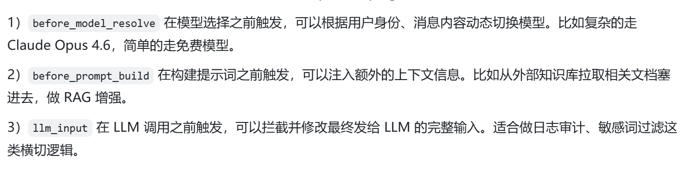

1

# 🤖一 Agent开发Question

## 1 Agent runtime 和LLM runtime 有什么区别

> #### 一、LLM Runtime 是什么
>
> LLM Runtime 的核心目标：
>
> > 让大模型“高效推理”
>
> 它关注：
>
> - 模型加载
> - KV Cache
> - Token 推理
> - GPU 调度
> - batching
> - attention 优化
> - quantization
> - speculative decoding
>
> ------
>
> ##### 常见 LLM Runtime
>
> ##### 推理框架
>
> - [vLLM](https://github.com/vllm-project/vllm?utm_source=chatgpt.com)
> - [TensorRT-LLM](https://github.com/NVIDIA/TensorRT-LLM?utm_source=chatgpt.com)
> - [llama.cpp](https://github.com/ggml-org/llama.cpp?utm_source=chatgpt.com)
> - [SGLang](https://github.com/sgl-project/sglang?utm_source=chatgpt.com)
> - [Ollama](https://ollama.com?utm_source=chatgpt.com)
>
> ------
>
> ##### LLM Runtime 负责什么
>
> 例如：
>
> ```
> response = llm.generate(prompt)
> ```
>
> runtime 内部：
>
> ```
> 1. tokenize
> 2. load kv cache
> 3. attention compute
> 4. sample next token
> 5. stream token
> ```
>
> 它不关心：
>
> - 用户目标
> - tool calling
> - memory
> - planning
> - workflow
>
> ------
>
> #### 二、Agent Runtime 是什么
>
> Agent Runtime 的核心目标：
>
> > 让模型“完成任务”
>
> 它关注：
>
> - tool calling
> - memory
> - planning
> - task loop
> - workflow
> - multi-agent
> - state management
> - retry
> - reflection
> - routing
>
> ------
>
> ## Agent Runtime 的典型流程
>
> ```
> User Query
>    ↓
> Planner
>    ↓
> Tool Selection
>    ↓
> Execute Tool
>    ↓
> Observation
>    ↓
> LLM Reasoning
>    ↓
> Next Action
> ```
>
> ------
>
> ## 常见 Agent Runtime
>
> ### Agent Framework
>
> - [LangGraph](https://github.com/langchain-ai/langgraph?utm_source=chatgpt.com)
> - [AutoGen](https://github.com/microsoft/autogen?utm_source=chatgpt.com)
> - [CrewAI](https://github.com/crewAIInc/crewAI?utm_source=chatgpt.com)
> - [OpenManus](https://github.com/mannaandpoem/OpenManus?utm_source=chatgpt.com)
> - [PydanticAI](https://github.com/pydantic/pydantic-ai?utm_source=chatgpt.com)


## 2 怎么设计dataclass

2.1 继续才分dict; 

2.2 不要管全局, task 前后分别都有dataclass


## 3 AgentSpec

因为可能都是ReAct agent, 只是prompt和tools不同,但都是同一个类, 所以采用AgentSpec而不是class

更像：“agent profile registry”

而不是：“class registry”

```
{
 "brief_react": AgentSpec(
     cls=BriefReActAgent,
     tools=[],
     system_prompt=...,
 ),

 "reacttoolcall": AgentSpec(
     cls=BriefReActAgent,
     tools=[toolcall],
     system_prompt=...,
 )
}
```


## 4 emit envent和log有什么区别?

### 4.1 区别是什么

**1. log 是单向的**

例如：

```
logger.info("tool started")
```

通常：

- 人看
- 排查问题
- 调试
- 监控

它不会：

- 驱动系统
- 触发行为
- 通知其他模块

**2. event 是系统通信**

例如：

```
_emit_event(
    "tool_start",
    {"tool": "search"}
)
```

本质：

```
“告诉整个系统：
某件事发生了”
```

然后：

- UI更新
- websocket推送
- TTS暂停
- Scheduler记录
- Agent切换状态

都可能被触发。

### 4.2 怎么设计? 分开写event 吗? llm层和runtime层, 甚至是agent层??

通常都会：

```
分层事件
```

而不是：

```
所有 event 全塞 runtime
```

因为不同层：

- 负责的东西不同
- 生命周期不同
- 粒度不同

### 4.3  even 是不是比简单的callable高级? 

```
callable = 点对点回调
event    = 可扩展的系统通信
```

event 本质上是：

```
“管理过的 callable”
```

或者：

```
“可订阅、可广播、可扩展的 callback 系统”
```

### 4.4 stream event

`callable` 明确只用于流式文本；`on_event` 可能承载更多类型（start/end/error…）。


1. 


## 6 tool

### 6,1 要不要把list tool变成readfile

@weakagent/tools/tool/list_tools.py 要不要 合并到read file和@weakagent/tools/files/read_file.py, 然后单独写一个tool_list的记录文件? 甚至我感觉不用, 直接read就可以了? 

```
**`read`（ReadFileTool）** — 读取**文件系统上的静态文件内容**（如 .md、.py 等本地文件）。
**`list_tools`（ListToolsTool）** — 查询**当前 agent 运行时的内存状态**（已挂载了哪些工具、还能添加哪 些内置工具）。

两者的数据来源完全不同：一个来自磁盘，一个来自 agent 的 `available_tools` 集合。所以**不适合合并**到 read 里。

你的思路「直接 read 就可以了」也不太行，因为 read 读的是文件，不是 agent 内存里的工具注册表。

不过你的感觉「感觉不用」有一定道理——`list_tools` 确实是个运行时调试/元工具，不是业务工具。我的建议是：

**保持现状**，`list_tools.py` 留在 `weakagent/tools/tool/` 作为一个独立的元工具，不合并，不单独写记录 文件。因为：
1. 它和 read 职责正交（磁盘 vs 内存）
2. 它是 agent 系统内部自省用的，独立文件更清晰
3. 没必要额外维护一个工具清单文件——工具注册是代码事实，不是文档
```

### 6.2 添加hot reload tool

实现:


### 6.3 添加/手动命令

-> 可以直接被hot reload 替代了

```
### 结论
**可以替换。** `HotReloadTool` 是 `AddToolTool` 的超集——所有 `AddToolTool` 的功能都能通过 `hot_reload` 的 `remount_tools` 参数完成，且额外支持代码热重载、替换已有工具、刷新注册表等能力。如果只为"挂载一个 尚未挂载的工具"这个场景，`hot_reload` 略重（需传 `module_names` + `remount_tools`），但功能上完全覆盖 。
```


### 6.5 browser tool

#### 1 如何实现? 

1. ## Playwright 

2. ## browser use库


## 7 loop

#### 以后怎么避免「误杀整个 loop」

可选改进（当前代码还没做）：

1. 400 不重试 — `retry_if_not_exception_type(BadRequestError)` 或只对 429/5xx 重试
2. `run_loop` 按轮捕获 — 单轮 `run()` 失败只打印错误，继续 `You>`
3. `think()` 优雅降级 — API 400 时写 assistant 错误消息并 `FINISHED`，而不是 `raise`


> ## 核心矛盾
>
> Recovery 的设计是「把错误当作下一轮 user message，让 agent 自我修复」。但 400 schema 错误发生在请求发出之前——只要 `bash` 还挂在 agent 上，任何一轮都会在 `think()` 阶段失败，agent 无法调用 `patch_file` / `hot_reload` 去修。
>
> 所以：坏 schema + 自动 recovery = 必死循环，直到 `max_steps` 或你 Ctrl+C。
>
> ------
>
> ## 怎么打破循环（手动）
>
> 1. 重启进程，并修正 `bash.py`（`properties` 改回正确结构）
> 2. 或在代码里先 卸载 bash：`available_tools` 里移除 `bash`，再跑
> 3. 修好后 `hot_reload` + `remount_tools=["bash"]`
>
> ------
>
> ## 框架上还应补的防护（如需我可以改）
>
> 1. 同一 error fingerprint 最多 recovery 1–2 次，之后停掉并回到 `You>`
> 2. 新 `run()` 开始时 `current_step = 0`、`state = IDLE`
> 3. schema 类 400：不 schedule recovery，或自动 unmount 报错工具
> 4. `BaseTool.to_params()` 校验 `parameters.type == "object"`，坏 schema 不发给 API
>
> ------
>
> 一句话：你故意写错的 schema 导致每次 LLM 调用必 400；recovery 又把失败自动当成下一轮 request，而 bad tool 仍挂着，所以会在同一 session 里无限重试，直到 step 上限或你手动停。这不是 API「随机报错」，是预期内的死循环。


```
“Recovery 机制期望通过‘产生对话’来修复错误；但 Schema 错误直接剥夺了 Agent‘产生对话’的权利。”

当一个坏掉的工具（Bad Tool）变成了 Agent 身体里摘不掉的“毒瘤”，任何一次尝试呼叫大模型的举动（think()）都会在临门一脚前被 API 拒之门外。Agent 连思考的机会都没有，更别提调用 patch_file 去动手术了。这就成了一个完美的闭环死锁。

你提出的这几条框架级防护措施，完全切中了分布式/智能体系统中的熔断（Circuit Breaker）和防御性编程精髓。如果你要动手重构框架，我强烈建议按照以下方案去补强：
```


##  框架防护实现方案

### 1. 静态防线：`BaseTool.to_params()` 强制校验（源头拦截）

别让脏数据出门。在工具加载或序列化为 OpenAI JSON Schema 时，直接在本地做拦截。如果格式不对，拒绝启动或拒绝发送。

### 2. 动态防线：Schema 400 自动隔离/卸载（Unmount）

如果静态校验漏过了，API 返回了 400（且特征明显是 Schema 错误），框架应该启动**隔离机制**——“既然你让我过敏，我就先把你切除”。


## 9 更新长期记忆

### 0 什么long memory 需要记忆哪些?

> 模型在“跨会话、跨任务、长期运行”过程中，持续保留的重要信息。

不是所有东西都要记，而是：
 **“未来还会影响决策、行为、回答”的信息才值得长期记忆。**

> # 1. 用户画像（User Profile）
>
> 这是最核心的长期记忆。
>
> 例如：
>
> - 用户是谁
> - 做什么方向
> - 技术栈
> - 偏好
> - 常用语言
> - 长期目标
>
> 比如你：
>
> - AI / CV 方向
> - YOLO、FastAPI、Spring AI
> - 喜欢深入原理
> - 正在做 Agent 系统
> - 偏向工程化
>
> 这些都属于长期稳定信息。
>
> # 2. 长期项目状态（Project Memory）
>
> Agent 很重要的一类。
>
> 例如：
>
> - 当前正在开发什么系统
> - 系统架构
> - 模块职责
> - 已做过的设计决策
> - 已踩过的坑
>
> 例如：
>
> - ChatService / SqlService / QueryService
> - FastAPI 人脸识别系统
> - YOLO 剪枝项目
> - SQL 工业分析系统
>
> 这些属于：
>  “未来多轮会持续引用的信息”。
>
> ------
>
> # 3. 用户偏好（Preference Memory）
>
> 这类非常实用。
>
> 例如：
>
> - 喜欢中文回答
> - 喜欢深入原理
> - 不喜欢过度简化
> - commit message 要固定模板
> - 喜欢 PyTorch 风格文档
> - 回答不要太水
>
> 这会直接影响生成风格。
>
> # 不该进入 Long Memory 的内容
>
> 很多人会把“聊天记录”直接当长期记忆。
>
> 这是错误的。
>
> 以下通常不该长期保存：
>
> ------
>
> ## 1. 一次性问题
>
> 例如：
>
> - 今天 CUDA 报错
> - pip install 失败
> - 某次日志分析
>
> 这些生命周期太短。
>
> ------
>
> ## 2. 短期上下文
>
> 例如：
>
> - “帮我翻译一下”
> - “解释这段代码”
> - “这个变量是什么意思”
>
> 会话结束基本没价值。
>
> ------
>
> ## 3. 临时状态
>
> 例如：
>
> - 今天在公司
> - 正在下载模型
> - 刚刚编译失败
>
> 这种属于 working memory。

#### 判断标准

判断该不该进入 Long Memory：

问一句：

> “未来 1 个月后，这条信息还会影响 Agent 行为吗？”

如果：

- 会 → 值得长期记忆
- 不会 → 放短期记忆

### 2 怎么载入

2.1 全量直接拼 Prompt

2.2 动态检索相关记忆。

### 3 怎么拼? 

#### 3.1 拼到 system prompt 

1 双rule=system

```
  {
    "role": "system",
    "content": "你是 AI 助手"
  },
  {
    "role": "system",
    "content": "[Memory]\n用户正在做 YOLO 剪枝"
  },
  {
    "role": "user",
    "content": "为什么速度没提升？"
  }
```

2 

```
你是 AI 助手

[Memory]
- 用户正在做 YOLO 剪枝
- 用户使用 TensorRT
```

####  3.4 system list


####  3.3 fake assistant/tool message


### 4 什么时候写

#### 4 memory flush 

#### 5 自动归档


## 10 设置 rereading?

### 为什么会有 Re-Reading

很多模型会出现：

- 忽略用户约束
- 长上下文遗漏
- RAG 检索结果没用上
- Tool 调用后忘记原问题
- 多轮对话后偏题

> ### 三、Agent 中的 Re-Reading 场景
>
> Agent 比普通 Chat 更容易丢信息。
>
> 因为：
>
> ```
> User
>  -> Planner
>  -> Tool
>  -> Memory
>  -> RAG
>  -> Reflection
>  -> Final Answer
> ```
>
> 上下文会越来越长。
>
> 因此常见：
>
> ------
>
> #### 1. Tool 后 Re-Reading
>
> 例如：
>
> ```
> 用户：
> 帮我查 RTX 5090 显存
> ```
>
> Agent：
>
> - 调 web tool
> - 返回一堆网页
> - 最后回答时忘记用户问的是“显存”
>
> 所以：
>
> Tool 后：
>
> ```
> Re-read original user request:
> "帮我查 RTX 5090 显存"
> ```
>
> ------
>
> #### 2. 多轮任务 Re-Reading
>
> 例如 Coding Agent：
>
> ```
> Step1: 生成代码
> Step2: 修改代码
> Step3: 修 Bug
> ```
>
> 容易：
>
> - 忘记最初架构
> - 忘记用户限制
>
> 所以每轮：
>
> ```
> Re-read system constraints and user requirements.
> ```
>
> ------
>
> #### 3. RAG 后 Re-Reading
>
> RAG 常见问题：
>
> ```
> 检索内容很多
> 模型没真正利用
> ```
>
> 所以：
>
> ```
> 在回答前，
> 重新阅读：
> 1. 用户问题
> 2. 检索结果
> 3. 当前计划
> ```
>
> ------
>
> ### 四、Re-Reading ≠ Reflection
>
> 很多人会混。
>
> 区别：
>
> | 技术             | 核心             |
> | ---------------- | ---------------- |
> | Re-Reading       | 重新聚焦上下文   |
> | Reflection       | 自我检查推理错误 |
> | Self-Consistency | 多路径推理投票   |
> | ReAct            | 推理 + 工具调用  |
> | Retry            | 失败重试         |
>
> Re-Reading 更轻量。
>
> 它不一定“思考”。
>
> 只是：
>
> > 再看一遍。


## 11 进行工具管理?

### 🎯 动态工具检索 (Two-Stage Tool Retrieval)

不要把所有的工具一次性塞给大模型。

1. **第一阶段（检索）：** 用户输入请求后，利用一个轻量级的向量检索器（Embedding Router）或意图分类模型，从数百个工具中筛选出最相关的 3~5 个工具。
2. **第二阶段（决策）：** 仅将这几个筛选后的工具 Schema 送入大模型，让其进行最终的调用决策。这不仅极大地节省了 Context 成本，还显著提高了 Agent 的决策准确率。

```
Tool Selector
    ├── Tool Classifier（分类器）
    ├── Rule-based Filter（规则过滤）
    ├── Semantic Retriever（语义检索）
    └── Ranker（最终排序）
```

**动态注入**： 不同任务类型使用不同的工具子集。例如：

- 编程任务 → 重点注入代码、文件、调试工具
- 研究任务 → 重点注入搜索、浏览、RAG 工具


# ✍️二 设计实现相关

## 1 上下文相关

### 1.1 user message, 如何上下文拼接✅

#### 1.1.0 直接拼接

```
usr1: 原始query

assistant1: content+tool_use

tollcall1: toolcall result

assistant2: content+tool_use

tollcall2: toolcall result

assistant3: content+tool_use
...
```


#### 1.1.1 把history写入user

```
usr1: 原始query

assistant1: content+tool_use

usr1: **history**+原始query+ toolcall result

assistant1: content+tool_use

usr1:  **history**+原始query+ toolcall result

...
```


#### 1.1.1设计next prompt

设计而外的next prompt作为user prompt

```
usr1: 原始query

assistant1: content+tool_use

tollcall1: toolcall result

usr2: **next prompt**

assistant2: content+tool_use

tollcall2: toolcall result

usr3: **next prompt**

...
```


#### 1.1.2 把toolcall result作为user prompt

```
usr1: 原始query

assistant1: content+tool_use

usr2: toolcall result

assistant2: content+tool_use

usr3: toolcall result

...
```


### 1.2 怎么agent stop的? ✅

#### 1.2.1  无toolcall 调用

#### 1.2.2 调用特殊的结束工具


### 1.3 message如何压缩的 ✅

#### 1.3.1 run stream时

1. 只保留20max step的历史, 但是不最多只跑20 step

#### 1.3.2 runtime时

1. 只保留n max run的历史, 且只保留query+terminate message, 省略中间调用链
2. 中间tool链可选提取出SKILL


## 2 scheduler如何设计的

### 2.1 怎么设计agent启动scheduler任务


### 2.4 如何创建

用户通过自然语言让 Agent 调用 `scheduler` 工具，例如：

> 每天早上 9 点提醒我开会

Agent 会创建 cron 任务 `0 9 * * *`

**实现特点小结**

| 特性     | 说明                                                         |
| :------- | :----------------------------------------------------------- |
| 调度引擎 | 自研轻量实现，线程 + `time.sleep` 轮询                       |
| 精度     | 约 ±30 秒（30 秒检查间隔）                                   |
| 持久化   | 用户任务存 `tasks.json`，重启后恢复                          |
| 防递归   | 定时执行 Agent 任务时会设 `is_scheduled_task=True`，并排除 `scheduler` 工具 |
| 会话隔离 | 定时任务用独立 `session_id`（`scheduler_{receiver}_{task_id}`），不污染用户对话 |
| 记忆注入 | 定时任务结果可写回用户会话历史，便于后续追问                 |

### 2.5 如何运行

在独立 daemon 线程里循环：

```
scheduler_service.pyLines 55-65

​    def _run_loop(self):

​        """Main scheduler loop"""

​        logger.debug("[Scheduler] Scheduler loop started")

​        

​        while self.running:

​            try:

​                self._check_and_execute_tasks()

​            except Exception as e:

​                logger.error(f"[Scheduler] Error in scheduler loop: {e}")

​            time.sleep(30)
```

到期后根据 `action.type` 分发：

- `agent_task`：调用 Agent 执行任务，结果发到对应渠道
- `send_message`：发固定文本（旧格式）
- `tool_call` / `skill_call`：直接调工具或让 Agent 跑 skill

启动入口在 `AgentInitializer._initialize_scheduler()`，首次初始化 Agent 时调用 `init_scheduler()` 并启动后台服务。


### 2.6 上下文是如何拼接的?

scheduler session 的上下文 = 完整 system prompt + 该 task 隔离 session 的历史 + 本轮 `task_description` 作为 user 消息 + 本轮 tool 多轮过程；与用户聊天 session 无关，且重启后历史会被压成「任务描述 + 最终回复」的文本对。

1. 本轮 `task_description` 作为 user 消息 ,+ 本轮 tool 多轮过程(如果有)
2. 不同的task有不同的上下文, 且与用户聊天 session 无关
3. 重启时, 会读取历史(内存/数据库)四个user assistant对, 且只会保留query+final content, 中间的toll call 省略了.
4. 第二次触发会保留上一次的完整tool工具链,但是最多四轮
5. task结果可选择是否写回对话session的上下文


### 2.7 tool 去scheduler, 防止嵌套


### 2.999 scheduler runner要全局单例吗? 什么情况下考虑使用全局单例


## 3 memory设计


### 1 memory机制✅



```
我发现一个问题, 当进行flush memory的时候, user request会默默消失, 变成上一条的, 比如我刚刚问的其实是You> hot reload tool 具体是如何实现的?     [WARNING][2026-05-27 14:29:46][short.py:367] - Memory cleanup: keep_last_n trimmed turns. before=116 after=113 keep_last_n=12[INFO][2026-05-27 14:29:46][base.py:450] - Short memory pruned before run (messages=113 strategy=keep_last_n)[INFO][2026-05-27 14:29:46][base.py:484] - Executing step 3/100[WARNING][2026-05-27 14:29:46][short.py:265] - Short memory flush run_id=d834004ae1e3 flushed=74 kept=40[INFO][2026-05-27 14:29:46][base.py:498] - Short memory flushed run_id=d834004ae1e3 flushed=74 kept=40[INFO][2026-05-27 14:29:55][llm.py:171] - Token usage: Input=14645, Completion=693, Cumulative Input=939702, Cumulative Completion=19060, Total=15338, Cumulative Total=958762
```


### 2 长tool result 处理 ✅




### 3 记忆格式






### 4 memory 是如何存储的? 


## 4 system messsage

### 4.1如何保存? 

1. 是在run的时候检查是否需要session_id 有无system message, 再加一个标志位,只第一个run检查
2. 还是init agent的时候检查和写入? 
3. 如果同一个session, 但是long memory 变换导致system message变换了, 又该如何处理?=> 给system message 添加一个字段, 判断该message是不是long memory的, 进行增量更新? 还是?

## 5 结构化输出

### 1 失败重试+history fail message 替换

## 6 幂等性保护?


## 7 排队机制? 

### 1 单个消息排队? 

### 2 多用户排队? 

### 3 


## 8 Hook 插入点

### 1 


## 9 MCP

```
                ┌──────────────┐
Client ───────▶ │ HTTP Gateway │
                └──────┬───────┘
                       │
        ┌──────────────┴──────────────┐
        │                             │
   Tool API                    Stream API
 (HTTP JSON)                  (SSE/WebSocket)
        │                             │
   MCP Core                     MCP Runtime
```


## 999 自我进化

自我进化用一句来讲，大概是这样：

> 真实任务里的经验，怎么变成下一次任务可复用、可验证、可治理的能力。

### 策略

**上下文进化**：将执行经验、用户偏好或环境约束写回本地记忆文件、会话索引或技能目录，在下一次任务触发时通过检索提取并拼接入上下文。

**技能进化**：把经验外化成结构化的 SKILL.md、技能包或工作流脚本。系统依据执行报错或反馈信号，自动修改技能代码，在测试集中跑通后覆盖老版本，失败则触发版本回滚。

**群体智能进化**：多个 Agent、多台机器、多个用户的本地经验接入云端共享层。系统在服务端完成轨迹去重、冲突合并、安全脱敏与质量验证，最后将提纯后的技能或记忆分发回所有终端。

**策略进化**：将真实的交互轨迹与成败反馈收集起来，直接修改 Agent 的核心调度代码、工作流拓扑，甚至转化为强化学习（RL）的标量奖励来更新大模型的底层参数。


#### 1 上下文进化

典型的上下文资产包括：

- 跨会话记忆✅
- 会话检索
- 用户画像✅
- 项目级上下文
- 技能目录的动态装载
- 失败后的反思记录

**触发时机**

执行反馈与用户纠正产生分叉，一部分写入策展记忆，一部分沉淀为 Skills。当新任务到来，系统通过 session_search 将历史记忆与技能一并汇入下一轮上下文。


#### 2. 技能进化

系统依据执行报错或反馈信号，自动修改技能代码，在测试集中跑通后覆盖老版本，失败则触发版本回滚。

所以当我们发现某类经验开始重复出现，就不应该继续把它留在记忆层，而应该上升成技能资产。

允许 agent 自己创建、编辑、补丁、删文件、写附属文件。

**自动复盘机制。**

第一层是 nudge。memory 按用户回合数触发，skills 按工具迭代次数触发。达到阈值以后，系统会在主任务完成后，后台 fork 一个 review agent，让它复查当前会话，看有没有东西值得落 memory 或 patch/create skill。[run_agent.py] run_agent.py#L2448-L2547  [run_agent.py] run_agent.py#L11586-L11612

第二层是 guidance。系统提示里直接写明：

- 复杂任务、踩坑任务、发现可复用流程，要考虑存技能
- 技能用着发现过时或不完整，要立刻 patch


#### 3 多agent skill共享层

#### 4 微调模型


# 📋三, 代码相关


# 1 runtime

### 1.1 manager = AgentManager.get_instance() 这个能不能写在@weakagent/agent/manager.py , 进行初始化

可以写，但按你现在这套实现，直接写在 `manager.py` 顶层基本没效果。

原因是：

- `AgentManager.get_instance()` 只是“取现有实例”，不会创建。
- 模块导入时如果还没调用过 `await AgentManager.instance()`，它返回的就是 `None`。
- 所以在 `manager.py` 顶层写 `manager = AgentManager.get_instance()`，大概率只是把 `None` 绑定到一个变量。

更推荐两种方式：

- 在应用启动处统一初始化一次：`await AgentManager.instance()`
- 业务代码里继续用 `get_instance()` 取（拿不到就报“未初始化”），你现在 `run_sub_agent` 就是这种防御写法。


### 1.2 现在的调用链是不是从BriefReActMultiAgent->sub_agent name -> manager -> Factory.agent_type; 如果@factory.py (14-21) 没有就会报错? 为什么factory要register, factory也要register

当前链路是：

`BriefReActMultiAgent.execute_tool()`
→ 调 `RunSubAgentTool`（传 `sub_agent_name`）
→ `manager.create_agent(sub_agent_name, ...)`
→ `manager.factory.create(agent_type=sub_agent_name)`
→ `AgentFactory` 从 `_registry` 找到类并实例化。

如果 `factory.py` 里没有这个 key（比如没注册某个 `sub_agent_name`），会报错/失败，而且你这里是“双保险”：

- `run_sub_agent.py` 先检查 `sub_agent_name in factory.supported_types`，不在就直接返回失败；
- 就算前面没检查，`factory.create()` 里也会 `Unsupported agent_type`。


#### 1.2.1 问“为什么 factory 要 register，manager 也要 register”：

它们职责不一样，不是重复。

- `Factory.register`：注册类型映射（`"multi_react" -> BriefReActMultiAgent`），解决“怎么创建”。
- `Manager.register`：注册运行时实例（agent_id、parent/children、task、状态），解决“创建后怎么管理”。

可以理解成：

- Factory 是“类工厂/构造器路由表”；
- Manager 是“实例生命周期管理器”。

两层都需要，分别管“出生”和“养育”。


## 2 scheduler

### 2.1 为什么不要直接 Factory

因为：

Factory 更偏：

```
创建对象
```

而你这里更像：

```
根据 task_type 找执行器
```

所以：

```
Registry 比 Factory 更准确
```

### 2.2 Executor? 为什么不用task.execute

你在纠结：

```
task.execute()
```

还是：

```
executor.execute(task)
```

本质上是在：

```
OO（面向对象）
vs
Runtime/Engine 架构
```

之间做选择。

**Task 更应该像 DTO**

推荐：

```
class Task(BaseModel):
    id: str
    type: str
    payload: dict
```

------

**Executor 才是 Runtime**

真正复杂的是：

```
class SummaryExecutor:
```

它才有：

```
self.memory
self.llm
self.agent_factory
self.eventbus
```

因为：

```
它属于运行时
```

> ### 真正推荐的是“注册式执行器”
>
> 类似：
>
> ```
> task.type
>  ↓
> registry
>  ↓
> executor class
> ```
>
> 例如：
>
> ```
> registry.register(
>  "daily_summary",
>  DailySummaryExecutor
> )
> 
> registry.register(
>  "weekly_report",
>  WeeklyReportExecutor
> )
> ```


### 2.3 那为什么tool 设计成tool..execute

Task 本质是“调度**描述**”，它的存在是为了让系统可以把“什么时候做什么事”持久化下来、排队、恢复、分布式执行。它更像一条记录、一份计划书，所以它必须保持稳定、纯粹、无依赖，这样才能被存到数据库里、跨进程传输、失败后重新执行。如果你让 Task 自己去 execute，那它就必须知道怎么调用 LLM、怎么用 tool、怎么处理 retry、怎么管理状态，这**会导致它从“数据”变成“运行时系统”，**整个调度层会和业务逻辑强耦合，系统会逐渐失去可拆分性和可扩展性。

而 Tool 不一样，Tool 本质是“能力本身”，它不是计划，也不是调度结果，而是**最底层的动作单元**，比如搜索、计算、请求 API、读数据库。它的特点是输入明确、输出明确、**无调度逻辑**，它不会关心什么时候被调用，也不会关心是谁在调用，它只负责“做一件事”。所以 Tool 设计成 execute 是合理的，因为它本来就是被执行的对象。

真正关键的区别在于：
 **Task 解决的是“要不要做、什么时候做”，Tool 解决的是“具体怎么做”。**

如果把 Task 也设计成 execute，就等于把调度系统和执行系统混在一个对象里，最终会变成一个既要管时间、状态、队列，又要懂业务逻辑和外部能力的“超级对象”，系统会失去分层结构，后期扩展（比如加新 tool、加分布式 worker、加重试队列）都会变得非常痛苦。

所以不是“能不能这样设计”的问题，而是：
 一旦 Task 负责 execute，系统就不再是调度系统，而变成一个难以拆分的运行时整体；而把 execute 放在 Tool 上，是在保持“调度”和“能力”分离，让整个系统可以像操作系统一样分层运行。

> 这是个很好的“你已经开始区分层级了”的问题，因为：
>
> > **Tool 和 Task / Executor 根本不是同一层抽象**
>
> 你卡住的点本质是：
> 👉 “为什么有的东西是 data + executor 分离，有的又是 object.execute()？”
>
> ------
>
> Tool 是“可执行能力单元”，Task 是“调度数据单元”。
>
> 
>
> ------
>
> ## 三、为什么 Tool 可以 execute？
>
> 因为 Tool 本质是：
>
> ```text
> 最底层“动作原子”
> ```
>
> 类似：
>
> ## CPU instruction
>
> ```text
> ADD / SUB / LOAD / STORE
> ```
>
> ------
>
> ## Tool = 原子能力
>
> ```python
> class SearchTool:
>     async def execute(query):
>         ...
> ```
>
> 它特点：
>
> ### ✔ 没有“调度逻辑”
>
> ### ✔ 没有“任务生命周期”
>
> ### ✔ 没有“业务编排”
>
> ### ✔ 输入 → 输出非常明确
>
> ------
>
> # 四、Task 为什么不能 execute？
>
> 因为 Task 是：
>
> ```text
> “描述”
> ```
>
> 不是：
>
> ```text
> “能力”
> ```
>
> ------
>
> ## Task 如果 execute，会变成：
>
> ```python
> task.execute() -> 内部决定调用 tool / llm / memory
> ```
>
> 问题：
>
> 👉 Task 变成“mini runtime”
>
> 最终：
>
> ```text
> Task = Scheduler + Executor + Tool + Agent
> ```
>
> 系统直接坍缩
>
> 
>
> ## 六、为什么 Tool 必须是 execute 风格？
>
> 因为 Tool 有一个非常关键特点：
>
> ------
>
> ## 👉 Tool 是“可替换能力模块”
>
> 例如：
>
> ```text
> search_tool_v1
> search_tool_v2
> search_tool_llm_based
> ```
>
> 统一接口：
>
> ```python
> tool.execute(input)
> ```
>
> ------
>
> ## 如果不用 execute，会变成：
>
> ```python
> tool.search()
> tool.query()
> tool.run()
> tool.call()
> ```
>
> 系统会变得：
>
> ```text
> 不可统一编排
> ```


## 3 default_kwargs

more default_kwargs

后续会进行payload覆盖

### 3.1 部分参数单独处理

- `name` 单独处理：`name` 作为显式参数传进来时，必须覆盖 `default_kwargs` 里的 `name`，也覆盖你在 `**kwargs` 里可能传的 `name`。所以工厂在合并完 `kwargs` 后再强制 `payload["name"]=name`。
- `llm` / `config_name` 单独处理：这是依赖注入逻辑。
  - 如果调用方直接给了 `llm` 实例，就用它（最高优先级）。
  - 否则如果给了 `config_name`，工厂帮你构造 `LLM(config_name=...)` 再注入（让调用方不用自己 new）。
  - 这也会覆盖默认或 `**kwargs` 里可能带的 `llm`，保证“工厂参数 > 其它来源”


# 🪄三, 代码语法解析

## 1  *, 和 **kwargs: Any 的区别是什么 作用是什么?

```
    def create_agent(
        self,
        agent_type: str,
        *,
        agent_id: Optional[str] = None,
        parent_id: Optional[str] = None,
        **kwargs: Any,
    ) -> str:
        """Create and register an agent via AgentFactory."""
        agent = self.factory.create(agent_type, **kwargs)
        return self.register(
            agent,
            agent_id=agent_id,
            agent_type=agent_type,
            parent_id=parent_id,
        )
```

在 Python 函数签名里，这两个东西作用不同：

- **`*,`**：把它后面的参数都变成**只能用关键字传**（keyword-only）。
  - 所以这里 `agent_id`、`parent_id` 不能用位置参数传，只能写成 `agent_id="..."`、`parent_id="..."`。
  - 好处是调用更清晰，也避免把一堆可选参数按位置传导致顺序/含义搞错。

- **`**kwargs: Any`**：收集调用时额外传入的、签名里没显式列出来的所有关键字参数，打包成一个 `dict`（类型标注为值是 `Any`）。
  - 在 runtime 里通常用来把这些“创建 agent 的参数”（比如 `name`、`system_prompt`、`max_steps` 等）继续转发给工厂/agent 构造。

举例：

```python
runtime.create_agent("echo", "oops")          # 会报错，因为 * 之后不允许位置参数
runtime.create_agent("echo", agent_id="a1")   # OK
runtime.create_agent("echo", name="p", max_steps=1)  # name/max_steps 会进 kwargs
```

# 五 优化相关

## 1 ReAct agent

1. 把think message 作为临时历史对话发送给tool select, 而不再写入上下文
2. 把next prompt作为临时message, 指导loop中每一个step
3. 


