# 标定


# 1. 相机标定

## 1.1 目的: 

**求相机内参和畸变参数**

包括：

- 焦距
- 主点
- 畸变系数
- 外参

## 1.2 常用方法

### **张正友标定法**

#### Step 1：准备棋盘格

示例：`9 × 6` 棋盘格

⚠️ 重要注意：

- 数值代表**内角点数量**
- **不是棋盘格子的数量**

------

#### Step 2：拍摄多张图片

拍摄要求：

- 不同角度
- 不同距离
- 不同位置

示例姿态：

- 左倾
- 右倾
- 近距离
- 远距离

推荐数量：**10~20 张**即可满足标定精度需求。

------

#### Step 3：检测角点

使用 OpenCV 核心函数：

- `cv2.findChessboardCorners()`

得到结果：

- 棋盘格角点的**图像像素坐标**

精度优化：

- `cv2.cornerSubPix()`：亚像素角点优化
- 最终可达到**亚像素级精度**

------

#### Step 4：建立对应关系

构建**世界坐标 ↔ 图像坐标**的映射关系：

- 世界坐标：`(X, Y, Z)`
- 图像坐标：`(u, v)`

标定简化规则：

棋盘格为平面，默认令 **Z = 0**

只需使用：`(X, Y, 0)`

------

#### Step 5：求单应矩阵 H

每张标定图片，都对应一个**单应矩阵（Homography）**

------

#### Step 6：求内参矩阵 K

标定**核心目标**：求解相机内参矩阵

内参矩阵格式：

K=fx000fy0cxcy1

求解依据：

利用**多张图像的单应约束**，计算得到：

- fx、fy：焦距参数
- cx、cy：图像主点坐标

------

#### Step 7：求外参

每张图片对应一组**外参**，表示：

**棋盘格相对于相机的位置**

外参包含：

- 旋转矩阵 R
- 平移向量 t

------

#### Step 8：求畸变参数

真实相机镜头存在光学畸变：

- 桶形畸变
- 枕形畸变

OpenCV 标准畸变系数：

```
[k1, k2, p1, p2, k3]
```

- k1,k2,k3：径向畸变系数
- p1,p2：切向畸变系数

------


# 2 手眼标定

## 2.1 目的: 

标定目的是为了统一坐标系 。摄像头检测的物体是在摄像头的坐标系下， 机械臂的运动又是在机械臂自身坐标系下。 物体是同一个物体， 但在不同的坐标系下有不同的坐标表示， 这就需要统一到一个坐标系下。

## 2.2 原理

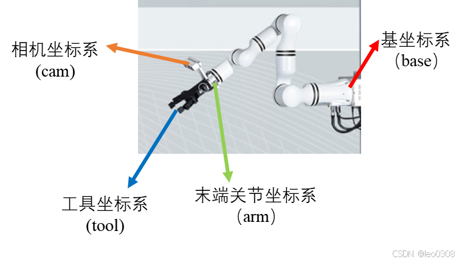

**机械臂手眼标定就是要找出相机坐标系到末端关节坐标系的转换关系。**

> https://blog.csdn.net/leo0308/article/details/141498200


## 2.3 常用方法

### 通用思路

> https://blog.csdn.net/qq_45006390/article/details/121670412

​    机器人的手眼标定其实就是**两个坐标系之间的转换关系**的标定。我们希望计算出**相机坐标系到机械手坐标系**的转换关系，并且我们已知**对应的几个固定点**  在这两个坐标系的坐标 和 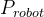 。根据坐标转换 公式，可以得出：

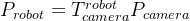

​    上式中的 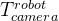 表示我们希望计算出的相机到机械手的转换矩阵。


> 代码:
>
> https://github.com/leo038/hand_eye_calibrate
>
> https://github.com/TIMIDBABY/HandEyeCalibrateForRobot

### 1 眼在手上

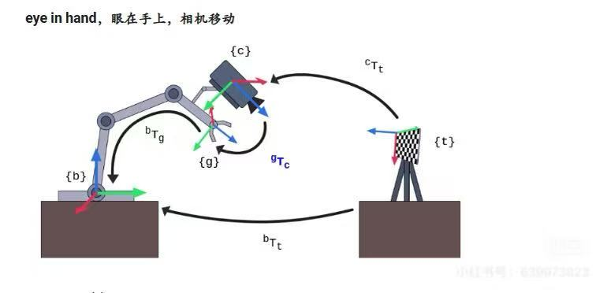

#### 1.1 待求量

​    相机安装在机械手上，随着机械手一起移动。对于 *Eye-in-Hand* 而言，**相机坐标系**相对于**机械手末端夹具坐标系**是**固定的**，而对于**机械手基础坐标系**是**变化的**。

​    当相机固定于机械手末端夹具时，此时**相机坐标系与机械手末端夹具坐标系**的变换关系固定，而与基座坐标系的变换关系会时刻变化，因此此时的**待求量**变成了**相机坐标系**(camera )到**机械手末端载具坐标系**(tool)的变换矩阵 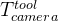。

#### 1.2 转换关系推导

​    根据各个坐标系的关系，我们可以给出下述的坐标变换方程：

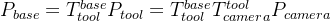

​    上式中  代表固定在某个位置上的**棋盘格中的角点**，在机器人基座坐标系下的坐标。可以通过两种方式计算这个坐标：

​    1）在机械手末端的夹具上**加上探针**，直接由**末端去触碰棋盘格上的点**，根据机器人正向运动学得到的**末端夹具到基座坐标系**的转换矩阵 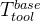 及**棋盘格角点到末端坐标系**的坐标 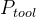，我们可以得到固定的**棋盘格角点在机器人基座坐标系下的坐标**  。

​    2）在机械手末端的夹具上**安装相机**，由相机去**直接测量棋盘格角点机器对应的坐标** 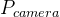，通过计算**机器手末端夹具到基座坐标系**的转换矩阵  和**相机坐标系到机器人末端坐标系**的转换矩阵 ，便可以求出**棋盘格在机器人基座坐标系**下的坐标 。

​    在第二种方式中，相机坐标系到机器人末端坐标系的转换矩阵  是我们的待求量，因此我们需要对**开始时描述的坐标变换方程**进行简单的**变换**：

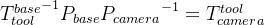

​    在上式中，坐标的三个变量都是**已知量**，由此我们可以计算**出相机到机器人末端坐标系**的转换矩阵 。


### 2 眼在手外

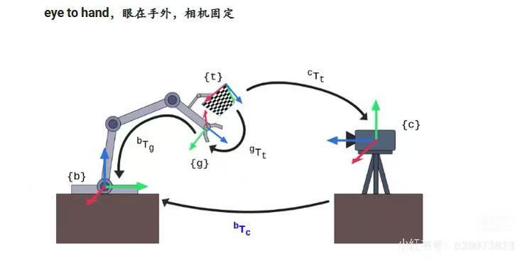


#### 2.1 待求量

​    相机固定在一个地方，机械手的运动不会带着相机一起移动。对于 *Eye-to-Hand* 而言，**相机坐标系相对于机械手基础坐标系是固定的**，而**对于机械手末端夹具坐标系是变化的**。

​    在 *Eye-to-Hand* 的问题下，待求量为**相机到机械手基座坐标系**的**固定转换矩阵** 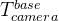 。考虑到相机是固定在一个位置，因此相机只有相对于基座坐标系才是固定不变的，这样我们的**待求量** **是一个固定的参数**，这样的标定才是有意义的。

#### 2.2 标定思路

​    根据 **第3.1节** 中所介绍的通用求解思路，下一步需要通过**棋盘格图像上的固定点** 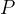 来获得**机械手基座坐标系下的固定点坐标** 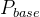 和**相机坐标系下的坐标** 。

​    通过识别棋盘格，我们可以得到**棋盘格中的角点**在**相机坐标系下**的坐标 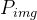，但是这是**二维坐标**，通过**相机内参和物体的深度信息**我们可以计算出 。接下来我们只要测量出来对应的**棋盘格点在机械手基座坐标系下**的坐标 ，便可以标定出**机械手和相机之间的转换矩阵** 。

#### 2.3 转换关系推导

​    在 *Eye-to-Hand* 问题下，**棋盘格**在标定的时候，会**固定在机械手的末端夹具**上，而机械手的**末端夹具坐标系到基座坐标系的转换矩阵**，可以通过机器人**正向运动学**计算得到。因此我们可以通过如下关系测量出棋盘格点在机器人基座坐标系下的坐标  ：

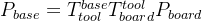

​    在上述公式中， 和 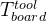 分别代表**机械手末端夹具坐标系***(tool)*到**基座坐标系***(base)*的转换矩阵和**棋盘格坐标系***(board)*到**机械手末端夹具坐标系***(tool)*的转换矩阵。

​    其中， 可以实时根据**机器人正向运动学**得到，而  可以通过设计**一个固定尺寸**的**棋盘格**得到。当棋盘格尺寸以及安装固定后，我们可以设**棋盘格的左上角点为原点**，然后通过测量或者设计尺寸**计算棋盘格原点**到**机器人末端坐标原点**的**平移坐标**，而棋盘格平面一般**与机械手末端载具平面平行**，因此该**原点的法向量**也可以获得，接下来就可以计算出  。

​    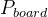 代表**棋盘格角点再棋盘格坐标系下的坐标**，这个同样可以根据设计棋盘格的尺寸得到。需要注意的是棋盘格的角点在**机器人坐标系**和**图像坐标系**的顺序需要**一一对应**，但是一般的方形棋盘格会存在旋转对称的问题，即我们无法区分棋盘格的原点是在左上角还是右下角，因此在进行手眼标定时可以**使用非对称的棋盘格**。

​    通过上面的推导，我们已经可以计算出**棋盘格角点在机器人基座坐标系中的坐标** ，然后根据**张正友标定法**得到**棋盘格在相机坐标系中的坐标** 。那么根据 **第3.1节** 中介绍的计算方法就可以得到相机到机器人的转换矩阵：

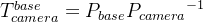


# 3 实现

## 3.1 眼在手上标定采样

### 1 标定过程

> https://www.bilibili.com/video/BV1xQgBztEsF

| 特性     | 眼在手上                     | 眼在手外                           |
| :------- | :--------------------------- | :--------------------------------- |
| 移动部件 | 相机（末端带动）             | **标定板（末端带动）**             |
| 固定部件 | 标定板                       | **相机**                           |
| 运动目的 | 让相机从不同角度看静止标定板 | 让标定板从不同角度出现在静止相机中 |


### 2 问题汇总

#### 2.1 在**手眼标定**中，棋盘格是否需要确认上下方向?

通常不需要刻意确认“上下方向”，但**必须保证棋盘格在标定过程中相对于所附着的刚体（末端或固定支架）保持固定的位姿。**


#### 2.2 **眼在手上标定时，移动的是机器人末端（夹爪/法兰），棋盘格必须保持固定不动。**

手眼标定的核心方程 AX=XB*A**X*=*XB* 或等价形式依赖于**相对运动**的约束：

- A*A*：机器人末端的两次运动之间的变换（由机器人控制器给出）
- B*B*：相机相对于**同一标定板**的两次观测之间的变换（通过视觉求解）

如果棋盘格也在移动，那么两次观测之间的 B*B* 就不再是单纯的相机运动，而是相机与棋盘格**相对运动**的叠加。此时方程退化为 AX=X⋅(未知移动棋盘格的影响)*A**X*=*X*⋅(未知移动棋盘格的影响)，无法分离出唯一的手眼矩阵 X*X*。


#### 2.3 是否需要拍全棋盘格? 

**必须确保棋盘格的所有内角点都完整出现在相机视野内**。

OpenCV 的 `cv2.findChessboardCorners` 要求棋盘格的所有内角点（例如 9×6 棋盘格有 8×5 个内角点）都在图像中，且能够形成完整的矩形网格。

- 如果棋盘格部分超出视野或被遮挡，函数会返回 `False`，无法提取任何角点。

- 即使强行使用部分角点（修改代码），也无法确定角点的全局编号（哪个是(0,0)哪个是(8,5)），导致物体坐标系错乱。

  

#### 2.4 图像xyz和法兰的xyz不一样,标定有影响吗? 

**没有影响**。手眼标定本身就包含了**两个坐标系之间的旋转对齐**，不需要你事先将相机XYZ与法兰XYZ对齐。标定结果会**自然地描述两个坐标系之间的相对方位**


#### 2.5 位姿坐标如何选择? 选谁的位姿坐标?

注意! 位姿要选择和相机相对静止的坐标

需要选择和手上相机固定轴的坐标, 如果相机固定在末端轴, 就需要末端的位姿; 如果机械臂末端而外嫁了工具坐标, 且相机固定在工具上, 那么位姿输入要是根据坐标而不是末端坐标


#### 2.6 机器人避免纯平移运动

每次移动应包含明显的**旋转变化**


## 3.2 内参标定结果

### 1 结果对比

| 参数     | DEFAULT (无畸变) | Calib1 (第一次)                                          | Calib2 (第二次)                                          | Calib1→Calib2 变化 |
| :------- | :--------------- | :------------------------------------------------------- | :------------------------------------------------------- | :----------------- |
| fx       | 476.1199         | 442.9018                                                 | 456.2401                                                 | +13.3383 (+3.0%)   |
| fy       | 476.1199         | 442.7662                                                 | 454.0876                                                 | +11.3214 (+2.6%)   |
| cx       | 321.7154         | 332.2391                                                 | 346.8900                                                 | +14.6509           |
| cy       | 197.3588         | 246.3240                                                 | 225.5018                                                 | -20.8222           |
| 畸变系数 | 无               | k1=0.07639 k2=-0.06578 p1=0.00341 p2=0.00316 k3=-0.24026 | k1=0.12873 k2=-0.22656 p1=-0.01889 p2=0.01624 k3=0.10490 |                    |

| 指标 | DEFAULT | Calib1 | 与 DEFAULT 差 | Calib2 | 与 DEFAULT 差 | 谁更接近 DEFAULT |
| :--- | :------ | :----- | :------------ | :----- | :------------ | :--------------- |
| fx   | 476.12  | 442.90 | -33.22        | 456.24 | -19.88        | ✅ **Calib2**     |
| fy   | 476.12  | 442.77 | -33.35        | 454.09 | -22.03        | ✅ **Calib2**     |
| cx   | 321.72  | 332.24 | +10.52        | 346.89 | +25.17        | ✅ **Calib1**     |
| cy   | 197.36  | 246.32 | +48.96        | 225.50 | +28.14        | ✅ **Calib2**     |
