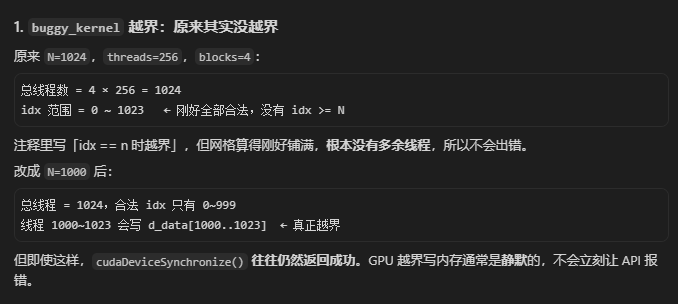

## 一、 设备内存分配：`cudaMalloc`

`cudaMalloc` 是最基础的显存分配函数，相当于 C 语言中的 `malloc`，只不过它是在 **GPU 的显存**上挖出一块空间。

C++

```
cudaError_t cudaMalloc(void **devPtr, size_t size);
```

### 1. 核心机制

- **参数**：
  - `devPtr`：传入一个指针的地址（双指针），函数成功后会将分配好的**显存首地址**写进这个指针。
  - `size`：需要分配的字节数（Byte）。
- **内存类型**：分配的是 **可分页的设备内存（Pageable Device Memory）**。
- **特性**：
  - **CPU 无法直接读写**这块内存，必须通过 `cudaMemcpy` 等传输函数。如果在 CPU 端直接对 `devPtr` 解引用（例如 `*devPtr = 1.0f`），程序会发生段错误（Segmentation Fault）直接崩溃。

### 2. 使用示例

C++

```
float *d_data = nullptr;
size_t bytes = 1024 * sizeof(float);
cudaMalloc(&d_data, bytes); // 在 GPU 分配 4KB 空间
// ... 使用 d_data ...
cudaFree(d_data);           // 释放显存
```

## 二、 主机锁页内存分配：`cudaHostAlloc`

`cudaHostAlloc` 是在 **CPU 端（主机端）** 分配内存的函数。但它分配的不是普通的内存，而是 **锁页内存（Pinned Memory / Page-locked Memory）**。

C++

```
cudaError_t cudaHostAlloc(void **hostPtr, size_t size, unsigned int flags);
```

### 1. 什么是“锁页内存”？为什么需要它？

普通的 C 语言 `malloc` 分配的是**可分页内存（Pageable Memory）**。操作系统为了节省物理内存，随时可能会把这块内存交换到硬盘的虚拟内存中（Page Out）。

当 GPU 想通过 PCIe 总线从普通的 Host 内存复制数据时，系统由于担心数据被操作系统移动，必须先在 CPU 内存里开辟一块隐藏的“锁页缓冲区”，把你的数据复制过去，然后再从这个缓冲区通过 PCIe 传给 GPU。这导致了**两次复制**，浪费了时间。

使用 `cudaHostAlloc` 则是直接告诉操作系统：“**锁定这块物理内存，绝对不准交换到硬盘，也不准改变物理地址**。”

### 2. 它的优势与代价

- **优势 1（更高带宽）**：GPU 可以通过 DMA（直接内存访问）直接从该内存拿数据，跳过中间缓冲，传输速度显著提升（通常能提升 30%~50% 甚至更多）。
- **优势 2（异步传输的先决条件）**：只有锁页内存，才能支持后面要讲的 `cudaMemcpyAsync`（异步拷贝）。
- **代价**：由于内存被死死锁住，系统可用的物理内存变少了。如果过度分配 `cudaHostAlloc`，会导致整个操作系统变得极度卡顿。

### 3. 使用示例

C++

```
float *h_data = nullptr;
size_t bytes = 1024 * sizeof(float);
// 使用默认标志分配锁页内存
cudaHostAlloc(&h_data, bytes, cudaHostAllocDefault); 
// ... 使用 h_data ...
cudaFreeHost(h_data);       // 注意：锁页内存必须用 cudaFreeHost 释放
```

## 三、 异步内存拷贝：`cudaMemcpyAsync`

传统的 `cudaMemcpy` 是同步的（会把 CPU 死死卡住直到传输完毕）。而 `cudaMemcpyAsync` 是它的**异步非阻塞版本**。

C++

```
cudaError_t cudaMemcpyAsync(void *dst, const void *src, size_t count, 
                            cudaMemcpyKind kind, cudaStream_t stream);
```

### 1. 核心机制

- **参数**：
  - `dst` / `src` / `count` / `kind`：目标地址、源地址、字节数、拷贝方向（如 `cudaMemcpyHostToDevice`），这四个与同步版本完全一致。
  - `stream`：**流参数**。指定将这个拷贝任务放进哪一个 CUDA 流队列中。
- **特性（CPU 立即返回）**： 当 CPU 执行到这一行时，它仅仅是向 GPU 的底层硬件驱动队列下发了一条“搬运数据”的指令，**耗时基本为 0，随后立刻返回执行下一行代码**。此时，数据的传输动作在 GPU 后台默默进行。

### 2. 成功触发异步的两大死理（极其重要）

新手经常发现自己写了 `cudaMemcpyAsync`，但程序运行速度没有任何提升。要让它真正实现异步，必须满足以下两个条件：

1. **Host 端必须使用锁页内存**：如果 `src` 或 `dst` 位于主机端，它必须是由 `cudaHostAlloc`（或 `cudaMallocHost`）分配的锁页内存。如果是普通的 `malloc` 内存，CUDA 内部会自动将其退化为同步传输。
2. **必须使用非默认流**：传入的 `stream` 参数不能是默认的 `0` 流。因为默认流具有隐式同步的特性，会打断所有的并行。

### 3. 使用示例

C++

```
// 假设 h_data 是由 cudaHostAlloc 分配的，d_data 是由 cudaMalloc 分配的
cudaStream_t stream;
cudaStreamCreate(&stream); // 创建非默认流

// 异步发射：CPU 发完这行指令立刻往下走，不会在这里等待传输完成
cudaMemcpyAsync(d_data, h_data, bytes, cudaMemcpyHostToDevice, stream);

// 执行核函数（它在同一个流里，会自动排队在拷贝后面，不需要 CPU 操心）
my_kernel<<<blocks, threads, 0, stream>>>(d_data);

// 在 CPU 需要使用结果前，进行流同步
cudaStreamSynchronize(stream); 
cudaStreamDestroy(stream);
```

## 💡 总结与记忆卡片

我们可以把这三者的配合关系比喻为一个高效的**物流体系**：

| 函数                  | 扮演的角色        | 相当于现实中的...                                          | 注意事项                                                     |
| --------------------- | ----------------- | ---------------------------------------------------------- | ------------------------------------------------------------ |
| **`cudaMalloc`**      | 准备 GPU 仓库     | 在外地（GPU）租用了一个自动化现代仓库                      | CPU 无法直接进去拿货。                                       |
| **`cudaHostAlloc`**   | 准备 CPU 专属货台 | 在本地（CPU）建了一个**专属的、不限流的**高速直通货台      | 占用物理空间，不用了要及时释放。                             |
| **`cudaMemcpyAsync`** | 签发异步运单      | 把拉货任务单扔给快递员（Stream），签完字**立刻去干别的事** | 必须配合上述的“高速直通货台（锁页内存）”和“独立车道（非默认流）”才生效。 |

## 一、 智能的“二合一”内存：`cudaMallocManaged`

`cudaMallocManaged` 分配的是 **统一内存（Unified Memory，简称 UM）**。它是英伟达在 CUDA 6.0 引入的极具革命性的技术。

C++

```
cudaError_t cudaMallocManaged(void **devPtr, size_t size, unsigned int flags = cudaMemAttachGlobal);
```

### 1. 核心机制（什么是统一内存？）

在过去，我们需要分别维护 Host 指针（`h_ptr`）和 Device 指针（`d_ptr`），并手动写 `cudaMemcpy`。 而 `cudaMallocManaged` **只分配一个指针**（`devPtr`）。这个指针极其神奇：**CPU 可以直接读写它，GPU 也可以直接读写它**。

### 2. 底层黑科技：页错误（Page Fault）与自动迁移

你可能会问：两块硬件物理上是分开的，为什么能共用一个指针？ 它的底层依赖于操作系统的 **页表错误（Page Faulting）** 机制：

1. 当你调用 `cudaMallocManaged(&ptr, size)` 时，系统并没有立刻在 CPU 或 GPU 上真正分配物理内存，只是规划了一张“虚拟地址映射表”。
2. **CPU 读写 `ptr`**：如果数据此时在 GPU 端，CPU 访问会触发一个硬件中断（Page Fault），CUDA 驱动会自动通过 PCIe 总线把数据从 GPU 抓回内存，让 CPU 读写。
3. **GPU 读写 `ptr`**：当你在核函数里使用 `ptr` 时，如果数据在 CPU 端，GPU 同样会触发 Page Fault，驱动会自动把数据迁移到显存中。

### 3. 优缺点分析

- **绝对优势**：
  - **代码极度简化**：删掉了 90% 的 `cudaMemcpy` 核心代码，写 CUDA 就像写普通 C++ 一样简单。
  - **支持内存超售（Over-subscription）**：在支持的架构上（如 Pascal 及之后），如果 GPU 显存只有 11GB，但你分配了 32GB 的统一内存，程序**不会崩溃**。CUDA 会像操作系统使用虚拟内存一样，在需要时自动在内存和显存之间换入换出。
- **劣势**：
  - **初次访问延迟高**：因为数据是“按需动态迁移”的，第一次触发 Page Fault 会带来显著的延迟。
  - **控制上限较低**：对于极致的高性能计算，自动迁移的效率往往不如你手动用 `cudaMemcpyAsync` 编织的流水线（03_3代码）。

### 4. 使用示例

C++

```
float *ptr = nullptr;
cudaMallocManaged(&ptr, 1024 * sizeof(float));

// CPU 直接初始化
for(int i=0; i<1024; i++) ptr[i] = 1.0f; 

// GPU 直接计算（不需要写 cudaMemcpy！）
my_kernel<<<blocks, threads>>>(ptr); 
cudaDeviceSynchronize(); // 必须同步，因为内核是异步的

// CPU 直接读取结果
printf("Result: %f\n", ptr[0]); 

cudaFree(ptr); // 统一内存也是用普通的 cudaFree 释放
```


## 二 `cudaMemset` 是啥？

### 💡 核心概念：GPU 版的 `memset`

你在标准 C/C++ 中肯定用过 `memset(ptr, 0, size)`，用来把内存中某块区域全部刷成 0（或者其他指定的值）。


## 二、 传统的 C++ 普通内存（可分页内存）

这就是我们在写普通 C++ 程序时，通过 `new`、`malloc` 或者 `std::vector` 分配的内存。在 CUDA 的语境下，它被称为 **可分页主机内存（Pageable Host Memory）**。

### 1. 核心机制

- 它是完全受操作系统虚拟内存管理器控制的。操作系统为了防止物理内存爆满，随时会把这块内存的物理页交换到硬盘的 Swap 分区（虚拟内存）中，此时它的**物理地址是会随时改变的**。

### 2. 在 CUDA 中的局限性

- **无法用于异步拷贝**：如前所述，由于它的物理地址随时在变，GPU 的 DMA（直接内存访问）引擎无法直接抓取它。如果你对它使用 `cudaMemcpyAsync`，CUDA 内部会默默将其退化为普通的**同步拷贝**。
- **传输速度慢**：每次你用 `cudaMemcpy` 传输普通 C++ 内存的数据时，CUDA 驱动都需要在后台偷偷干两件事：
  1. 在系统内部临时申请一块临时的“锁页内存”；
  2. 把你的普通 C++ 内存数据复制到这块临时锁页内存，然后再传给 GPU。 这无形中造成了 CPU 内部的二次拷贝，极大地压低了 PCIe 的传输带宽。

## cudaEvent_t 

```cpp
  cudaEvent_t start, stop;

  cudaEventCreate(&start);

  cudaEventCreate(&stop);

  cudaEventRecord(start);


  add_global<<<blocksPerGrid, threadsPerBlock>>>(out, a, b, N);

  cudaEventRecord(stop);

  cudaEventSynchronize(stop);


  cudaEventDestroy(start);

  cudaEventDestroy(stop);
```


nvcc 优化

nvcc 编译过程


nvcc运行时api和驱动api

smi功耗监控和设置


SM wrap 


线程块与sm的映射关系是CUDA程序性能优化的关键环节。


## 2.1 线程模型

### 2.1.1 线程与SM, 硬件

### 2.1.2 

线程生命周期\

寄存器等资源有限\

## 2.2 矩阵相乘


## 2.3 线程块大小选择与资源分配


## 32倍速

### 寄存器个数限制

#### 硬件常驻的“全开或全关”原则

GPU 的调度策略是：**一个 Block 内的所有线程必须同时被分配到同一个 SM 上执行。** * 如果一个 Block 计算出来的总寄存器需求量，**超过了单个 SM 的硬件上限**，那么这个核函数将直接**无法启动**（报错：launch out of resources）。


### 共享内存

#### 1. 共享内存是“按块（Block）”分配的

**动态分配时的乘法效应：** 如果你在核函数启动时动态申请了共享内存（例如每个线程需要 64 字节），那么一个 Block 实际申请的共享内存大小为：

$$\text{Block Shared Memory} = \text{Block Size} \times 64 \text{ 字节}$$

**硬件限制：** 每个 SM（Streaming Multiprocessor）处理器的共享内存容量是有限的（例如 64KB 或 100KB）。如果你的 Block Size 设得太大，导致单个 Block 索要的共享内存超过了 SM 的上限，程序就会直接报错无法启动。

2 当一个 Block 被发射到 SM 上执行时，它必须**同时满足**硬件对其物理资源的分配要求，其中最核心的两个资源是：**线程数上限**和**共享内存容量**。


### 活跃线程块大小


## 2.4  动态并行


## 2.5 Wrap机制

发散问题: shuffle指令

bank冲突


# 3 内存

## 3.1


L1L2缓存


#  4cuda数据访问

| **层级**       | **概念**              | **角色**         | **数量级**                                       | **本质**                                  |
| -------------- | --------------------- | ---------------- | ------------------------------------------------ | ----------------------------------------- |
| **软件设计层** | **CUDA Stream**       | **任务排队队列** | 程序员任意创建（几个到几十个）                   | 纯软件层面的**异步指令通道**（逻辑概念）  |
| **硬件架构层** | **SM (流式多处理器)** | 核心制造工厂     | 一块 GPU 内有数十个到上百个（如 H100 有 132 个） | 独立的**硬件调度与执行单元**（物理实体）  |
| **硬件计算层** | **CUDA Core**         | 基础流水线工人   | 每个 SM 内部有 64~128 个（整块卡上万个）         | 负责执行单条指令的 **ALU (算术逻辑单元)** |

> ## 二、 它们之间是如何一步步映射的？
>
> 当我们提交一段多流代码时，软件层面的 Stream 任务是如何一步步落到硬件上执行的？
>
> ### 步骤 1：Stream（软件） $\rightarrow$ 硬件指令队列 (HWS)
>
> 当你向 `Stream0` 和 `Stream1` 异步提交了两个不同的核函数（Kernel 0 和 Kernel 1）时，CUDA 驱动和 GPU 内部的 **硬件调度器（Hardware Vector Scheduler / Host Interface）** 会接管这两个流。
>
> - 只要这两个流是非默认流，硬件调度器就会把它们视为**两个相互独立、没有依赖关系的任务源**。
>
> ### 步骤 2：Grid $\rightarrow$ SM（软件网格映射到硬件工厂）
>
> 每一个 Kernel 在发射时，都对应一个由大量线程块组成的 **Grid（网格）**。
>
> - 硬件调度器会以 **Block（线程块）** 为最小单位，把 Kernel 0 和 Kernel 1 的 Blocks 动态分发给显卡上的各个 **SM**。
>
> - **🔥 核心重叠点（Stream 与 SM 的关系）**：
>
>   如果你的 GPU 上有 80 个 SM，而 `Stream0` 的 Kernel 0 规模很小，只占用了 20 个 SM。此时，硬件调度器发现还有 60 个 SM 闲着，它就会**立刻把 `Stream1` 的 Kernel 1 的线程块也分发到剩下的 SM 上去运行**！
>
>   > **结论**：在同一时刻，**同一个 SM 内部可以同时并存来自不同 Stream 的不同线程块**；或者说，不同的 SM 可以同时在跑不同 Stream 的任务。这就是**流并发（Concurrent Kernel Execution）**的硬件本质。
>
> ### 3. Block $\rightarrow$ Warp $\rightarrow$ CUDA Core（硬件微架构的执行）
>
> 当 Block 被指派到某个具体的 SM 后，SM 内部的 **Warp Scheduler（线程束调度器）** 会把 Block 进一步拆解为 32 个线程一组的 **Warp（线程束）**。
>
> - SM 会根据指令准备情况，调度这些 Warp 去轮流使用 SM 内部的 **CUDA Core**（执行单精度浮点运算 FP32、整数运算 INT32 等）。
> - **Warp 是硬件上真正的基本执行单元**。一个 Warp 里的 32 个线程在同一时刻必须执行同一条指令（SIMT 架构），它们会并排霸占 32 个 CUDA Core 进行计算。
>
> ## 三、 用一个生动的“工业园区”来做比喻
>
> 如果把整块 NVIDIA 显卡比作一个**大型现代化工业园区**：
>
> - **CUDA Core 是“流水线工人”**：他们什么都不懂，只会机械地做最基础的加减乘除（ALU 计算）。
> - **SM 是“生产车间”**：每个车间里有 128 个工人（CUDA Core），并配备了共享的原材料仓库（Shared Memory/寄存器）和车间主任（Warp Scheduler）。车间主任负责指挥哪 32 个工人上去同时干一模一样的活（Warp 执行）。
> - **整个 GPU 就是“工业园区”**：里面整整齐齐排着 100 个这样的生产车间（SM）。
> - **CUDA Stream 是“订单传送带”**：
>   - 程序员是厂长。你开了 4 条独立的传送带（4个 Stream）往园区里送原料和需求。
>   - `Stream0` 送来的是一批“造手机（Kernel 0）”的 Block 组件；`Stream1` 送来的是一批“造手表（Kernel 1）”的 Block 组件。
>   - 园区的总调度室（硬件调度器）一看，1车间到50车间现在空着，去造手机（`Stream0`）；51车间到100车间也空着，去造手表（`Stream1`）。
>   - 甚至，如果 1 车间的空间和原材料很大，它可以前半边流水线造手机，后半边流水线造手表（同一个 SM 同时并发运行多个 Stream 的 Block）。


> 你之前写了这么多多流流水线（03_3）、流间同步（04_2），现在我们不妨跳出来，返璞归真，彻底把 **CUDA Stream（CUDA流）** 的底层本质、定义以及它一生的完整操作梳理得明明白白。
>
> ## 一、 什么是 CUDA Stream？（通俗定义）
>
> 在英伟达官方的定义中：**CUDA Stream 是一系列由 CPU 主机端发射、并在 GPU 设备端按照严格顺序执行的异步操作序列。**
>
> 用大白话来解释：
>
> - **它就是一个“先进先出”（FIFO）的硬件任务队列。**
> - 你（CPU）往这个队列里扔进一连串的任务（比如：H2D拷贝、跑核函数、D2H拷贝）。
> - GPU 拿到这个队列后，会像排队买奶茶一样，**严格按照你扔进去的先后顺序，一件一件地执行**。执行完第一件，才会动第二件。
>
> ### 为什么需要它？
>
> 如果没有流，GPU 就像一个单核 CPU，只能做完一件事再做下一件。有了流，CPU 可以同时创建多个队列（Stream0, Stream1...）。GPU 内部有不同的硬件引擎（计算引擎、拷贝引擎），它们可以**同时去处理不同流里的任务**，从而实现并行的流水线。
>
> ## 二、 默认流（Default Stream） vs 非默认流
>
> 在 CUDA 中，流分为两大类：
>
> 1. **默认流（Default Stream / NULL Stream / 0流）**
>    - **特点**：如果你在写代码时**不指定任何流参数**（比如普通的 `cudaMemcpy`，或者核函数配置不写第四个参数 `kernel<<<b, t>>>()`），任务就会自动跑在默认流里。
>    - **致命缺点**：默认流是**隐式同步**的。它是一个“恶霸”，当它在 GPU 里运行时，会霸道地拦截其他所有流，导致其他流无法与它并行。
> 2. **非默认流（Non-default Stream）**
>    - **特点**：由程序员通过代码显式创建（如你代码里的 `cudaStreamCreate`）。
>    - **优点**：它们彼此之间是**完全独立、互不干扰、互不阻塞**的。
>
> ## 三、 CUDA 流的“完整操作生命周期”
>
> 一个非默认流从生到死，在代码中要经历 **5 个标准步骤**。我们结合你提供的这段 Thrust 代码，来看看它的完整演修过程：
>
> ### 步骤 1：定义与创建（出生）
>
> 使用 `cudaStream_t` 声明句柄，并调用 `cudaStreamCreate` 显式向 GPU 驱动申请一个硬件队列空间。
>
> C++
>
> ```
> cudaStream_t stream;            // 1. 定义流句柄
> cudaStreamCreate(&stream);      // 2. 真正创建流
> ```
>
> ### 步骤 2：任务绑定与发射（搬砖）
>
> 把你要做的操作（拷贝、计算、排序）丢进这个流里排队。在原生 CUDA 中是用尖括号或 Async 函数；在 Thrust 库中，则是通过指定执行策略：
>
> C++
>
> ```
> // 告诉 Thrust 算法：把排序内部所有的核函数，全部推进刚才创建的这个 stream 队列里
> thrust::sort(thrust::cuda::par.on(stream), d_vec.begin(), d_vec.end());
> ```
>
> > **⚠️ 注意**：这一步是**完全异步（非阻塞）**的。CPU 刚把排序命令塞进队列，耗时不到 1 微秒，就立刻执行下一行代码了。
>
> ### 步骤 3：流查询（探路 - 可选）
>
> 虽然你的代码里没写，但在大厂生产环境里，CPU 提完任务后经常会调用这个函数：
>
> C++
>
> ```
> cudaError_t err = cudaStreamQuery(stream);
> ```
>
> - 如果返回 `cudaSuccess`：说明流里的任务（排序）已经全干完了。
> - 如果返回 `cudaErrorNotReady`：说明 GPU 还在队列里忙活着呢，CPU 你先别急。
>
> ### 步骤 4：流同步（死等）
>
> 当 CPU 接下来必须用到 GPU 计算出来的结果（比如你要打印、或者验证数据）时，CPU 必须强制停下脚步，死等该流清空。
>
> C++
>
> ```
> cudaStreamSynchronize(stream); // CPU 阻塞在这里，直到当前 stream 里的排序彻底完工
> ```
>
> ### 步骤 5：流销毁（寿终正寝）
>
> 当程序结束或者这个流不再需要时，必须手动释放它，否则会导致显卡底层驱动的上下文内存泄漏。
>
> C++
>
> ```
> cudaStreamDestroy(stream);     // 销毁流，释放硬件队列资源
> ```
>
> ## 四、 站在更高的维度看你的这段代码
>
> 你给出的这段代码，虽然简短，但它展示了现代 CUDA 混合编程的一个非常标准的过程：
>
> ```
> 【CPU 主机端】                       【GPU 设备端 (stream 队列)】
>       |                                      |
>  cudaStreamCreate(&stream); ---------> [ 创建独立硬队列 ]
>       |                                      |
>  thrust::sort(par.on(stream)...); ---> [ 排队: 基数排序Kernel ] (异步返回)
>       |                                      |
>   (CPU 继续跑, 分配h_vec等)                   |  (GPU 内部开始疯狂排序...)
>       |                                      |
>  cudaStreamSynchronize(stream); ----> [ 等待该队列清空 ] (CPU 卡住)
>       | <----------------------------- [ 排序内核彻底收工 ] (解除阻塞)
>  std::cout << "排序在流中完成";
>       |
>  cudaStreamDestroy(stream); ---------> [ 销毁、回收队列资源 ]
> ```
>
> ### 💡 终极启发
>
> 如果你的程序里**只有一个非默认流**（就像这段代码），那么它在 GPU 内部依然是串行的，性能和不用流几乎没有区别。
>
> CUDA 流的真正威力在于**多流组合（Multi-stream）**。当你把这段代码的逻辑外面套上一个 `for(int i=0; i<NUM_STREAMS; i++)` 循环，创建 4 个或 8 个流，同时对 8 块不同的 `d_vec` 进行排序时，GPU 内部的多个计算核心就会同时开火，那才是流发挥出成倍算力提升的时刻！


## cudaStreamCreate

  cudaStream_t stream0, stream1;

  CHECK(cudaStreamCreate(&stream0));


## cudaEventCreate

  cudaEvent_t start0, start1, stop0, stop1;

  CHECK(cudaEventCreate(&start0));


### cudaEventRecord


###  cudaEventElapsedTime(&ms, start, stop);

### cudaEventCreateWithFlags(&data_ready,cudaEventDisableTiming));


### cudaMemcpyAsync

### cudaStreamQuery

  cudaError_t status = cudaStreamQuery(stream1);

### cudaStreamDestroy

  CHECK(cudaStreamDestroy(stream1));

### cudaStreamWaitEvent(consumer_stream, data_ready, 0));

### cudaStreamSynchronize

**显式同步**阻塞函数

**CPU 坐下喝茶，死等指定的这个 `stream`（流）把里面排队的所有任务彻底做完”**。

由于 CPU 把所有 4 个流的任务全部提交完之后，才执行 `cudaEventSynchronize`。所以在提交期间，**CPU 是完全自由的**。


### cudaEventSynchronize


# 5 报错处理

#### cudaPeekAtLastError

# 6 

数据传输与计算量比值

> 最好接近1

算术强度

>  算术强度低更多受到内存延迟影响

wrap收敛性

> 指令融合, 分支规约\
>
> 1. 合并为一个表达式 
> 2. 运算符替代
>
> 减少分支发散
>
> 1. 避免条件分支
> 2. 重排计算逻辑
> 3. 减少全局内存访问

1. 线程块规模设计
2. 分块策略
3. 32倍数

# 7


合并访问和对其优化

数据类型与内存地址对其

bank冲突

shared memory bank conflict

1. 共享内存大小设置
2. 访问模式连续
3. 内存操作同步
4. 原子操作, 块内求和


# 8

更新数据数据竞争

原子操作产生额外消耗

1. 串行
2. 内存读写
3. 原子操作次数
4. 热点问题
5. 直方图桶


**warp同步**

1. 硬件实现
2. wrap shuffle

**线程块同步**

1. 所有线程可达,避免死锁
2. 块内同步
3. 共享内存同步


**线程内交换数据**


**协作组**

块间交换


# 8 Trust

## 1. `cudaMemcpy(..., cudaMemcpyDeviceToDevice)` 是什么？

这一行代码的核心含义是：**“在 GPU 显存内部进行数据的自我复制。”**

具体到这段代码：

- **源头（`raw_ptr`）**：是由 Thrust 的 `d_vec` 管理的**显存**空间。
- **目的地（`d_raw`）**：是由原生 `cudaMalloc` 分配的另一块**显存**空间。
- **行为**：GPU 收到指令后，直接把数据从显存的 A 区域拷贝到 B 区域，**全程数据不经过 PCIe 总线，不经过 CPU 主机内存**。

| **拷贝方向 (Kind)**                     | **物理路径**                                                 | **决定速度的瓶颈**         | **典型速度 (以主流硬件为例)**           |
| --------------------------------------- | ------------------------------------------------------------ | -------------------------- | --------------------------------------- |
| **`HostToDevice`** / **`DeviceToHost`** | 数据必须挤过 **PCIe 总线**（CPU $\leftrightarrow$ GPU 外部通道） | PCIe 总线带宽              | 约 **16 GB/s - 64 GB/s** (PCIe 4.0/5.0) |
| **`DeviceToDevice`**                    | 数据直接在 **GPU 芯片内部显存颗粒** 之间流转                 | 显存（VRAM）的高速硬件带宽 | 约 **900 GB/s - 2 TB/s** (HBM / GDDR6)  |


```
cublasStatus_t cublasSgemm(
    cublasHandle_t handle,           // cuBLAS 句柄，通过 cublasCreate 初始化
    cublasOperation_t transa,        // A 矩阵是否转置 (CUBLAS_OP_N / CUBLAS_OP_T)
    cublasOperation_t transb,        // B 矩阵是否转置
    int m, int n, int k,             // 矩阵维度的核心参数
    const float *alpha,              // 标量 alpha 的指针（通常设为 1.0 的地址）
    const float *A, int lda,         // A 矩阵指针及其主维度 (Leading Dimension)
    const float *B, int ldb,         // B 矩阵指针及其主维度
    const float *beta,               // 标量 beta 的指针（通常设为 0.0 的地址）
    float *C, int ldc                // C 矩阵指针及其主维度
);
```


# 9 非默认流

1 创建

2 数据传输与核函数执行重叠, 异步api 同步运行

3 并发运行异步api for 循环

4 流优先级

5 不同流运行不同任务


# 10 THRUST

1 Thrust

2 cuBLAS: sgemm

3 cuRand: 高斯分布生成, 随机数

4寸


# 11 多GPU

任务分块, 设备间通信, 同步; 

1 cudaSetDevice

**2 MPI: 分发和收集**

3 cpu, gpu并行异构计算

4 分布式cuda: 主次节点

5 动态调度与负载均衡: 进程排名; 


## 12 完整项目

1. 全局内存吞吐量
2. 核函数占用绿
3. 线程收敛性

> 分子动力学模拟项目  


# nvcc 命令行

## -G

确保你的代码是可调试的: 在编译你的 CUDA 代码时，必须使用 -G 或 -lineinfo 标志来生成调试信息。

-G: 生成完整的调试信息，但会严重禁用所有编译器优化，极大影响性能，仅用于调试。

-lineinfo (--generate-line-info): 生成行号信息，允许调试和性能分析，但对性能影响较小，是 Nsight Compute 性能分析的首选。对于调试 __device__ 函数，-lineinfo 通常就足够了。

示例编译命令:

nvcc -g -G -o my_program my_program.cu # 使用 -g -G 进行完整调试




## cuda-gdb

```
# 版本号与 nvcc 一致（你的是 12.4）
sudo apt-get install cuda-gdb-12-4
```

### 命令行使用

```bash
(cuda-gdb) break buggy_kernel          # 在 kernel 入口断点
(cuda-gdb) break 01_1debug_practice.cu:23   # 按行号
(cuda-gdb) run                           # 运行

# 命中 kernel 后，查看 GPU 线程
(cuda-gdb) info cuda threads             # 所有 CUDA 线程
(cuda-gdb) cuda thread (0,0,0),(100,0,0) # 切到 block(0,0,0) thread(100,0,0)
(cuda-gdb) print idx                     # 看 kernel 内变量
(cuda-gdb) next                          # 单步（当前 CUDA 线程）
(cuda-gdb) continue                      # 继续
```

```bash
cuda-gdb -batch \
  -ex "break buggy_kernel" \
  -ex "run" \
  -ex "info cuda threads" \
  -ex "quit" \
  ./01_1debug_practice_debug
```


## compute-sanitizer


## nsight扩展

https://developer.nvidia.com/nsight-visual-studio-code-edition
