# DAY0 

**关键概念卡片**：

| 概念                | 解释                                                | 类似工厂比喻 |
| :------------------ | :-------------------------------------------------- | :----------- |
| **Thread（线程）**  | 最基本的执行单位，每个线程独立执行kernel代码        | 一个工人     |
| **Block（线程块）** | 一组Thread的集合，Block内的Thread可以共享内存和同步 | 一个车间     |
| **Grid（网格）**    | 一次kernel启动的Block集合                           | 整个工厂     |
| SP流式处理器        | 就是常说的cuda core                                 |              |
| **SM流多处理器**    | 硬件层面，每个Block被分配到一个SM上执行             | 厂房区域     |

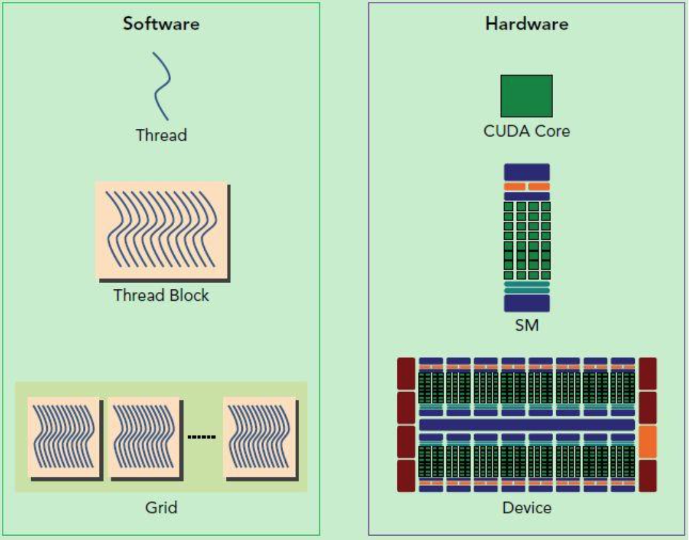


## 硬件层面

线程和硬件的cuda core不是一一对应的, 软件线程是自定义大小的, 但是硬件的线程束和sm内的cuda个数是固定的,  其实就是相当于把软件线程一个个装入线程束, 装满了就换下一个cuda core, sm满了就换下一个sm


### SM

GPU中每个SM都能支持数百个线程并发执行，每个GPU通常有多个SM，当一个核函数的网格被启动的时候，多个block会被同时分配给可用的SM上执行。


### 线程束

CUDA 采用**单指令多线程SIMT架构**管理执行线程，不同设备有不同的线程束大小，但是到目前为止基本所有设备都是维持在32，也就是说**每个SM上有多个block，一个block有多个线程**（可以是几百个，但不会超过某个最大值），但是从**机器的角度**，在某时刻T，**SM上只执行一个线程束，也就是32个线程在同时同步执行**，


### SIMD vs SIMT

> 单指令多数据的执行属于向量机，比如我们有四个数字要加上四个数字，那么我们可以用这种单指令多数据的指令来一次完成本来要做四次的运算。这种机制的问题就是过于死板，不允许每个分支有不同的操作，所有分支必须同时执行相同的指令，必须执行没有例外。
> 相比之下单指令多线程SIMT就更加灵活了，虽然两者都是将相同指令广播给多个执行单元，但是SIMT的某些线程可以选择不执行，也就是说同一时刻所有线程被分配给相同的指令，SIMD规定所有人必须执行，而SIMT则规定有些人可以根据需要不执行，这样SIMT就保证了线程级别的并行，而SIMD更像是指令级别的并行。
>
> 作者：谭升
> 链接：https://zhuanlan.zhihu.com/p/38553409
> 来源：知乎
> 著作权归作者所有。商业转载请联系作者获得授权，非商业转载请注明出处。


### threadIdx、blockIdx、blockDim、gridDim的含义


以上图为例子，把线程格和线程块都看作一个三维的矩阵。这里假设线程格是一个`3*3*3`的三维矩阵， 线程块是一个`4*4*4`的三维矩阵。****

**gridDim**

> 是指自身包含的维度而不是自身所在的维度

`gridDim.x`、`gridDim.y`、`gridDim.z`分别表示**线程格**各个维度的大小，所以有

```text
gridDim.x=3    gridDim.y=3   gridDim.z=3
```

**blockDim**

`blockDim.x`、`blockDim.y`、`blockDim.z`分别表示**线程块**中各个维度的大小，所以有

```text
blockDim.x=4   blockDim.y=4  blockDim.z=4
```

**blockIdx**
blockIdx.x、blockIdx.y、blockIdx.z分别表示**当前线程块所处的线程格的坐标位置**

**threadIdx**
threadIdx.x、threadIdx.y、threadIdx.z分别表示**当前线程所处的线程块的坐标位置**

**总的线程个数N**

```text
N = gridDim.x * gridDim.y * gridDim.z * blockDim.x * blockDim.y * blockDim.z

```

**blockId**

```text
blockId = blockIdx.x + blockIdx.y*gridDim.x + blockIdx.z*gridDim.x*gridDim.y;
```

假设我们要找的block是红色标注的那块。

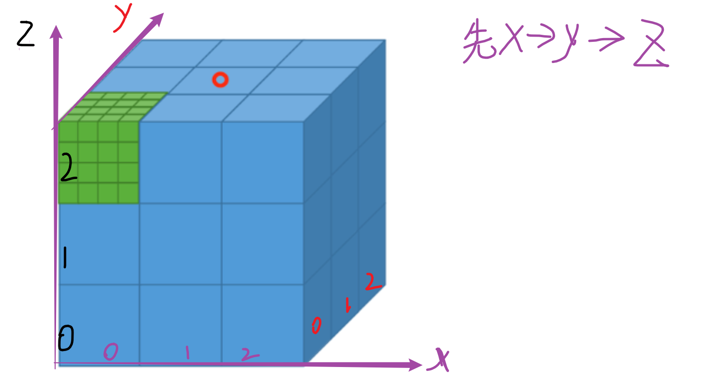

先是blockIdx.z*gridDim.x*gridDim.y，也就是从下往上包含了红色block所在的那一层的下面所有层。(也就是我涂成红色的这两层。)


下面就是blockIdx.y*gridDim.x ，也就是我涂成橘黄色的这部分

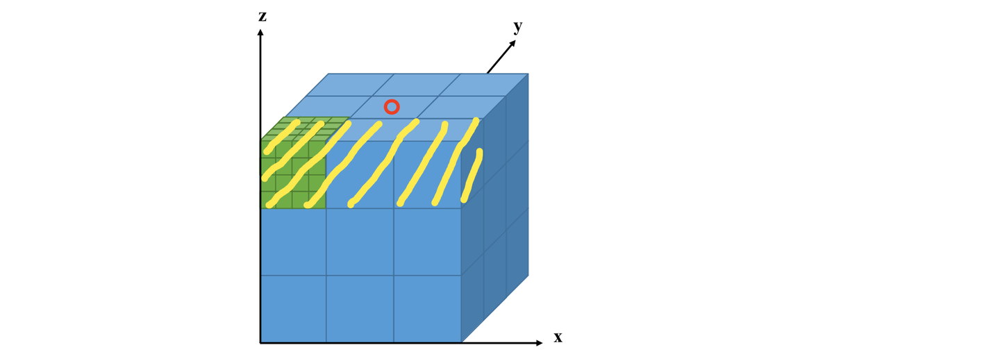

最后再加上blockIdx.x，就到达了目标点～

**threadId**

接着找到当前线程位于线程块中的哪一个线程`threadId`，思路和上面找block一样

```text
threadId = threadIdx.x + threadIdx.y*blockDim.x + threadIdx.z*blockDim.x*blockDim.y;
```

**一个线程块中一共有多少个线程M**

```
M = blockDim.x*blockDim.y*blockDim.z
```

**线程序列号`idx`**

```text
idx = threadId + M*blockId;
```


## Warp

GPU 以 Warp（32 个 thread 一组） 为基本执行单位：

每个 warp 内的 thread 共享同一个指令流，但每个 thread 有独立的寄存器和程序计数器。

Warp 0:  thread  0 ~  31  →  i:  0 ~  31

Warp 1:  thread 32 ~  63  →  i: 32 ~  63  ← 你看到的 32~63

...

Warp 5:  thread 160 ~ 191 →  i: 160 ~ 191  ← 你看到的 160~191


你的笔记内容其实已经比较完整了，但有几个问题：

1. **内存分类混杂**（CUDA Device Memory 和 Host Memory 混在一个表里）
2. **局部内存、锁页内存没填完整**
3. **常量内存没有强调 Cache 本质**
4. **Unified Memory 和 Pinned Memory属于不同维度概念**
5. **缺少 CUDA 内存层级图**
6. **访问延迟数据有些架构相关，容易误导**

我建议整理成下面这种更工程化的版本。

------

# 2 CUDA 内存体系

CUDA 并不是只有一种内存，而是拥有多个独立的内存空间（Memory Space）。

从性能角度看：

```text
寄存器
   ↓
共享内存
   ↓
常量缓存/L1 Cache
   ↓
L2 Cache
   ↓
全局内存(GDDR/HBM)
```

从容量角度看：

```text
寄存器  << 共享内存 << 常量内存 << 全局内存
```

------

## 2.1 CUDA内存层级

```text
CPU
 ├── Pageable Memory（普通内存）
 ├── Pinned Memory（锁页内存）
 └── Unified Memory（统一内存）

PCIe / NVLink

GPU
 ├── Register（寄存器）
 ├── Shared Memory（共享内存）
 ├── Constant Memory（常量内存）
 ├── Local Memory（局部内存）
 └── Global Memory（全局内存）
```

------

## 2.2 CUDA内存特性总览

| 特性     | Register   | Shared Memory | Constant Memory | Global Memory | Local Memory |
| -------- | ---------- | ------------- | --------------- | ------------- | ------------ |
| 物理位置 | SM寄存器堆 | SM片上SRAM    | DRAM+常量缓存   | DRAM          | DRAM         |
| 作用域   | Thread     | Block         | Grid            | Grid          | Thread       |
| 生命周期 | 线程结束   | Block结束     | 程序运行期间    | 手动释放前    | 线程结束     |
| 可读写   | RW         | RW            | Read Only       | RW            | RW           |
| 延迟     | 最低       | 很低          | 缓存命中很低    | 高            | 高           |
| 容量     | 极小       | KB级          | 64KB            | GB级          | 理论无限     |
| 是否缓存 | 不需要     | 不需要        | Constant Cache  | L1/L2         | L1/L2        |
| 典型用途 | 局部变量   | 数据共享      | 广播参数        | 大数据存储    | 寄存器溢出   |

------

## 2.3 Register（寄存器）

寄存器是 GPU 上最快的存储资源。

```cpp
__global__ void kernel()
{
    int idx = threadIdx.x;
    float temp = 0.f;
}
```

这里：

```cpp
idx
temp
```

通常都会存放在寄存器中。

特点：

- 每个线程私有
- 无需访存指令
- 延迟最低
- 数量有限

### 寄存器溢出（Register Spill）

当寄存器不足时：

```cpp
float tmp[100];
```

编译器会把部分变量放入：

```text
Local Memory
```

虽然名字叫 Local Memory：

> 实际存储在 Global Memory 中

因此性能会急剧下降。

------

## 2.4 Shared Memory（共享内存）

共享内存位于 SM 内部。

一个 Block 中所有线程共享。

```cpp
__shared__ float tile[256];
```

特点：

- Block内共享
- 延迟远低于Global Memory
- 支持线程通信
- 适合数据复用

典型场景：

### 矩阵乘法

```text
Global Memory
     ↓
 Shared Memory
     ↓
 多次重复计算
```

避免重复访问显存。

### 归约（Reduction）

```cpp
sum += shared[i];
```

Block内线程协同完成计算。

------

### Bank Conflict

Shared Memory 被划分为多个 Bank。

若多个线程同时访问同一个 Bank：

```text
Thread0 -> Bank0
Thread1 -> Bank0
Thread2 -> Bank0
```

会发生：

```text
Bank Conflict
```

导致访问串行化。

------

## 2.5 Constant Memory（常量内存）

常量内存本质：

```text
DRAM中的64KB只读区域
+
Constant Cache
```

声明：

```cpp
__constant__ float coeff[1024];
```

特点：

- 只读
- 所有线程可见
- Warp广播优化

------

### 最佳场景

Warp中所有线程访问同一地址：

```cpp
y = coeff[0];
Warp
 ├─Thread0 -> coeff[0]
 ├─Thread1 -> coeff[0]
 ├─Thread2 -> coeff[0]
 └─...
```

GPU只需要：

```text
一次访存
```

即可广播给整个 Warp。

------

### 最差场景

```cpp
coeff[threadIdx.x]
Thread0 -> coeff[0]
Thread1 -> coeff[1]
Thread2 -> coeff[2]
...
```

会退化成多个独立访问。

优势基本消失。

------

## 2.6 Global Memory（全局内存）

GPU主显存。

通常就是：

```text
GDDR6
HBM
```

通过：

```cpp
cudaMalloc()
```

分配。

```cpp
float* d_data;

cudaMalloc(
    &d_data,
    N*sizeof(float)
);
```

特点：

- 容量最大
- 所有线程可访问
- 延迟最高
- 带宽极高

------

### 为什么慢？

GPU核心与显存不在同一位置：

```text
SM
 ↓
L1
 ↓
L2
 ↓
DRAM
```

需要经过多级缓存。

一次未命中访问可能需要数百个时钟周期。

------

## 2.7 Local Memory（局部内存）

Local Memory 名字容易误导。

它并不是：

```text
SM上的局部存储
```

而是：

```text
Global Memory中的线程私有区域
```

例如：

```cpp
float tmp[100];
```

或者：

```cpp
寄存器不足
```

都会导致：

```text
Register Spill
      ↓
 Local Memory
```

因此：

> Local Memory 本质上是性能较差的后备存储。

------

## 2.8 Host Memory（CPU侧内存）

CUDA数据传输涉及：

```text
CPU Memory
   ⇅
PCIe/NVLink
   ⇅
GPU Memory
```

Host Memory主要有：

```text
Pageable Memory
Pinned Memory
Unified Memory
```

------

### Pageable Memory（可分页内存）

普通：

```cpp
malloc()
new
```

分配的内存。

```cpp
float* data =
    (float*)malloc(size);
```

操作系统可以：

```text
换页
交换到磁盘
```

------

当执行：

```cpp
cudaMemcpy()
```

时：

```text
Pageable
   ↓
Pinned Buffer
   ↓
GPU
```

CUDA Runtime 会先复制到内部锁页缓冲区。

因此产生一次额外拷贝。

------

### Pinned Memory（锁页内存）

使用：

```cpp
cudaHostAlloc()
```

或者：

```cpp
cudaMallocHost()
```

分配。

```cpp
float* host_ptr;

cudaMallocHost(
    &host_ptr,
    size
);
```

特点：

- 不会被换页
- GPU可直接DMA访问
- 传输速度更高
- 支持异步传输

------

#### 为什么 Async 必须用 Pinned？

```cpp
cudaMemcpyAsync()
```

底层DMA要求：

```text
物理地址固定
```

因此：

```text
Pinned Memory
✓

Pageable Memory
✗
```

------

### Unified Memory（统一内存）

CUDA 6.0引入。

```cpp
cudaMallocManaged()
```

分配：

```cpp
float* data;

cudaMallocManaged(
    &data,
    size
);
```

特点：

- CPU/GPU共享同一指针
- 自动迁移数据
- 编程最简单

------

#### 工作机制

CPU访问：

```text
页面位于CPU
```

GPU访问：

```text
页面迁移到GPU
```

迁移由 Runtime 自动完成。

------

#### 性能问题

首次访问可能触发：

```text
Page Fault
```

导致：

```text
CPU ↔ GPU 页面迁移
```

开销较大。

优化方法：

```cpp
cudaMemPrefetchAsync()
```

提前迁移数据。

------

## 2.9 内存选择指南

```text
是否需要存储大量数据？
        │
        ▼
      是
        │
        ▼
   Global Memory

        否
        │
        ▼
所有线程是否读取同一只读数据？
        │
    ┌───┴───┐
    │       │
   是      否
    │       │
    ▼       ▼
Constant   是否Block内共享？
 Memory
            │
        ┌───┴───┐
        │       │
       是      否
        │       │
        ▼       ▼
     Shared   Register
     Memory
```

------

## 2.10 比喻

```text
Register
= 工人手里的工具

Shared Memory
= 车间公共工作台

Constant Memory
= 工厂广播系统

Global Memory
= 工厂中央仓库

Local Memory
= 仓库里的个人储物柜（很远）

Pinned Memory
= 专用高速装卸区

Unified Memory
= 自动搬运机器人
```


## Day 11：Warp与线程束分化（Warp Divergence）

Warp内的线程会**锁步执行**——即所有线程同时执行同一条指令，但有些线程可以“被屏蔽”（不激活），这就是SIMT（单指令多线程）模型

### 什么是线程束分化？

当一个warp内的线程因为条件分支（如`if-else`）而需要执行不同的指令序列时，GPU必须依次执行这些分支：先执行if路径，屏蔽掉else线程；再执行else路径，屏蔽掉if线程。

**性能影响**：最坏情况下，warp内32个线程各自取不同分支，GPU需要串行执行32次，性能降低32倍。

### 如何避免线程束分化

- **均匀划分**：让同一warp内的线程尽量走同一分支
- **利用线程束内的一致性**：如果可以，在分配数据时按warp维度对齐
- **重构算法**：将非一致的分支转换为位掩码操作

秒（类比指令分化）。你站在终点看总时间，根本感觉不出这两根绳有什么区别。


## Day 12：Nsight Compute入门

## 实战——矩阵转置的合并访问优化

## 共享内存冲突

## 1 BLANK

GPU 的共享内存在硬件上被划分为 **32 个小仓库（称为 Bank，编号 0~31）**。硬件规定：**同一个 Warp（32个线程）如果同时访问同一个 Bank 的不同数据，这些访问就不能并行，必须排队（称为 Bank Conflict）**。

在内存中，一维数组是按顺序轮流投递到这 32 个 Bank 里的。

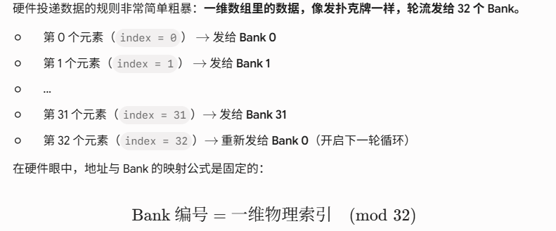

**低位交叉编址?**

```
           列 0      列 1      列 2   ...   列 31
        +---------+---------+---------+     +---------+
行 0    | Bank 0  | Bank 1  | Bank 2  | ... | Bank 31 |
        +---------+---------+---------+     +---------+
行 1    | Bank 0  | Bank 1  | Bank 2  | ... | Bank 31 |
        +---------+---------+---------+     +---------+
行 2    | Bank 0  | Bank 1  | Bank 2  | ... | Bank 31 |
        +---------+---------+---------+     +---------+
...     |  ...    |  ...    |  ...    |     |  ...    |
行 31   | Bank 0  | Bank 1  | Bank 2  | ... | Bank 31 |
        +---------+---------+---------+     +---------+
```


### 2 如果我们定义 `tile[32][32]`（无 Padding）

每一行恰好有 32 个元素，完美填满一轮 Bank：

- 第 0 行：元素 0~31，分别属于 Bank 0 ~ Bank 31。
- 第 1 行：元素 0~31，分别属于 Bank 0 ~ Bank 31。
- ...
- 第 31 行：元素 0~31，分别属于 Bank 0 ~ Bank 31。

当我们在第二步转置“竖着（按列）”读取共享内存时（例如读取第 0 列）：

Warp 内的 32 个线程会同时读取：`tile[0][0]`、`tile[1][0]`、`tile[2][0]` $\dots$ `tile[31][0]`。

你发现了吗？**这一列上的所有元素，它们的物理列号都是 0，也就是说它们全部堆在 Bank 0 里面！**

> 🚫 **结果**：32 个线程同时抢同一个 Bank 0，触发了**32 重严重冲突**。原本 1 个时钟周期就能完成的并行读取，被强行串行化成了 32 次排队，共享内存的优势被瞬间抹平。


```
列 0      列 1      列 2   ...   列 31     空房间
        +---------+---------+---------+     +---------+---------+
行 0    | Bank 0  | Bank 1  | Bank 2  | ... | Bank 31 | Bank 0  |
        +---------+---------+---------+     +---------+---------+
行 1    | Bank 1  | Bank 2  | Bank 3  | ... | Bank 0  | Bank 1  |
        +---------+---------+---------+     +---------+---------+
行 2    | Bank 2  | Bank 3  | Bank 4  | ... | Bank 1  | Bank 2  |
        +---------+---------+---------+     +---------+---------+
```


## Day 14：阶段项目——矩阵乘法优化

**目标**：完成从CPU版本到共享内存优化版本的完整优化过程。

**背景知识**：矩阵乘法`C = A × B`，其中A是M×K，B是K×N，C是M×N。

每个输出元素`C[i][j]`需要计算K次乘加：`C[i][j] = sum_{k=0..K-1} A[i][k] × B[k][j]`。

**朴素GPU方案的瓶颈**：每个线程计算一个输出元素，需要从全局内存中读取A和B。由于重复读取同一个A/B元素，导致全局内存带宽浪费。

**优化方案（Tiling + 共享内存）** ：

1. 将A和B划分成小块（Tile），每个Block加载一个Tile到共享内存
2. 在一个Block内，线程协作计算多个输出元素
3. 每次从共享内存中读取数据，避免重复的全局内存访问


> ### 朴素gpu4原理是什么? 
>
> 像是**在 GPU 显存上布置了百万级的“吸血管道”**：
>
> 1. **空间并行**：GPU 瞬间铺开 $M \times N$ 个硬件线程，每个线程死死盯住结果矩阵 $C$ 的一个物理格子。
> 2. **独立内积**：每个线程各自拉取自己需要的那一整行 $A$ 和那一整列 $B$，在自己的寄存器里做高频的乘加。
> 3. **就地收尾**：计算完毕后，百万线程同时往全局内存 $C$ 写入一笔数据，整个矩阵乘法瞬间宣告结束。
>
> ### 朴素gpu不是有TILE_SIZE吗? 是分块了吗? dim3 
>
> ```cpp
> dim3 blocks_naive((N + TILE_SIZE - 1) / TILE_SIZE, (M + TILE_SIZE - 1) / TILE_SIZE);
> 
> ```
>
> 答案是：**在“线程组织”的形式上，它确实分块了；但在“算法本质（内存重用）”上，它完全没有分块。**
>
> 这也是 CUDA 编程中初学者最容易混淆的一个概念：**线程的分块** $\neq$ **数据的分块（Tiling）**。


> ## 1. 数学原理：分块矩阵相乘
>
> 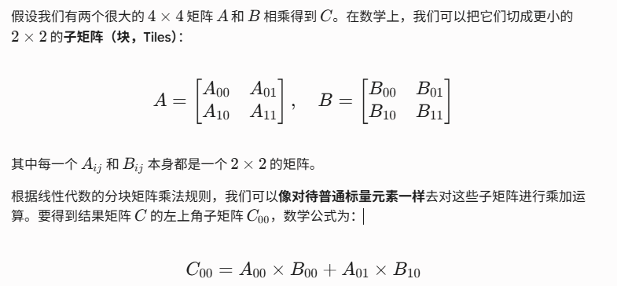
>
> 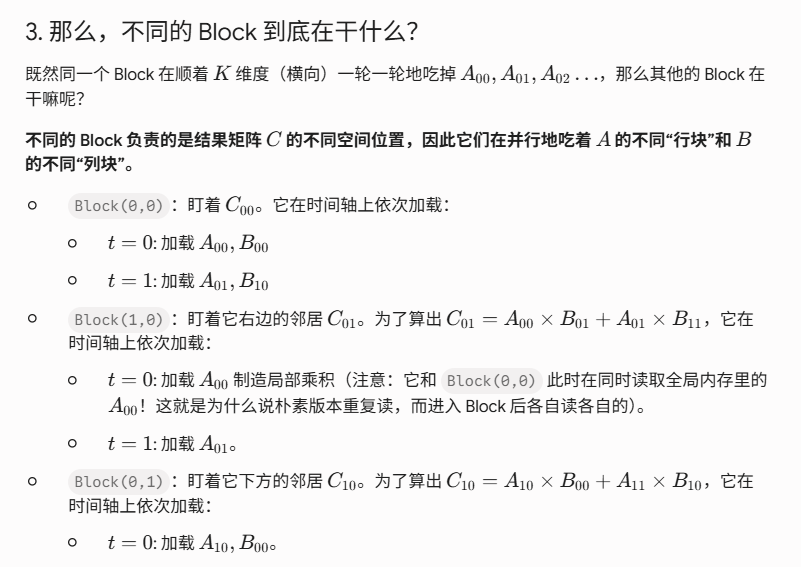


# Day 16：异步执行模型与流的基础概念

### 第一部分：核心概念（上午，1.5小时）

**目标**：理解“异步”在CUDA中意味着什么，以及流为什么是并发的核心工具。

**核心精要理解**：

到目前为止，你写的每个CUDA程序都遵循这个模式：分配内存 → 拷贝数据到GPU → 启动kernel → 拷贝结果回CPU → 释放内存。每一步都是**同步**的——`cudaMemcpy`会阻塞CPU直到传输完成，kernel启动虽然立即返回，但你总会在后面加一个`cudaDeviceSynchronize()`来等待。

现代 GPU 内部通常拥有**独立的硬件引擎**：

1. **Copy Engine (CE) - 拷贝引擎**：专门负责 PCIe 总线的数据传输（有 H2D 和 D2H 两个双工通道）。
2. **Execution Engine (EE) - 计算引擎**：专门负责执行 CUDA 核函数（SM 核心）。
3. 

但CUDA的真正威力在于**异步并发执行**：

1. **CPU和GPU可以同时工作**：kernel启动后立即返回，CPU可以继续做其他事（如准备下一批数据），GPU同时在计算
2. **GPU内部的拷贝引擎和计算引擎可以同时工作**：数据从CPU传输到GPU的同时，GPU可以在计算另一批数据
3. **多个kernel可以同时运行**：如果GPU有足够的资源，不同流中的kernel可以并行执行

**流的本质**：

CUDA流是一个**命令队列**——你把内存拷贝、kernel启动等操作按顺序放进流里，GPU按顺序执行这个流中的命令。

- **默认流（NULL流）** ：所有操作都在这个流中顺序执行，且具有隐式同步行为——默认流中的操作会阻塞其他流
- **非默认流**：不同流中的操作**可以**并发执行（是否真的并发取决于硬件能力和资源）

**关键原则**：流提供了**并发可能性**，但不保证并发一定发生。是否真的并发取决于GPU是否有空闲的拷贝引擎和计算引擎


### 1. D2H（拷回）阻碍了后续的 H2D（流水线阻塞）

在单拷贝引擎上，你目前在一个流里的顺序是：`H2D -> Kernel -> D2H`。 当 `chunk 0` 运行到 `D2H` 时，它会霸占拷贝引擎，导致 `chunk 2` 的 `H2D` 必须等待。

- **更高级的玩法（多流分配）**： 如果拆成 **4个流**（2个专门负责 H2D，2个专门负责 D2H），并使用信号量（Event）进行跨流同步，可以让拷贝引擎上的任务排列得更紧密，榨干最后一丝带宽。

### 2. 块大小（`CHUNK_N`）的黄金隐性约束

你现在设置的 `CHUNK_N` 是 1M float（4MB）。

- **如果 CHUNK 太大**：比如分块变成 64MB，总共只有 2 块，那么流水线的“热身（Warm-up）”和“收尾（Cool-down）”时间占比太大，重叠效果不明显。
- **如果 CHUNK 太小**：比如每块只有 1KB。虽然分块多了，但由于每次触发 PCIe 传输都有固定的**硬件延迟（Overhead）**，过小的传输会导致带宽跑不满（无法达到 PCIe 饱和带宽）。

> 💡 **小实验**：你可以尝试修改 `CHUNK_N` 分别为 `256KB`, `4MB`, `16MB`，观察总耗时（`total_ms`）的变化曲线，找出你这台笔记本上的 **Sweet Spot（最佳平衡点）**。


# Day 17：流的实战——单流异步操作

### 第一部分：核心概念（上午，1小时）

**目标**：在单个流中组织完整的异步操作序列。

**单流中的执行顺序**： **CPU和GPU可以同时工作**：kernel启动后立即返回，CPU可以继续做其他事（如准备下一批数据），GPU同时在计算

在同一个流中，所有操作按**提交顺序**依次执行：

text

```
cudaMemcpyAsync(H2D, stream) → kernel<<<..., stream>>> → cudaMemcpyAsync(D2H, stream)
```


这三个操作在流中排队，按顺序执行。但CPU在提交每个操作后立即返回，不会阻塞。

**关键点**：

- 单个流内是**顺序**的，但CPU和GPU可以**并行**（CPU提交下一个操作时，GPU可能正在执行上一个）
- `cudaMemcpyAsync`要求源/目标内存是**锁页内存**（pinned memory），否则会退化为同步行为


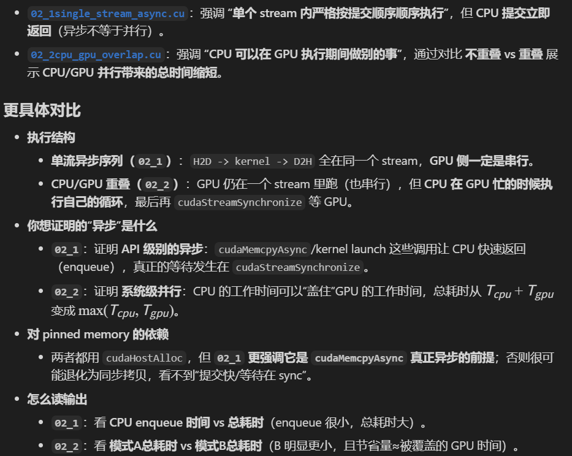

| **维度**               | **第一个代码 (01_2sync_vs_async_demo)**                      | **当前这个代码 (02_2cpu_gpu_overlap)**                       |
| ---------------------- | ------------------------------------------------------------ | ------------------------------------------------------------ |
| **并行的核心**         | **GPU 内部自己和自己并行** （GPU 拷贝引擎 与 GPU 计算引擎 并行） | **CPU 与 GPU 之间跨硬件并行** （CPU 核心 与 GPU 整体 并行）  |
| **流（Stream）的数量** | **多个流**（双流 `stream0` 和 `stream1`）                    | **单个流**（只有一个 `stream`）                              |
| **数据处理方式**       | **分块（Chunking）**。把大任务切成 32 个小块，交替塞进两个流里。 | **不分块**。整块数据一次性塞进去。                           |
| **CPU 在干什么**       | CPU 纯粹是个“无情的下单机器”，快速把 32 块任务塞满 GPU 队列后就闲下来了。 | CPU 把整块任务塞给 GPU 后，**趁着 GPU 还在算，自己跑去执行了 `cpu_work_sim()`（模拟 CPU 自己的计算）**。 |


### 1. 锁页内存（Pinned Memory）的隐式拷贝开销

你已经知道了不使用锁页内存会导致 `cudaMemcpyAsync` 退化为同步。但你知道它为什么会退化吗？

- **常规内存（Pageable）**：随时可能被操作系统换出到硬盘虚拟内存中，物理地址不固定。GPU 的 DMA 引擎无法直接访问。
- **退化机制**：如果你强行传了一个常规内存指针给 `cudaMemcpyAsync`，CUDA 驱动为了保证安全，会在 CPU 端悄悄申请一块临时的锁页内存，把你的数据先同步拷贝（Host-to-Host）到这块临时内存里，然后再异步推给 GPU。
- **后果**：这导致 CPU 依然在 `cudaMemcpyAsync` 那一行被阻塞了，白白浪费了宝贵的 CPU 时间。


# Day 18：多流并发——传输与计算重叠

### 第一部分：核心概念（上午，1.5小时）

**目标**：用多个流实现数据传输和计算的重叠，这是流技术最核心的应用。

**核心精要理解**：

单流虽然实现了CPU/GPU的异步，但GPU内部仍然是“传输→计算→传输”的顺序执行——拷贝引擎工作时计算引擎空闲，计算引擎工作时拷贝引擎空闲。

**多流的核心思想**：将数据切分成多个块（chunk），每个块使用一个独立的流。当流1在计算chunk 1时，流2可以同时传输chunk 2。

text

```
时间 →
流1: [H2D chunk1] [Kernel chunk1] [D2H chunk1]
流2:              [H2D chunk2] [Kernel chunk2] [D2H chunk2]
流3:                           [H2D chunk3] [Kernel chunk3] [D2H chunk3]
```


这样，拷贝引擎和计算引擎可以**同时工作**，GPU利用率大幅提升。

**关键条件**：

1. 必须使用**锁页内存**（pinned memory）
2. 必须使用**非默认流**（默认流有隐式同步，会破坏并发）
3. 每个流中的操作要**独立**（没有数据依赖）


## 🛑 规避多流并发的“三大隐形刺客”

在上午的理解中，有三个极易踩坑的底层机制，它们会悄悄把你的“多流”降维打击成“单流串行”：

### 刺客 1：广度优先（Breadth-First）vs 深度优先（Depth-First）提交

这是多流编程中最经典的代码设计陷阱。

- **❌ 错误的提交方式（广度优先）**：

  

  ```C++
  for(int i=0; i<3; ++i) cudaMemcpyAsync(..., stream[i]); // 全部的 H2D
  for(int i=0; i<3; ++i) kernel<<<..., stream[i]>>>(...);  // 全部的 Kernel
  for(int i=0; i<3; ++i) cudaMemcpyAsync(..., stream[i]); // 全部的 D2H
  ```

  - **后果**：因为硬件队列是按 CPU 提交顺序排队的。这会导致 3 个 H2D 把拷贝引擎塞满，然后 3 个 Kernel 把计算引擎塞满。**完全无法产生交错重叠！**

- **✅ 正确的提交方式（深度优先，正如你之前写的）**：

  先用一个循环把 4 个流的 `H2D` 全部异步提交掉。

  再用一个循环把 4 个流的 `Kernel` 全部异步提交掉。
  
  最后用一个循环把 4 个流的 `D2H` 全部异步提交掉。
  
  ```C++
  for(int i=0; i<3; ++i) {
      cudaMemcpyAsync(..., stream[i]); // H2D_i
      kernel<<<..., stream[i]>>>(...);  // Kernel_i
      cudaMemcpyAsync(..., stream[i]); // D2H_i
  }
  ```
  
  - **效果**：这样提交，底层硬件才能看到 `Kernel_0` 和 `H2D_1` 同时就绪的机会，从而触发重叠。

### 刺客 2：显卡驱动的“单硬件队列”限制（Hyper-Q 技术）

- 在老旧的 GPU（Kepler 架构之前）上，虽然你开了多流，但驱动层只有一个硬件网格队列（Hardware Work Queue）。不同流的命令混在一起，依然会退化成串行。
- **现代硬件（你的 Ampere 架构）**：支持 **Hyper-Q 技术**（拥有多达 32 个独立的硬件工作队列）。你的 `stream0` 和 `stream1` 会被分发到不同的硬件管道中，这才保证了真正的 **流间互不干扰**。

### 刺客 3：数据块大小（Chunk Size）的物理极限

- **太小（如 1KB）**：每一次 `cudaMemcpyAsync` 触发 DMA 传输，操作系统和 PCIe 总线都有大约几微秒的 **固有的启动开销（Overhead）**。如果分块太小，总线带宽还没跑满就传输结束了，时间全浪费在握手切换上。
- **太大（如 128MB）**：如果总共就切了 2 块，那么只有在两块交接的中间那一点点时间有重叠，首尾的大部分时间 GPU 还是在单兵作战（热身和收尾时间太长）。


# Day 19：CUDA事件——计时与流间同步

### 第一部分：核心概念（上午，1小时）

**目标**：掌握CUDA事件的两种核心用途——精确计时和流间同步。

**什么是CUDA事件**：

CUDA事件是流中的一个**标记点**，代表流执行到某个位置的时间点。事件有两个主要用途：

1. **精确计时**：在流中记录开始和结束事件，计算之间的耗时
2. **流间同步**：让一个流等待另一个流中的事件完成

**事件API核心函数**：

| 函数                                     | 作用                             |
| :--------------------------------------- | :------------------------------- |
| `cudaEventCreate(&event)`                | 创建事件对象                     |
| `cudaEventRecord(event, stream)`         | 在流中记录事件（标记时间点）     |
| `cudaEventSynchronize(event)`            | 阻塞CPU直到事件被记录            |
| `cudaEventElapsedTime(&ms, start, stop)` | 计算两个事件之间的时间差（毫秒） |
| `cudaEventDestroy(event)`                | 销毁事件对象                     |


# Day 20：流同步的三种方式对比

### 第一部分：核心概念（上午，1小时）

**目标**：系统比较三种同步方式，理解各自的适用场景。

**三种同步方式对比**：

| 同步方式                             | 作用范围         | 阻塞行为                | 典型用途                 |
| :----------------------------------- | :--------------- | :---------------------- | :----------------------- |
| `cudaDeviceSynchronize()`            | 整个设备的所有流 | 阻塞CPU直到所有流完成   | 调试、程序结束前全局同步 |
| `cudaStreamSynchronize(stream)`      | 单个指定流       | 阻塞CPU直到该流完成     | 等待特定任务完成         |
| `cudaStreamWaitEvent(stream, event)` | 单个流等待事件   | 不阻塞CPU，流内操作等待 | 流间细粒度依赖           |

**选择指南**：

- **调试时**：用`cudaDeviceSynchronize()`最省事，但会破坏并发
- **生产代码中**：尽量用`cudaStreamSynchronize()`或`cudaStreamWaitEvent()`
- **需要流间依赖**：必须用`cudaStreamWaitEvent()`（不能直接用`cudaStreamSynchronize()`，因为那会阻塞CPU）


# Day 21：CUDA Graph入门

### 第一部分：核心概念（上午，1.5小时）

**目标**：理解CUDA Graph是什么、解决什么问题、如何基本使用。

**核心精要理解**：

到目前为止，你每次启动kernel都要经过CPU→GPU的调度路径。对于少量大kernel，这个开销微不足道。但当你在循环中反复启动**大量小kernel**时，CPU的启动开销可能成为瓶颈。

**CUDA Graph的核心思想**：

1. **录制（Capture）** ：先执行一次完整的操作序列，CUDA运行时“记住”了所有操作  **cudaStreamBeginCapture, cudaStreamEndCapture**
2. **回放（Launch）** ：后续直接以极低开销重放整个图，跳过CPU调度**cudaGraphInstantiate cudaGraphLaunch**

**类比**：普通执行就像每次做菜都看菜谱一步步来；CUDA Graph就像把菜谱背下来，以后每次直接做。

**适用场景**：

- 循环中反复执行相同的kernel序列（如深度学习训练迭代）
- 多个小kernel频繁启动
- 需要最低延迟的场景

## 核心痛点：为什么需要 CUDA Graph？

在传统的流（Stream）模式下，每次你调用 `kernel<<<...>>>`，CPU 都会发生以下事情：

1. **参数打包**：将内核参数放入驱动层缓冲区。
2. **驱动层校验**：检查硬件资源、流状态。
3. **硬件入队**：将任务推送到 GPU 的命令队列。

- **传统 Stream（流）**：属于命令式（Imperative）执行。每次循环，CPU 都要重新走一遍上述流程。如果 Kernel 运行时间只有 5 微秒，而 CPU 调度开销却要 10 微秒，GPU 就会经常处于“饿死”状态。
- **CUDA Graph**：属于声明式（Declarative）执行。它把整个执行流固化成一个拓扑图（DAG），CPU 一次性提交给 GPU，GPU 自己按照图的依赖关系执行，**彻底解放了 CPU**。


# Day 23：Thrust入门——容器与基础算法

### 第一部分：核心概念（上午，1.5小时）

**目标**：理解Thrust是什么、为什么需要它、如何用最少的代码完成GPU加速的并行操作。

**核心精要理解**：

Thrust是一个基于C++模板的并行算法库，类似于C++标准模板库（STL），专为CUDA平台设计。它提供了丰富的数据并行原语，如排序、前缀求和、归约等，使开发者能够以高级抽象的方式编写高性能并行代码。

**为什么需要Thrust？**

前两周你写的每个kernel都需要手动管理线程索引、block/grid配置、内存分配。对于向量加法这种简单操作，这还能接受。但当你要实现排序、归约、前缀和等复杂算法时，手写kernel的工作量巨大，而且很难达到NVIDIA官方优化过的性能。

**Thrust的核心优势**：

| 特性              | 说明                                               |
| :---------------- | :------------------------------------------------- |
| **类似STL的接口** | 熟悉`std::vector`、`std::sort`的开发者可以快速上手 |
| **自动内存管理**  | `device_vector`自动调用`cudaMalloc`/`cudaFree`     |
| **多后端支持**    | 同一份代码可在CUDA GPU、TBB、OpenMP上运行          |
| **header-only**   | 无需额外编译安装，CUDA Toolkit已包含               |

**Thrust的两个核心容器**：

| 容器                       | 位置    | 说明                                        |
| :------------------------- | :------ | :------------------------------------------ |
| `thrust::host_vector<T>`   | CPU内存 | 类似于`std::vector<T>`，但可与GPU直接交互   |
| `thrust::device_vector<T>` | GPU显存 | 自动管理GPU内存，类似于GPU上的`std::vector` |

**核心理解**：`host_vector`和`device_vector`之间的赋值操作（`d_vec = h_vec`）会自动触发`cudaMemcpy`。这意味着你不需要手动调用`cudaMemcpy`——Thrust帮你做了。


> 在 CUDA 编程中，**排序（Sorting）**、**归约（Reduction）** 和 **前缀和（Prefix Sum / Scan）** 被称为三大并行算法基石。
>
> 由于这三个算法具有极强的**数据相关性**，在传统的串行思维中它们往往需要前后依赖。但在 GPU 的大规模并行架构下，我们需要利用**共享内存（Shared Memory）**、**变形虫式的树状结构**以及线程束洗牌指令（Warp Shuffle）来重构它们。
>
> 下面为你分别拆解这三个复杂算法在 CUDA 中的核心实现原理与架构设计。
>
> ## 1. 归约算法 (Reduction)
>
> 归约是将一个数组（如 $N$ 个元素）通过一个二元运算符（如加法、最大值）压缩为一个单一元素的过程。
>
> ### 核心思想：树状折半归约
>
> 不能让一个线程去加所有数，而是让所有线程两两对半分担。
>
> - **第一轮**：线程 0 加上第 $N/2$ 个元素，线程 1 加上第 $N/2 + 1$ 个元素……数据量减半。
> - **后续轮次**：不断折半，直到最后只剩一个值。
>
> ### 代码实现要点（以共享内存加法归约为例）
>
> Code snippet
>
> ```
> __global__ void reduceNeighbors(int *g_idata, int *g_odata, unsigned int n) {
>     extern __shared__ int sdata[];
>     unsigned int tid = threadIdx.x;
>     unsigned int idx = blockIdx.x * blockDim.x + threadIdx.x;
> 
>     // 1. 将数据从全局内存加载到共享内存
>     sdata[tid] = (idx < n) ? g_idata[idx] : 0;
>     __syncthreads();
> 
>     // 2. 在共享内存在进行折半归约（控制散列，避免分支发散）
>     for (unsigned int stride = blockDim.x / 2; stride > 0; stride >>= 1) {
>         if (tid < stride) {
>             sdata[tid] += sdata[tid + stride];
>         }
>         __syncthreads(); // 必须同步，确保上一轮所有线程都加完了
>     }
> 
>     // 3. 将当前 Block 的归约结果写回全局内存
>     if (tid == 0) g_odata[blockIdx.x] = sdata[0];
> }
> ```
>
> ### 关键优化演进 (面试常考)
>
> 1. **消除分支发散 (Divergence)**：不要用 `if(tid % (2*stride) == 0)`，这会导致同一个 Warp 内的线程走不同分支。改用上面的 `if(tid < stride)`，让连续的线程保持活跃。
> 2. **解决银行冲突 (Bank Conflict)**：采用逆向跨步（从 `blockDim.x/2` 开始递减），使得线程访问共享内存时地址完全连续，避开同银行并发冲突。
> 3. **Warp 展开 (Warp Unrolling)**：当 `stride <= 32` 时，所有活跃线程都在同一个 Warp 内，此时不需要 `__syncthreads()`，直接使用 Warp Shuffle 指令（如 `__shfl_down_sync`）在寄存器间交换数据，速度极快。
>
> ## 2. 前缀和算法 (Prefix Sum / Scan)
>
> 前缀和（Scan）是指对于输入数组 $A$，输出数组 $B$，满足 $B[i] = \sum_{j=0}^{i} A[j]$（包含式 Scan）或 $B[i] = \sum_{j=0}^{i-1} A[j]$（独占式 Scan）。它是并行计数、流压缩（Filter）和排序的基础。
>
> ### 核心思想：Blelloch 算法 (双调扫描)
>
> 并行前缀和通常分为两个阶段（类似于树的遍历）：
>
> 1. **Up-Sweep（上划阶段/减少阶段）**：构建一颗类似归约的二叉树，计算出各个区间的局部和。此时根节点存的是总和。
> 2. **Down-Sweep（下划阶段/分发阶段）**：从根节点开始，将根节点设为 0，然后向下传递并交换数据，逐步计算出每个位置的前缀和。
>
> ### 核心逻辑伪代码
>
> Code snippet
>
> ```
> // 伪代码：在共享内存 sdata 中进行双调 Scan (以独占式为例)
> // 1. Up-Sweep
> for (int d = 1; d < n; d <<= 1) {
>     int ai = offset * (2 * tid + 1) - 1;
>     int bi = offset * (2 * tid + 2) - 1;
>     if (bi < n) sdata[bi] += sdata[ai];
> }
> 
> // 2. 根节点清零
> if (tid == 0) { sdata[n - 1] = 0; }
> 
> // 3. Down-Sweep
> for (int d = n >> 1; d > 0; d >>= 1) {
>     // 交换并相加的逻辑
>     int t = sdata[ai];
>     sdata[ai] = sdata[bi];
>     sdata[bi] += t;
> }
> ```
>
> ### 痛点与优化
>
> - **高度依赖共享内存**：Scan 算法对共享内存的 Bank Conflict 非常敏感。通常需要通过**数据填充（Padding）**（如 `sdata[idx + (idx >> 5)]`）来打散内存索引，避免硬件阻塞。
> - **跨 Block 扫描**：单 Block 只能处理几千个数据。如果是大规模数据，需要采用 **Reduce-Then-Scan** 策略：先算每个 Block 的总和，对 Block 求和数组做一次 Scan，再把偏移量加回各 Block 的元素中。
>
> ## 3. 排序算法 (Sorting)
>
> 在 GPU 上，传统的快速排序（Quick Sort）和归并排序（Merge Sort）由于复杂的递归和分支预测，表现并不好。GPU 最喜欢的排序算法是**双调排序（Bitonic Sort）\**和\**基数排序（Radix Sort）**。
>
> ### 方案 A：双调排序 (Bitonic Sort) —— 适合小规模/固定长度
>
> - **原理**：它是一种**排序网络（Sorting Network）**。它的比较顺序是完全固定的，与输入的数据内容无关。
> - **特点**：完美契合 GPU。因为比较路径固定，没有任何条件分支发散！
> - **核心操作**：不断将序列变成“先升后降”的双调序列，然后再将双调序列拆分合并。
>
> ### 方案 B：基数排序 (Radix Sort) —— 工业界主力 (如 Thrust 库)
>
> 对于大规模数据，基数排序是 GPU 上的绝对王者，时间复杂度为 $O(N)$。
>
> - **核心步骤**：
>   1. 每次只看数据的一个位（比如二进制的最后 4 位，即基数为 16）。
>   2. **直方图统计（Histogram）**：统计当前位上，0~15 每个桶里有多少个元素。
>   3. **前缀和（Scan）**：对直方图结果做全局 Scan，计算出每个桶在输出数组中的**起始偏移地址**。
>   4. **数据重排（Scatter）**：每个线程根据自己数据的位值和 Scan 出来的地址，把数据写到正确的位置。
>   5. 移向高位，重复上述步骤。
>
> ## 总结：三大算法的技术链条
>
> 这三个算法在实际开发中不是孤立的，它们往往环环相扣：
>
> $$\text{Warp Shuffle指令} \longrightarrow \text{块内归约/Scan} \longrightarrow \text{直方图统计} \longrightarrow \text{基数排序}$$
>
> - 如果你想实现一个高性能的**数据筛选器（Filter）**：你需要先用 **Reduction** 算出有多少符合条件的元素，再用 **Scan** 算出每个符合条件的元素应该写在全局内存的哪个下标。
>   - 工业界一般不推荐手写这些底层算法，建议直接使用 NVIDIA 官方高度优化的 **Thrust 库** 或 **CUB 库**（例如 `cub::BlockScan`, `cub::BlockReduce`），它们已经把 Warp 洗牌、Bank Conflict 优化到了硬件极限。


## Day 23：Thrust入门——容器与基础算法

### 第一部分：核心概念（上午，1.5小时）

**目标**：理解Thrust是什么、为什么需要它、如何用最少的代码完成GPU加速的并行操作。

**核心精要理解**：

Thrust是一个基于C++模板的并行算法库，类似于C++标准模板库（STL），专为CUDA平台设计。它提供了丰富的数据并行原语，如排序、前缀求和、归约等，使开发者能够以高级抽象的方式编写高性能并行代码。

**为什么需要Thrust？**

前两周你写的每个kernel都需要手动管理线程索引、block/grid配置、内存分配。对于向量加法这种简单操作，这还能接受。但当你要实现排序、归约、前缀和等复杂算法时，手写kernel的工作量巨大，而且很难达到NVIDIA官方优化过的性能。

**Thrust的核心优势**：

| 特性              | 说明                                               |
| :---------------- | :------------------------------------------------- |
| **类似STL的接口** | 熟悉`std::vector`、`std::sort`的开发者可以快速上手 |
| **自动内存管理**  | `device_vector`自动调用`cudaMalloc`/`cudaFree`     |
| **多后端支持**    | 同一份代码可在CUDA GPU、TBB、OpenMP上运行          |
| **header-only**   | 无需额外编译安装，CUDA Toolkit已包含               |

**Thrust的两个核心容器**：

| 容器                       | 位置    | 说明                                        |
| :------------------------- | :------ | :------------------------------------------ |
| `thrust::host_vector<T>`   | CPU内存 | 类似于`std::vector<T>`，但可与GPU直接交互   |
| `thrust::device_vector<T>` | GPU显存 | 自动管理GPU内存，类似于GPU上的`std::vector` |

**核心理解**：`host_vector`和`device_vector`之间的赋值操作（`d_vec = h_vec`）会自动触发`cudaMemcpy`。这意味着你不需要手动调用`cudaMemcpy`——Thrust帮你做了。

## Day 24：Thrust进阶——自定义操作与CUDA互操作

### 第一部分：核心概念（上午，1小时）

**目标**：学会在Thrust中自定义操作，以及如何让Thrust与你手写的CUDA kernel协同工作。

**核心精要理解**：

Thrust的强大之处在于**可扩展性**——你可以用自定义函数对象（仿函数）或Lambda表达式定义自己的操作，Thrust会自动在GPU上并行执行。

**Thrust与CUDA C的互操作性**：

你不需要在“纯Thrust”和“纯CUDA”之间二选一。Thrust提供了与CUDA C的**完全互操作**接口：

| 互操作方式                     | 说明                             |
| :----------------------------- | :------------------------------- |
| `thrust::device_ptr<T>`        | 将原始CUDA指针包装成Thrust迭代器 |
| `thrust::raw_pointer_cast()`   | 将Thrust迭代器转换为原始CUDA指针 |
| `thrust::cuda::par.on(stream)` | 在特定CUDA流中执行Thrust算法     |

**核心理解**：Thrust本质上是一个**模板库**，它的算法最终会编译成CUDA kernel。这意味着你可以随时在Thrust代码和手写kernel之间切换——用Thrust写高层逻辑，用手写kernel处理Thrust不直接支持的操作。

## 一、 代码实现对比（Thrust vs 原生 CUDA）

就拿你代码中的“100万个数据并行排序”这一件事来说，我们来看看不使用库（原生写法）需要付出多大的代价。

### 1. 使用 Thrust 库（你的代码）

C++

```
// 1行代码搞定：自动分配网格、调用高度优化的基数排序（Radix Sort）内核
thrust::sort(thrust::cuda::par.on(stream), d_vec.begin(), d_vec.end());
```

### 2. 原本不使用库（原生 CUDA 编写排序）

如果你打算自己从零手写一个能跑在 GPU 上的高效排序（例如双调排序 Bitonic Sort 或基数排序），你必须编写：

1. **核函数（Kernel）**：自己写 `__global__ void radix_sort_kernel(...)`，处理复杂的线程索引（`threadIdx`、`blockIdx`）、共享内存（Shared Memory）交换、以及线程块内和块间的同步。

2. **处理边界与动态规划**：当 $N=1000000$ 不是 2 的幂次方时，处理复杂的边界挂靠。

3. **主机端复杂的调用链**：

   C++

   ```
   int threads = 256;
   int blocks = (N + threads - 1) / threads;
   // 你可能需要通过好几个阶段的 Kernel 迭代才能完成整个排序
   for(int step = 0; step < max_steps; step++) {
       bitonic_sort_step<<<blocks, threads, 0, stream>>>(d_ptr, j, k);
   }
   ```

> **💡 事实残酷**：自己手写的 GPU 排序算法，99% 的情况下性能都**远远比不上** Thrust，因为 Thrust 内部集成了 NVIDIA 顶尖工程师几十年沉淀下来的硬件级并行图论优化（底层通常基于高度压榨硬件的 CUB 库）。


## Day 25：cuBLAS入门——矩阵乘法

### 第一部分：核心概念（上午，1.5小时）

**目标**：学会使用cuBLAS库完成矩阵乘法，并与第二周手写的矩阵乘法进行性能对比。

**核心精要理解**：

cuBLAS是NVIDIA提供的**高度优化的BLAS（基础线性代数子程序）库**，包含经过高度优化的矩阵与向量运算。它支持所有152个标准BLAS例程，支持单精度、双精度、复数和双复数数据类型。

**为什么需要cuBLAS？**

你在第二周花了一天时间优化矩阵乘法，从朴素版本到共享内存Tiling版本，可能达到了3-10倍的加速。但cuBLAS的矩阵乘法比你手写的版本**还要快2-5倍**——因为cuBLAS利用了更多硬件特性（如Tensor Core、指令级优化等）。

**cuBLAS的核心API**：

| API                     | 用途                                 |
| :---------------------- | :----------------------------------- |
| `cublasCreate(&handle)` | 创建cuBLAS上下文                     |
| `cublasDestroy(handle)` | 销毁cuBLAS上下文                     |
| `cublasSgemm(...)`      | 单精度矩阵乘法（C = α*A*B + β*C）    |
| `cublasDgemm(...)`      | 双精度矩阵乘法                       |
| `cublasGemmEx(...)`     | 更灵活的矩阵乘法（支持更多数据类型） |

**⚠️ 重要提醒**：cuBLAS使用**列优先**（column-major）存储格式。如果你习惯C/C++的行优先（row-major）存储，需要在调用时注意矩阵的转置参数。


## Day 26：cuFFT入门与更多库概览

### 第一部分：核心概念（上午，1小时）

**目标**：学会使用cuFFT进行快速傅里叶变换，并了解CUDA生态中的其他重要库。

**核心精要理解**：

cuFFT是NVIDIA提供的GPU加速快速傅里叶变换（FFT）库，类似于CPU端的FFTW，但利用CUDA并行计算大幅提高性能。它可以处理一维、二维、三维的FFT，支持复数到复数（C2C）、实数到复数（R2C）、复数到实数（C2R）的变换。

**cuFFT基本流程**：

text

```
cufftHandle plan;
cufftPlan1d(&plan, N, CUFFT_C2C, 1);   // 创建plan
cufftExecC2C(plan, d_data, d_data, CUFFT_FORWARD);  // 执行正向FFT
cufftExecC2C(plan, d_data, d_data, CUFFT_INVERSE);  // 执行逆向FFT
cufftDestroy(plan);  // 销毁plan
```


**CUDA生态库概览**：

| 库         | 用途                           | 适用场景             |
| :--------- | :----------------------------- | :------------------- |
| **Thrust** | 并行算法（排序、归约、变换）   | 通用数据处理         |
| **cuBLAS** | 线性代数（矩阵乘法、向量运算） | 科学计算、机器学习   |
| **cuFFT**  | 快速傅里叶变换                 | 信号处理、图像处理   |
| **cuDNN**  | 深度神经网络原语               | 深度学习训练/推理    |
| **NPP**    | 图像与信号处理原语             | 图像处理、视频处理   |
| **cuRAND** | 随机数生成                     | 蒙特卡洛模拟、初始化 |

> 


## Day 33：Nsight Systems深度使用

### 第一部分：核心概念（上午，1.5小时）

**目标**：掌握Nsight Systems的系统级性能分析方法，能够从全局视角识别性能瓶颈。

**核心精要理解**：

**Nsight Systems vs Nsight Compute的分工**：

| 工具               | 分析范围               | 输出                     | 适用场景             |
| :----------------- | :--------------------- | :----------------------- | :------------------- |
| **Nsight Systems** | 整个应用程序（系统级） | 时间线视图、所有操作概览 | 找到瓶颈在哪里       |
| **Nsight Compute** | 单个CUDA内核（内核级） | 指令级指标、详细分析     | 找到瓶颈为什么在那里 |

**工作流程**：先用Nsight Systems找到**哪个kernel**耗时最长，再用Nsight Compute分析**为什么**这个kernel慢。

**Nsight Systems能告诉你什么**：

- GPU利用率（SM占用率）
- 内存带宽使用情况
- Kernel调度和执行时间
- 流（Stream）的并发情况
- CPU和GPU之间的时间关系
- Tensor Core利用率


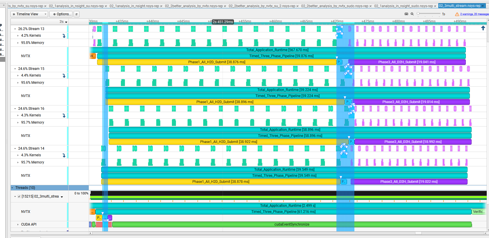

> 我的观察发现: 1 HtoD每一个stream是连续两个的
>
> 2 threads(cpu): 使用Phase1_All_H2D_Submit Phase2_All_Kernel_Submit Phase3_All_D2H_Submit时间很短, 三者一共才2.5ms; 更多是cudaeventsynchronize
>
> 3 Phase1_All_H2D_Submit Phase3_All_D2H_Submit在gpu里占很大头. 39ms与19ms而Phase2_All_Kernel_Submit 基本上每一个stream1ms左右, 
>
> 4 第一个H2DcudaMemcpyAsync到gpu运行间隔很小250us
>
> 5 还有其他重要点我没注意到吗?]


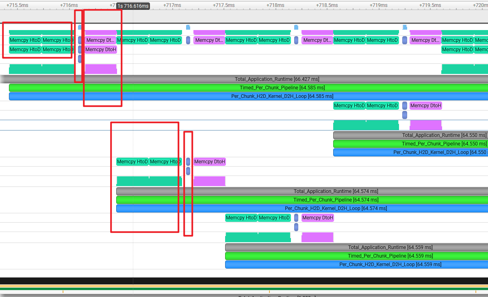

> ## 🔍 为什么 20000 次循环依然没效果？
>
> ### 1. 理论计算：传输与计算的时间差
>
> 我们以单块（Chunk）数据为例，看看 PCIe 传输和 GPU 计算到底谁快：
>
> - **数据传输时间 (H2D + D2H)：**
>
>   一个 Chunk 是 1M 个 `float`，也就是 4MB。
>
>   每个 Chunk 需要：`H2D(A)` + `H2D(B)` + `D2H(Out)` = 共 **12MB** 的数据传输。
>
>   假设在 PCIe Gen4 x16 上，实际有效带宽约为 **24 GB/s**。
>
>   $$\text{传输时间} = \frac{12 \text{ MB}}{24 \text{ GB/s}} \approx 500 \ \mu s \ (微秒)$$
>
> - **Kernel 计算时间（Element-wise Add + Loop）：**
>
>   在现代 GPU（如 RTX 3090 / 4090）上，拥有数万个单精度浮点（FP32）核心。1M 的数据量只有 $2^{20}$ 个元素，仅仅只需要 **4096个线程块**（每个线程处理几个元素），瞬间就能把所有核心铺满。
>
>   对于 GPU 来说，20000 次核心循环（只有 1 条指令 `tmp = tmp * 1.0001f + 0.0001f`）只是开胃菜。在强大的算力面前，这个 Kernel 可能只需要 **几十微秒** 就跑完了。
>
> ### 2. 结论：传输时间 >> 计算时间
>
> 当**传输（500微秒）\**远远大于\**计算（几十微秒）\**时，流流水线（Stream Pipeline）失去了重叠的空间。 即使你做了多流重叠，GPU 计算引擎在 500 微秒的传输周期里，只花了 30 微秒就把活干完了，剩下的 470 微秒它都必须\**干等着 PCIe 总线把下一批数据送过来**。因此，你在 Nsys 里看到的依然是密密麻麻的 Memory 传输霸占了总线，而 Kernel 只是里面不起眼的一小点。


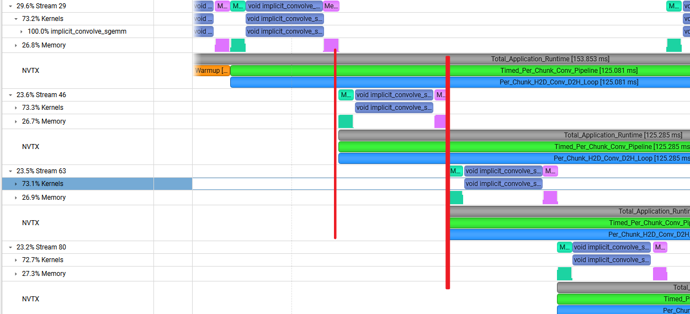

> ```
> stream0: [H2D0][==== conv0 ====][D2H0]
> stream1:       [H2D1]
>                  ↑ 与 conv0 同时
> ```
>
> 
>
> ### 为何 conv 很长仍可能看不到 overlap？
>
> 先说结论：
>
> > 你的 H2D1 并没有被 Compute 阻塞，而是被 **前面的 H2D0/H2D2/H2D3 排队阻塞了**。
>
> 你当前代码实际上不是：
>
> ```
> Stream0:
> H2D0 -> Conv0 -> D2H0
> 
> Stream1:
> H2D1 -> Conv1 -> D2H1
> ```
>
> 而是 Host 一次性提交：
>
> ```
> for (int c = 0; c < NUM_CHUNKS; ++c)
> {
>     H2D
>     Conv
>     D2H
> }
> ```

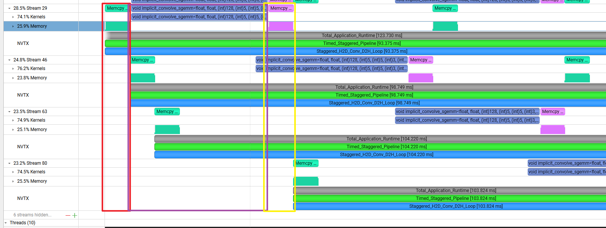

> nice 成功了虽然不是说我想的一个conv进行一个H2D但是竟然运行了二个H2D! 
>
> 现在是每个kernel运行完后直接下一个kernel, 而H2D和 D2H都是见缝插针, 空闲就进
>
> 而且有速度的提升! 


## Day 34：Nsight Compute深度使用与联合分析工作流

### 第一部分：核心概念（上午，1.5小时）

**目标**：掌握Nsight Compute的微观性能分析方法，建立“宏观→微观→优化→验证”的完整工作流。

**核心精要理解**：

Nsight Compute是**内核级**的性能分析工具。它能告诉你一个kernel内部的详细情况：指令执行效率、内存访问模式、warp调度效率等。

**Nsight Compute的关键指标**：

| 指标                                                  | 含义               | 健康值     | 问题诊断              |
| :---------------------------------------------------- | :----------------- | :--------- | :-------------------- |
| `sm__warps_active.avg.pct`                            | SM中活跃warp的比例 | >80%       | 低值表示occupancy不足 |
| `dram__bytes.sum.per_second`                          | DRAM带宽利用率     | 接近理论值 | 高值表示内存受限      |
| `smsp__sass_thread_inst_executed_op_fadd_pred_on.sum` | 浮点加法指令数     | 高值       | 低值表示计算指令不足  |
| `gpu__time_duration.sum`                              | kernel执行总时间   | 越小越好   | 主要优化目标          |

**性能分析完整工作流**：

text

```
步骤1: Nsight Systems（宏观）
       ↓ 识别耗时最长的kernel
步骤2: Nsight Compute（微观）
       ↓ 分析该kernel的详细指标
步骤3: 定位瓶颈（计算受限/内存受限/调度受限）
       ↓
步骤4: 修改代码优化
       ↓
步骤5: 回到步骤1验证效果
       ↓ 迭代直到达到目标
```

任何一个没有达到性能极限的 Kernel，其瓶颈必然归属于以下三大受限之一：

### 1. 内存受限 (Memory Bound)

- **表现**：DRAM 或各级缓存（L1/L2）的带宽利用率（如 `dram__bytes.sum.per_second`）接近硬件理论极限，但计算单元大部分时间在“等米下锅”。
- **典型病因**：访存未对齐、不连续（非合并访存）、没有有效利用 Shared Memory 导致频繁读取全局内存（Global Memory）。

### 2. 计算受限 (Compute Bound)

- **表现**：流水线吞吐率非常高，某类计算指令（如浮点加乘、Tensor Core 指令）的计数器爆表，而内存带宽还有很大富余。
- **典型病因**：这通常是个**好信号**，说明你充分利用了硬件。如果还想优化，需要考虑算法层面的剪枝、将特殊数学函数替换为硬件级低精度指令（如使用 `__fadd_rn` 等内联函数），或使用 Tensor Core 代替普通 ALU。

### 3. 调度/延迟受限 (Latency Bound)

- **表现**：计算和内存的利用率**都很低**，执行总时间 `gpu__time_duration.sum` 却很长。
- **典型病因**：指令流水线存在长延迟（Long Scoreboard Stall）。最常见的是**活跃 Warp 数（Occupancy）太低**，导致当某个 Warp 因为读取内存而挂起时，SM 找不到其他可以顶替上来的 Warp，使得计算单元集体“发呆”。

## 核心指标深度拆解：学会看懂 NCU 的体检报告

Nsight Compute 收集的指标（Metrics）名字看似冗长，但其实有着极严密的命名规范：`[单元]__[基本操作].[统计方式].[单位]`。

以下是你在上午必须背下来的四个“黄金指标”：

| **指令名（Metric）**                      | **通俗含义**                              | **诊断说明**                                                 |
| ----------------------------------------- | ----------------------------------------- | ------------------------------------------------------------ |
| **`sm__warps_active.avg.pct`**            | **活跃 Warp 百分比** (Achieved Occupancy) | 衡量 SM 的装载率。如果低于 60%，说明你的 Block 大小设置不合理、寄存器（Registers）用量过多或 Shared Memory 分配过大，导致硬件无法调度更多的 Warp 进驻。 |
| **`dram__bytes.sum.per_second`**          | **DRAM 实际吞吐带宽**                     | 拿这个值对比你显卡的理论带宽（如 RTX 4090 理论带宽约 1 TB/s）。如果极度接近，说明已榨干显存带宽。 |
| **`smsp__sass_thread_inst_executed_...`** | **特定 SASS 指令执行数**                  | `sass_thread_inst_executed` 代表真正转换成机器码（SASS）后的指令计数。通过观察加法（fadd）、乘加（fma）等指令占比，能精准发现有没有生成预期的硬件加速指令（如 Tensor Core 指令 `smsp__sass_inst_executed_op_tensor_...`）。 |
| **`gpu__time_duration.sum`**              | **Kernel 绝对执行时间**                   | 终极裁判。无论中间指标调得多好看，这个值变小了才是硬道理。   |

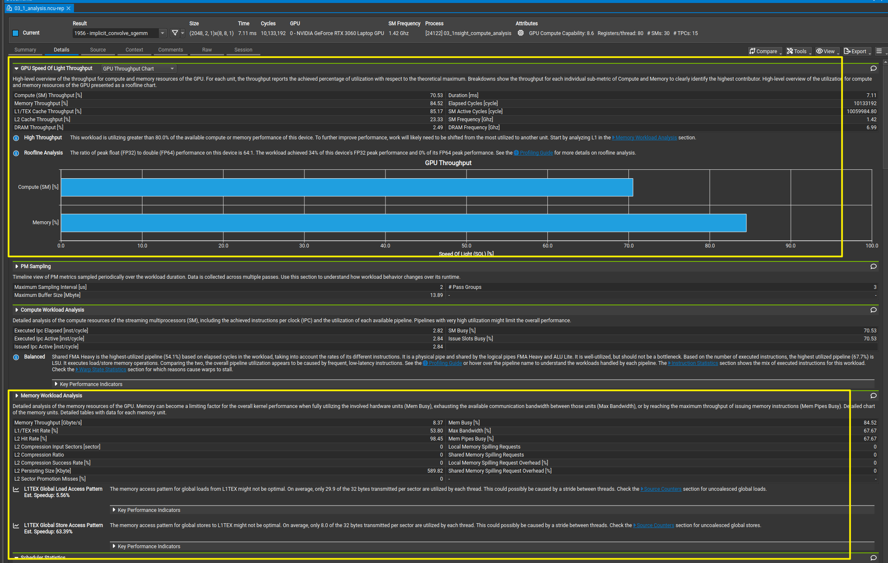


## Day 35：PTX汇编入门——阅读与理解

### 第一部分：核心概念（上午，1.5小时）

**目标**：理解PTX是什么、为什么要读PTX、如何阅读编译器生成的PTX代码。

**核心精要理解**：

## 核心概念一：解构 CUDA 的三层金字塔架构

要理解 PTX，首先要看清代码从高级语言到硅片硬件的蜕变过程：

```
┌────────────────────────────────────────────────────────┐
│ 1. CUDA C++ (高级源码)                                 │ ──> 易于人类编写与维护
│    例如：__global__ void add() { c[i] = a[i] + b[i]; } │     具有极强的抽象能力
└───────────────────────────┬────────────────────────────┘
                            ▼ [nvcc 编译前端]
┌────────────────────────────────────────────────────────┐
│ 2. PTX (Parallel Thread Execution, 虚拟汇编)           │ ──> 跨代兼容的“普通话”
│    例如：ld.global.f32 %f1, [%rd1]; add.f32 %f3, ...   │     独立于具体 GPU 架构
└───────────────────────────┬────────────────────────────┘
                            ▼ [ptxas 汇编后端 / 驱动 JIT]
┌────────────────────────────────────────────────────────┐
│ 3. SASS (Shader Assembly, 实际机器码汇编)               │ ──> 针对特定显卡芯片的
│    例如：IMAD.MOV.U32 R1, R0, 0x1, R1;                 │     微观指令，随架构剧烈变化
└────────────────────────────────────────────────────────┘
```

> ## 在编译链中的位置
>
> .cu 源文件
>
>   ↓  nvcc（前端 + NVVM/LLVM）
>
> .ptx   ← 虚拟 ISA，可读文本，类似「汇编源码」
>
>   ↓  ptxas（PTX 汇编器）
>
> .cubin ← 某个具体 GPU 架构的机器码（如 sm_52）
>
>   ↓  链接 / fatbinary
>
> 可执行文件 或 .fatbin
>
> | 格式      | 内容                      | 特点                                   |
> | :-------- | :------------------------ | :------------------------------------- |
> | `.ptx`    | PTX 文本                  | 人类可读，可跨架构 JIT                 |
> | `.cubin`  | 某 `sm_XX` 的 SASS 机器码 | 二进制，只能在该架构（及兼容架构）上跑 |
> | `.fatbin` | 多个 cubin 打包           | 一个程序支持多种 GPU                   |
>
> ## 和 `.ptx` 的区别
>
> - `.ptx`：中间表示，驱动可以在运行时 JIT 成当前 GPU 的 SASS
> - `.cubin`：已经汇编好的 SASS（真正在 GPU 上执行的指令），不再经过 JIT


### 💡 核心痛点：为什么不直接编译成机器码，而要多一个 PTX？

- **硬件迭代太快**：从 Kepler、Pascal、Volta、Ampere 到 Blackwell，NVIDIA GPU 的底层硬件架构（如寄存器文件数量、指令流水线、Tensor Core 内部设计）在剧烈变动。
- **解耦与兼容性（JIT 编译）**：PTX 是一种**虚拟指令集**。你在 5 年前编译的 CUDA 程序中包含的 PTX 代码，在今天最新的 GPU 上运行时，驱动程序（JIT 编译器）会自动将这段 PTX 翻译成针对当前最新显卡优化的 SASS。这保证了 CUDA 生态的**向前兼容性**。

## 核心概念二：PTX 的语法骨架与“三大基石”

PTX 的可读性其实比传统的 8086 或 ARM 汇编要好得多，因为它保留了高级语言的**数据类型**和**无限寄存器**的伪抽象。阅读 PTX 时，抓准以下三个核心：

### 1. 强类型指令后缀

PTX 指令必须通过`.类型`明确指定操作数的数据宽度和性质。

- **整数**：`.u32` (无符号32位), `.s64` (有符号64位)
- **浮点数**：`.f32` (单精度), `.f64` (双精度)
- **谓词/布尔**：`.pred` (用于条件跳转或分支)

### 2. 特殊寄存器（State Spaces）

你在 CUDA C++ 中常用的内置变量（如 `threadIdx.x`），在 PTX 中对应着特殊的只读寄存器：

- `%tid.x`, `%tid.y` $\rightarrow$ `threadIdx.x`, `threadIdx.y`
- `%ntid.x` $\rightarrow$ `blockDim.x`
- `%ctaid.x` $\rightarrow$ `blockIdx.x`

### 3. 三地址指令格式

PTX 绝大多数指令遵循“目标寄存器, 源操作数1, 源操作数2”的规律（即：结果写在最左边）。

> **经典示例剖析：**
>
> Code snippet
>
> ```
> ld.global.f32  %f1, [%rd1];    // 从 global 内存地址 %rd1 读取一个 32位浮点数 到 寄存器 %f1
> add.f32        %f3, %f1, %f2;  // 计算 %f3 = %f1 + %f2 (单精度浮点加法)
> st.global.f32  [%rd2], %f3;    // 将 寄存器 %f3 的结果写回到 global 内存地址 %rd2
> ```

## 核心解密：为什么要读 PTX？（高级工程视角）

作为高性能计算或算子优化工程师，读 PTX 不是为了好玩，而是为了捕捉编译器的“偷懒”**或**“帮倒忙”：

### 1. 抓取“寄存器溢出 (Register Spilling)”的元凶

当你的 Kernel 局部变量太多、写得太复杂时，显卡硬件寄存器不够用了，编译器会悄悄把多出来的变量放到极慢的局部内存（Local Memory）中。在 C++ 源码中你根本看不出来，但打开 PTX 一看，如果发现大量 `.local` 空间的 `ld.local` 和 `st.local`，你就找到了 Kernel 变慢的罪魁祸首。

### 2. 观察循环展开（Loop Unrolling）与分支预测

你加了 `#pragma unroll` 后，编译器到底有没有乖乖听话展开循环？你写的一个复杂的 `if-else`，编译器是把它变成了代价高昂的跳转分支（`.pred` 跳转），还是优化成了硬件级的条件控制指令（Predicated Execution）？PTX 会把编译器的底裤看得一清二楚。

> 这两个问题都问得非常辛辣，直接戳中了 CUDA 编译器在处理底层内存模型和寄存器分配时的“核心小秘密”。
>
> 我们来逐一拆解：
>
> ## 1. 为什么需要将参数显式转换为全局内存地址 (`cvta.to.global`)？
>
> 在高级语言 C++ 中，你看到的 `float *out` 只是一个普通的指针。但在 GPU 硬件物理层面，CUDA 拥有**多个完全独立的内存空间（State Spaces）**，比如：
>
> - **Global Memory**（全局内存，主显存）
> - **Shared Memory**（片上共享内存，线程块内可见）
> - **Local Memory**（线程私有局部内存）
> - **Param Memory**（专门存放函数输入参数的只读区域）
>
> ### 💡 核心原因：从“通用指针”切换到“硬核物理指令”
>
> 在 CUDA C++ 里，所有的指针都是**通用指针（Generic Pointer）**。也就是说，你写一个 `ptr[idx]`，编译器在前端编译时，并不知道这个指针到底指向哪里。
>
> 而在 PTX 虚拟汇编中，加载指令是分物理空间的，比如：
>
> - `ld.param`：专门从参数区拿数据。
> - `ld.global`：专门从主显存拿数据。
>
> Code snippet
>
> ```
> ld.param.u64 	%rd1, [_Z10add_kernelPfPKfS1_i_param_0];
> ```
>
> 上面这行代码，把参数区里的 `_param_0`（也就是 `out` 指针的值）读取到了通用寄存器 `%rd1` 中。此时，`%rd1` 里面存的只是一个 64 位的无类型数值。
>
> 为了后面能安全、高效地使用 `st.global`（向全局内存写入）指令，编译器必须明确告诉硬件：“**请把 `%rd1` 这个通用指针，正式映射/转换为全局内存空间的绝对物理地址**”。
>
> 这就是下面这行代码的由来：
>
> Code snippet
>
> ```
> cvta.to.global.u64 	%rd9, %rd1; // cvta 代表 Convert Address (地址转换)
> ```
>
> 通过这一步，硬件和编译器才 100% 确认 `%rd9` 里的地址就是用来操作 Global Memory 的，从而生成最优化的硬件访存指令。
>
> ## 2. `%r0` 怎么没看到有用到？
>
> 细心的你一定发现了，在最开始声明 32 位整型寄存器时，编译器申请了 6 个：
>
> Code snippet
>
> ```
> .reg .b32 	%r<6>;  // 这会产生 %r0, %r1, %r2, %r3, %r4, %r5 连续 6 个寄存器
> ```
>
> 但在后面的代码中，`%r1` 到 `%r5` 都干活了，唯独 `%r0` 消失了。
>
> ### 💡 核心原因：编译器的“一刀切”声明与内部寄存器重命名
>
> 有两个主要原因导致了 `%r0` 的缺席：
>
> #### 原因 A：PTX 的区间声明语法（主要原因）
>
> 在 PTX 中，`.reg .b32 %r<6>;` 是一种**区间快捷声明**。它的意思是：“帮我开辟一个名字叫 `%r`、下标从 `0` 开始、总共 `6` 个元素的寄存器阵列”。
>
> 也就是说，**你无法跳过 `0` 直接声明 `%r<1> 到 %r<6>`**。编译器因为在后面的计算中（比如算 `idx`）恰好需要 5 个 32 位整型寄存器，它就必须一口气声明 `%r<6>`。
>
> #### 原因 B：编译器的后端优化与死代码消除（Dead Code Elimination）
>
> 在编译的最早期阶段，编译器可能确实用过 `%r0`（例如用来存某个中间变量）。但当高级优化器（Optimizer）介入后，发现这个中间变量可以和其他指令合并（比如合并成了 `mad` 指令），或者发现某行代码是死代码并将其删除了。
>
> 虽然代码被删了，但前端的寄存器声明数量（`.reg .b32 %r<6>`）为了省事或保持对齐，通常不会再回过头去精确地把它改成不连续的形式。
>
> ### 🛠️ 你不用担心浪费：SASS 会重新洗牌
>
> 不用担心 `%r0` 的缺席会浪费显卡宝贵的硬件寄存器。
>
> 正如我们在第 35 天上午学到的，**PTX 只是虚拟汇编**，这里的 `%r0`~`%r5` 都是虚拟的。当这段 PTX 被进一步编译成真正的硬件机器码 **SASS** 时，后端的 `ptxas` 汇编器会进行极其严苛的“寄存器染色算法（Register Allocation）”。在最终的 SASS 机器码里，所有没被用到的、或者可以复用的寄存器都会被压缩，绝对不会允许任何一个物理寄存器在硬件里白白“摸鱼”。
>
> 你观察得非常仔细！这两个问题说明你不仅在“看”代码，而且在试图理解编译器底层的底层逻辑。接下来，你准备好尝试把代码改加 `__restrict__` 看看指针转换的变化了吗？


## Day 37：多GPU编程与NCCL基础

### 第一部分：核心概念（上午，1.5小时）

**目标**：了解多GPU编程的基本模型，掌握NCCL通信库的基础使用。

**核心精要理解**：

**为什么需要多GPU？**

单个GPU的显存和计算能力有限。当模型或数据集超出单卡容量时，或者需要更快的训练/推理速度时，就需要多GPU并行。

**多GPU编程的两种模式**：

| 模式         | 说明                             | 适用场景           |
| :----------- | :------------------------------- | :----------------- |
| **数据并行** | 每张卡持有完整模型，处理不同数据 | 数据量大，模型适中 |
| **模型并行** | 每张卡持有模型的一部分           | 模型超大（如GPT）  |

**NCCL（NVIDIA Collective Communications Library）**

NCCL是NVIDIA开发的多GPU通信库，提供高效的集合通信操作：

| 操作              | 说明                                    |
| :---------------- | :-------------------------------------- |
| **AllReduce**     | 所有GPU的数据求和/求平均后广播给所有GPU |
| **Broadcast**     | 从一个GPU广播数据到所有GPU              |
| **AllGather**     | 收集所有GPU的数据并广播                 |
| **ReduceScatter** | 归约后分散到各GPU                       |

## 核心概念一：数据并行 vs 模型并行（大白话拆解）

多卡编程的核心任务，就是把一个原本单卡放不下的“超级大任务”，拆分到多张显卡上。拆分的方法主要有两种：

### 1. 数据并行 (Data Parallelism, DP)

- **大白话**：**“每人一本相同的书，各自做不同的作业”**。
- **怎么做**：每张 GPU 的显存里都塞入一个一模一样的模型。把海量的数据（Batch）切分成好几份，GPU 0 算第一份，GPU 1 算第二份…… 它们各自算完之后，把结果（梯度）汇总对齐一下，再更新模型。
- **痛点**：如果模型本身超大（比如 70B 的大模型，单卡显存连模型权重都装不下），这种方法就彻底瘫痪了。

### 2. 模型并行 (Model Parallelism, MP)

- **大白话**：**“流水线工厂，一人负责组装一部分”**。
- **怎么做**：模型太大了，一张卡放不下，那就“切两半”。GPU 0 负责前 50 层的计算，GPU 1 负责后 50 层的计算。GPU 0 算完的中间结果（Activation），通过高速通道传给 GPU 1 继续算。
- **痛点**：显卡之间会产生高频、大量的中间数据传输。如果传输太慢，GPU 1 就会经常处于“等米下锅”的闲置状态。

## 核心概念二：NCCL 集合通信的四大神兵利器

当多张显卡在一起协同工作时，它们之间必须频繁地交换数据。如果让你用传统的 `cudaMemcpyPeer`（点对点拷贝）手写多卡数据同步，代码会变成一团乱麻，且性能极差。

NVIDIA 官方推出的 **NCCL（读作 Nickel）** 专门用来解决多卡、多机之间的集合通信（Collective Communications）问题。你必须熟练掌握以下四个核心操作：

### 1. `Broadcast`（广播）

- **动作**：由一个特定的“源 GPU”（通常是 Root，如 GPU 0）把手里的一份数据，原封不动地复制发送给集群中的**所有**其他 GPU。
- **场景**：初始化时，Rank 0 产生了一组随机权重，广播给所有卡，确保大家起点一致。

### 2. `AllGather`（全收集）

- **动作**：每个 GPU 手里都有一份不同的小数据（大小为 $N$）。执行完后，所有 GPU 的显存里都同时拥有了**所有人拼接在一起的总数据**（大小为 $K \times N$）。
- **场景**：序列并行或分布式特征提取，把各卡算出的局部 embedding 拼回完整的全局特征。

### 3. `ReduceScatter`（归约分散）

- **动作**：每个 GPU 手里有一份相同大小的数据。首先把所有卡对应位置的数据进行**数学运算（如求和）**，然后把这个求和后的总数据**切成 $K$ 份**，每张卡分到其中的一份。
- **场景**：ZeRO（零冗余优化器）技术的核心，用来切分和分散存储梯度与优化器状态。

### 4. `AllReduce`（全归约——最核心、最常用）

- **动作**：等价于先做一次 `Reduce`（所有卡数据求和），再做一次 `Broadcast`（把求和结果分发给所有人）。最终结果是：**所有 GPU 在相同的位置，都得到了所有卡数据求和/求平均后的最新大表**。
- **场景**：数据并行训练的灵魂。每张卡各自算出了不同的梯度，通过 `AllReduce` 一键实现全网梯度同步，然后大家一起整齐划一地更新模型。


## Day 39：cuDNN入门——安装、核心概念与张量描述符

### 第一部分：核心概念（上午，1.5小时）

**目标**：理解cuDNN是什么、能做什么、如何与CUDA程序协同工作。

**核心精要理解**：

**cuDNN是什么？**

cuDNN（CUDA Deep Neural Network library）是NVIDIA提供的**GPU加速深度神经网络算子库**。它为标准操作（如前向和反向卷积、注意力、矩阵乘法、池化和归一化）提供高度优化的实现。

**cuDNN vs 手写kernel**：

| 对比维度        | 手写CUDA kernel    | cuDNN                                              |
| :-------------- | :----------------- | :------------------------------------------------- |
| 开发效率        | 低（需要大量调试） | 高（调用API即可）                                  |
| 性能            | 取决于优化水平     | 接近硬件极限                                       |
| 算法选择        | 固定               | 自动选择最优算法（Winograd、FFT、Implicit GEMM等） |
| Tensor Core支持 | 需要手动WMMA编程   | 自动利用Tensor Core                                |
| 适用场景        | 新算子、特殊需求   | 标准CNN操作                                        |

**cuDNN的核心概念**：

cuDNN使用**描述符（Descriptor）** 模式来配置操作：

| 描述符类型                     | 用途                                     |
| :----------------------------- | :--------------------------------------- |
| `cudnnTensorDescriptor_t`      | 描述张量的形状、数据类型、布局           |
| `cudnnFilterDescriptor_t`      | 描述卷积核（滤波器）的形状               |
| `cudnnConvolutionDescriptor_t` | 描述卷积操作的参数（步长、填充、扩张率） |
| `cudnnPoolingDescriptor_t`     | 描述池化操作的参数                       |
| `cudnnActivationDescriptor_t`  | 描述激活函数的类型和参数                 |


## Day 41：cuDNN Graph API与算子融合

### 第一部分：核心概念（上午，1小时）

**目标**：掌握cuDNN Graph API，理解算子融合的价值和实现方式。

**核心精要理解**：

**什么是算子融合？**

在深度学习中，一个简单的卷积层通常包含多个操作：卷积 → 偏置加法 → 批归一化 → 激活函数。如果每个操作都单独调用，每次都需要读写全局内存，产生大量中间结果。

**算子融合**将这些操作合并为一个kernel，数据在寄存器/共享内存中传递，避免中间结果的显存读写。

**cuDNN Graph API**：

cuDNN 8.0引入了Graph API，提供了一种**声明式编程模型**，将计算描述为操作图。你可以定义一个包含多个操作的有向无环图（DAG），cuDNN会将其融合并生成高效的GPU代码。

**Graph API vs 传统API**：

| 对比维度 | 传统API            | Graph API                |
| :------- | :----------------- | :----------------------- |
| 编程模型 | 命令式（逐步调用） | 声明式（描述图）         |
| 算子融合 | 手动或依赖运行时   | 自动融合                 |
| 灵活性   | 较低               | 高                       |
| 性能     | 好                 | 更好（融合减少显存访问） |

## 核心概念一：为什么要“融合”？（从访存受限看世界）

在第 34 天学习 Nsight Compute 时，我们强调过一个黄金定律：深度学习中的绝大多数非卷积算子（如 ReLU 激活、Bias 加法、Element-wise 加法）都是内存受限（Memory Bound）的。

### 🚨 传统非融合模式（Memory-to-Memory）

假设我们有一个最经典的深度学习管线：`卷积 (Conv) ──> 偏置加 (Bias) ──> 激活 (ReLU)`。

传统的单算子调用方式，其底层的显存读写轨迹是这样的：

1. **执行 Conv**：从显存读取输入，计算，将巨大的中间结果 $Y_{conv}$ **写入显存**。
2. **执行 Bias**：从显存**读取** $Y_{conv}$，加上偏置，将中间结果 $Y_{bias}$ **写入显存**。
3. **执行 ReLU**：从显存**读取** $Y_{bias}$，执行激活，最后将最终结果 $Y_{relu}$ **写入显存**。

> ❌ **痛点**：GPU 的计算单元（ALU/Tensor Core）快如闪电，但大部分时间都在痛苦地等待中间结果在“全局内存（显存）”和“芯片内部”之间搬运。这种频繁的 Read-Write 带来了极大的**显存带宽浪费**。

### ⚡ 算子融合模式（Register-to-Register）

算子融合的核心思想是：**让数据在芯片内部的“寄存器（Register）”或“共享内存（Shared Memory）”中跑完所有流程，只在开始和结束时读写一次显存**。

1. 硬件将输入数据拉入芯片。
2. 在寄存器中算完 **Conv**，结果不回传显存，直接在寄存器里交给 **Bias** 逻辑。
3. 算完 Bias，继续在寄存器里交给 **ReLU** 逻辑。
4. 最终将执行完 ReLU 的完美结果，**一次性写回显存**。

> 💡 **效果**：中间结果 $Y_{conv}$ 和 $Y_{bias}$ 在物理显存中**彻底消失了**。这不仅省下了海量的显存空间，更通过消除访存延迟，让整体吞吐量飙升。

## 核心概念二：cuDNN Graph API 的声明式革命

在以前，想要做到上面这种融合，工程师必须自己用手写 CUDA 内核。但面对千变万化的神经网络组合（有的加 ReLU，有的加 GeLU，有的带残差连接），手写融合内核简直是地狱难度。

cuDNN 8.x 推出的 **Graph API** 彻底改变了这一切。它采用的是**声明式编程（Declarative Programming）**：

> 🗣️ **命令式（传统 API）**：“cuDNN，你先帮我算个卷积；算完了，你再帮我算个偏置……”
>
> 🧠 **声明式（Graph API）**：“cuDNN，这是我的终极目标：我要输入 $X$，经过一个包含 Conv、Bias、ReLU 的有向无环图（DAG），最后输出 $Y$。**图在这里，至于怎么融合、怎么最快，你自己在底层全自动生成内核吧！**”

### 🔍 Graph API 的四大核心组件

在下午编写代码前，你需要在宏观上认识图 API 的四个主要对象：

1. **`cudnnBackendDescriptor_t` (图节点/操作描述符)**：

   图里的“乐高积木”。比如一个 `CUDNN_BACKEND_OPERATION_CONVOLUTION_FORWARD_DESCRIPTOR` 代表一个卷积操作节点。

2. **`cudnnBackendTensorDescriptor_t` (图张量描述符)**：

   图里流动的“血液”。用来声明每一个操作节点的输入、输出张量（包含形状、布局）。

3. **`cudnnBackendDescriptor_t` (Operation Graph, 操作图)**：

   把上面的积木和血液连起来的“图纸”。通过 `CUDNN_BACKEND_OP_GRAPH_DESCRIPTOR` 创建，它会容纳你添加的所有操作节点。

4. **`cudnnBackendDescriptor_t` (Execution Plan, 执行计划)**：

   cuDNN 顶级的智能编译器。它拿到你的“图纸”后，在底层疯狂推演，**把能融合的算子焊接到同一个内核里**，最终生成一个可以直接扔给 GPU 执行的“终极方案”。

## 💡 上午思考与预热

算子融合是当前主流 AI 推理框架（如 **TensorRT**、**ONNX Runtime**、**PyTorch 2.0 编译器**）能实现高并发、低延迟的底层核心黑科技。

下午你将开始挑战构建你人生中的第一个 cuDNN 计算图。因为图 API 的配置非常严密，请在脑海中牢记这个心法：

- **“数据未动，声明先行”**：你需要先把每一个中间变量的张量都声明出来，通过张量名字（或指针绑定）把 Conv 节点的输出和 Bias 节点的输入“接”在一起，cuDNN 才能看懂你的拓扑结构。


## Day 42：PyTorch自定义算子——框架搭建与C++绑定

### 第一部分：核心概念（上午，1.5小时）

**目标**：理解PyTorch自定义算子的整体架构，搭建完整的工程结构。

**核心精要理解**：

**为什么需要自定义CUDA算子？**

1. **性能瓶颈**：框架的通用算子为兼容各种情况，往往不是最快的。将多个操作融合成一个自定义算子，性能提升可能是几倍甚至几十倍
2. **实现新算法**：当最新的论文提出全新的计算操作，而PyTorch还没实现时
3. **深入理解底层**：亲手实现算子，彻底理解数据在CPU和GPU之间的流动

**PyTorch自定义CUDA扩展的架构**：

text

```
Python层 (用户调用)
    ↓
pybind11绑定 (C++ → Python)
    ↓
C++主机端接口 (封装kernel调用)
    ↓
CUDA核函数 (GPU端执行)
```


**核心组件**：

| 组件          | 文件类型   | 作用                                |
| :------------ | :--------- | :---------------------------------- |
| CUDA核函数    | `.cu`      | GPU端的实际计算逻辑                 |
| C++主机端接口 | `.cpp`     | 封装核函数调用，处理张量            |
| pybind11绑定  | `.cpp`     | 将C++函数暴露给Python               |
| 编译脚本      | `setup.py` | 使用`torch.utils.cpp_extension`编译 |

**PyTorch张量在C++中的表示**：

在C++端，PyTorch张量用`torch::Tensor`类型表示。你可以通过以下方法访问张量数据：

- `tensor.data_ptr<float>()`：获取数据指针
- `tensor.size(0)`：获取维度大小
- `tensor.device()`：获取设备类型

## 核心概念一：解密跨语言大桥——PyTorch 扩展四层架构

一个自定义 CUDA 算子从你手写出来的 `.cu` 文件，到用户在 Python 里丝滑地调用 `import my_lib; my_lib.forward(...)`，必须跨越四层架构。

### 1. 核心计算层：CUDA 核函数 (`.cu`)

- **职责**：你最熟悉的纯 GPU 计算世界。用 `__global__` 声明，处理裸指针（如 `float*`），利用 Shared Memory、Threads 和 Blocks 压榨算力。

### 2. 调度与安全层：C++ 主机端接口 (`.cpp`)

- **职责**：作为 GPU 和 Python 之间的“安检站”。它接收 PyTorch 的高级对象 `torch::Tensor`，在 Host 端做三件事：
  1. **安全检查**：检查张量是不是 CUDA 张量（`tensor.is_cuda()`），是不是连续的（`tensor.is_contiguous()`）。
  2. **动态动态分配/推导**：根据输入尺寸，用 `torch::empty_like` 动态创建好用来装结果的输出张量。
  3. **发射核函数**：通过 `.data_ptr<float>()` 剥离出裸指针，计算出 Grid/Block 维度，启动第一层的 CUDA Kernel。

### 3. 胶水绑定层：pybind11 映射 (`.cpp`)

- **职责**：跨语言的翻译官。利用 `pybind11` 库，把第二层的 C++ 函数，注册映射为 Python 能够识别的模块方法（例如把 C++ 的 `at::Tensor forward_cpp(...)` 翻译成 Python 的 `forward()`）。

### 4. 用户调用层：Python 接口 (`.py`)

- **职责**：面向最终用户。包装成标准的 `torch.autograd.Function`，把前向传播（Forward）和反向传播（Backward）封装在一起，让自定义算子完美融入 PyTorch 的自动求导图。

## 核心概念二：ATen 库——C++ 视角的张量世界

在 Python 里，你习惯了操作 `torch.Tensor`。当它来到 C++ 端时，它映射为 ATen 库中的 **`torch::Tensor`**（或 `at::Tensor`）。

作为 Python 高手，你会发现 ATen 库的设计极具亲和力，因为它几乎**像素级复制了 Python 端的 Tensor 接口**。以下是上午必须牢记的 C++ 操控方法：

### 1. 基础属性窥探

C++

```
// 假设传入了一个 torch::Tensor tensor;
int64_t batch = tensor.size(0);   // 等价于 Python 的 tensor.shape[0]
int64_t channels = tensor.size(1);
auto device = tensor.device();     // 获取设备信息 (CPU/CUDA)
auto dtype = tensor.dtype();       // 获取数据类型 (Float, Half 等)
```

### 2. 剥离裸指针（核心纽带）

为了把数据传给 CUDA 内核，你必须用 `.data_ptr<T>()` 获取数据的物理首地址：

C++

```
float* data_ptr = tensor.data_ptr<float>(); // 必须显式指定泛型类型
```

### 3. 跨语言的工厂函数（在 C++ 中直接新建张量）

在 C++ 端，你经常需要创建新的张量来存储中间结果或最终输出，你可以直接调用类似 PyTorch 的 API：

C++

```
// 在 GPU 上创建一个形状相同的、未初始化的空张量，类型与输入一致
torch::Tensor output = torch::empty_like(input); 

// 创建一个指定形状的全 0 张量
torch::Tensor mask = torch::zeros({batch, channels, 1}, input.options()); 
// 注：input.options() 会自动帮你把设备(CUDA)和数据类型(Float)对齐，极其方便！
```


