# 一 前言

### 如何优化

代码应用热点-> 热点分析->优化->分析代码

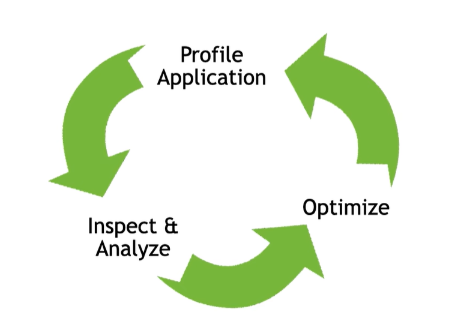

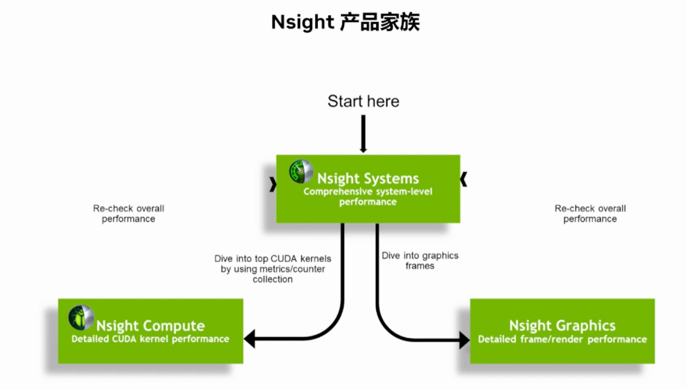

# 二 分析工具

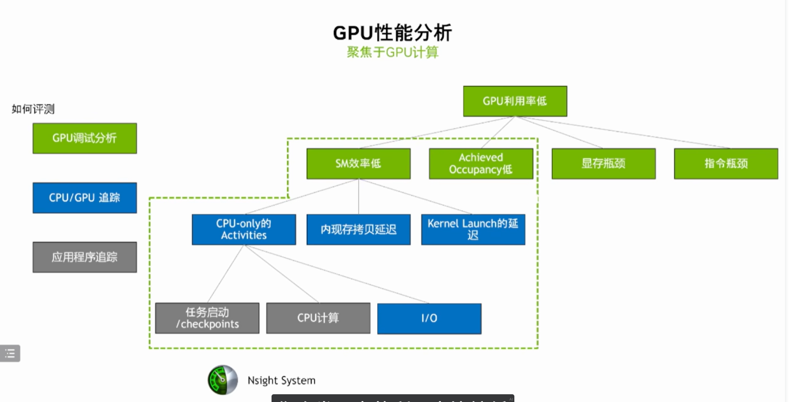

| 工具               | 分析范围               | 输出                     | 适用场景             |
| :----------------- | :--------------------- | :----------------------- | :------------------- |
| **Nsight Systems** | 整个应用程序（系统级） | 时间线视图、所有操作概览 | 找到瓶颈在哪里       |
| **Nsight Compute** | 单个CUDA内核（内核级） | 指令级指标、详细分析     | 找到瓶颈为什么在那里 |

## 2.1 Nsight system

主要分析系统层面

**功能:**

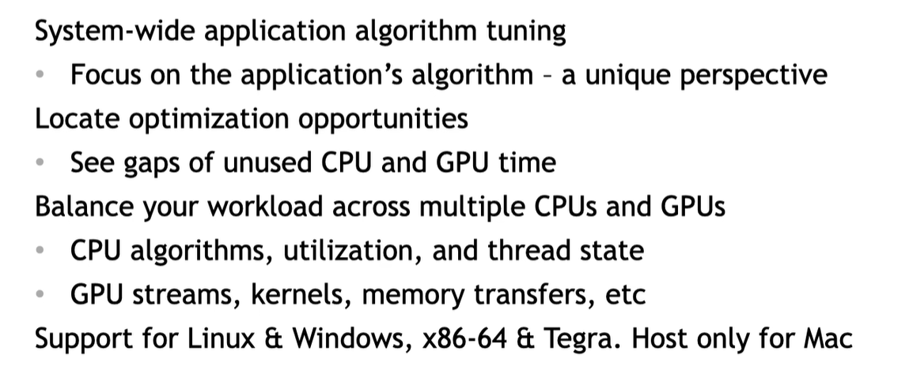 

**分析:**

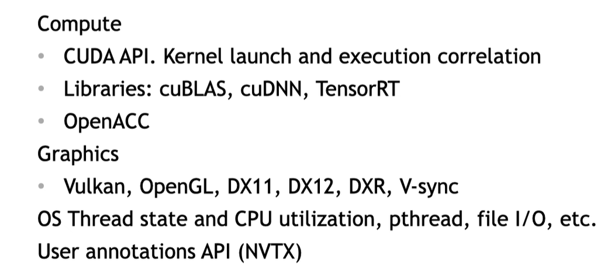  

### 2.1.2 界面分析

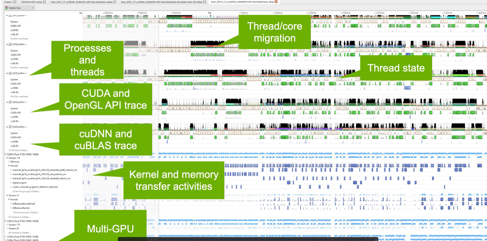

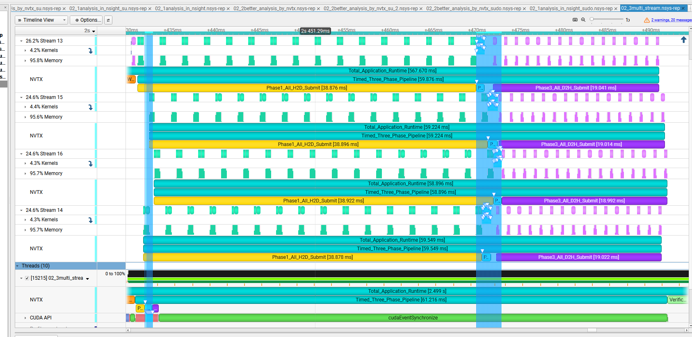

### 2.1.3  Threads

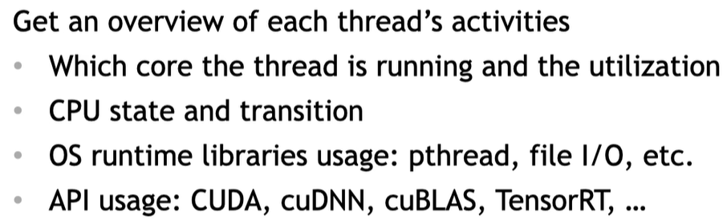 

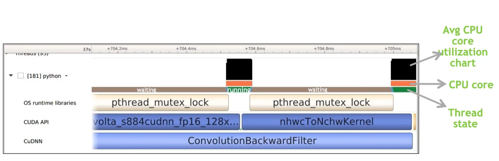

#### **1 CPU利用率**

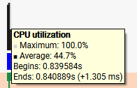 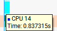 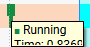

#### 2 os runtime

1. 信号量等待
2. 互斥锁等待

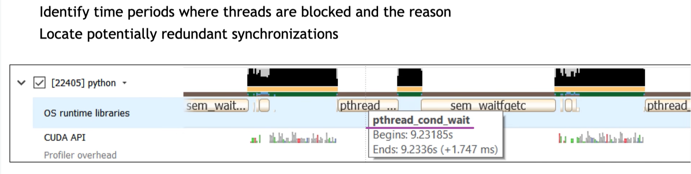

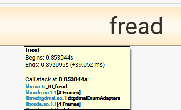 

#### 3 cuda api

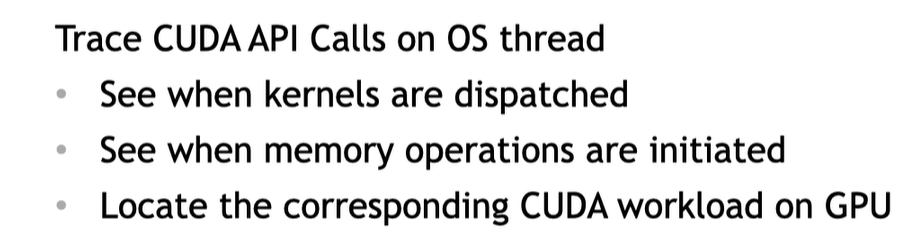 

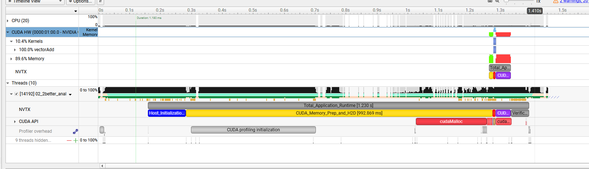

#### 4 NVTX 注释

1.  算法时间分布

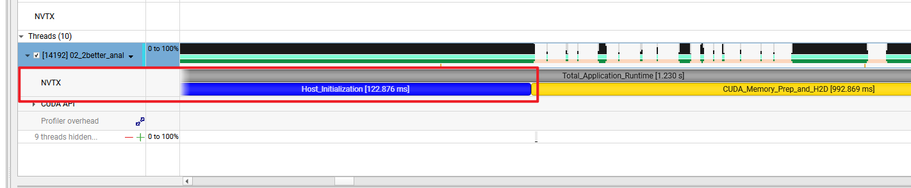

### 2.1.4 GPU

> 确保开启sudo权限和更新nsys版本

1. kernels->stream

 

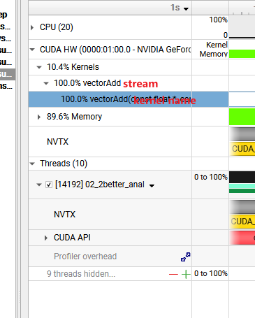  

#### 5 总览

1. 平均kernel占有率
2. memory操作数量

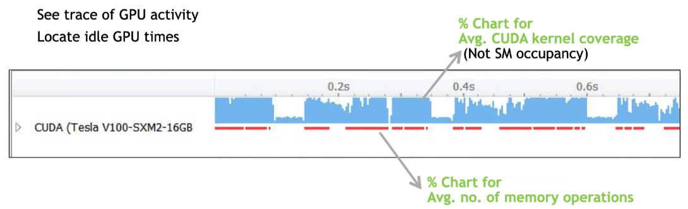

#### 6 memory

1. 1
2. 2

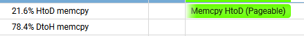

#### 7 kernel stream

1. kernel启动(cpu) 与kernel执行 **颜色关联**
2. 2

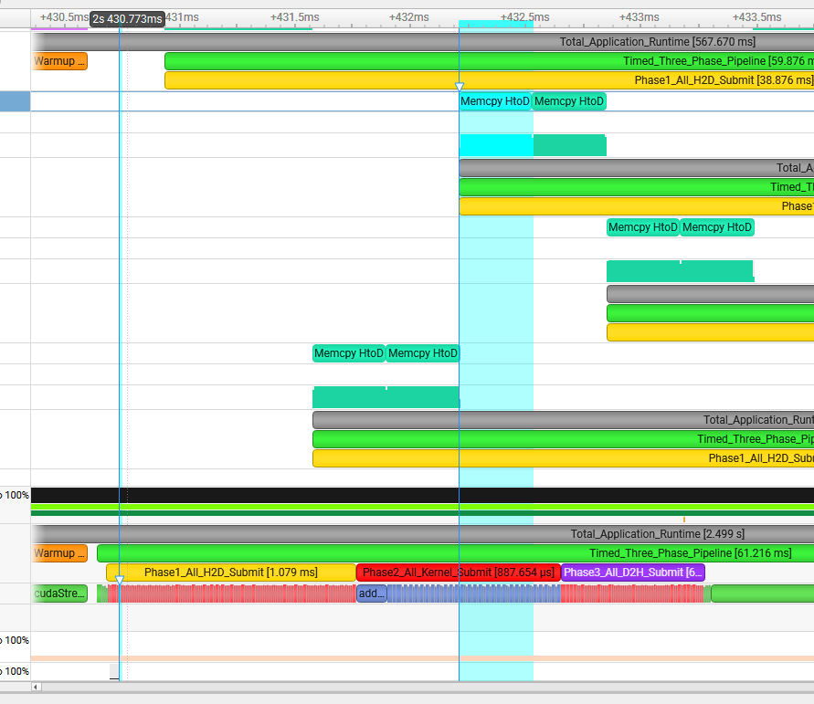

## 2.2 Nsight compute

> https://zhuanlan.zhihu.com/p/721868889

优化kernel层面交互和分析以及debug,深入分析单个 CUDA 内核的性能瓶颈，帮助你优化内核代码。

**功能**

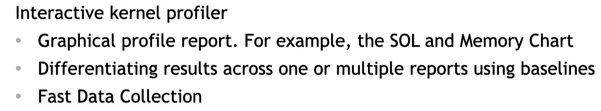 

1. 优化功能
2. baseline比较
3. 数据收集

### 2.2.1 界面分析

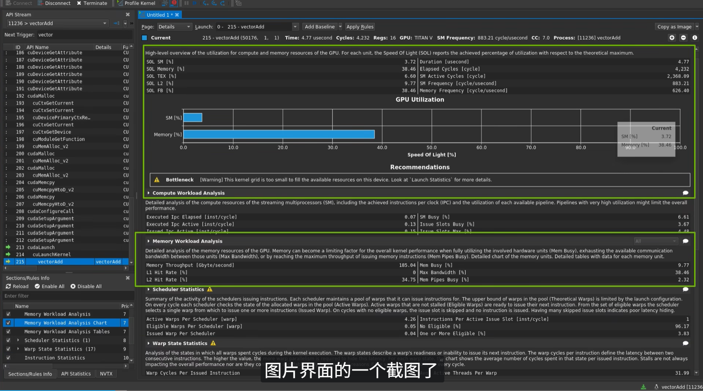

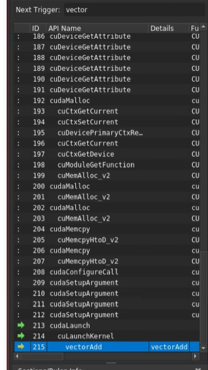 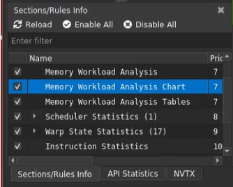

****

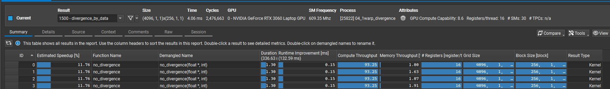

#### 1. 顶部标签页栏（Top Navigation Tabs）

在界面的左上角，有一排切换标签，它们代表了性能分析的不同维度：

- **Summary（当前所在页）：** 全局多 Kernel 的性能总览表，用于多 Kernel 之间的横向对比。
- **Details：** 极其详细的单 Kernel 报告页。你之前发给我的那些“优化建议（Speedup Estimates）”、Roofline 模型图、Warp 状态、MIO/L2 异常指标，全部藏在点击这个标签后的详情里。
- **Source：** 代码对齐剖析页。能把 CUDA C++ 源码、PTX 中间码和 SASS 汇编码并排显示，并精确标出哪一行代码卡死了硬件。
- **Context / Comments / Raw / Session：** 用于查看运行环境上下文、记录优化笔记、查看原始性能计数器（Counters）数据以及管理多次采样的 Session。

#### 2. 核心数据表格列解析（Table Columns）

从左到右，这个表格为你展示了当前 Kernel 的“体检报告”：

- **ID：** 触发执行的顺序编号（0, 1, 2...）。每次你的程序调用一次这个 Kernel，就会记录一行。
- **Estimated Speedup [%]（预估提升空间）：**
  - **当前数值：11.76%**
  - **含义：** 这是一个非常贴心的指标。Nsight Compute 根据它发现的瓶颈，计算出“如果你把这个 Kernel 的底层代码优化到完美状态，理论上整个 Kernel 能变快多少”。
- **Function Name / Demangled Name（函数名）：**
  - **当前显示：`no_divergence(float \*, int)`**
  - **含义：** 告诉你当前这行数据对应的是哪一个 CUDA 核函数。Demangled Name 会把 C++ 的编译修饰名还原，完整显示它的入参类型。
- **Duration [ms]（执行耗时）：**
  - **当前数值：1.30 ms**
  - **含义：** 该 Kernel 单次执行在 GPU 上实际跑了多久。这是最直观的性能指标，优化就是要想办法把这个数字压下去。
- **Runtime Improvement [ms]（预估运行时间缩短）：**
  - **当前数值：0.15 ms**
  - **含义：** 对应前面的 11.76%。如果把瓶颈修掉，单次执行预计能省下 0.15 毫秒。
- **Compute Throughput [%]（计算吞吐量 / SM 利用率）：**
  - **当前数值：93.25%**
  - **含义：** 非常高！这说明你的 Kernel 在执行时，GPU 的**计算单元（数学运算）几乎全负荷拉满了**。这也是为什么你之前的瓶颈里，虽然有 MIO 或 L2 不均衡，但预计总收益不太高的原因——因为算力已经用得很充分了。
- **Memory Throughput [%]（内存吞吐量 / 带宽利用率）：**
  - **当前数值：1.63% ~ 1.87%**
  - **含义：** 非常低。结合上面 93.25% 的计算利用率，说明这是一个**极度极度典型的“算力受限型（Compute-Bound）”Kernel**。它一直在做高密度的数学计算，而极少去读写显存。
- **# Registers（寄存器数量）：**
  - **当前数值：16**
  - **含义：** 每个线程分配了 16 个硬件寄存器。16 是一个非常小的数字，说明这个 Kernel 静态资源占用极低，硬件理论上可以塞满 100% 的 Occupancy（硬件占用率）。
- **Grid Size / Block Size（网格与线程块尺寸）：**
  - **当前数值：Grid (4096, 1, 1), Block (256, 1, 1)**
  - **含义：** 你的启动配置（Launch Configuration）。这里每个 Block 有 256 个线程，一共启动了 4096 个 Block。总线程数 = 4096 × 256 = 1,048,576 个线程。这是一个非常标准且健康的配置，能很好地填满大算力 GPU。
- **Result Type：**
  - **显示：Kernel**。说明采样的对象是一个标准的 CUDA 核函数。

****

### 

#### 1 API stream

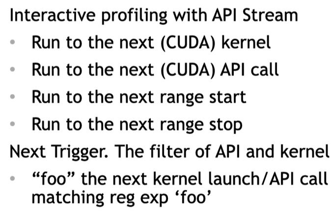 

### 2.2.4 section

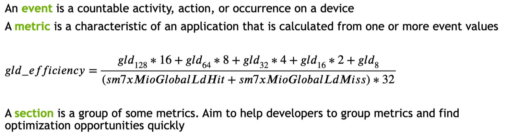

### 2.2.2 Details功能

### 1 SOL

#### 1 

1  

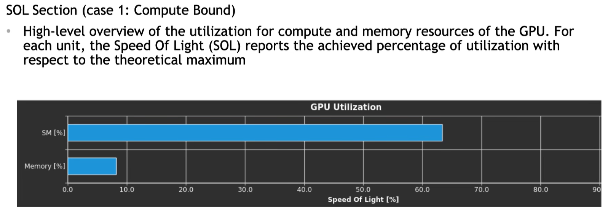

2

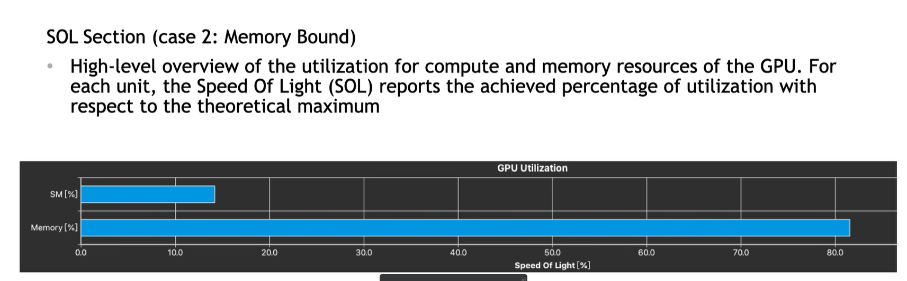

3 

1. 都不高

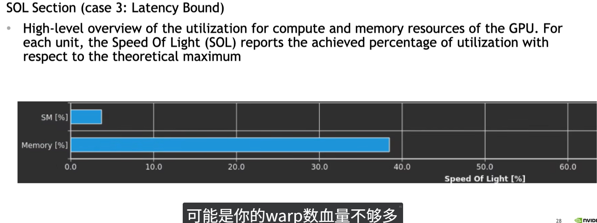

#### 2

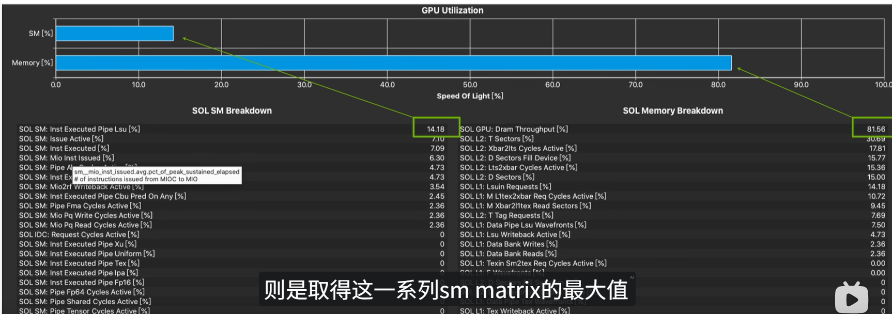

nvprof 与 ncu区别

#### 3表格

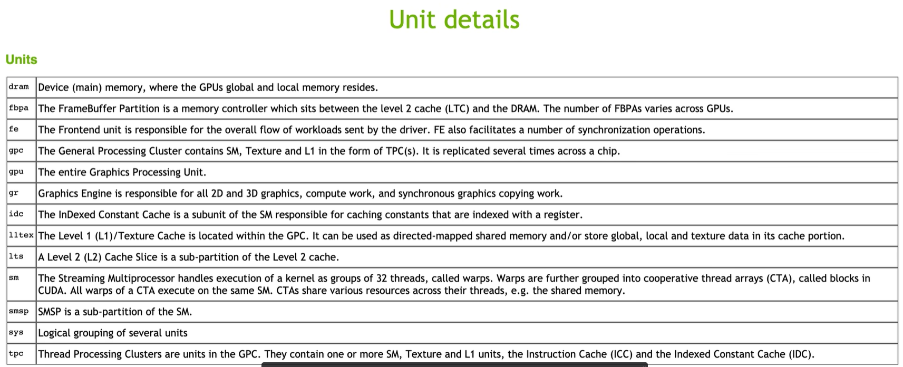

### 2 compute workload

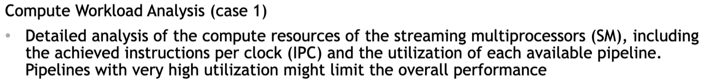

1. 根据运行的pipeline来分析硬件使用情况是否符合自己的预期
2. 

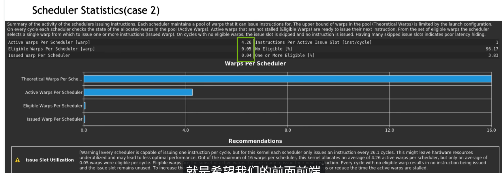

> 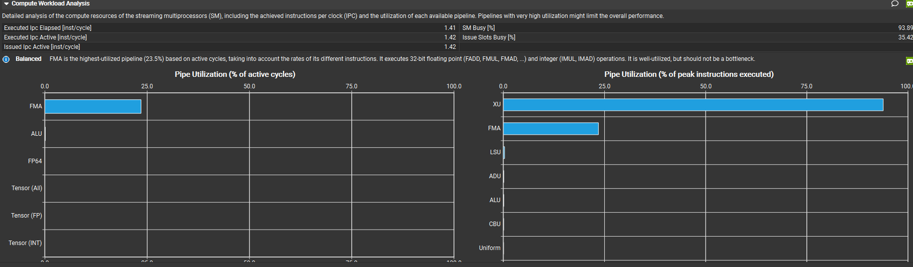

### 3 wrp/ cheduler

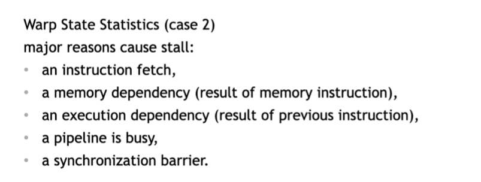

#### **1 warp结构**

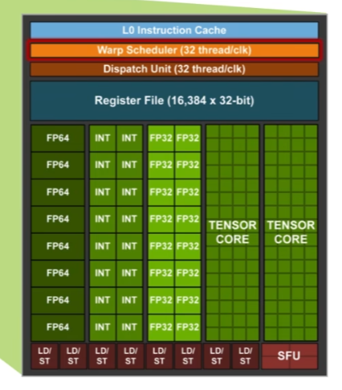\

#### 2 warp scheduler

不同架构的wrap slot 是不一样的

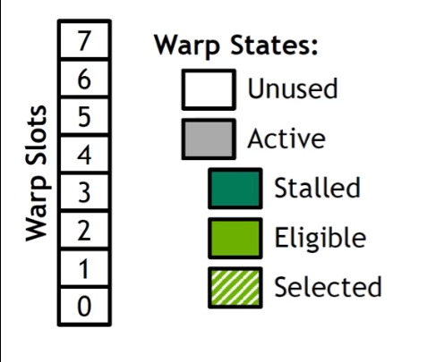 

1. 没使用
2. 激活
3. 原因阻塞
4. 准备好
5. 已选择

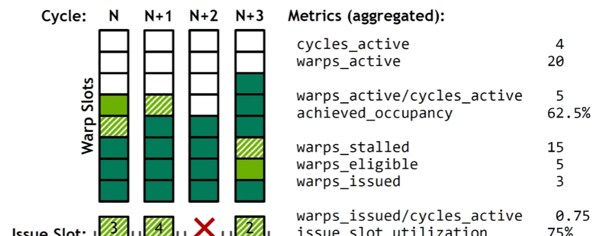 

> 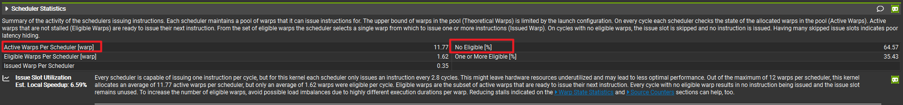

### 3  Warp State Statistics

在回答：**“Warp 为什么没有在持续发射指令？”**

以及：**“GPU 的时间究竟花在计算、等待内存，还是等待同步上？”**

> 这里展开了之前我们零散看到的几个关键警报，并给出了具体底层数据：
>
> - **Avg. Active Threads Per Warp: `16.08` / Avg. Not Predicated Off Threads: `16.06`**
>   - **硬核解读：** 这两个数字精准实锤了 **Thread Divergence（分支分歧）**。一个 Warp 有 32 个线程，但在整个运行周期中，平均只有 16.08 个线程处于活跃状态；更糟糕的是，除去被硬件用掩码强行挂起（Predicated Off）的线程，真正有效干活的线程只有 **16.06** 个。**这就意味着你的硬件计算资源在运行时被精确地拦腰斩断（浪费了 49.8% 的算力）**。

>  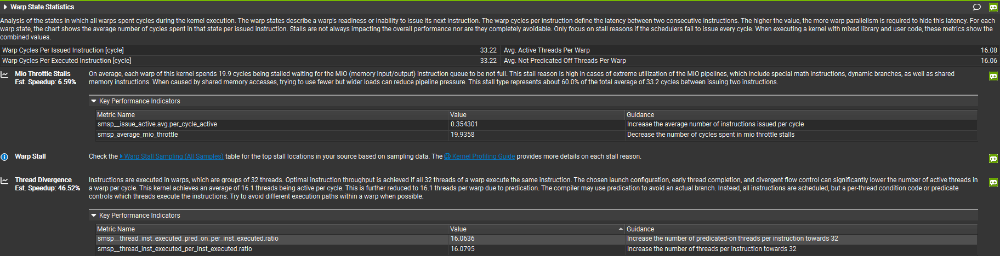

### 4 Instruction Statistics（第一张图核心）

你的 Kernel 到底在执行哪些 SASS 指令？

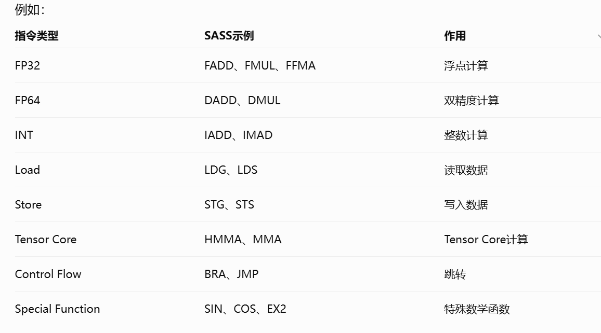 

> - **Executed Instructions: `98,893,824` / FP32 Non-Fused Instructions: `65,536,000`**
>   - **硬核解读：** 你的 Kernel 一共执行了约 9889 万条汇编指令。而其中，**未融合的 FP32 单精度计算指令占了 6553.6 万条（占比高达 66.2%）**。
>   - **破案了：** 整个 Kernel 超过三分之二的指令都在做基础的 FP32 加法或乘法。由于这 6553.6 万条指令完全没有利用 FMA 融合，导致计算单元在成倍地重复劳动。

> 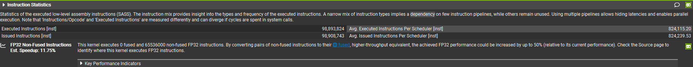

****

### 5 memory

#### **1 memory hierarchy**

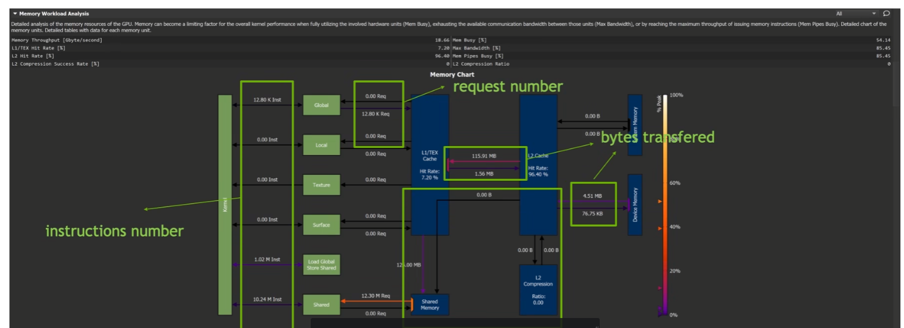

> 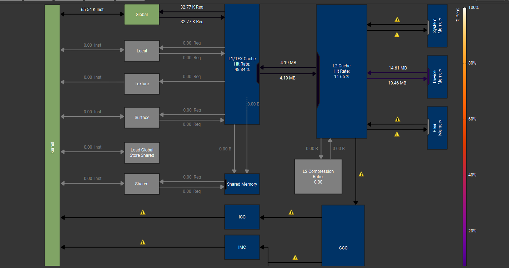 

#### **2 memory report**

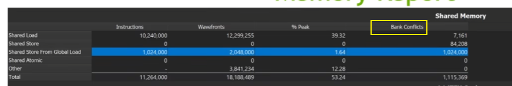

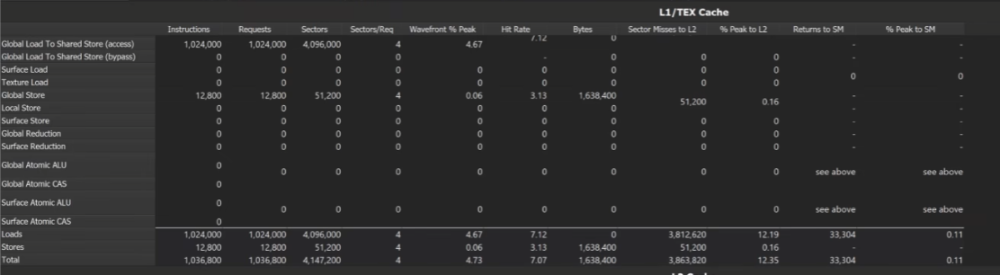

1. 优化blank conflict
2. 尽量实际和理论数据传输量相同
3. 

**sector/request**? 

> 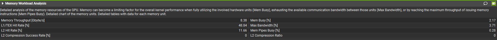

### 4  Launch Statistics & Occupancy

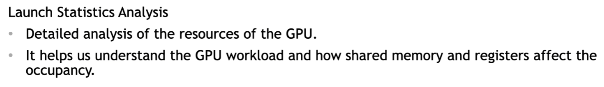

> 这里展示了你的启动参数以及硬件资源的静态/动态利用情况：
>
> - **Launch 静态资源参数：**
>   - **Block Size: `256` / Registers Per Thread: `16`**：由于每个线程只用了 16 个寄存器，这个资源消耗极低。
>   - **Shared Memory Per Block: `0`**：代码中完全没有显式使用共享内存（Shared Memory）。
> - **Occupancy 占用率指标：**
>   - **Theoretical Occupancy: `100%`**：因为寄存器和共享内存用得少，硬件理论上允许你把每个 SM 里的物理线程坑位全部塞满。
>   - **Achieved Occupancy: `98.07%`** 🌟：**这个数字非常优秀！** 实际占用率达到了 98.07%，说明你的 Grid 足够大（4096），硬件资源从宏观上来看是全部被调动起来了的。

> 
>
> 

### 6 GPU and Memory Workload Distribution（工作负载分布）

> 这里揭示了数据在各级缓存（L1、L2、DRAM）之间的流转和时钟周期统计：
>
> - **Average SM Active Cycles: `2,326,778`**
> - **Average L2 Active Cycles: `221,375`**
> - **Average DRAM Active Cycles: `709,930`**
> - **硬核解读：** SM 核心整整活跃了 232 万个周期，而 L2 缓存只活跃了 22 万个周期。这再次以绝对的数据优势证明：**这是一个纯粹到极点的计算受限（Compute-Bound）Kernel**。数据一经读入，就在 SM 的寄存器内部被疯狂计算（循环），极少与外面的 L2 缓存和 DRAM 发生频繁交互。

> 

### 7  Source Counters（源计数器 - 分支效率）

**源代码级别（Source-Level）的性能指标，包括分支效率（Branch Efficiency）以及采样得到的 Warp Stall 原因。**

Warp Stall Sampling（Warp 停顿采样）指标会在 Kernel 执行期间周期性地进行采样统计。

这些指标用于反映：

**Warp 在什么时间处于停顿状态（Stalled），从而无法被调度器（Scheduler）调度执行。**

> 这是揭示分歧原因的终极底层铁证：
>
> - **Branch Instructions [inst]: `196,608`**
> - **Branch Efficiency [%]: `50.00%`** 🌟🌟🌟
> - **硬核解读：** 你的 Kernel 内部总共执行了 19.6 万次分支跳转指令（例如执行到 `if` 语句）。而**分支效率（Branch Efficiency）是精准的 50.00%**。 这说明在整个 GPU 的宏观执行中，所有的分支全部对半开（一半走 `if`，一半走 `else`），且完全错落交织在同一个 Warp 内部，导致了最完美的对称分支分歧。

### 

### 2.2.3 wrap

#### 2.3.1 stall resaon

 

### 2.2.4 Source

#### 1 SASS

#### 2 PTX

# 三 优化方向

## 核心指标分析

### 1 融合指令（Fused）

支持 **FMA（Fused Multiply-Add，乘加融合）** 指令（即一步完成 $A \times B + C$）。如果把乘法和加法拆成两条指令执行，不仅吞吐量减半，还会带来额外的寄存器读写开销

### 2 Mio Throttle Stalls（MIO 管道丢速/停顿）

线程束（Warp）在执行两条指令之间平均要等 33.1 个周期，其中有 **19.7 个周期（高达 59.6%）** 卡在了等待 **MIO（Memory Input/Output）指令队列**释放空间上。说明 MIO 管道被塞满了。

### 3 L2 Slices Workload Imbalance（L2 缓存分片负载不均衡）

**现状数据：** 某些 L2 Slices（分片）的活跃周期比平均值**高出了 40.09%**，而最闲的分片比平均值低 3.95%。

**诱因：**

1. **非连续/固定步长的内存访问（Strided Access with Power-of-2 Steps）：** 如果你的线程在访问一个大矩阵或多维数组时，跳跃的步长（Stride）刚好是 **2 的幂次方**（例如每次跳跃 1024、2048 个元素，这在处理图像通道、矩阵转置、或者特定 ROI 区域拉取时非常常见）。这会导致所有线程计算出来的物理内存地址，经过哈希后**全部神奇地指向同一个或少数几个 L2 Slice**。
2. **严重的内存热点（Data Hotspots）：** 大量的线程在同一时间去读取/原子写入（Atomic Operations）全局显存中的**同一块特定区域**（比如全局计数器、或者某个特定的锚点数据）。

### 4 **Thread Divergence（线程分支分歧）**

#### 1. 现象解读：一半的算力在“陪跑”

- **核心数据：** 该 Kernel 在执行时，每个周期平均只有 **16.1 个线程**是真正活跃（Active）的。
- **直白翻译：** GPU 是以 **Warp（线程束，共 32 个线程）** 为最小单位由硬件同步执行相同指令的（SIMT 架构）。而你的程序在运行时，一个 Warp 里的 32 个兄弟，**平均每个周期只有 16.1 个在真正干活，剩下的 15.9 个线程都在围观或被挂起**。你的 GPU 算力直接被白白浪费了近 50%。

#### 2. 为什么会发生 Thread Divergence？

根本原因在于你的 CUDA 代码中包含了**条件分支语句（如 `if-else`、`switch`、`while`）**，并且分选条件取决于线程的 ID 或它处理的数据。

当一个 Warp 内的 32 个线程走到一个 `if-else` 冲突点时：

1. 满足 `if` 条件的线程（假设有 16 个）去执行 `if` 块内的代码，此时**不满足条件的另外 16 个线程必须原地原地挂起、死等**。
2. `if` 块执行完后，轮到满足 `else` 条件的 16 个线程去执行，此时**刚才干完活的 16 个线程反过来原地死等**。
3. 这种串行排队执行不同分支的现象，就是**分支分歧**

### 5 Long Scoreboard Stalls（长记分板停顿）

- **核心数据：** 线程束（Warp）在两条指令之间平均要等 40 个周期，其中有 **30.3 个周期（高达 75.7%）** 都卡在 `Long Scoreboard` 依赖上。
- **什么是 Long Scoreboard？** GPU 的“记分板（Scoreboard）”是用来追踪指令数据依赖的硬件机制。而 **Long Scoreboard** 专门负责追踪**高延迟的内存访问请求**——主要包括：从全局显存（Global Memory）、本地内存（Local Memory）以及纹理内存（Texture）中读取数据。
- **现状解读：** 你的代码发出了读取显存的指令，但数据从**遥远的 DRAM 运回片上寄存器需要几百个周期。**在这期间，后续的代码又马上需要用到这个数据。硬件一看数据还没到，只能让线程束原地“发呆”死等。

### 6 Achieved Occupancy（实际占用率偏低）

- **核心数据：** 理论最大占用率是 100%，但实际测得的占用率（Achieved Occupancy）只有 **74.4%**。
- **为什么会有这个落差？** 理论占用率是根据你 Kernel 消耗的寄存器和共享内存算出来的（静态指标）。而**实际占用率**是运行时真正在跑的活跃 Warp 比例（动态指标）。 报告指出，造成这 25.6% 落差的原因是 **Warp 调度开销（Scheduling Overheads）** 或 **负载不均衡（Workload Imbalances）**。结合下面的 Long Scoreboard 指标可以断定：大量的 Warp 因为在等显存数据（卡在 Long Scoreboard 停顿），导致硬件调度器没有足够的“处于就绪状态的 Warp”来发射指令，使得原本充裕的物理通道出现了间歇性闲置。

> ### 方案 A：引入“软件流水线”——异步或提前加载（Prefetching）
>
> - **原理：** 不要等到马上要用数据时才去读显存，把读操作提前。
> - **做法（CUDA 11+ / Ampere 架构及以上）：** 如果是从全局显存加载到共享内存，强烈建议使用 **`cuda::memcpy_async`（异步内存拷贝）**。它直接在硬件层面将数据从 Global Memory 搬运到 Shared Memory，中间**不占用寄存器**，这意味着线程可以一边继续做其他的计算（如上一轮循环的计算），一边让硬件在后台运下一轮的数据。
>
> ### 方案 B：重构内存访问模式，提高缓存命中率
>
> - **做法：** 检查你的显存访问是否做到了**合并访问（Coalesced Access）**。如果访问不连续（如上一张图提示的 L2 Slices 不均衡），会导致单次读取触发多条显存事务，极大地延长了数据返回的周期，加剧 Long Scoreboard 停顿。
> - **效果：** 让数据连续，让 L1/L2 缓存命中。只要数据在 L2 缓存里就被截获，返回速度会比去 DRAM 快数倍，Scoreboard 很快就能解除锁定。
>
> ### 方案 C：增大计算/内存比（增加 ILP：指令级并行）
>
> - **做法：** 如果你的循环里只有一条读指令和一条计算指令，可以尝试进行**循环展开（Loop Unrolling，使用 `#pragma unroll`）**，或者让一个线程一次处理 2 个或 4 个元素（比如利用 `float4` 读入后，连续做 4 次不相关的计算）。
> - **效果：** 抛出多个不依赖的读取请求（Memory-level parallelism），并用不依赖该数据的其他计算指令去填补等待的空白期，以此来“欺骗”硬件调度器。

****

### 1 Bank Conflict（存储体冲突）

**什么是bank**

**为什么会bank conflict**

**怎么解决**

### **SM效率低问题**

是什么

1. 主要cpu活动:
2. 内显存拷贝
3. kernel启动延迟: kernel合并

### 实现占有率低: 

是什么

怎么看: system

 

### 添加注释

### 案例

1. 看瓶颈在哪?

   例如矩阵操作, 使用混合精度

   

   

> 顺序读, ,跳跃写=> 显存消耗大, 计算量小 
>
> 放到shared memory的快速范文

