### 会议室讨论

- **Query (Q) 是“提问者”**：他负责去询问信息。
- **Key (K) 是“标签”**：它定义了信息的内容。
- **Value (V) 是“内容”**：它是实际的信息本身。

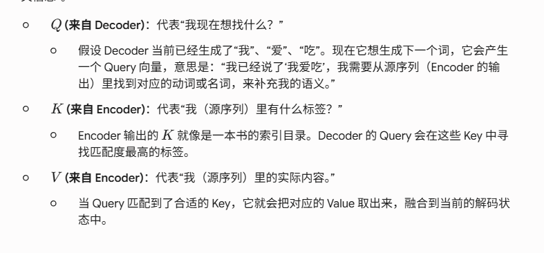


# 0 Attention


## Self-Attention

### QK

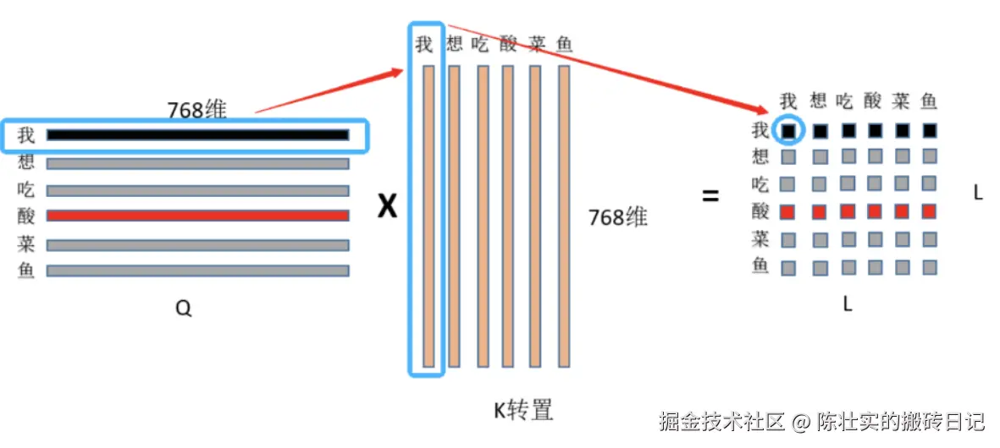

### @V

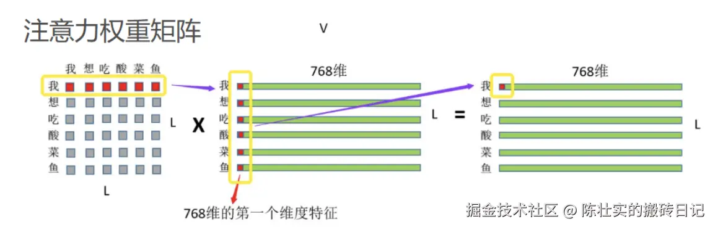

乘上 $V$（Value）代表的是：**根据计算出的注意力权重（关注度），对所有词的语义特征进行“加权求和”，从而提炼出新的综合特征表示。**

通过 `Attention @ V`，原本单一维度的“词”，被融汇了上下文中其他相关词的信息。

- 比如原本“苹果”这个词的向量只代表水果，但在“苹果手机”的上下文中，通过注意力机制去乘以与“手机”相关的 $V$ 向量后，它输出的新向量就带有了电子产品的语义特征。

这就是注意力机制能够“结合上下文”更新词向量的终极奥秘

## Multi-Head Attention

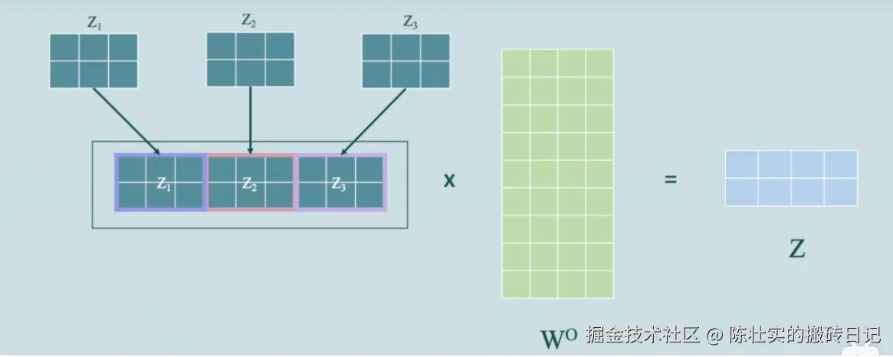

> 


## Cross-Attention


## FlashAttention


> transformer的并行到底体现在哪里？ - chouheiwa的回答 - 知乎
> https://www.zhihu.com/question/656342880/answer/2052007560274784445


# 1 训练并行

## Self-attention 怎么把单行道拆成一次矩阵乘


## 训练能并行的真正钥匙：因果掩码 + teacher forcing

可以把训练时的 Transformer 想象成：

> **一次输入完整句子，然后让句子里的每一个位置都"扮演"一次推理过程。**

也就是说，一次前向传播实际上**同时模拟了多个不同长度的前缀**：

- 第 0 个位置相当于在做：`<BOS> → I`
- 第 1 个位置相当于在做：`<BOS> I → love`
- 第 2 个位置相当于在做：`<BOS> I love → AI`
- 第 3 个位置相当于在做：`<BOS> I love AI → !`

```
          <BOS>    I    love    AI

<BOS>       ✓      ×      ×      ×

I           ✓      ✓      ×      ×

love        ✓      ✓      ✓      ×

AI          ✓      ✓      ✓      ✓
```

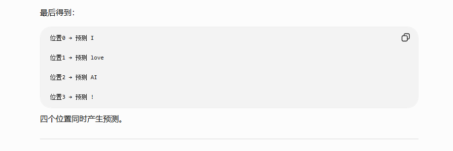

## 注意力内部还能再榨：多头并行和 FlashAttention


## 模型放不下单卡：五个维度切着来

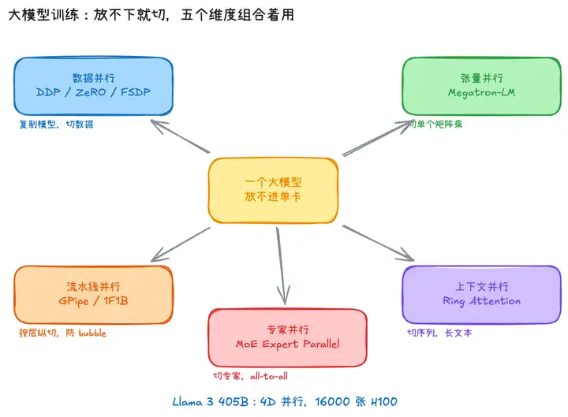


# 3 decoder only推理

### 🛠️ 阶段一：Prefill 阶段（算力密集型 Compute-bound）

- **特点：** 输入是一整块文本（比如 2000 个词的 Prompt）。
- **GPU 状态：** GPU 最擅长做**大规模矩阵并行计算**。因为一次性进来的 Token 很多，GPU 的计算单元（Tensor Cores）能被完全塞满，计算效率极高（速度非常快）。
- **缓存动作：** 这一步是 KV Cache 的**生产者**，负责把算好的海量 $K, V$ 写入显存。

### 🐌 阶段二：Decoding 阶段（带宽/内存密集型 Memory-bound）

- **特点：** 每次输入只有 $1$ 个新词（比如每次生成一个字）。
- **GPU 状态：** GPU 处于“吃不饱”的状态。因为只有一个 $Q_{new}$，计算量极小，但 GPU 必须频繁地、一次又一次地去显存里读取巨大的 $K, V$ 缓存池（KV Cache）。**读取显存的速度（显存带宽）成为了卡脖子的瓶颈**。
- **缓存动作：** 这一步是 KV Cache 的**消费者与追加者**。


## 1. Prefill 阶段：为什么必须从头算？

当你输入一个全新的 Prompt “人工智能”，此时模型的 **KV Cache 是完全空的**。

模型为了能理解这 4 个字并预测第 5 个字（“改”），它必须首先计算出这 4 个字彼此之间的关联。因此，它会做一次**并行的大计算**：

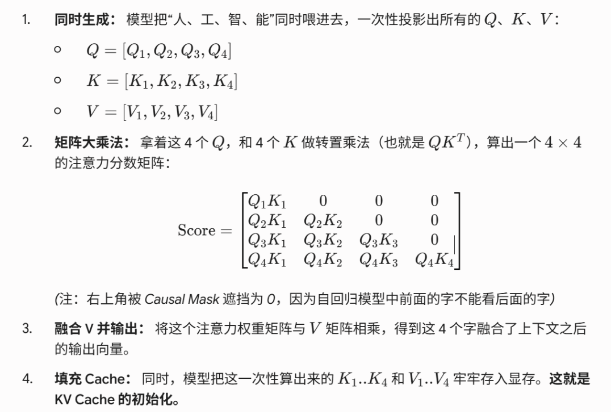


# 3 推理优化

## 1 为什么标准 Attention 是内存瓶颈？

1 来自qk矩阵的巨大

> 矩阵大小是 O(T²)（T = 序列长度）。对于长上下文（T=8k~128k），这会占用海量显存（FP16 下 8k 序列一个 head 就需要 ~256MB

2 显存读写频繁：

>  需要多次 global memory 访问（写 scores → 读 scores 做 softmax → 写回）。


2 IO 受限而非 Compute 受限

> 现代 GPU 计算能力（TFLOPS）远超内存带宽（HBM），标准实现大量时间浪费在内存搬运上，而不是实际计算。


## 2 KV cache

**什么是KV Cache?** 

就是把之前的K V矩阵常驻在显存中

> 


**为什么需要KV Cache？**

> https://www.zhihu.com/question/653658936/answer/107469197025

在自回归生成中，每个新Token的生成都需要所有历史Token的Key和Value。如果每次重新计算所有历史Token的K和V，计算量随序列长度二次增长 O(N2)。

KV Cache的核心思想：**用显存换计算**——将之前计算好的K和V存储起来，新Token生成时只需计算当前Token的K和V，然后从Cache中读取历史K和V。

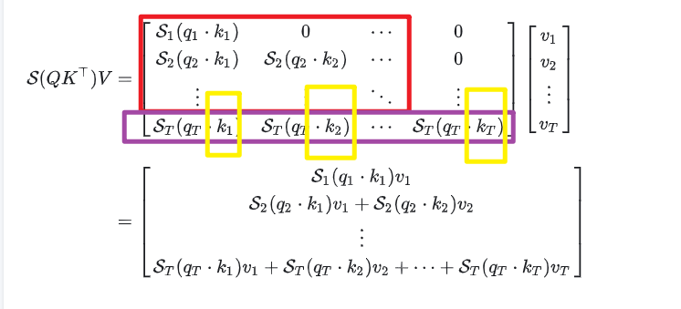 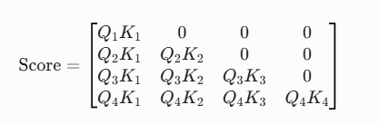

> 因为k和v是会在每一个新的q中重复使用, 但是q会变:推理过程中, 之前的q和kv的结果会cache, 但是之前的q不会, 而之前kv因为要和新的q计算, 所以就需要cache

> ## ❌ 1. 为什么“之前计算的结果”无法被 Cache？(图片红色框)
>
> 你可能觉得，既然 $Q_4$ 和 $K_1..K_4$ 已经算过一次注意力权重了，下一次 $Q_5$ 进来时，能不能复用一部分之前算出来的权重（结果）？
>
> **答案是：不能。因为每一轮的“总权重”必须重新做 Softmax 归一化。**
>
> 我们用数字做个极简的对比：
>
> - **这一轮（生成第 5 个字）：** 我们拿 $Q_4$ 去和 $K_1..K_4$ 算点积，假设算出来的原始得分是 $[10, 5, 2, 8]$。
>
>   经过 Softmax 归一化后，它们变成了比例（比如 $[0.8, 0.1, 0.02, 0.08]$），和为 1。**这就是这一轮的“结果”。**
>
> - **下一轮（生成第 6 个字）：**
>
>   新来的主角是 $Q_5$（代表第 5 个字“改”）。
>
>   $Q_5$ 是一个**全新**的向量，它去和 $K_1..K_5$ 算点积。算出来的原始得分可能是 $[1, 9, 4, 2, 12]$。
>
>   这时候，模型必须对这 5 个全新的数字**整体重新做一次 Softmax 归一化**。

> 在有了 KV Cache 的 Decoding 阶段，模型进入了高效循环。当要预测第 6 个字“变”时：
>
> - **输入：** 模型的输入端**只被喂进了单个 Token —— “改”**。
> - **投影：** 既然输入只有“改”，那么模型在这一层经过权重矩阵投影时，就**只能产生一个 $Q_5$、一个 $K_5$、和一个 $V_5$**。这三个向量都属于“改”。
> - **结论：** 从物理产生上，$Q_5$ 就是“改”的查询向量。

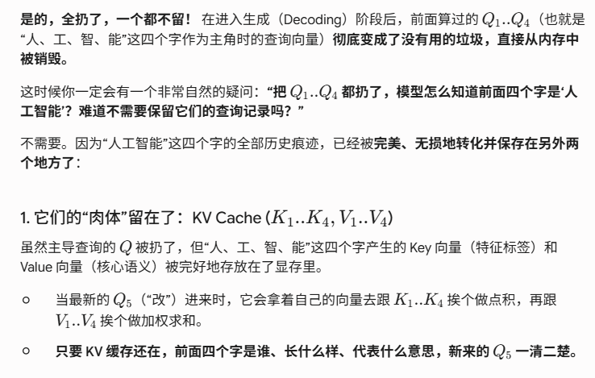


**怎么实现KV Cache?**

简单来说, 

****

**Cache了什么**

cache了一次自回归过程的k v向量

> 当输入一个词（Token）时，它首先会被转化为一个高维的稠密向量（Embedding）。但这个向量只是静态的词义，缺乏上下文。
>
> 为了让词与词之间产生联系，模型会利用**三个不同的权重矩阵**（$W_Q, W_K, W_V$，这些是模型训练好后固定不变的参数），将这个词的 Embedding 投影到三个不同的向量空间。
>
> 这三个空间对应的就是 **Query（查询）**、**Key（键）** 和 **Value（值）**。

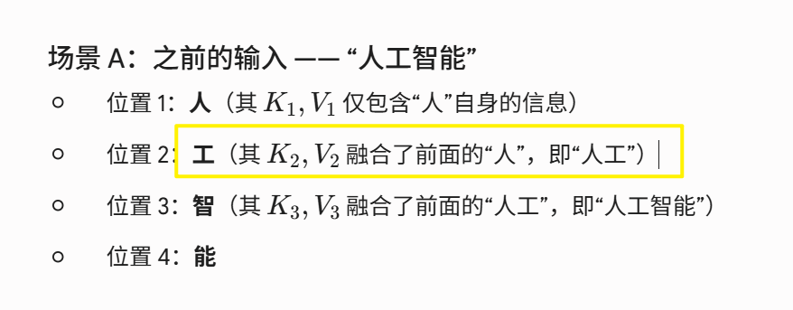 

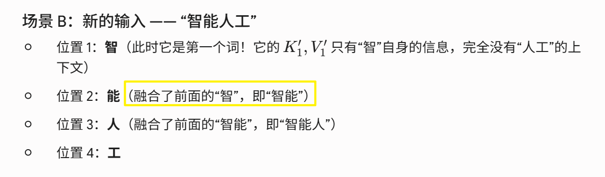 

****

**什么样的特殊情况能复用？（前缀对齐）**

如果你的新 Prompt 不是“乱序”的，而是**保持相同的前缀**，那么情况就完全不同了。

- 假设你已经对模型输入过： `Prompt 1: "人工智能的未来发展空间是什么？"` （模型缓存了这一串的 KV）
- 半小时后，你输入了一个新的 Prompt： `Prompt 2: "人工智能的未来发展空间对就业有什么影响？"`

这时候，**“人工智能的未来发展空间”** 这一段完全相同的前缀，它们的绝对位置和上下文是完全一致的！

****

**为什么K2融合了K1的信息?**

> 在计算 K$的时候，不是直接拿第 2 个字“工”的向量乘以权重矩阵 W_K吗？既然是只乘了“工”字，为什么会融合“人”的信息呢？

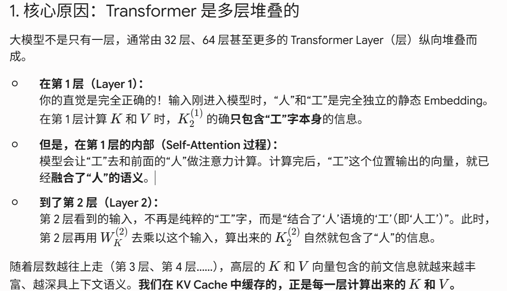 

****

**为啥kvcache要使用K1呢? V1我能理解但是K1和K2... Kn有什么区别呢? 对于Qn? 是因为使用了V1 所以要使用K1 吗**

> ：“既然最后要乘以 $V_1, V_2$，那我就直接用 $V$ 就行了，为什么中间还要强行塞一个 $K_1..K_n$ 进来计算呢？”

因为我们要用 V_1（也就是“人”这个字的内容），我们才必须先用 K_1$来算出“我们需要多少比例的 V_1

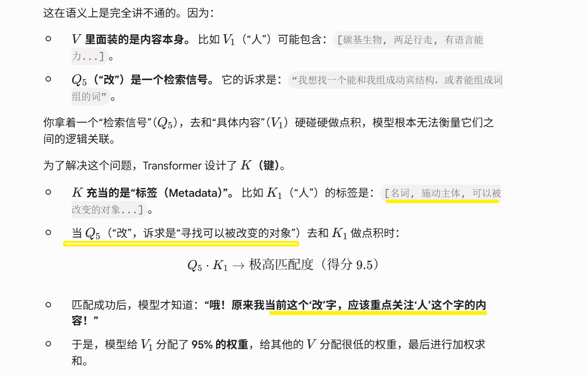

****

**$K_1..K_n$ 彼此有什么区别？（对于最新的 $Q_n$ 而言）**

对于同一个最新的 $Q_n$ 而言，**每一个 $K_i$ 代表了历史中每一个不同位置的 Token “自荐”时的不同侧重点。**

继续以我们之前堆叠后的状态为例。假设最新生成的 Token 是 $Q_5$（“改”），它要去探测历史：

- **$K_1$（“人”的 Key）：** 它的向量内部在呐喊：`“我是句子的开头，我是主语‘人’！”`
- **$K_2$（“工”的 Key）：** 它的向量在呐喊：`“我紧跟在‘人’后面，我们组成了‘人工’，代表科技和非自然！”`
- **$K_3$（“智”的 Key）：** 它的向量在呐喊：`“我是‘智能’的核心，代表智慧和算法！”`
- **$K_4$（“能”的 Key）：** 它的向量在呐喊：`“我是‘智能’的结尾，我可以和‘改’组成‘智能改变未来’！”`

- 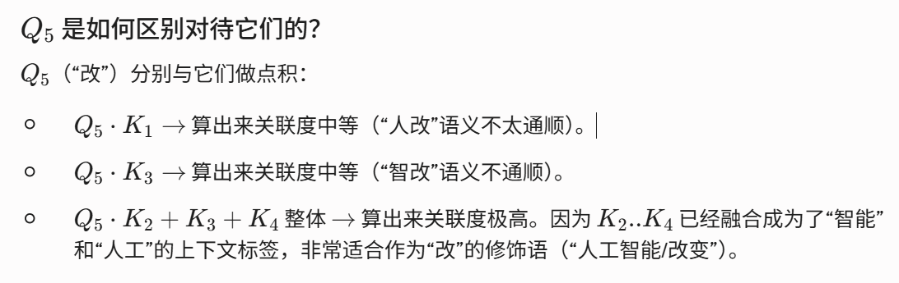

**正因为 $K_1..K_n$ 每一个向量内部蕴含的“位置信息”、“语法成分标签”和“上下文特征”截然不同，对于同一个 $Q_n$ 来说，算出来的注意力得分才会千差万别。**

****

**K 1到底是什么**

单独来说

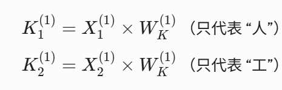 

但是上下文变长时

> 对于同一个模型、同一个输入序列，在**某一次特定的前向传播**中，$K_1$ 的数值确实是完全固定的。

****

**每一个 Block 都有自己独立的 KV Cache 账本**

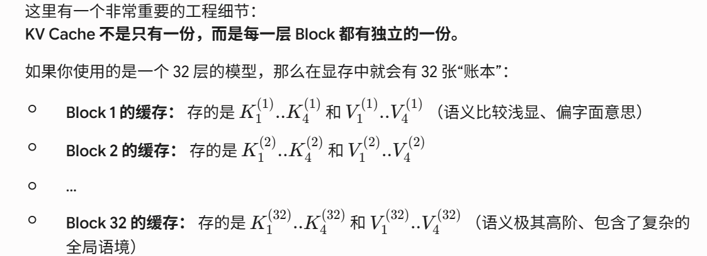 

****

**Transformer 是多层堆叠是怎么样的? 每一层的输入输出是什么?**

**encoder:**

b1 输入是embed的x0,   之后**转成qkv** -> 输出x1(shape相同)
b2 输入将x1**转qkv**, -->输出x2
...
bn

****

**decoder:**

把输入的x 作为decoder的q矩阵, 不再单独转q

****

>  ⚙️ 内部加工过程（Layer 内部发生了什么？）
>
> 当 $X_{in}$ 进入第 $N$ 层后，会发生以下两步关键转换：
>
> #### 第一步：Self-Attention 空间整合（横向互动）
>
> 1. 模型利用权重矩阵把 $X_{in}$ 投影出我们上一问提到的 $Q, K, V$。
> 2. **核心动作：** 拿着当前 Token 的 $Q$，去和历史所有 Token 的 $K$ 做点积，算权重，然后对 $V$ 加权求和。
> 3. **结果：** 这一步实现了“信息在不同 Token 之间的横向流动”。比如“工”字在这一步融合了“人”字的信息。
>
> #### 第二步：FFN / MLP 维度特征提取（纵向挖掘）
>
> 1. 经过注意力机制融合后的向量，会进入一个前馈神经网络（通常是一个两层的全连接层）。
> 2. **核心动作：** 此时 Token 之间不再互相关注了，而是**每个 Token 各自独立地**进行非线性变换。它把维度放大（比如从 4096 升到 11008 维），再缩小回来。
> 3. **结果：** 这一步用来**记忆知识、抽取高阶特征**（类似专家系统在深度剖析这个词当前代表的含义）。
>
> ### 🔹 每一层的输出（Output Matrix：$X_{out}$）
>
> - **数学形式：** 形状与输入完全一致，依然是 `[Batch_Size, Sequence_Length, Hidden_Dim]`。
> - **语义内涵：** * 经过当前层的“横向融合（Attention）”和“纵向深挖（FFN）”后，每个 Token 位置上的向量被赋予了**更新、更抽象、更深刻的上下文语义**。
>   - 这个 $X_{out}$ 随即作为 $X_{in}$，毫无保留地送入第 $N+1$ 层。

> ## 存什么、不存什么
>
> 在你代码里，attention 算到这一步：
>
> 00_1self_attention.pyLines 121-121
>
> ​        q, k, v = qkv.chunk(3, dim=-1)  *# 各 (B, n_heads, T, head_dim)*
>
> 会缓存的：
>
> - `k`：形状 `(B, n_heads, T, head_dim)`
> - `v`：形状 `(B, n_heads, T, head_dim)`
> - 每一层各自一份（第 1 层、第 2 层……的 K/V 互不共用）
>
> 一般不缓存的：
>
> | 不存                           | 原因                                                         |
> | :----------------------------- | :----------------------------------------------------------- |
> | `q`                            | 每步只对新 token 现算                                        |
> | `attn_scores` / `attn_weights` | 中间量，用完即丢                                             |
> | `x` 隐状态                     | 不是 KV cache 本体（有的框架另存 hidden state，那是另一回事） |
> | `out`（attention 输出）        | 每步重算                                                     |

****


## 3 上下文窗口

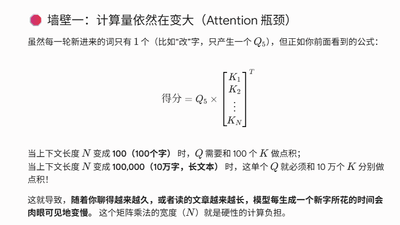 

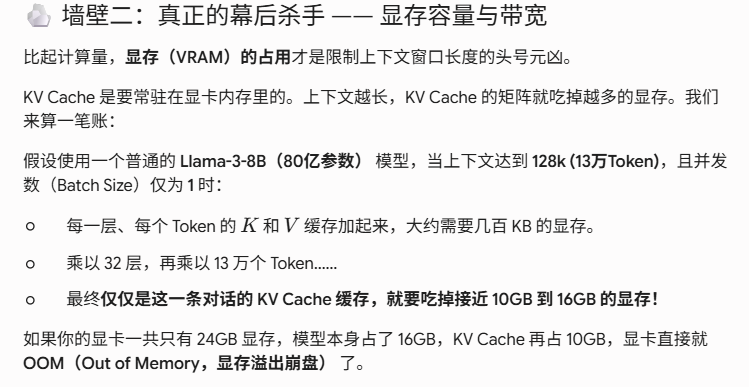

> ## 🧭 上下文窗口长度的决定因素
>
> 所以，你问的“上下文窗口的长度就是这个的运行因素吗？”答案是绝对的“是”。大模型厂商宣称的“支持 100k 还是 1M 上下文”，本质上是在向这两个极限发起挑战。
>
> 为了让上下文窗口变得极长，技术界在 2024~2026 年间普及了以下几种续命技术：
>
> 1. **GQA（Grouped-Query Attention，分组查询注意力）：**
>
>    让多个不同的 $Q$ 共享同一个 $K$ 和 $V$。这样可以把 KV Cache 的体积直接**压缩到原来的 $1/4$ 甚至 $1/8$**，大大缓解了显存压力。
>
> 2. **PagedAttention（如 vLLM 框架）：**
>
>    像操作系统的虚拟内存一样，把显存切成一块块小碎块（Pages）来动态管理 KV Cache。不再为每个请求预留连续的巨大显存，解决了显存碎片化问题，让吞吐量提升数倍。
>
> 3. **RoPE（旋转位置编码）的外推与插值：**
>
>    不仅要显存放得下，还要模型在面对第 100,000 个位置的词时，数学上不会“算糊涂”。科学家们通过修改位置编码的数学公式，让模型能理解超长距离的位置依赖。


## 4 串行工程优化

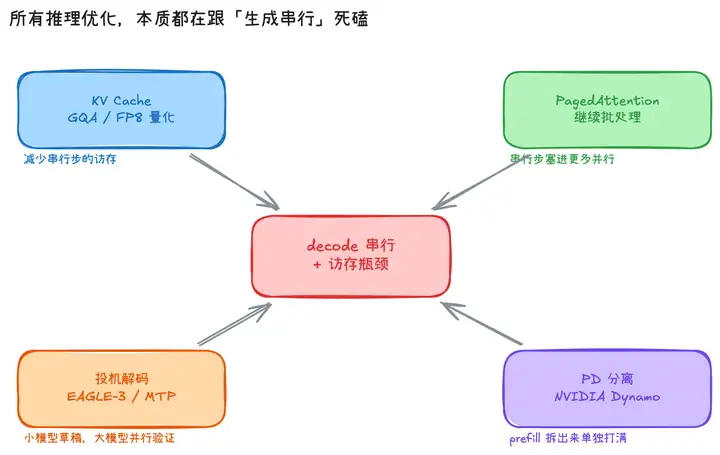


## 5 PagedAttention

> ## 🪨 1. 传统 KV Cache 的痛点：巨大的显存浪费
>
> 在传统的推理框架中，模型必须为每一个请求（Request）在显存中开辟一块**连续**的物理空间，用来存放该请求源源不断产生的 KV Cache。
>
> 因为模型在生成前**根本不知道用户最终会生成多长的文本**（比如可能生成 10 个字，也可能生成 2048 个字），为了防止中途显存溢出，传统的做法是**按照最大长度（Max Sequence Length）预先分配一整块连续显存**。
>
> 这就导致了三个极其致命的显存浪费（通常浪费高达 **60% - 80%**）：
>
> 1. **未用预留浪费（Reservation）：** 如果模型为用户预留了 2048 个 Token 的空间，但用户聊了 10 个字就结束了，剩下的 2038 个 Token 空间的显存就被白白浪费了，别人也用不了。
> 2. **动态成长浪费（Internal Fragmentation）：** 随着文本一步步生成，显存从前往后慢慢填满，那些还没用到的空间只能空置。
> 3. **内存碎片（External Fragmentation）：** 不同的请求频繁启动和结束，显存被切割得支离破碎，明明总剩余显存还够，却因为找不到一块**连续**的显存，导致新请求无法启动。
>
> ## 💡 2. PagedAttention 的降维打击：像操作系统一样分页
>
> PagedAttention 的核心思想是：**打破“连续性”的诅咒。**
>
> 它允许将每个请求的 KV Cache 存放在**不连续的物理显存**中。
>
> ### 核心机制：物理块（Physical Blocks）与虚拟映射
>
> 1. **KV 块（KV Blocks）：** PagedAttention 把每个请求的 KV Cache 划分为固定大小的“块”（Block），每个块默认可以容纳固定数量（例如 16 个）Token 的 KV 向量。
> 2. **逻辑内存 vs 物理内存：**
>    - **逻辑块（Logical Blocks）：** 在模型眼里，它看到的依然是连续的一串字（`Block 0: 0~15字` $\rightarrow$ `Block 1: 16~31字` $\rightarrow$ `Block 2: 32~47字`）。
>    - **物理块（Physical Blocks）：** 在实际的显卡内存里，这些块被分散在天南海北、任意不连续的空闲位置。
> 3. **块表（Block Table）：** 框架维护了一个映射表（类似操作系统的页表 Page Table）。当模型需要计算第 35 个字的 Attention 时，它通过块表查到逻辑上的 `Block 2` 对应的物理显存地址是 `Physical Block 104`，然后直接去那里读取数据。

****

## KV cache量化

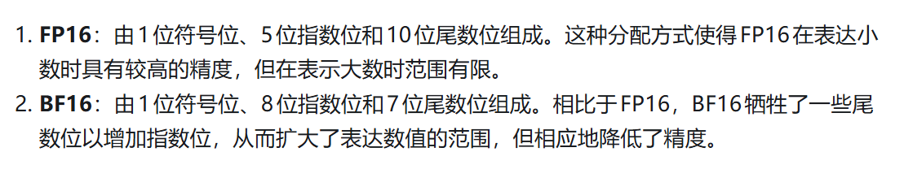


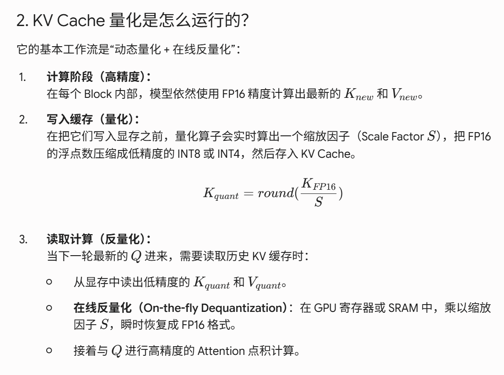	

> ## 4. 主流的 KV Cache 量化技术方案
>
> 为了解决精度损失问题，业界演进出了几种不同的量化粒度：
>
> ### ① 按 Token 量化（Per-Token Quantization）
>
> - **原理**：对每一个 Token 向量，独立计算一组缩放因子 $S$。
> - **特点**：实现简单，对吞吐量友好，但在面对离群值通道时，精度保护不够。
>
> ### ② 按通道/按头量化（Per-Channel / Per-Head Quantization）
>
> - **原理**：针对 $K, V$ 矩阵的不同维度（如每个 Attention Head 内部的 Channel）分别计算缩放因子。
> - **特点**：精度保留极好，能完美避开离群值的干扰，但硬件计算对齐稍微复杂一点。
>
> ### ③ FP8 KV Cache（Hopper / Blackwell 架构新宠）
>
> 随着 NVIDIA H100 等新一代 GPU 硬件原生支持 **FP8（8位浮点数，如 E4M3 和 E5M2 格式）**，FP8 KV Cache 正在迅速取代 INT8。
>
> - **优势**：它既有低精度的带宽优势，又保留了浮点数对大范围数值（离群值）的容忍度。在 vLLM 等主流框架中，开启 FP8 KV Cache 几乎可以做到**几乎无损的精度保留**。
>
> ### ④ 极致压缩：INT4 量化（如 KIVI 算法）
>
> 2024 年底至 2026 年，像 **KIVI** 这样的算法把 KV Cache 卷到了 **INT4**。
>
> - **核心思路**：因为 $K$ 向量对离群值极度敏感，而 $V$ 向量相对平缓。KIVI 对 $K$ 采用 Group-wise 细粒度量化，对 $V$ 采用 Channel-wise 量化。在 Llama 等模型上，成功在 4-bit 精度下实现了近乎无损的超长文本生成。


# 4 结构优化

## 1 GQA (Grouped Query Attention)

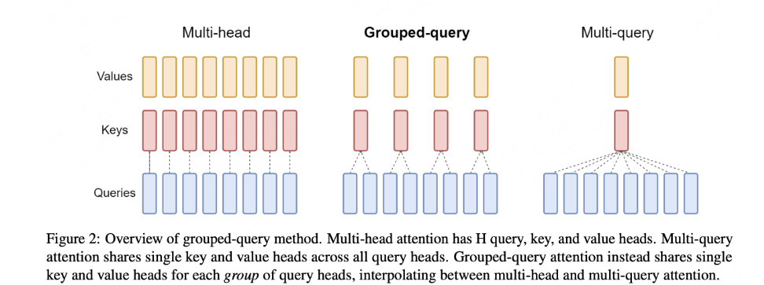

> 假设模型总维度是 $D_{model} = 4096$，每个头维度 $D = 128$，则总头数为 $4096 / 128 = 32$ 个。
>
> #### 如果是 MHA (Multi-Head Attention)：
>
> - **计算矩阵：**
>   - $W_Q \in \mathbb{R}^{D_{model} \times 4096}$ (32 个头，每个 128)
>   - $W_K \in \mathbb{R}^{D_{model} \times 4096}$ (32 个头，每个 128)
>   - $W_V \in \mathbb{R}^{D_{model} \times 4096}$ (32 个头，每个 128)
> - **缓存大小：** 你需要存 32 个 K 和 32 个 V，一共 64 个向量。
>
> #### 如果是 GQA ($H_{kv} = 4$)：
>
> - **计算矩阵：**
>   - $W_Q \in \mathbb{R}^{D_{model} \times 4096}$ (仍然是 32 个头)
>   - $W_K \in \mathbb{R}^{D_{model} \times 512}$ (**只有 4 个头**，即 $4 \times 128 = 512$)
>   - $W_V \in \mathbb{R}^{D_{model} \times 512}$ (**只有 4 个头**)
> - **实际操作：** 当计算 Attention 时，模型会将 $W_Q$ 输出的 32 个头，**每 8 个一组**，分别去乘以对应的那 1 个 K 和 1 个 V。
>
> ### 3. 为什么这样可以实现？（关键逻辑）
>
> 你可能会问：**共享了 K 和 V，模型不会变笨吗？**
>
> 研究发现：
>
> 1. **信息的冗余性：** 在 Transformer 中，不同头捕捉到的特征往往高度重合。让多个头共享 KV，损失的信息量远小于节省的显存带来的收益。
> 2. **Q 的多样性保留：** 因为 $H_q$（查询头）的数量依然保持为 32 个，每一个“查询者”依然拥有独特的视角去理解问题。只要“查询者”足够多，模型就依然能捕捉到细微的语义差别。


