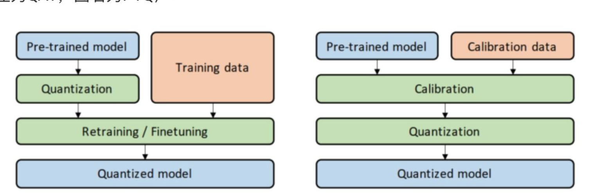
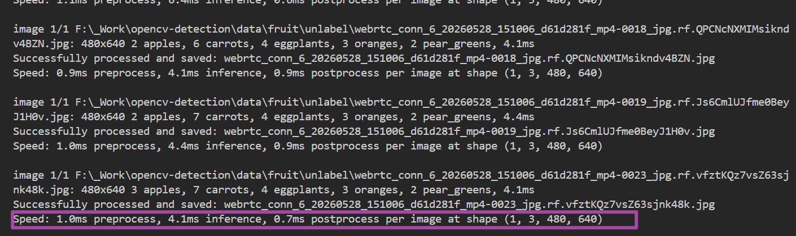
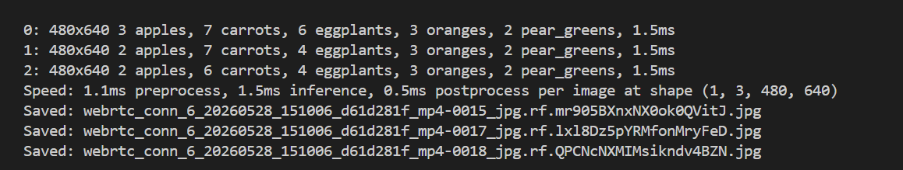

最近在搞量化相关的, 之前学习到的量化也只是皮毛. 什么是量化? 怎么量化?

这篇用于深入理解和使用量化, 并进行结果分析


# 1 前言

## 1.1 量化

量化分为训练后量化(PTQ)和训练时量化(QAT)

**PTQ** 主要是针对模型压缩后,比如int8, 带来的精度损失进行微调. 具体流程是找出最合适的 **Scale（缩放因子）**，把 FP32 的浮点数安全地映射到 INT8 的整数范围（$-128$ 到 $127$）。用极少量的**校准数据,** 提高统计学方法挽回精度的损失. 



**QAT** 主要是对量化后得模型进行微调,找出最合适的 **Scale（缩放因子）**, 相当于预训练模型微调训练

量化的本质就是**寻找最优映射（Scale）并尽可能减少信息损失**：

- **PTQ：** 考前不复习，直接用统计学公式**盲猜**一个最优鞋码（Scale），几分钟搞定。
- **QAT：** 穿上鞋去操场上**拉练几个大项（跑梯度下降训练）**，让鞋码（Scale）和脚（Weights）磨合到最完美的契合度。


但 QAT 比 PTQ 还多做了一件事：**对抗“舍入误差”（Rounding Error）**。

把浮点数变成整数，不可避免地要进行四舍五入。

- **PTQ 极其死板：** `0.4` 必须变 `0`，`0.6` 必须变 `1`。
- **QAT 极其聪明：** 通过神经网络训练，模型可能会发现，在当前这一层，把 `0.4` 强制变成 `1` 反而能让后面的矩阵乘法结果更接近原版。这种“不讲理”的微调能力，是纯统计学的 PTQ 绝对做不到的。


# 2 PQT

## 2.1 具体流程

普通 PTQ 的目标是找出最合适的 **Scale（缩放因子）**，把 FP32 的浮点数安全地映射到 INT8 的整数范围（$-128$ 到 $127$）。它的具体步骤如下：

### 1. 权重（Weights）直接量化

模型的权重（比如卷积层、全连接层的参数）是固定的、静态的。

- 工具（如 TensorRT 或 ModelOpt）会直接扫描每一层权重的最大值（Max）和最小值（Min）。
- 映射公式非常直接：把这个最大绝对值直接映射到 INT8 的 $127$。
- **耗时：** 几秒钟，纯粹的矩阵运算。

### 2. 激活值（Activations）校准（Calibration）

这是普通 PTQ 最关键的一步。网络的输入和中间层的输出（激活值）是**动态的**，输入不同的图片或文本，中间层的数值范围大不相同。

- **准备校准集：** 抽取极少量的真实数据（通常 **32 ~ 128 个样本**，不需要标签）。
- **前向跑数据（Forward Pass）：** 让这些数据在 FP32 模型里跑一次，工具会像“监控摄像头”一样，记录下每一层激活值数据的分布直方图。
- **计算激活值 Scale：** 因为激活值可能存在极端的离群点（Outliers），如果直接按最大值截断，会导致大部分正常数据的精度严重压缩。所以工具会使用一**些高级统计学算法**来找到最佳截断点Scale：
  - **KL 散度（KLD / Entropy）：** 寻找一个截断点，使得量化前后的信息熵（数据分布）损失最小（TensorRT 默认视觉模型算法）。
  - **Percentile（分位数）：** 比如丢弃全网络最大的 $0.01\%$ 的数据，只用 $99.99\%$ 的最大值作为截断范围。
  - **MinMax：** 简单粗暴，直接用统计到的绝对最大值。

### 3. 合并与导出

把计算好的“权重 INT8 矩阵”和“每一层激活值的 Scale 缩放表”打包。

交给 TensorRT 后，推理时数据一进来，就乘以对应的 Scale 变成 INT8 进行硬件加速，出结果时再除以 Scale 变回浮点数。


# 3 QAT

## 3.1 具体流程

### 1. 自动插入“伪量化”节点（Fake-Quantization）

你不需要手动去改写 PyTorch 的网络层。ModelOpt 可以自动扫描你的 PyTorch 模型，在卷积层、全连接层、激活函数等地方自动插入 `FakeQuantize` 节点。

- **原理：** 在前向传播时，数据会被转换为低精度再转回高精度（模拟 INT8 的精度损失）；在反向传播时，正常的更新梯度。

### 2. 校准与范围学习（Calibration & Learnable Scales）

量化最难的是确定“截断范围”（Scale）。ModelOpt 提供了多种算法：

- 它可以在 QAT 开始前，通过少量数据进行**校准（Calibration）**，初始化一个比较好的量化范围。
- 在 QAT 训练过程中，这个量化范围（Scale）会变成**可学习的参数**，随着网络权重一起优化，找到最完美的截断点。


## 3.2 伪量化节点

是:

在 QAT（量化感知训练）期间，普通的 PyTorch 算子（比如卷积层）其实**依然在用 FP32（32位浮点数）进行计算**。

> 

在前向传播和反向传播中分别扮演不同的角色：

- **前向传播（Forward）—— 制造伤害（模拟误差）：** 当一个完美的 FP32 浮点数（比如 `0.342178`）流经伪量化节点时，它会执行以下操作：

  1. **量化（Quantize）**：根据当前的缩放因子（Scale），把它四舍五入变成 INT8 整数（比如 `87`）。
  2. **反量化（Dequantize）**：立刻把这个 `87` 再乘回 Scale，变回 FP32 浮点数（比如 `0.339843`）。

  这个过程故意丢失了尾部的精度（`0.342178` 变成了 `0.339843`），这就叫**量化噪声**。后面的卷积层吃到的就是这个“带有噪声、被污染过”的输入。

- **反向传播（Backward）—— 绕过惩罚（传递梯度）：** 当梯度传回来时，因为四舍五入函数（Round）的导数是 0，伪量化节点会使用一种叫 **STE（Straight-Through Estimator，直通估计器）** 的技术，直接假装什么都没发生，把后面的梯度**原封不动地传过自己**，让前面的层能够正常更新权重。

> 💡 **总结它的目的**：让模型在训练时，提前**体验并适应**未来部署到 INT8 硬件上时才会遇到的精度损失，从而在训练中自己调整权重来弥补这个损失。


#### ➡️ 原始的 FP32 结构：

非常干净，输入和权重直接送进卷积层做矩阵乘法。

```
[输入 Activation (FP32)] ───┐
                            ▼
[权重 Weights (FP32)] ────> [ Conv2d 算子 ] ───> [输出 (FP32)]
```

#### ➡️ 插入伪量化（QDQ）后的 QAT 结构：

ModelOpt 会在权重（Weights）**输入前，以及**激活值（Activation/输入）进入算子前，硬生生插进两对 QDQ 节点：

```
[输入 Activation (FP32)] ──> [ Quantize ] ──> [ Dequantize ] ───┐
                                                                 ▼
[权重 Weights (FP32)] ────> [ Quantize ] ──> [ Dequantize ] ──> [ Conv2d 算子 ] ──> [输出 (FP32)]
```

如上图所示，原本一根线拉过去的计算，现在中间多出了好几个拦截点：

1. **权重支路**：原本静态的 Weight，现在每次前向传播前，都要先经过一套 `Q -> DQ` 的洗礼，变成带有 INT8 误差的 FP32 权重，再送进 Conv2d。
2. **特征图支路**：上一层传过来的动态特征图，同样要经过 `Q -> DQ` 节点。这两个节点里还包含着**可以学习的 `Scale`（缩放因子）参数**。


## 3.3 图融合

1. 它会把 `Quantize` 和 `Dequantize` 剥离，只把里面训练好的 `Scale` 参数提取出来。
2. 它把夹在中间的 `Conv2d (FP32)` 物理替换为 NVIDIA Tensor Core 支持的 **`Conv2d (True INT8)`** 硬件指令。
3. 最终的物理结构变成了最纯粹的：

```
[输入 (INT8)] ───> [ 真正的硬件级 INT8 Conv2d 算子 ] ───> [输出 (INT8)]
```


# 4 常见层





batch=3



| **性能指标 (单张平均)**  | **模式 A：单张循环 (Batch=1)** | **模式 B：批处理 (Batch=3)**  | **性能变化趋势**          |
| ------------------------ | ------------------------------ | ----------------------------- | ------------------------- |
| **前处理 (Preprocess)**  | ~0.97 ms                       | **~1.35 ms** *(剔除首包异常)* | 略微上升 (+39%)           |
| **模型推理 (Inference)** | ~4.20 ms                       | **~2.20 ms** *(提升巨大)*     | **缩短 47.6% (性能翻倍)** |
| **后处理 (Postprocess)** | ~0.83 ms                       | **~0.45 ms** *(剔除首包异常)* | **缩短 45.8%**            |
| **单张总耗时 (Total)**   | ~6.00 ms                       | **~4.00 ms**                  | **整体耗时缩短约 1/3**    |

### 1. 推理速度（Inference）：从 4.2ms 暴跌至 2.2ms

- **Batch=1 耗时（~4.2ms）**：由于每次只喂一张图，RTX 3060 的 CUDA 核心（Stream Processors）根本吃不饱，GPU 频繁在“接收单张数据 -> 计算 -> 返回”之间切换，硬件利用率低下。
- **Batch=3 耗时（~2.2ms，单张平摊）**：虽然 Batch=3 时，整组（3张图）的总推理耗时大概是 $2.2 \times 3 = 6.6\text{ ms}$，但是由于 3 张图的张量在显存中连续，TensorRT 的矩阵乘法算子可以**并行同时计算 3 张图的特征图**。平摊到每张图上，推理时间直接斩半。

### 2. 任务退化警告：`WARNING: Unable to automatically guess model task`

在第二段日志开头出现了一个关键警告：

> ```
> WARNING Unable to automatically guess model task, assuming 'task=detect'.
> ```

- **原因**：由于你使用的是纯粹的 `.engine` 文件且没有通过代码显式指定 `task` 属性，Ultralytics 框架无法确定它是分割（segment）还是检测（detect），于是**默认退化成了目标检测（detect）**。
- **影响**：看两段日志的检测输出就能发现端倪：
  - **Batch=1 时（正确识别为分割）**：能检测出 `carrots`、`eggplants` 等非常复杂的长尾类别（比如 6 carrots, 4 eggplants）。
  - **Batch=3 时（退化为目标检测）**：检测出来的类别变成了大类：`apples`, `oranges`, `pear_greens`。并且**后处理时间（Postprocess）从 0.83ms 骤降到 0.45ms**，就是因为目标检测的后处理计算量远小于实例分割的 Mask 生成。

### 3. 首包启动开销（Warmup Artifact）

观察 Batch=3 的第一组输出：

> `Speed: 7.9ms preprocess, 2.6ms inference, 3.3ms postprocess` 其前处理（7.9ms）和后处理（3.3ms）明显偏高。这是因为 TensorRT 在接收到真正的数据进行第一次推理时，需要向操作系统申请显存（图中显存占用了 **2404 MiB**）、初始化 `IExecutionContext` 上下文并建立内存映射。从第二组开始（前处理 1.3ms，后处理 0.4ms），速度就进入了稳定的全速状态。


第一段是**修正了任务类型（恢复为了真正的实例分割 `task=segment`）后的 TensorRT INT8 引擎**输出，第二段是原生的 **PyTorch FP16/FP32 模型 (`.pt`)** 输出。

| **指标 (单张平均)**      | **PyTorch 原生 (.pt)** | **TensorRT INT8 (.engine)** | **性能倍数 / 优化幅度**         |
| ------------------------ | ---------------------- | --------------------------- | ------------------------------- |
| **前处理 (Preprocess)**  | ~1.25 ms               | **~1.15 ms**                | 基本持平 (TRT 略快)             |
| **模型推理 (Inference)** | ~5.50 ms               | **~1.60 ms**                | **TRT 快了 3.44 倍 (缩短 71%)** |
| **后处理 (Postprocess)** | ~1.65 ms               | **~1.25 ms**                | **TRT 快了 1.32 倍 (缩短 24%)** |
| **单张总耗时 (Total)**   | ~8.40 ms               | **~4.00 ms**                | **整体耗时缩短一半以上**        |
| **理论吞吐量 (FPS)**     | ~119 FPS               | **~250 FPS**                | **吞吐量直接翻倍**              |


```bash
0: 480x640 3 apples, 2 carrots, 1 eggplant, 4 pear_greens, 1.6ms
1: 480x640 2 apples, 1 carrot, 1 eggplant, 4 pear_greens, 1.6ms
2: 480x640 2 apples, 1 carrot, 1 eggplant, 4 pear_greens, 1.6ms
Speed: 1.1ms preprocess, 1.6ms inference, 1.1ms postprocess per image at shape (1, 3, 480, 640)
Saved: original_160513236_jpg.rf.eOSvSN7TK8DmQRqOq30B.jpg
Saved: original_160514954_jpg.rf.uhI9bJenX55KMSkIf7vJ.jpg
Saved: original_160901413_jpg.rf.fFTSMecLjmWxbfxQwQPp.jpg

0: 480x640 3 apples, 1 carrot, 1 eggplant, 4 pear_greens, 1.6ms
1: 480x640 2 apples, 1 carrot, 1 eggplant, 4 pear_greens, 1.6ms
2: 480x640 3 apples, 1 carrot, 1 eggplant, 4 pear_greens, 1.6ms
Speed: 1.2ms preprocess, 1.6ms inference, 1.4ms postprocess per image at shape (1, 3, 480, 640)
Saved: original_160903161_jpg.rf.yodYM7O1UrA5eFz8yY19.jpg
Saved: original_160929619_jpg.rf.zqH80BHsWolhMpqezhcR.jpg
Saved: original_160953247_jpg.rf.dU1vLVwvGOLYBMftTat9.jpg
```


```bash
0: 480x640 3 apples, 2 carrots, 1 eggplant, 4 pear_greens, 5.5ms
1: 480x640 2 apples, 1 carrot, 1 eggplant, 4 pear_greens, 5.5ms
2: 480x640 2 apples, 1 carrot, 1 eggplant, 4 pear_greens, 5.5ms
Speed: 1.3ms preprocess, 5.5ms inference, 1.6ms postprocess per image at shape (1, 3, 480, 640)
Saved: original_160513236_jpg.rf.eOSvSN7TK8DmQRqOq30B.jpg
Saved: original_160514954_jpg.rf.uhI9bJenX55KMSkIf7vJ.jpg
Saved: original_160901413_jpg.rf.fFTSMecLjmWxbfxQwQPp.jpg

0: 480x640 2 apples, 1 carrot, 1 eggplant, 4 pear_greens, 5.5ms
1: 480x640 2 apples, 1 carrot, 1 eggplant, 4 pear_greens, 5.5ms
2: 480x640 3 apples, 1 carrot, 1 eggplant, 4 pear_greens, 5.5ms
Speed: 1.2ms preprocess, 5.5ms inference, 1.7ms postprocess per image at shape (1, 3, 480, 640)
Saved: original_160903161_jpg.rf.yodYM7O1UrA5eFz8yY19.jpg
Saved: original_160929619_jpg.rf.zqH80BHsWolhMpqezhcR.jpg
Saved: original_160953247_jpg.rf.dU1vLVwvGOLYBMftTat9.jpg
```

## 二、 核心差异深层分析

### 1. 推理速度（Inference）的断层式碾压（5.5ms vs 1.6ms）

这是本次对比的核心亮点。为什么 TensorRT 能够把推理时间压到不可思议的 **1.6ms**？

- **动态范围量化（INT8）**：PyTorch 默认使用 `FP32`（32位浮点数）或 `FP16` 进行计算。而你的 TRT 引擎使用了 `INT8`（8位整数）。在显存体积和计算吞吐上，INT8 具有压倒性优势，RTX 3060 的 Tensor Cores 处理 INT8 矩阵乘法的速度远快于浮点数。
- **计算图融合（Graph Fusion）**：PyTorch 在运行时是逐层调用 CUDA 核函数的。TensorRT 在编译阶段（你之前等的 155 秒）将 YOLO 里的 `Conv + BatchNorm + ReLU` 融合成了一个单一的算子，极大减少了显存与 GPU 寄存器之间的数据拷贝（Memory Bound 优化）。
- **核心选择（Kernel Selection）**：TensorRT 针对你这块 RTX 3060 Laptop 显卡的硬件架构（Ampere 架构），在底层精选了最契合的底层 CUDA 算子。

### 2. 后处理（Postprocess）为什么变快了？（1.65ms vs 1.25ms）

- **思考**：后处理（如 NMS 非极大值抑制、Mask 原型系数相乘等）通常是在 CPU 或通过普通的 PyTorch 算子在 GPU 上跑的，为什么 TRT 也会变快？
- **原因**：在第二阶段导出 ONNX 过程中，YOLO 的一部分后处理节点（甚至包括部分 Gather/Slice 边界处理）被转换成了高效的 ONNX/TRT 原生算子，或者通过 TensorRT 的编译进行了优化。数据从“模型结束”到“后处理开始”的交接更加紧凑，减少了 CPU/GPU 的同步等待时间。

### 3. 数据一致性（业务安全）

最让人欣慰的是数据的完全一致。例如：

- 图片 01：`3 apples, 2 carrots, 1 eggplant, 4 pear_greens`
- 图片 02：`2 apples, 1 carrot, 1 eggplant, 4 pear_greens`

在两套引擎下**数量和类别完全恒定**。这证明在当前的水果实例分割场景下，**TensorRT INT8 量化完全没有引发精度崩塌**，你可以非常安全地在生产环境替换掉 `.pt` 模型。


# 
