# Fruit 项目 AI 推理性能优化全景备忘录

本策划文档系统性汇总了 Fruit 项目在 **AI 模型推理与数据流** 上的全量优化项。涵盖已完成的基线构筑、刚刚定位并待实施的运行期重构，以及未来的模型层深度榨干方案。

---

## 一、 已完成的基础优化（第一阶段：稳固基线）

*核心目标：消除高额的硬件连接与线程冷启动固定开销。*

### 1. 摄像头常驻打开
* **内容简介**：将视频流拉取模块改为常驻守护线程，避免每次 API 请求时重新初始化硬件驱动和建立视频流连接，彻底消除了秒级的硬件唤醒延迟。

### 2. 模型启动期预热 (Warmup)
* **内容简介**：在系统初始化（`main.py`）阶段，使用哑数据（Dummy Data）提前触发 GPU 前向传播。规避了首次真实请求时，CUDA 引擎初始化和算子动态加载带来的首帧高延迟。

### 3. 推理线程常驻
* **内容简介**：构建长寿命的常驻推理线程池，避免在高频 API 请求下频繁创建、销毁 Python 线程所导致的系统上下文切换与 CPU 损耗。

### 4. 模型推理复用池 (Model Hub)
* **内容简介**：设计跨路径的模型单例复用机制。当不同的检测路径（`detection_path`）调用相同的底层模型时，共享内存与显存中的同一个模型实例，大幅降低了多路并发时的总显存占用。

---

## 二、 刚刚发现并确认的优化（第二阶段：精细重构）

*核心目标：消灭运行期（Runtime）热路径上的对象重建、串行阻塞、无谓渲染与轮询抖动。*

### 5. 消除每请求配置更新与 Processor 重建【P0】
* **内容简介**：重构 `target_detection.py`，绕过会触发文件锁（I/O 竞争）与重算相机内参的 `update_detector_config` 重型方法。改为在运行期**原地（In-place）动态修改** `target_classes` 属性，让“模型预热”的成果真正留存。

### 6. 位置检测降帧与多帧 Batch 推理优化【P0】
* **内容简介**：针对水果位置检测（Position）无需滑动窗口计数的特性，将 `reading_frames_count` 降为 `1`，消灭串行循环；或在必须多帧时，解耦深度配准逻辑，利用 YOLO 原生 Batch 一次性前向推理，将多帧延迟缩减至接近单帧。

### 7. 帧获取由 Sleep 轮询改为 Condition 唤醒机制【P2】
* **内容简介**：废除 `_get_last_frame` 中固定的 `time.sleep(0.05)` 盲等轮询。在 `annotated_hub` 写入新帧时引入 `threading.Condition` 信号通知（`notify_all`），让推理线程在帧就绪的瞬间被精准唤醒，消除几十毫秒的随机等待延迟。

### 8. 生产路径按需 `plot()` 与去除深度图拼接【P1】
* **内容简介**：将耗费大量 CPU 算力的实例分割 `plot()` 遮罩渲染和左右深度伪彩图拼接做“按需门控”机制。前 $N-1$ 帧纯做矩阵计算，仅在最后一帧或显式开启 Debug 存图时才执行图像可视化绘制。

### 9. 禁用 InArea 推理的控制台 verbose 打印【P1】
* **内容简介**：将 `FruitInAreaFrameProcessor` 内部调用模型时的 `verbose=True` 显式改为 `False`。消灭高频热路径上往控制台（stdout）打印文本引起的同步 I/O 阻塞。

### 10. 限制 `max_det`、固定 `imgsz` 与本地 `half` 推理【P2】
* **内容简介**：在 Object Detection 架构 Schema 中沉入新参数：位置场景限制 `max_det=1` 以断崖式降低 NMS（非极大值抑制）计算耗时；固定 `imgsz` 规避隐式 letterbox 尺寸缩放；本地 `.pt` 跑测时开启 `half=True`（FP16）使 GPU 吞吐翻倍。

---

## 三、 未完成的进阶优化（第三阶段：模型与引擎深度挖掘）

*核心目标：通过重构编译配置、量化、任务裁剪，将 TensorRT 推理性能榨干到极致。*

### 11. 引擎导出参数调优（零训练成本，最快见效）
* **内容简介**：在 `ultralytics` 导出 `.engine` 时进行定制：
  * **矩形输入**：将默认 $640 \times 640$ 的方形编译改为匹配相机的矩形 `imgsz=(480, 640)`，直接**减少约 33% 像素**的计算量。
  * **静态 Shape**：若锁定 Batch 帧数，导出时固定 `batch=3`（单帧则固定 `batch=1`），利用静态 Shape 让 TensorRT 针对性挑选最优算子（Tactic Selection），消除动态 Shape 的 Profile 消耗。
  * **启用简化**：开启 `simplify=True` 融合多余的 ONNX 算子。

### 12. INT8 训练后量化 (PTQ / QAT)
* **内容简介**：在 FP16 基础上推进 **INT8 量化**，预期可为 Orin/GPU 带来 1.5~2 倍的吞吐飞跃。收集产线几百张真实图片作为标定集（Calibration Dataset）进行 PTQ 导出；若精度（质心坐标）抖动超出预期，则引入量化感知训练（QAT）进行精度补偿。

### 13. 端到端 NMS 编译进引擎（消除 Host 传输瓶颈）
* **内容简介**：导出时设置 `nms=True`，利用 TensorRT 的 `EfficientNMS_TRT` 插件将检测框解码与 NMS 过滤完全融进 GPU 内部。使得模型直接输出过滤后的最终边界框，免除了大张量回传（GPU $\rightarrow$ CPU）与在 Python 层跑 NMS 的严重耗时。

### 14. 任务模型选型降级（Head 结构裁剪）
* **内容简介**：严格按业务“取什么信息”匹配最轻量的 Model Head。
  * 评估 Line2 主链路，由于其仅提取 BBox 中心点，可将 **Segment（分割）模型降级为 Detect（检测）模型**，彻底砍掉 Proto Mask 分支与 Mask 上采样计算。
  * 严格控制 OBB（定向边界框）模型的使用范围，仅在需要旋转角度的路径上保留。

### 15. 模型容量缩减、剪枝与蒸馏
* **内容简介**：针对水果定位等相对单一的工业场景，优先采用 Nano/Small 级别的小模型。进一步优化可采用结构化剪枝（Structured Pruning）剔除冗余通道，或通过大模型（Teacher）蒸馏小模型（Student）的方式，在保障精度的前提下极速瘦身。

### 16. 图像预处理全面移至 GPU (CUDA Preprocess)
* **内容简介**：将目前在 CPU（NumPy）上执行的图像 `resize`、归一化、色彩通道转换等预处理操作，改写为 GPU Tensor 操作（或利用 TensorRT 内部算子）。配合常驻 Hub 连续内存中的 Pinned Memory 传输，彻底释放 CPU 压力，实现全链路全加速。

# 现场

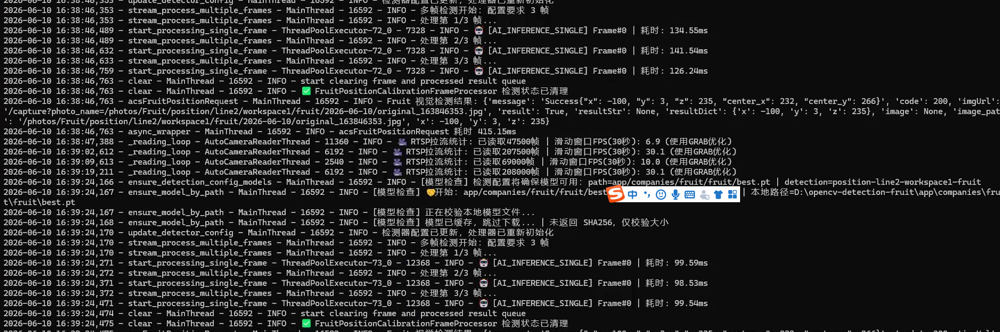

# stream流唤醒机制

之前, 固定0.05秒取出新帧->20fps
推理三帧: 串行执行 , 取帧->推理->取帧->推理->取帧->推理 (每帧耗时约#0 | 耗时: 39.02ms)
**如果推理时间小于50ms, 那么下一次推理还是用的旧的相同帧**

现在frame_id 唤醒机制, 20fps->0.05秒取一新帧; 60 pfs ->0.05/3秒取新帧
推理三帧: 串行执行, 且帧不同导致时间: 50ms+50+50+推理等操作, 时间花在等帧**(采帧阶段就花了约 25ms，且这段时间 Infer 线程完全空闲。)**
如果fps=60: 时间: 50+推理等操作; 取帧花费时间减少

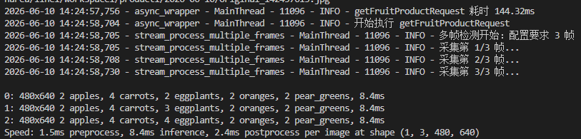

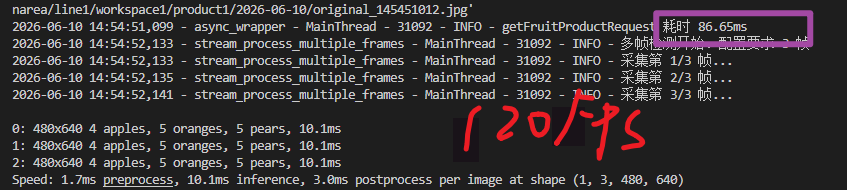

对比汇总

1. GPU 推理：逐帧 ~49ms → batch ~24ms，省约 25ms
2. 0.05s 会存在帧重复
3. batch推理在拉流fps高的时候有效(避免白等)
4. onnx会有30ms提升

###  pt

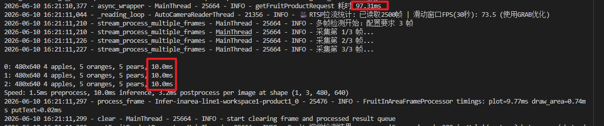

### half pt

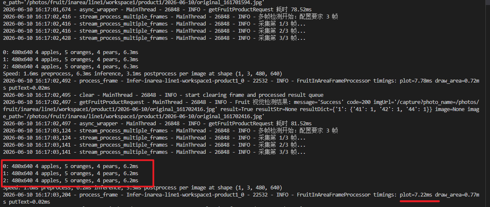

### onnx

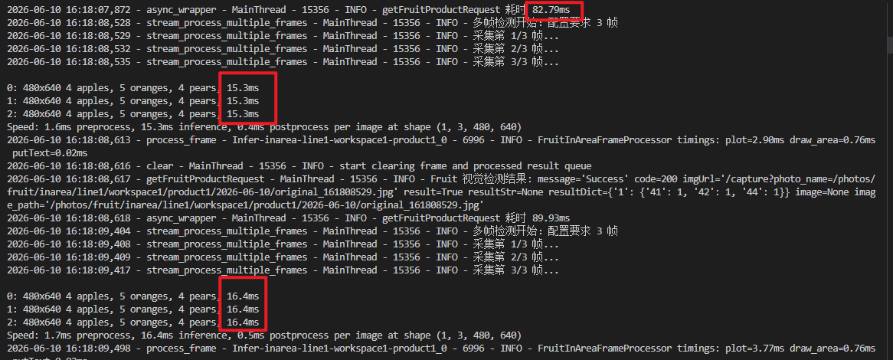

### trt:

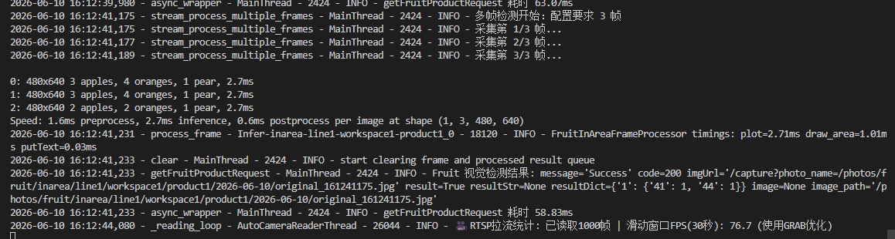

# 帮我creattask 异步协议图片, 防止波动带来的干扰

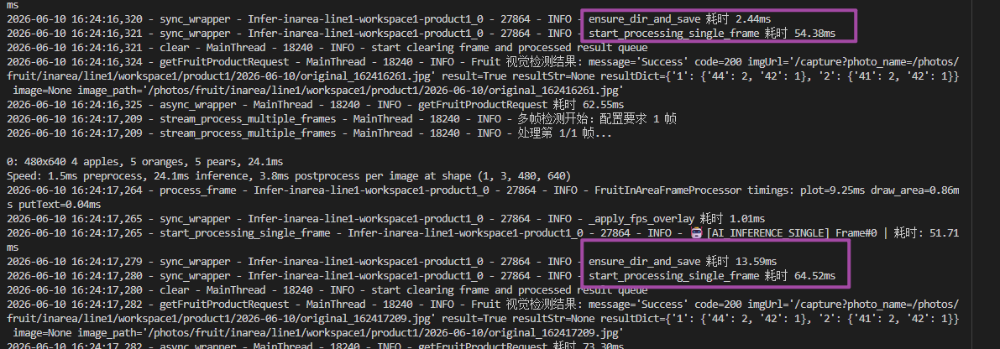

> 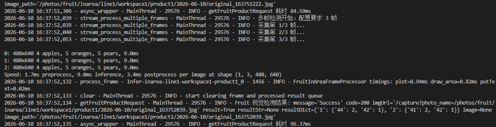
>
> 减少2~5秒以及大波动

### plot是不是也可以推理后保存, 减少api延迟, 同时还能保存现场结果

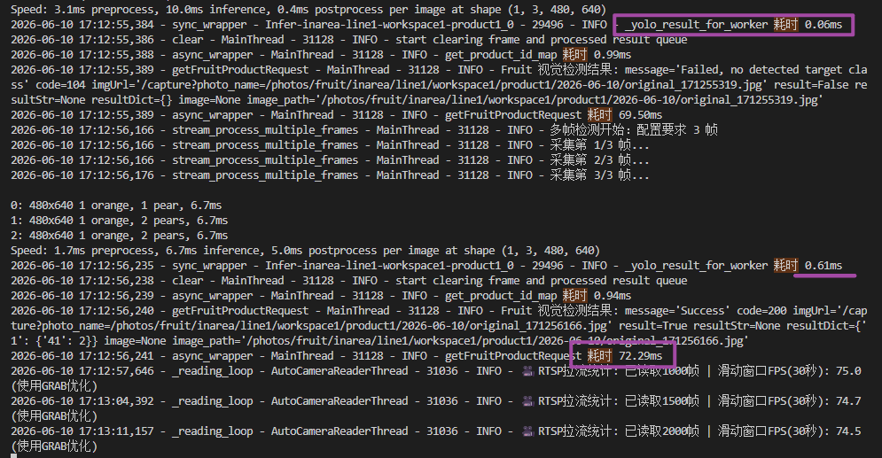

> 确实和不plot的耗时接近, 就是更容易导致硬件波动
>
> 同时copy到CPU的yolo result耗时也很低, 正常情况不到0.8ms

## 查数据CPU

1ms左右

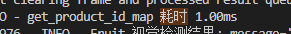

## 不plot

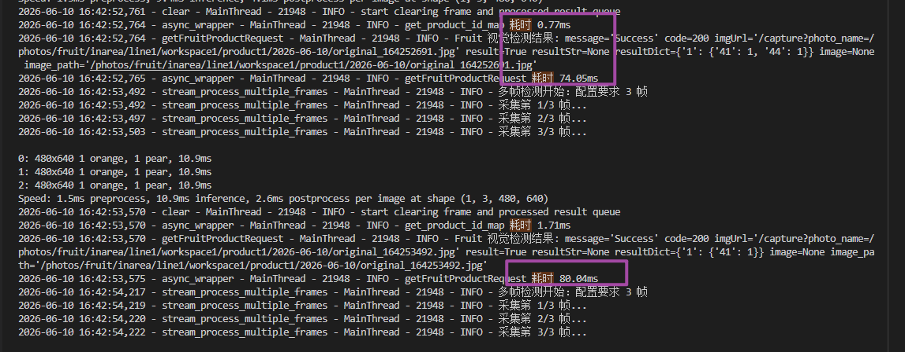

> 减少10~15ms左右

