# AFNI

## 1 介绍

主要用于 **fMRI 数据预处理、统计分析与可视化**。

主要特点：

- 支持 MRI、fMRI 数据分析
- 支持 GUI 三维浏览
- 可完成从原始数据到统计结果的完整分析流程

## 2  主要功能

AFNI 可以覆盖整个 fMRI 数据分析流程：

```
原始 fMRI 数据
        │
        ▼
数据预处理
(tcat、tshift、volreg、blur...)
        │
        ▼
个体水平分析
(GLM、3dDeconvolve)
        │
        ▼
群体统计分析
(3dttest++、3dMEMA...)
        │
        ▼
结果可视化
(AFNI GUI)
```

常见功能包括：

- 图像浏览与三维重建
- Slice Timing 校正
- 头动校正
- 空间标准化
- 空间平滑
- ROI 提取
- 时间序列分析
- GLM 建模
- 群体统计分析

## 3 操作

### 3.0 AFNI 标准分析流程

```
去前几个 TR
      │
      ▼
Slice Timing 校正
      │
      ▼
Head Motion 校正
      │
      ▼
空间标准化
      │
      ▼
空间平滑
      │
      ▼
GLM 建模
      │
      ▼
统计推断
      │
      ▼
结果可视化
```


### 3.1 安装afni

> ```bash
> afni -ver
> 3dcalc -help
> afni 
> ```


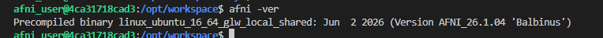

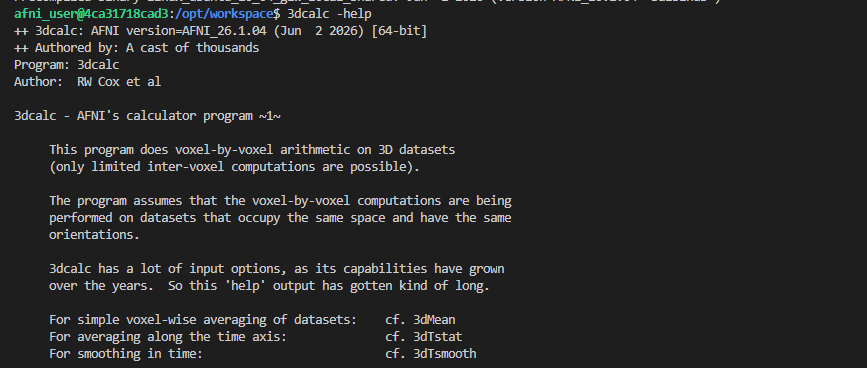

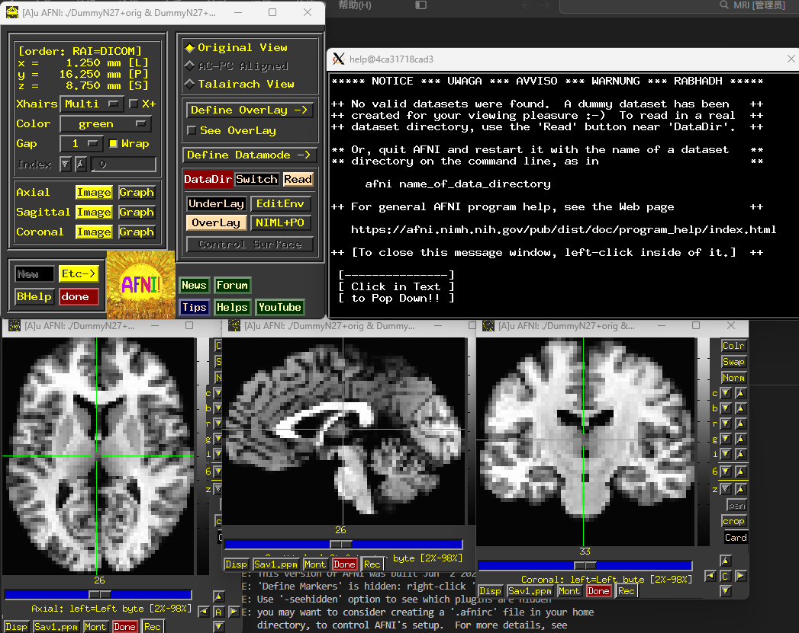

### 3.2 demo**原始图像的3D重构**

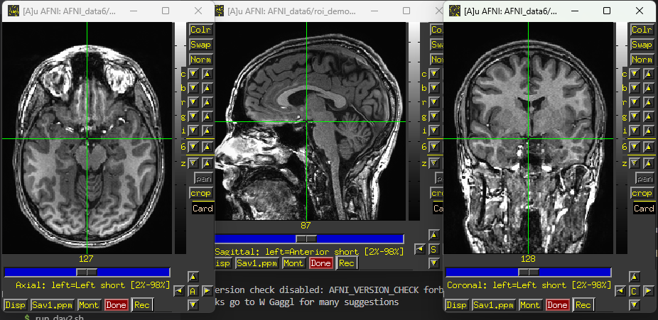


### 3.3 **自动化预处理脚本**

```
tcat (去前2TR) → outcount (异常检测) → tshift (层间校正)
→ volreg (头动校正) → blur (平滑) → mask → scale
→ 3dDeconvolve (GLM) → 3dClustSim → QC 报告
```

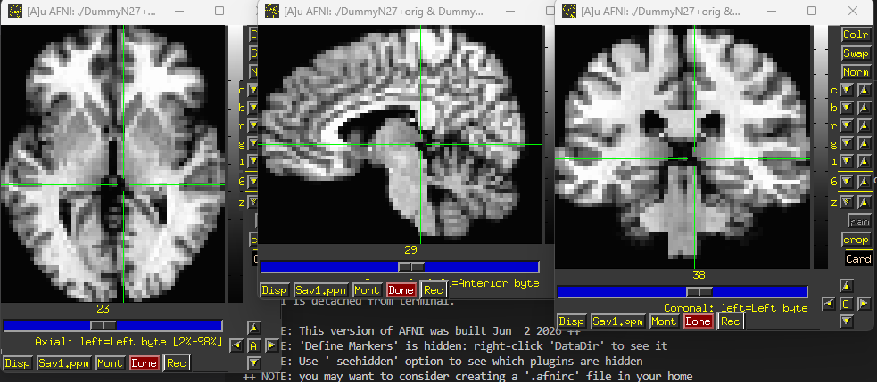


### 3.4 时间校正lice Timing 

MRI 一次扫描通常不是同时采集整个脑部，而是按照 slice 顺序逐层获取信号。因此**同一个时间点的不同脑层实际上存在时间偏移**，需要进行时间校正。

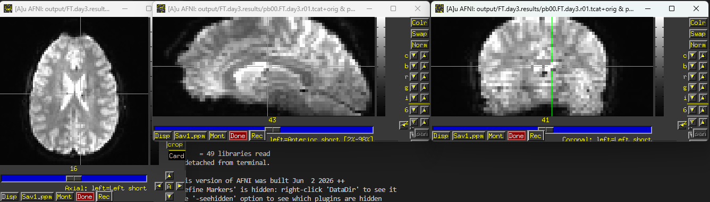

> - 校正前：33 层 offset 各不相同（alt+z 交错采集，如 `0.000 1.030 0.061 ...`）
> - 校正后：无 time-offset 行 → 各层对齐到 TR 起点
>
> ```bash
> cd /opt/workspace
> bash day3/run_day3.sh
> ```
>
> GUI 对比校正效果（推荐）：
>
> ```bash
> cd day3/output/FT.day3.results
> afni pb00.FT.day3.r01.tcat+orig pb01.FT.day3.r01.tshift+orig &
> ```


### 3.5 头动校正（Motion Correction）

fMRI 扫描过程中，被试轻微移动会导致不同

时间点**脑结构位置发生变化**，从而产生假激活信号。因此需要将所有时间点图像对齐到同一个参考空间。

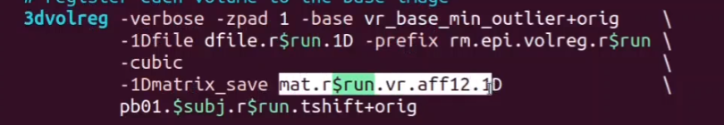

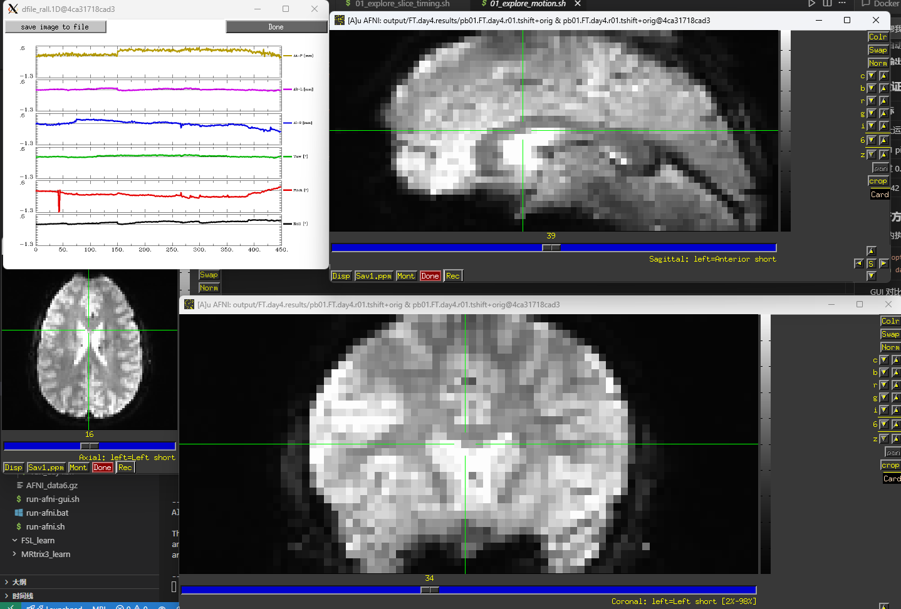

就是6Dxyz rx ry rz 的轴, 看那个位置的变化比较大

> 图中可见红色变化很大

### 3.6 空间配准和标准化（Spatial Normalization）

**不同被试**的大脑大小、形态存在差异，需要将个体脑图像转换到统一标准空间

功能像 -->结构像配准 --> 标准空间配准

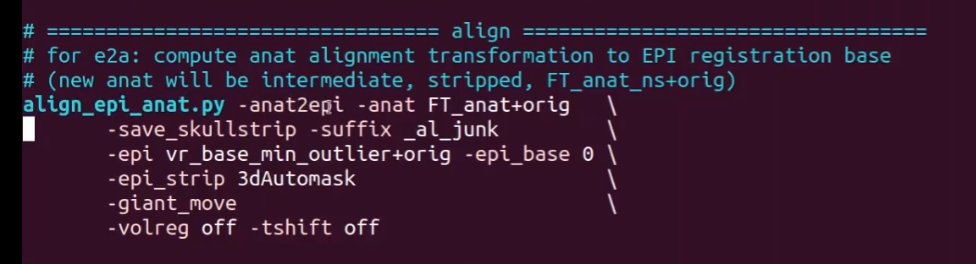


标准空间:
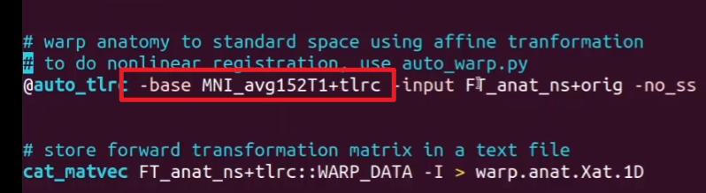


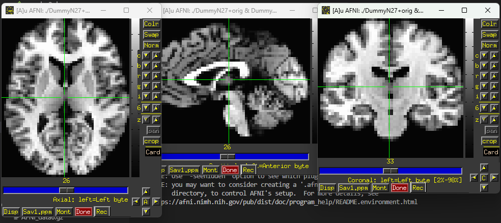


### 3.7  **平空间平滑（Spatial Smoothing）**

1. 相邻体素的噪音进行平滑, 提高信噪比
2. 激活脑区变大

fMRI 数据存在较高空间噪声，通过高斯滤波提高信噪比，同时满足统计分析中的空间连续性假设。


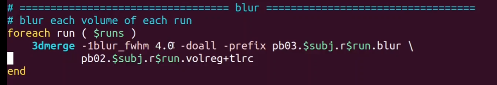


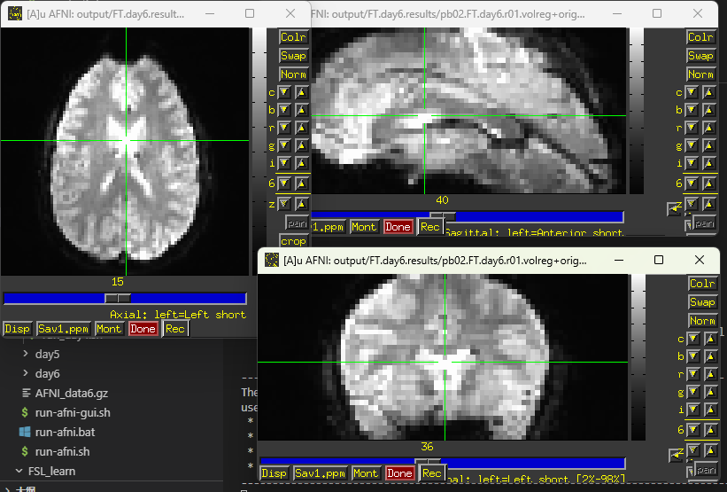

**对比:**

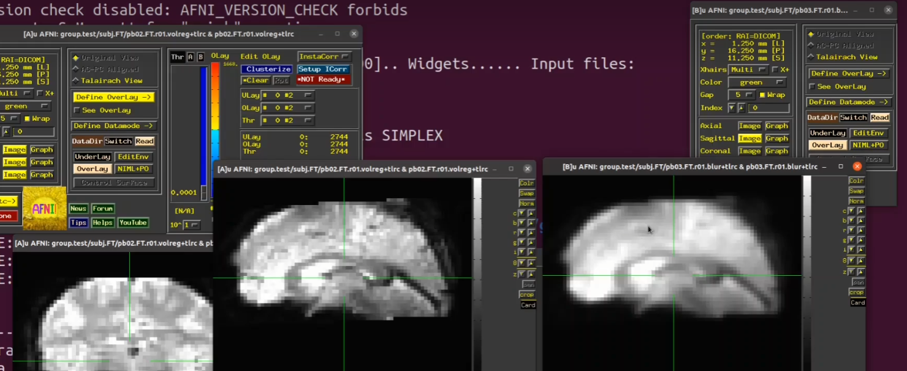


### 3.7 时间序列标准化

比较的是变化百分比而不是变化值大小

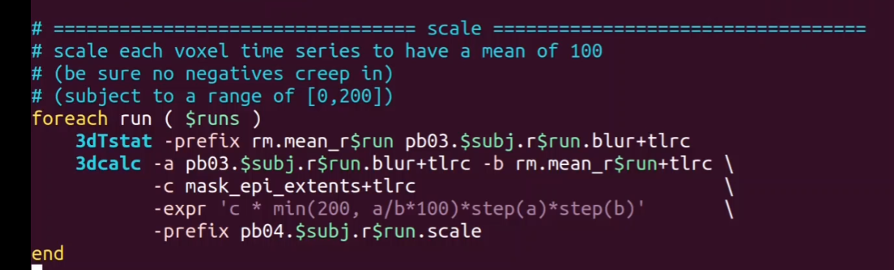


对比

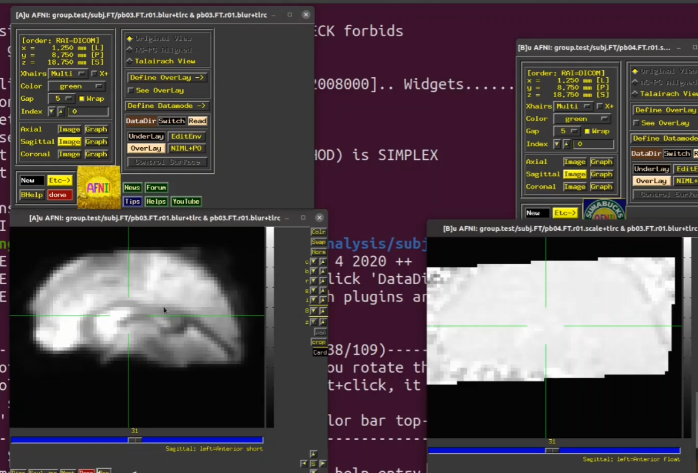

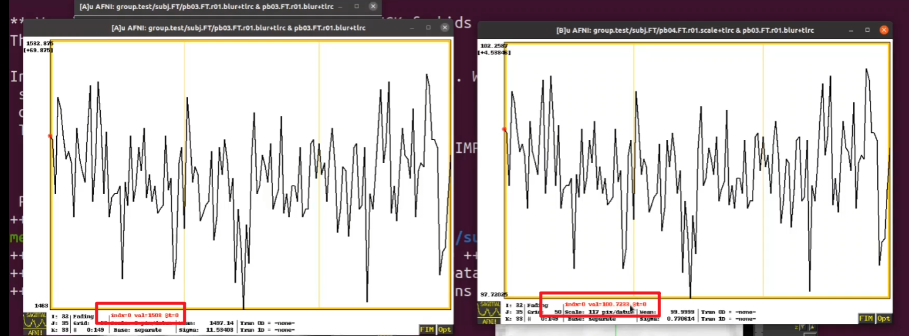


### 3.8 一般线性回归


### 3.8  **个体建模求解** (GLM）

分析实验刺激是否**导致特定脑区 BOLD 信号变化**。 使用一般线性模型（General Linear Model, GLM）建立刺激与脑活动之间的统计关系。

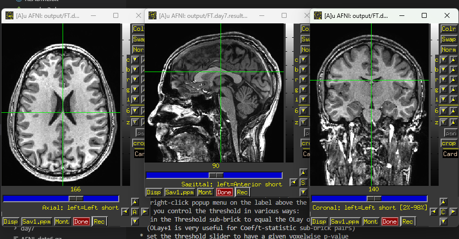

### 3.9 群体统计分析（Group Analysis）

个体分析得到每个人的大脑激活模式后，需要进一步比较多个被试之间的共同规律，例如疾病组和健康组之间的差异。

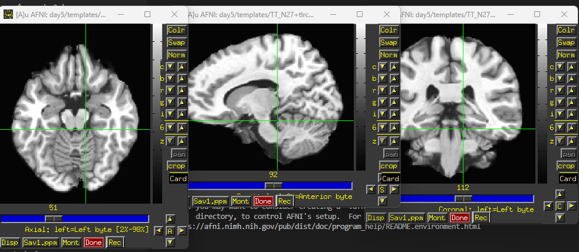


# MRtrix3

---

## 1 介绍

专注于**弥散磁共振成像（dMRI）** 数据的分析与可视化。

相比 AFNI 更关注：

- 白质纤维
- 神经束追踪
- 大脑结构连接

## 2 主要功能

MRtrix3 主要完成：

```
DWI 数据
     │
     ▼
预处理
     │
     ▼
扩散模型
(DTI/CSD)
     │
     ▼
纤维束追踪
     │
     ▼
结构连接组
```

主要功能：

- DWI 去噪
- Gibbs 去除
- Eddy/Head Motion 校正
- Bias Field 校正
- Brain Mask
- DTI 建模
- CSD 建模
- Fiber Tracking
- Connectome 构建

## 3 操作

### 3.0 标准流程

```
DWI 数据
     │
     ▼
去噪
     │
     ▼
运动/涡流校正
     │
     ▼
DTI/CSD 建模
     │
     ▼
纤维束追踪
     │
     ▼
结构连接组分析
```


### 3.1 安装


### 3.2 查看数据

```
mrview dwi.mif
```

```
bash MRtrix3_learn/day1/mrview.sh
```

> 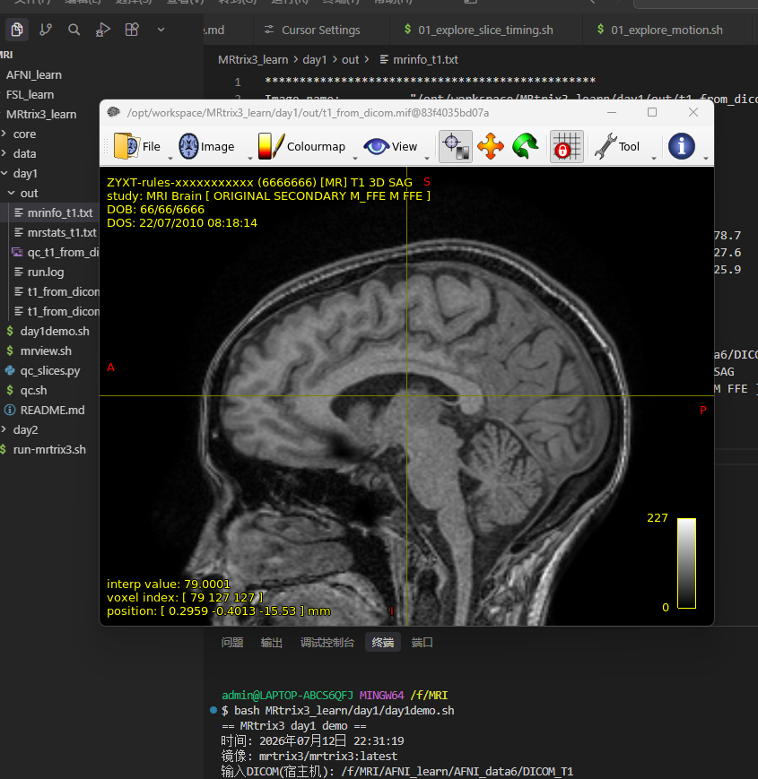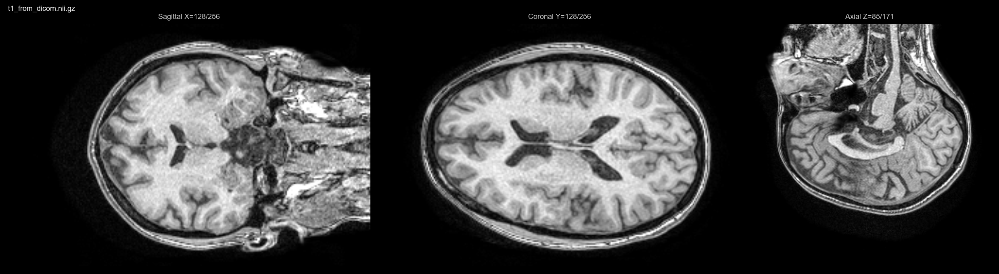


### 3.3  DWI的预处理

涵盖**去噪**（`dwidenoise`）、**Gibbs伪影去除**、**涡流校正和头动校正**（`dwifslpreproc` 调用FSL）。**B0场不均匀性校正（偏置场校正）** 和**大脑提取（剥颅骨）**，得到高质量弥散数据, 为建模做最终准备。

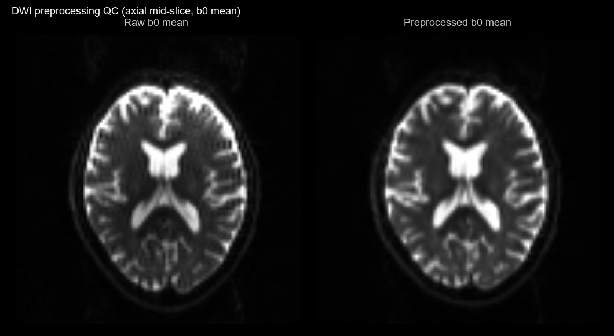

### 3.4 弥散张量和CSD

两种核心模型：**弥散张量成像（DTI）** 和**约束球面反卷积（CSD）**。

CSD能解决纤维交叉问题，是MRtrix3的核心优势。

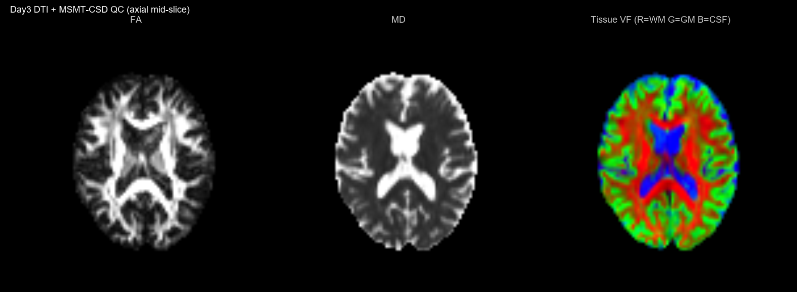


### 3.5  纤维束追踪

纤维追踪算法（使用 `tckgen` 进行**概率性追踪**），生成上百万条模拟白质纤维轨迹，并介绍如何过滤和修剪纤维（`tcksift`）。

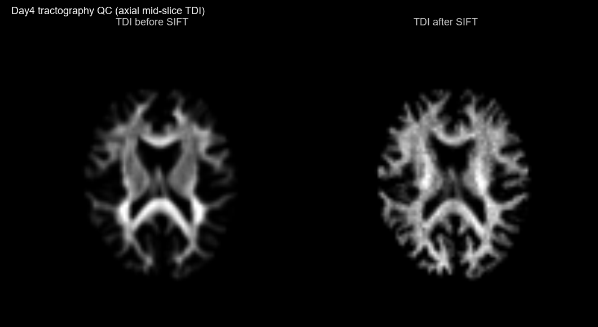

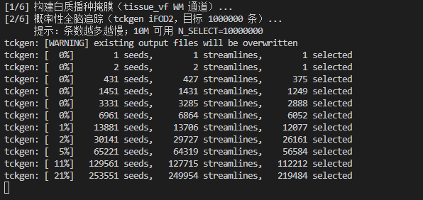

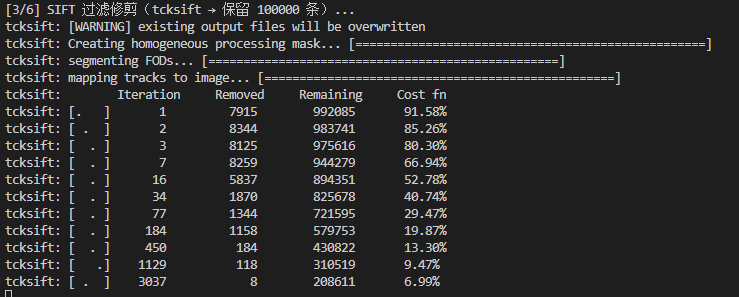


### 3.6  大脑连接组

将追踪出的纤维束与脑区图谱（节点）结合，构建**结构性连接矩阵（Connectome）**，用于分析大脑网络属性（使用 `tck2connectome`）。

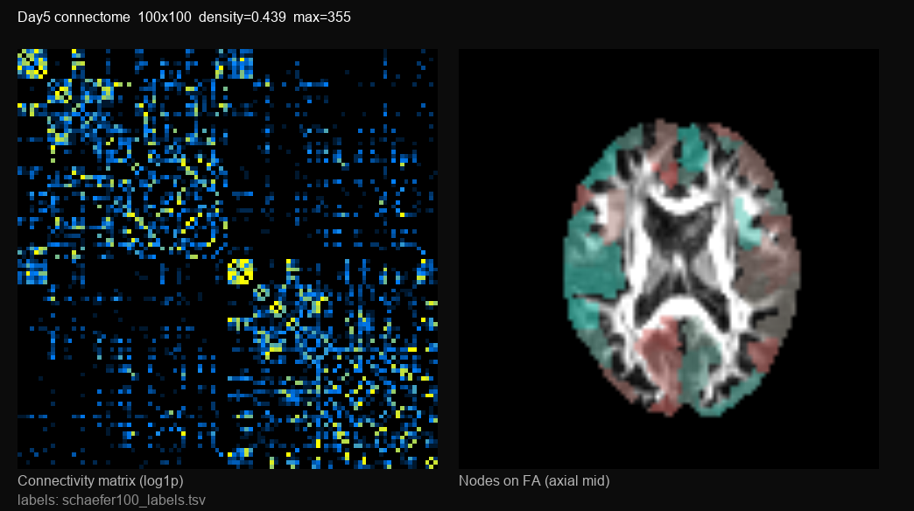


# UUNet


## 可视化


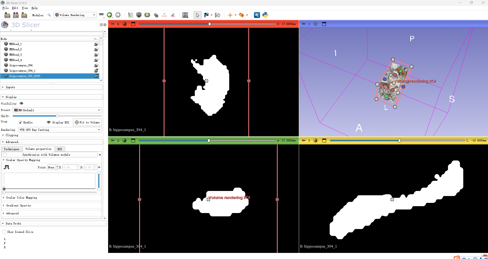

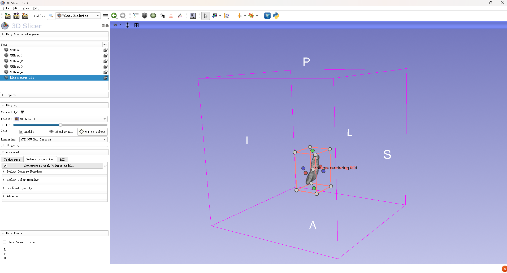


