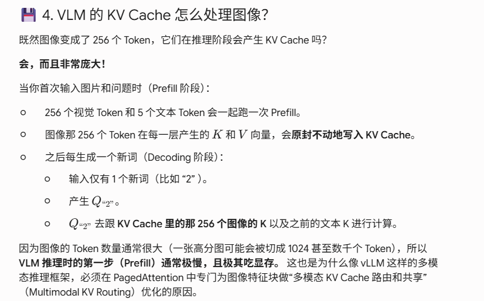

# 怎么融合文本语义和图像语义

## 1. 经典 VLM 的三剑客架构

绝大多数主流 VLM 都采用三阶段结构来连接视觉和语言：

1. **Vision Encoder（视觉编码器）：** 比如 ViT (Vision Transformer)。它的任务是把一张图片切成很多小方块（Patches），提取高维的空间视觉特征。
2. **Projector（多模态投影层）：** 这是一个“桥梁”（通常是 1~2 层 MLP 线性层，或者是 Q-Former 结构）。**它的作用是进行“格式转换”**，把视觉向量的维度硬生生转换成和 LLM 文本 Embedding 完全一样的维度。
3. **LLM Backbone（语言模型基座）：** 比如 Llama 或 Qwen。它负责接收转换后的图像特征和文本，进行最后的推理。


## 2 Q-Former

> https://zhuanlan.zhihu.com/p/24626046588

```python
import torch
import torch.nn as nn
import torch.nn.functional as F
from transformers import BertModel, BertConfig
class QFormer(nn.Module):
    def __init__(self, image_feature_dim=768, num_query_tokens=32, hidden_dim=768):
        super().__init__()

        # 初始化可学习的查询向量（Query Embeddings）
        self.query_tokens = nn.Parameter(torch.randn(1, num_query_tokens, hidden_dim))

        # Transformer 编码器（基于 BertConfig 的双流 Transformer）
        self.config = BertConfig(hidden_size=hidden_dim, num_hidden_layers=6, num_attention_heads=8)
        self.transformer = BertModel(self.config)

        # 线性投影层，用于调整视觉特征的维度
        self.image_proj = nn.Linear(image_feature_dim, hidden_dim)

    def forward(self, image_features):
        """
        image_features: (batch_size, num_patches, image_feature_dim)  ->  ViT/CLIP 提取的视觉特征
        """
        batch_size = image_features.shape[0]

        # 投影图像特征(来自vit)，使其维度匹配 Transformer
        image_features = self.image_proj(image_features)  # (batch, num_patches, hidden_dim)

        # 复制查询向量，并拼接到图像特征前面
        query_tokens = self.query_tokens.expand(batch_size, -1, -1)  # (batch, num_queries, hidden_dim)
        input_tokens = torch.cat([query_tokens, image_features], dim=1)  # (batch, num_queries + num_patches, hidden_dim)

        # 输入 Transformer
        outputs = self.transformer(inputs_embeds=input_tokens)

        # 只返回查询向量的输出（用于文本生成）
        query_outputs = outputs.last_hidden_state[:, :query_tokens.shape[1], :]  # (batch, num_queries, hidden_dim)
        
        return query_outputs
```


## 3 视觉token

输入序列 = [BOS] + [256个视觉 Tokens] + [5个文本 Tokens]

文本 Token 产生它的 **Query (Q)**。比如第 258 个 Token（“猫”字）的 $Q_{猫}$ 诞生了：

- **它会去和谁算注意力？** 它不仅会去和前后相邻的文本 Token 的 $K$ 做计算，还会**横向跨越物理边界，去和那 256 个视觉 Token 的 K 算点积！**

$$\text{Attention}(Q_{猫}, K_{所有}) \rightarrow \text{与那 256 个代表图片区域的 Key 逐一计算相似度}$$

- **神奇的结果：** * 模型发现，图片中左下角第 42 号和 43 号“网格（视觉 Token）”的 Key 向量，与文本“猫”的 Query 向量极其匹配，点积权重极高。
  - 于是，在加权求和（Weight $\times V$）阶段，“猫”这个字后续的特征向量里，就**物理融入了图片左下角那个毛茸茸区域的视觉 V 值**。
  - **语义融合完成！** “猫”这个抽象的文字，在这一层里找到了它在物理世界（图片中）的对应实体。

> 


