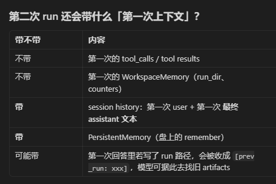
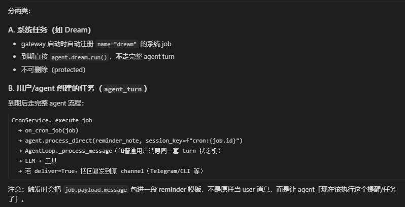

# 1 trading agent

## 1 memory

1. 内存上下文context
2. 持久性(偏好)memoru

### 1.1 WorkMemory

session中的上下文, 但是不会包含上一个

 

### 1.2 PersistentMemory 的 4 种 `memory_type`

由agent触发写入

| 类型      | 含义（约定用法）         | 典型内容                                   |
| :-------- | :----------------------- | :----------------------------------------- |
| user      | 人的偏好/习惯            | 语言、风险偏好、报告格式                   |
| feedback  | 对 agent 行为的纠错/反馈 | 「别用某某数据源」「回测要写 attribution」 |
| project   | 项目/标的上下文（默认）  | BTC 策略约定、当前研究主题                 |
| reference | 可复用的参考知识         | 公式、口径、外部资料摘要                   |


```
class WorkspaceMemory:
    """Shared workspace state between tools during a single agent run.

    Attributes:
        run_dir: Current run directory path.
        counters: Tool invocation counters.
    """

    run_dir: Optional[str] = None
    counters: Dict[str, int] = field(default_factory=dict)

```


### 1.3 上下文压缩:

****

**自动检测+agent触发**

每轮 `stream_chat` 之前按 token 压力逐级升级（默认阈值 `TOKEN_THRESHOLD=40000`，估算约 `len(json)//4`）：

| 层                  | 触发                 | 做法                                                        | 成本              |
| :------------------ | :------------------- | :---------------------------------------------------------- | :---------------- |
| L1 microcompact     | `> 0.5 × 阈值`       | 只动 `role=tool`：保留最近 3 条，更早的改成 `"[cleared]"`   | 无 API            |
| L2 context_collapse | `> 0.7 × 阈值`       | 除最近 6 条外，长文本（>2400）保留头 900 + 尾 500，中间折叠 | 无 API            |
| L3 auto_compact     | `> 阈值`             | LLM 结构化摘要，保留约 20k token 的尾部消息                 | 调一次 `llm.chat` |
| L4 compact 工具     | 模型主动调 `compact` | 走同一套 `_auto_compact`，可带 `focus_topic`                | 同 L3             |
| L5 迭代更新         | 本轮已压缩过         | 用 `_previous_summary` + 新 turns 做 update，不从零摘要     | 同 L3             |

```
L3 重建后的 messages：

[system 原样]

[user: 摘要 + WorkspaceMemory.to_summary() + "**Continue from the summary**…"]

[tail: 按 20k token 预算留下的最近消息]

→ _fix_tool_pairs 修孤儿 tool_call/tool_result

```


**同时workmemory会**

L3 压缩后的 handoff——旧对话被摘要掉后，把这份短状态再贴回去，避免丢掉 **`run_dir` / 工具使用痕迹, 让模型知道当前工作目录、已经调过哪些工具几次**

## 2 loop

### 2.1 loop上下文

直接tool拼接

### 2.2 停止

无tool调用, 

### 2.3 同session不同loop

只包含上一次的last message, 不含tool use


## 3 session

包含: 每次发消息写一条 user；跑完写一条 assistant（最终总结文本，不含中间 tool_calls）

喂给下一轮 LLM 时：`_convert_messages_to_history` 只留 user/assistant 文本，约 12k 字符预算，丢掉 tool 轨迹。

边界： 换一个新 session / 新开聊天 → 这份 history 不会自动带过去，只拿上面这份精简 history。

### 3.1 载入

agent tool选择载入


# 2 Nanobot

1 memory


## 2 loop

### 2.1 loop上下文

直接tool拼接

### 2.2 停止

无tool调用, 

### 2.3 同session不同loop

直接暴力拼接,


## 4 scheduler

agent设置定时任务, scheduler触发定时任务: agent.run?or agent.dream.run

 

```
用户: "每20分钟提醒我休息"
  ↓
Agent 调 cron(action="add", message="...", every_seconds=1200)
  ↓
写入 workspace/cron/jobs.json
  ↓
[gateway 常驻运行中]
  ↓
CronService 定时器到期
  ↓
on_cron_job(job)
  ↓
agent.process_direct("The scheduled time has arrived... Reminder: ...")
  ↓
完整 AgentLoop (BUILD → RUN → SAVE → RESPOND)
  ↓
deliver=True → 发到原 channel
```

