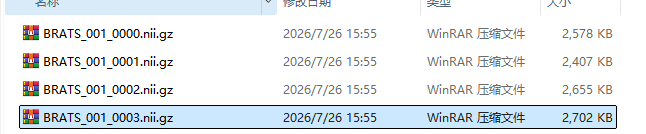
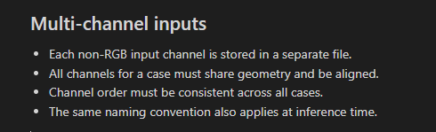
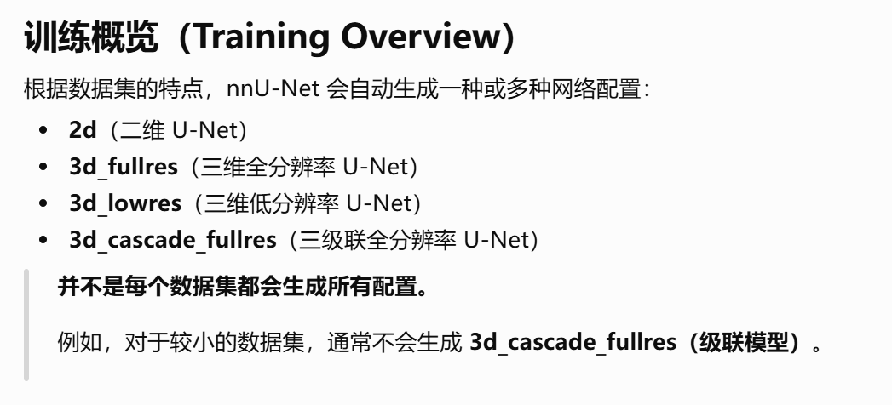

# nnUnet`汇报

## 0 研究背景和痛点

> ***\*While semantic segmentation algorithms enable image analysis and quantification in many applications, the\**** ***\*design of respective specialized solutions is non-trivial and highly dependent on dataset properties and hardware conditions.\**** 
>
> Despite the recent success of deep learning-based segmentation methods, their applicability to specific image analysis problems of end-users is often limited. 
>
> The task-specific design and configuration of a method requires high levels of expertise and experience, with small errors leading to large drops in performance1
>
> this process can be cumbersome and successful configurations from one dataset rarely translate to another.
>
> Purely empirical optimization of the co-dependent design choices in this high-dimensional space,amplifies both the number of required training cases, as well as compute resources,
>
> the application of AutoML to new datasets comes with its own set of required expert choices, 

1. 针对具体任务设计相应的专用解决方案并不是一件简单的事情，而且高度依赖于数据集特性以及硬件条件。


## 1 核心方法

> ***\*The key design choices in this process are modeled as\**** ***\*a set of fixed parameters, interdependent rules and empirical decisions.\****
>
> ***\*automatically configures itself,including preprocess\*******\*ing, network architecture, training and post-processing for any new task.\**** 
>
> 1. Collect design decisions that do not require adaptation between datasets and identify a robust common configuration  (‘fixed parameters’).
>
> 2. For as many of the remaining decisions as possible, formulate explicit dependencies between specific dataset properties(‘dataset fingerprint’) and design choices (‘pipeline fingerprint’) in the form of heuristic rules to allow for almost-instant adaptation on application (‘rule-based parameters’).
> 3. Learn only the remaining decisions empirically from the data(‘empirical parameters’).
>
> The  automatic  configuration  of nnU-Net is  based  on  distilling  domain  knowledge  into  three  parameter groups: fixed, rule-based and empirical parameters. 
>
> First, we collect all design choices that do not require adaptation between datasets (such as setting the architecture template to‘U-Net-like’) and optimize their joint configuration for robust generalization on our development datasets. Second, for as many of the remaining decisions as possible, we formulate explicit dependencies between the‘dataset fingerprint’, a standardized dataset representation comprising key properties such as image size, voxel spacing information or class ratios, and the‘pipeline fingerprint’, which we define as the entirety of choices being made during method design. The dependencies are modeled in the form of interdependent heuristic rules that allow for almost-instant execution upon application. 
>
>  By default,nnU-Net generates three different U-Net15 configurations: a two-dimensional (2D)U-Net,a 3D U-Net that operates at full image resolution and a 3D U-Net cascade in which the first U-Net operates on downsampled images, and the second is trained to refine the segmentation maps created by the former at full resolution. 


## 2 实验设计与结果

> The general applicability of nnU-Net’s automated configuration is  demonstrated in  13  additional  datasets. Altogether, we report results on 53 segmentation tasks, covering an unprecedented diversity of target structures, image types and image properties. As an open source tool, nnU-Net can simply be trained out-of-the box to generate state-of-the-art segmentations.
>
> nnU-Net  is  a  deep  learning-based  segmentation  method  that automatically  configures  itself,  including  preprocessing,  network architecture, training and post-processing for any new task in the biomedical domain. Exemplary segmentation results generated by nnU-Net for a variety of datasets are shown in Fig. 1
>
> applying it to 11 international biomedical image segmentation challenges comprising 23 different datasets and 53 segmentation tasks6,14,16–24   (https://cremi.org/). This selection comprised a variety of organs, organ substructures, tumors, lesions and cellular structures in 2D as well as 3D images acquired by magnetic resonance imaging (MRI), computed tomography (CT), electron microscopy (EM) and fluorescence microscopy (FM).
>
> Despite its generic nature, nnU-Net outperforms most existing segmentation solutions, even though the latter were specifically optimized for the respective task. Overall, nnU-Net sets a new state of the art in 33 of 53 target structures and otherwise shows performances on par with or close to the top leaderboard entries.
>
> We extracted the data fingerprints of 23 biomedical segmentation datasets. 
>
> pipeline settings either directly or indirectly depend on the data fingerprint under potentially complex relations.
>
> The original nnU-Net configuration showed the best generalization and ranked first when results from all datasets were aggregated.
>
>  nnU-Net was developed with a focus on the Dice coefficient as performance metric. 


## 3 讨论与启发

> Novel ideas can easily be integrated into nnU-Net and thus tested across multiple datasets without having to manually reconfigure the entire pipeline for each dataset. 
>
> To demonstrate the benefits of this approach, and also to support some of the core design choices made in nnU-Net, we systematically tested the performance of common pipeline variations by systematically modifying some of nnU-Net’s fixed parameters. The following variations were evaluated across ten different datasets and were compared against our default nnU-Net configuration, which served as a baseline in these experiments (Fig. 6
>
>  nnU-Net sets a new state of the art for the majority of tasks on which it was evaluated, outperforming all respective specialized processing pipelines.
>
> The strong performance of nnU-Net is not achieved by a new network architecture,loss function or training scheme (hence the name nnU-Net,‘no new net’),but by systematizing the complex process of manual method configuration, which was previously addressed either by cumbersome manual tuning or purely empirical approaches with practical limitations.
>
> performance lies in the distillation of knowledge from a large pool  of datasets into a set of robust design choices that translates into powerful inductive biases when applied to a new dataset, a
>
> nnU-Net is a new segmentation tool that can be applied out-of-the-box, without requiring any user intervention, to a large range of biomedical imaging datasets and is thus ideal for users who require access to semantic segmentation methods and do not have the expertise, time, data or computing resources required to adapt existing solutions to their problem
>
> There are several possible reasons for why performance improvements based on architectural extensions proposed by the literature may not translate to all datasets in the domain. 
>
> that“the exact architecture is not the most important determinant in getting a good solution” (ref. 10) and is supported by nnU-Net’s state-of-the-art results based on a strong method configuration in combination with a simple U-Net architecture. 
>
>  compared to nnU-Net, for which, due to the underlying use of guiding principles, each design decision can be traced back either to certain dataset properties or a limited set of empirical experiments. 
>
>  For example, nnU-Net was developed with a focus on the Dice coefficient as performance metric. Some tasks, however, might require highly domain-specific target metrics for evaluation,  which  could  influence  method  design.  
>
>   Also,  dataset properties that are yet unconsidered could exist, which may cause suboptimal segmentation performance. One example is the synaptic cleft segmentation task of the CREMI challenge (https://cremi.org). While nnU-Net’s performance is highly competitive (rank 6 of 39),
>
> manual adaptation of the loss function, as well as EM-specific preprocessing,  may be  necessary to  surpass  state-of-the-art  performance34. In principle, there are two means of handling cases that are not yet sufficiently covered by nnU-Net. For potentially recurring cases, nnU-Net’s heuristics could be extended accordingly; 
>
> 

你的框架已经很好了，但是现在的问题是**摘录原文太多，缺少汇报逻辑**。论文汇报一般不是翻译论文，而是回答四个问题：

1. 为什么提出 nnU-Net？
2. 它到底做了什么？
3. 为什么有效？
4. 它有哪些局限？

下面是一版更适合 **15~20 分钟组会/论文汇报** 的版本。

------


能够针对任何新的分割任务自动完成配置的方法，包括预处理、网络结构、训练流程以及后处理。

# 数据集

| 模态        | 最适合观察    | 图像特点                 |
| ----------- | ------------- | ------------------------ |
| FLAIR       | 水肿（Edema） | 抑制脑脊液，水肿突出     |
| T1w         | 解剖结构      | 灰白质对比清晰           |
| T1Gd (t1gd) | 强化肿瘤      | 注射造影剂后活跃肿瘤变亮 |
| T2w         | 液体、水肿    | 水和脑脊液高信号         |





> 这几句话是在说明 **nnU-Net 多通道（Multi-channel）输入数据的组织规则**。对于 BraTS 这样的 MRI 数据集尤其重要。
>
> ------
>
> ### 1. Multi-channel inputs
>
> > **多通道输入**
>
> 这里的 **Channel（通道）** 不是 RGB 的 R/G/B，而是**不同模态（Modality）的医学图像**。
>
> 例如 BraTS：
>
> | Channel | MRI 模态    |
> | ------- | ----------- |
> | 0       | FLAIR       |
> | 1       | T1w         |
> | 2       | T1Gd (T1ce) |
> | 3       | T2w         |
>
> 所以一个病例（Case）实际上有四个输入。
>
> ------
>
> ### 2. Each non-RGB input channel is stored in a separate file.
>
> > **每个非 RGB 输入通道都必须单独存放在一个文件中。**
>
> 例如一个病例：
>
> ```text
> Case001_0000.nii.gz   ← FLAIR
> Case001_0001.nii.gz   ← T1
> Case001_0002.nii.gz   ← T1Gd
> Case001_0003.nii.gz   ← T2
> ```
>
> 而**不是**：
>
> ```text
> Case001.nii.gz
> ```
>
> 里面放四个模态。
>
> nnU-Net 默认要求：
>
> > **一个通道 = 一个文件**
>
> ------
>
> ### 3. All channels for a case must share geometry and be aligned.
>
> > **同一个病例的所有通道必须具有相同的几何信息，并且彼此已经配准（Aligned）。**
>
> 这是最重要的一条。
>
> 例如：
>
> FLAIR：
>
> ```text
> 240 × 240 × 155
> ```
>
> T1：
>
> ```text
> 240 × 240 × 155
> ```
>
> T2：
>
> ```text
> 240 × 240 × 155
> ```
>
> 不仅尺寸相同，还要求：
>
> - Spacing（体素间距）相同
> - Origin（原点）相同
> - Direction（坐标方向）相同
>
> 也就是说：
>
> **第 (100,120,80) 个体素，在四个模态中必须对应同一个解剖位置。**
>
> 例如：
>
> ```
> FLAIR
>         肿瘤
>          ●
> 
> T1
>         肿瘤
>          ●
> 
> T2
>         肿瘤
>          ●
> ```
>
> 如果没有配准：
>
> ```
> FLAIR
>          ●
> 
> T1
>       ●
> 
> T2
>             ●
> ```
>
> 同一个体素位置实际上对应不同组织，网络就无法学习正确的特征。
>
> ------
>
> ### 4. Channel order must be consistent across all cases.
>
> > **所有病例的通道顺序必须保持一致。**
>
> 例如你定义了：
>
> ```json
> "channel_names": {
>     "0": "FLAIR",
>     "1": "T1w",
>     "2": "t1gd",
>     "3": "T2w"
> }
> ```
>
> 那么所有病例都必须遵循：
>
> ```
> 0000 → FLAIR
> 0001 → T1
> 0002 → T1Gd
> 0003 → T2
> ```
>
> 不能出现：
>
> Case001：
>
> ```
> 0000 = FLAIR
> 0001 = T1
> 0002 = T1Gd
> 0003 = T2
> ```
>
> 而 Case002：
>
> ```
> 0000 = T2
> 0001 = FLAIR
> 0002 = T1
> 0003 = T1Gd
> ```
>
> 虽然文件数量一样，但语义已经完全乱了，模型会把不同模态当成同一种输入，训练效果会很差。
>
> ------
>
> ### 5. The same naming convention also applies at inference time.
>
> > **推理（Inference）时也必须使用相同的命名规则。**
>
> 训练时：
>
> ```
> imagesTr/
> 
> BraTS_001_0000.nii.gz
> BraTS_001_0001.nii.gz
> BraTS_001_0002.nii.gz
> BraTS_001_0003.nii.gz
> ```
>
> 预测时（`imagesTs`）：
>
> ```
> imagesTs/
> 
> Test001_0000.nii.gz
> Test001_0001.nii.gz
> Test001_0002.nii.gz
> Test001_0003.nii.gz
> ```
>
> 不能写成：
>
> ```
> Test001_FLAIR.nii.gz
> Test001_T1.nii.gz
> ```
>
> 或者
>
> ```
> Test001.nii.gz
> ```
>
> 因为 nnU-Net 是通过文件名后缀 `_0000`、`_0001`、`_0002`、`_0003` 来识别每个通道的。
>
> ------
>
> ### 总结
>
> 对于一个包含四种 MRI 模态的病例，nnU-Net 期望的数据组织方式如下：
>
> ```text
> BraTS_001_0000.nii.gz   ← FLAIR
> BraTS_001_0001.nii.gz   ← T1w
> BraTS_001_0002.nii.gz   ← T1Gd
> BraTS_001_0003.nii.gz   ← T2w
> BraTS_001.nii.gz        ← 分割标签（仅训练集）
> ```
>
> 训练时，nnU-Net 会自动将这四个文件按通道顺序读取，并堆叠成一个四维张量：
>
> ```text
> (C, Z, Y, X)
> =
> (4, 155, 240, 240)
> ```
>
> 其中：
>
> - `C=4`：四个 MRI 模态（四个输入通道）
> - `Z`：切片数（深度）
> - `Y`、`X`：每张切片的高和宽
>
> 随后，这个四通道张量会作为模型的输入，让网络综合四种模态的信息完成肿瘤分割。


# 数据指纹和预处理


# 训练




# Best model


```

```


> # 它会评估什么？（What It Evaluates）
>
> 运行该命令后，nnU-Net 不只是简单比较单个模型，而是会自动测试三类方案。
>
> ## 1. 单个模型（Individual Configurations）
>
> 首先分别计算每个模型的验证集性能，例如：
>
> | 配置       | Dice  |
> | ---------- | ----- |
> | 2d         | 0.895 |
> | 3d_fullres | 0.912 |
> | 3d_lowres  | 0.903 |
>
> 这一步就是比较每个模型单独使用时的效果。
>
> ------
>
> ## 2. 模型集成（Pairwise Ensembles）
>
> 接着，它会尝试**两两组合模型**进行集成（Ensemble）。
>
> 例如：
>
> ```
> 2d + 3d_fullres
> ```
>
> 或者：
>
> ```
> 3d_fullres + 3d_lowres
> ```
>
> 甚至：
>
> ```
> 2d + 3d_lowres
> ```
>
> nnU-Net 会将两个模型输出的**预测概率图（Probability Maps）**进行融合，再计算最终分割结果。
>
> 例如：
>
> ```
> 2d 输出：
> 
> 背景：0.1
> 肿瘤：0.9
> 
> 3D 输出：
> 
> 背景：0.2
> 肿瘤：0.8
> 
> ↓
> 
> 平均概率
> 
> 背景：0.15
> 肿瘤：0.85
> ```
>
> 很多情况下，两个模型互补后，Dice 会比任何单个模型更高。
>
> 如果**不想进行模型集成**，可以使用：
>
> ```
> --disable_ensembling
> ```
>
> 这样只比较单个模型。


# 推理


# 3. 后处理（Postprocessing）

最后，nnU-Net 会自动测试不同的后处理策略。

文档中提到：

> **connected-component removal**

即**连通域去除（Connected Component Removal）**。

例如，模型预测出了很多孤立的小噪点：

```
□□□□□

□□■□□

□□□□□

□□□□■

□□□□□□□□
```

后处理会删除这些过小的连通区域，只保留真正的大目标：

```
□□□□□

□□□□□

□□□□□

□□□□□

□□□□□□□□
```

这样通常能够减少误检，提高 Dice 分数。


按我们前面核对过的实现，笔记建议改成下面这样（已纠错并补全）。

---

## MoME / MoME+ 结构笔记（修订版）

### 输入

|           | MoME                        | MoME+                                            |
| --------- | --------------------------- | ------------------------------------------------ |
| 输入      | **单模态**一张图            | **多模态**（可缺），最多 T1/T1ce/T2/FLAIR        |
| 进 Expert | **同一张图送给所有 Expert** | 先经 **Dispatch**，再 **每通道进对应 Expert**    |
| 缺模态    | 不适用（样本本身单模态）    | soft Dispatch 用已有模态 **体素加权** 补缺失通道 |

- 多模态并不是「原始模态直接只进指定 Expert」而不经处理；有模态时对应通道原样进对应 Expert，缺失通道是补全后再进。
- MoME 的「所有 Expert 同吃一张图」依赖各 Expert **预训练专长**，差异不在输入，而在权重。

---

### Expert

- 每个 Expert 对应一种 MRI 模态（MoME：T1/T1ce/T2/FLAIR/**DWI** 共 5；MoME+：前 4 种）。
- 结构均为 **nnU-Net**（独立 UNet 实例并列，非一个大网络内切块）。
- 先在对应模态上 **预训练**，再与融合/门控联合微调。
- 输出：多尺度分割预测（深监督）；浅层 encoder 特征另供 Gating 使用。

---

### Dispatch（仅 MoME+）

- 实现类：**`ClsDispatchNet`**（小 MLP），不是 3D Conv 版 `DispatchNetwork`。
- 输入：模态可用性向量 \(\mathbf{m}\)。
- 输出：\(N\times N\) soft 分配矩阵 → 对多通道图像做 \(\tilde{x}_i=\sum_j W_{ij}x_j\)。
- 先验：**有模态 → 行锁 one-hot（保真）**；**无模态 → 用可用模态 soft 加权补通道**。
- 本质：强度空间的可学习线性混合，非生成式补全。

---

### Gating（Hierarchical Gating）

**不要写「每一层 Decoder 都做特征融合」**——实现不是这样。

更准确：

- 另有一个 **nnU-Net 门控网络**（与 Expert 并列）。
- 输入：原图 + 各 Expert **第一层 encoder 浅层特征**。
- 在 **多个分辨率** 上输出 voxel-wise 门控图。
- 融合对象：各 Expert **同尺度分割输出**（软加权求和），不是 Decoder 中间特征逐层融合。
- 不是选一个最好 Expert（硬路由），而是全体参与、互补融合。

---

### Loss / 训练要点（可补）

- Dice + CE + 深监督（跟 nnU-Net）。
- 课程学习：\(L=(1-r)^2 L_{\text{expert}}+(1-(1-r)^2)L_{\text{fusion}}\)，\(r=\text{epoch}/N\)。  
  **早期偏 Expert 专精，后期偏融合协作**（方向勿写反）。
- \(L_{\text{expert}}\)：打在对应模态 Expert **原始输出**上（不乘 gate）。  
  \(L_{\text{fusion}}\)：打在门控加权后的最终输出上。

---

### 评估（可补）

- 主指标：**Dice**；按 image / task / dataset 及模态、病灶类型分组报告。

---

### 一句话总览

```
MoME:   单图 → 全体 Expert(同输入) → Hierarchical Gating(多尺度输出加权)
MoME+:  多通道(可缺) → Dispatch补通道 → 各Expert吃对应通道 → Gating融合
```

---

### 你原笔记对照改法

| 原文                              | 建议                                                         |
| --------------------------------- | ------------------------------------------------------------ |
| 单模态送入所有 Expert             | 保留 ✓                                                       |
| 多模态送入指定 Expert             | 改为：Dispatch 后各通道进对应 Expert；缺则 soft 补全后再进   |
| Expert 学一种模态 + nnU-Net       | 保留 ✓；可补预训练                                           |
| 每一层 Decoder 做 voxel-wise 融合 | 改为：多尺度上对 Expert **输出**做门控加权，非 Decoder 内特征融合 |


1. **完成猴脑 MRI 数据分析 pipeline**：基于标准脑图谱完成配准，并使用 AFNI 进行 rs-fMRI 分析，使用 MRtrix3 完成 DTI 纤维追踪与结构连接分析
2. **继续深入学习MRI相关知识:** 深入学习 MRI 成像原理与神经影像分析方法; 提升 AFNI、MRtrix3、3D Slicer 等工具使用能力; 持续阅读相关领域论文等等
3. **探索深度学习与神经影像结合:** 学习更多学习医学影像深度学习方法和应用
