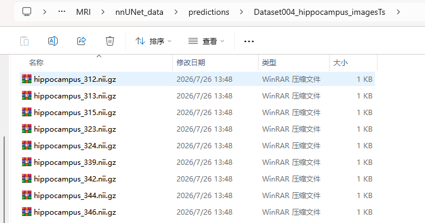

# **MRI（磁共振成像）**

**核心成像原理**

- 磁场对齐：人体内富含氢原子，在强磁场（如 1.5T/3.0T）中顺着磁场方向排列。  
- 射频脉冲激发：发射特定频率无线电波，氢原子吸收能量发生共振。  
- 信号释放（弛豫）：切断脉冲后氢原子恢复初始状态，释放电磁信号。  
- 图像重建：计算机收集信号并重建出图像。


### 2. 常见MRI

                    MRI
                     │
      ┌──────────────┼──────────────┐
      │              │              │
      T1/T2 MRI      fMRI          Diffusion MRI
     (结构MRI)      (功能MRI)        (扩散MRI)
          │              │              │
          │              │              │
    FreeSurfer        AFNI/FSL      MRtrix3/FSL


#### （1）结构成像（Structural MRI）

主要观察脑组织的解剖结构。

- **T1 加权像（T1WI）**\

  看的是"**静止水分子的磁化恢复过程**"。

  - 解剖结构最清晰
  - 灰质、白质对比明显
  - 常用于脑萎缩、皮层厚度、体积测量（如 ADNI 最常见）
  - **T1 + Gadolinium:** 注射钆造影剂（Gadolinium）后的 T1,注射造影剂后**活跃肿瘤变亮**

  > | 组织        | 恢复速度 |
  > | ----------- | -------- |
  > | 脂肪        | 快       |
  > | 白质        | 较快     |
  > | 灰质        | 较慢     |
  > | 脑脊液(CSF) | 非常慢   |

- **T2 加权像（T2WI）**

  **T2 测的是氢核横向失相。**

  - 水信号亮
  - 易观察水肿、炎症、囊肿等病变

- **FLAIR（Fluid Attenuated Inversion Recovery）**

  - 在 **T2 基础上抑制脑脊液（CSF）信号**
  - 更容易发现脑室周围白质病变、脑梗死、脱髓鞘病灶等

****

#### （2）功能/生理成像（Functional & Physiological MRI）

主要观察脑组织的功能活动或微观特性。

##### ① DWI（Diffusion Weighted Imaging，弥散加权成像）

研究**水分子的扩散速度**。

特点：

- 通常使用 **3 个扩散梯度方向**
- 计算 **ADC（Apparent Diffusion Coefficient）**
- 常用于急性脑梗死、肿瘤等疾病诊断

> **关注的是：水分子扩散有多快？**

↓

##### ② DTI（Diffusion Tensor Imaging，弥散张量成像）

 研究**水分子扩散方向**。

特点：

- 至少 **6 个扩散方向**（实际研究一般 30～64 个以上）
- 建立水分子扩散的三维张量（Tensor）
- 可计算：
  - **FA（Fractional Anisotropy）**：各向异性程度
  - **MD（Mean Diffusivity）**：平均扩散率
- 能进行：
  - 白质纤维束追踪（Fiber Tractography）
  - 神经连接分析（Structural Connectivity）

> **关注的是：水分子主要朝哪个方向扩散？**

因此：

```
MRI
 └── Diffusion MRI（扩散MRI）
      ├── DWI（扩散速度）
      └── DTI（扩散方向 + 白质纤维）
```

------

##### ③ fMRI（Functional MRI，功能磁共振）

通过**血氧变化（BOLD）**研究**脑区是否正在工作**。

原理：

- 基于 **BOLD（Blood Oxygen Level Dependent）** 信号
- 神经元活动增强 → 局部血流增加 → 血氧变化 → MRI 检测到信号变化

主要应用：

- 脑功能定位
- 静息态功能连接（rs-fMRI）
- 脑网络分析

> **关注的是：哪些脑区正在活动？**

****

> - **T1/T2（结构像）**：利用氢质子的**纵向弛豫（T1）**或**横向弛豫（T2）**时间差异成像。它们看的是组织的“化学成分”和“水分多少”。
>
> - **DWI/DTI（弥散像）**：利用氢质子的**微观随机运动（布朗运动）**来成像。它们看的是水分子的“位移范围”。
>
> 为了让你一目了然，我们先给这四者做一个**终极定位**，再详细拆解：
>
> - **MRI（常规磁共振）**：看**解剖结构**（大脑长什么样，有没有长肿瘤）。
> - **fMRI（任务态功能磁共振）**：看**大脑功能动态**（你动手指或看东西时，哪些脑区被“点亮”）。
> - **静息态fMRI（rs-fMRI）**：看**大脑功能网络**（你躺着发呆时，哪些脑区之间在“打电话”）


#### 3. 常规 MRI 与 fMRI 的本质区别（结构 vs 功能）

- **常规 MRI（如T1/T2加权像）**：拍的是**“照片”**。它利用氢质子在磁场中的弛豫时间不同，区分脑灰质、白质、脑脊液和肿瘤。它回答的问题是：**“这里有什么？”**（解剖位置、大小、形态）。
- **fMRI（功能性MRI）**：拍的是**“电影”**（动态变化）。它不直接看脑组织本身，而是看**血氧水平依赖（BOLD）信号**。原理是：脑区被激活时，局部耗氧增加，血流会过度补偿，导致脱氧血红蛋白减少，磁化率改变，信号增强。它回答的问题是：**“这个脑区在工作吗？”**


#### 4. 任务态 fMRI 与 静息态 fMRI 的区别（“做任务” vs “发呆”）

这两者都是fMRI，都测BOLD信号，但实验设计完全不同：

- **任务态 fMRI（Task-fMRI）**：
  - **操作**：让受试者在扫描仪里执行特定任务（如手指敲击、看恐怖图片、做数学题）。
  - **分析**：对比“任务期”和“休息期”的BOLD信号差异，找出**与任务正相关的脑区**。
  - **回答的问题**：**“哪个脑区负责这个特定功能？”**（例如，运动皮层、视觉皮层、语言中枢的定位）。常用于**术前功能区定位**，防止手术损伤重要区域。
- **静息态 fMRI（Resting-state fMRI， rs-fMRI）**：
  - **操作**：让受试者**闭眼放空、不做任何任务**，仅维持清醒状态扫描（通常5-10分钟）。
  - **分析**：不找“激活”点，而是分析全脑各个脑区的BOLD信号在**时间上的同步性（低频振荡）**。如果两个不相邻的脑区，信号波形几乎完全同步（正相关），就认为它们之间存在**功能连接**。
  - **回答的问题**：**“大脑的各个功能模块是如何协同工作的？”**。它发现了著名的**默认模式网络（DMN）**——即大脑在无所事事时，反而活跃度最高的内省、回忆、展望区域。


# 数据结构

最常见的是下面几种。

| 格式      | 扩展名            | 是否常见 | 用途                |
| --------- | ----------------- | -------- | ------------------- |
| **DICOM** | `.dcm`            | ⭐⭐⭐⭐⭐    | 医院原始 MRI 数据   |
| **NIfTI** | `.nii`、`.nii.gz` | ⭐⭐⭐⭐⭐    | 科研最常用格式      |
| Analyze   | `.hdr` + `.img`   | ⭐⭐       | NIfTI 前身          |
| MINC      | `.mnc`            | ⭐        | 加拿大 MNI 开发     |
| NRRD      | `.nrrd`           | ⭐⭐       | ITK、3D Slicer 常用 |
| MGH/MGZ   | `.mgh` `.mgz`     | ⭐⭐       | FreeSurfer 使用     |

------

### 1. DICOM（医院格式）

```
001.dcm
002.dcm
003.dcm
...
```

医院扫描完成后通常得到的是：

一张 MRI 切片 = 一个 DICOM 文件。

例如

```
Patient/
    IM0001.dcm
    IM0002.dcm
    ...
    IM0180.dcm
```

特点：

- 保存影像
- 保存患者信息
- 保存扫描参数
- 保存设备型号

里面有很多 Metadata：

```
PatientName
PatientID
Age
Sex
Scanner
TE
TR
FlipAngle
...
```

医院几乎都是 DICOM。

------

### 2. NIfTI（科研标准）

```
brain.nii
```

```
brain.nii.gz
```

这是 ADNI、FSL、AFNI、SPM 最常见的格式。

一个 `.nii` 文件就包含：

```
整个三维 MRI
```

例如：

```
256 × 256 × 170
```

直接就是一个 3D Volume。

而不是很多张图片。

------

NIfTI 里面包含：

```
Header
+
Voxel Data
```

Header：

```
尺寸
spacing
方向
数据类型
affine矩阵
```

Voxel：

```
[x,y,z]
```

每一个 voxel 一个灰度值。


#### Header

```
[jiangyi@idp01 3subs]$ mrinfo sub001_shcl_T1w.nii.gz 
************************************************
Image name:          "sub001_shcl_T1w.nii.gz"
************************************************
  Dimensions:        208 x 300 x 320
  Voxel size:        0.8 x 0.8 x 0.8
  Data strides:      [ 1 2 3 ]
  Format:            NIfTI-1.1 (GZip compressed)
  Data type:         unsigned 16 bit integer (little endian)
  Intensity scaling: offset = 0, multiplier = 1
  Transform:                    1           0           0       -82.8
                                0      0.9997     0.02482      -122.3
                                0    -0.02482      0.9997      -134.2
  comments:          TE=3.4;Time=124752.593
```


**intensity**

```
Intensity scaling: offset = 0, multiplier = 1
```

```
存储值  ──× multiplier + offset──>  实际影像强度
```


**为什么需要这个机制？**

因为 MRI 图像的数据可能不是直接用 `float32` 保存的。例如某个 MRI 原始强度可能是：

```
0
125.3
842.7
1523.6
...
```

如果直接保存成 `float32`，当然可以，但文件会比较大。

于是可以把它压缩成整数：

```
原始/实际值       存储值
0.0       →       0
125.3     →       1253
842.7     →       8427
1523.6    →       15236
```

然后在 NIfTI header 里记录：

```
multiplier = 0.1
offset = 0
```


 


------

### 3. `.nii.gz`

其实就是

```
nii
+
gzip压缩
```

例如

```
brain.nii
↓

gzip

↓

brain.nii.gz
```

读取时：

```python
import nibabel as nib

img = nib.load("brain.nii.gz")
```

不用手动解压。

ADNI 大多数下载下来都是：

```
nii.gz
```

------

## ADNI 下载下来是什么？

ADNI 官网通常提供：

```
DICOM
```

或者已经转换好的

```
NIfTI (.nii)
```

很多论文都会先：

```
DICOM

↓

dcm2niix

↓

NIfTI

↓

FSL/SPM/AFNI
```

因此科研流程通常是：

```text
MRI Scanner
      │
      ▼
DICOM (.dcm)
      │
      ▼
dcm2niix
      │
      ▼
NIfTI (.nii/.nii.gz)
      │
      ▼
Preprocessing
（SPM/FSL/AFNI）
      │
      ▼
Machine Learning / Deep Learning
```

------


# 数据维度

NIfTI 不只是 3D，还可以表示不同维度的数据：

| 数据              | 维度   | 示例                             |
| ----------------- | ------ | -------------------------------- |
| 结构 MRI（T1/T2） | **3D** | `256×256×170`                    |
| fMRI              | **4D** | `64×64×40×240`（240 个时间点）   |
| DTI               | **4D** | `128×128×70×64`（64 个扩散方向） |
| 分割标签          | **3D** | 每个 voxel 是类别编号            |
| 概率图            | **3D** | 每个 voxel 是概率值              |


------

# 数据处理

## 1. 预处理（Preprocessing）

预处理（Preprocessing）是指对原始 MRI 数据进行标准化处理，以减少不同扫描设备、受试者和采集条件带来的差异，为后续分析和模型训练提供统一的数据。

典型流程如下：

```text
原始MRI（DICOM/NIfTI）
        │
        ▼
格式转换（DICOM → NIfTI）
        │
        ▼
质量检查（Quality Control）
        │
        ▼
Bias Field Correction（偏置场校正）
        │
        ▼
Skull Stripping（去颅骨）
        │
        ▼
Spatial Registration（空间配准）
        │
        ▼
Spatial Normalization（空间标准化）
        │
        ▼
Resampling（重采样）
        │
        ▼
Intensity Normalization（强度归一化）
        │
        ▼
ROI 提取 / 特征提取 / 深度学习
```

------

### （1）格式转换（Format Conversion）

将医院采集的 **DICOM（`.dcm`）** 转换为科研常用的 **NIfTI（`.nii` / `.nii.gz`）**。

常用工具：

- dcm2niix
- MRIConvert

------

### （2）质量检查（Quality Control，QC）

检查 MRI 是否存在：

- 图像缺失
- 运动伪影（Motion Artifact）
- 扫描错误
- 信噪比过低

低质量图像通常需要剔除。

------

### （3）偏置场校正（Bias Field Correction）

由于 **MRI 磁场不均匀**，同一种组织可能出现亮度渐变。

例如：

```text
真实组织

████████████

采集后

███▆▅▄▃▂
```

偏置场校正用于消除这种低频亮度变化。

常用算法：

- N3
- N4 Bias Field Correction（最常用）

------

### （4）去颅骨（Skull Stripping）

去除脑组织以外的区域，例如：

- 头皮
- 头骨
- 眼球
- 脂肪

仅保留脑组织（Brain Extraction）。

常用工具：

- BET（FSL）
- HD-BET
- SynthStrip
- FreeSurfer

------

### （5）空间配准（Registration）

将不同时间、不同受试者或不同模态的 **MRI 对齐**。

包括：

- 刚性配准（Rigid）
- 仿射配准（Affine）
- 非线性配准（Non-linear）

常见配准目标：

- 同一患者不同时间扫描
- T1 与 PET 配准
- T1 与 DTI 配准

------

### （6）空间标准化（Spatial Normalization）

将所有脑部映射到统一标准空间（Template）。

最常见的是：

- MNI152 标准脑

这样**不同受试者**的大脑位置具有**一致的空间坐标**，方便群体分析。

------

### （7）重采样（Resampling）

统一**图像分辨率**（Voxel Spacing）。

例如：

```text
原始：

0.94 × 0.94 × 1.20 mm

↓

统一：

1 × 1 × 1 mm
```

这样所有样本具有一致尺寸。

------

### （8）强度归一化（Intensity Normalization）

由于不同 MRI 设备没有**统一的灰度标准**，同一种组织在不同扫描中的灰度可能不同。

常见方法：

- Min-Max Normalization
- Z-score Normalization
- White Matter Normalization

目的：

提高不同数据之间的一致性。

------

### （9）ROI 提取（Region of Interest）

根据研究目标提取特定脑区。

例如阿尔茨海默病研究常关注：

- 海马（Hippocampus）
- 杏仁核（Amygdala）
- 皮层（Cortex）
- 脑室（Ventricle）

ROI 可用于：

- 体积计算
- 厚度分析
- 深度学习输入

------

## 2. 预处理评估

**fMRI（尤其 resting-state fMRI）预处理结果是有评估标准的**，但是不像分类任务有一个固定 accuracy，而是通过多个 QC（Quality Control）指标综合判断。

对于你现在的 **猕猴 rs-fMRI + AFNI 预处理**，通常从以下几个方面评价：

------

### 2.1. 头动（Motion Quality）——最重要指标之一

因为 fMRI 对运动非常敏感。

常用指标：

#### (1) Framewise Displacement (FD)

衡量每个 TR 相对于前一个 TR 的头动。

常见标准：

| FD         | 评价     |
| ---------- | -------- |
| < 0.2 mm   | 很好     |
| 0.2–0.5 mm | 可以接受 |
| >0.5 mm    | 需要谨慎 |
| >1 mm      | 通常剔除 |

很多人脑 rs-fMRI 研究：

- FD > 0.5 mm 的 volume censor
- 平均 FD 作为组间协变量

你的结果：

```
motion limit              : 0.2
average motion (per TR)   : 0.0086
max motion displacement   : 0.0395
TRs censored              : 0
```

非常好。

相当于：

```
平均 FD ≈ 0.009 mm
最大 FD ≈ 0.04 mm
```

对于猴子来说也是非常低的。

------

### 2.2. Censor比例（Scrubbing）

看多少时间点因为质量问题被删除。

你的：

```
TRs censored : 0
fraction censored : 0
```

评价：

| censor比例 | 评价         |
| ---------- | ------------ |
| < 5%       | 很好         |
| 5-20%      | 可以接受     |
| >20%       | 数据质量下降 |

你的：

```
0%
```

很好。

------

### 2.3. Outlier检测

AFNI 使用：

```
3dToutcount
```

检查异常 voxel。

你的：

```
average outlier frac : 0.000317
num TRs above limit : 0
```

说明：

没有明显异常 volume。

一般：

| outlier fraction | 评价   |
| ---------------- | ------ |
| <1%              | 很好   |
| 1-5%             | 可接受 |
| >5%              | 有问题 |

你的：

```
0.03%
```

非常好。

------

### 2.4. TSNR（Temporal Signal-to-Noise Ratio）

衡量时间稳定性：

[
TSNR=\frac{mean(signal)}{std(signal)}
]

一般：

| TSNR    | 评价 |
| ------- | ---- |
| <50     | 较差 |
| 50-100  | 一般 |
| 100-200 | 较好 |
| >200    | 很好 |

你的：

```
TSNR average = 225
```

属于较高。

不过注意：

不同扫描仪、序列、猴子脑都会影响 TSNR。

所以最好：

```
subject之间比较
```

而不是套固定阈值。

------

### 2.5. 配准质量（Registration Quality）

对于猴子数据，这个比人脑更重要。

需要检查：

#### T1 ↔ EPI

也就是：

```
结构像
 ↓
功能像空间
```

常见指标：

Dice coefficient：

[
Dice=\frac{2|A∩B|}{|A|+|B|}
]

经验：

| Dice    | 评价     |
| ------- | -------- |
| >0.8    | 很好     |
| 0.6-0.8 | 可以     |
| <0.6    | 需要检查 |

你的：

```
anat/EPI mask Dice = 0.699
```

属于：

```
可接受
```

但对于猴子，我会建议人工检查。

------

#### Anatomy ↔ Template

你的：

```
anat/template Dice =0.808
```

很好。

说明：

猴子个体 T1 到模板空间：

```
比较成功
```

------

### 2.6. 空间平滑（Spatial Smoothness）

检查：

```
FWHM
```

一般：

human rs-fMRI:

```
4-8 mm
```

比较常见。

但是：

猴子：

```
1.5 mm voxel
```

通常不会像人脑那样大幅 smoothing。

你的：

```
FWHM = 0 0 0
```

需要确认。

可能原因：

1. 没有执行 blur

例如：

```
3dBlurToFWHM
```

没有运行。

1. AFNI summary 没有正确估计

看：

```
blur estimates (ACF)
```

即可。

------

### 2.7. Temporal Signal Quality

还会看：

#### DVARS

表示相邻 volume 信号变化。

#### Global signal

例如：

```
GS variance
```

#### GCOR

你的：

```
GCOR=0.0059
```

较低。

通常：

过高可能说明：

- motion残留
- 生理噪声
- global artifact

------

### 2.8. 对你这个数据的总体评价

按照常见 rs-fMRI QC：

| 指标               | 你的结果 | 评价             |
| ------------------ | -------- | ---------------- |
| TR数量             | 296      | 可以             |
| 扫描时间           | 9.8 min  | 很好             |
| 平均FD             | 0.0086   | 优秀             |
| 最大FD             | 0.0395   | 优秀             |
| Censor             | 0%       | 优秀             |
| Outlier            | 0        | 优秀             |
| TSNR               | 225      | 很好             |
| Anat/EPI Dice      | 0.699    | 可接受，需要检查 |
| Anat/template Dice | 0.808    | 很好             |

所以：

> **这个数据的时间质量（motion、noise）非常好，主要需要确认空间配准质量。**

------

对于你后续做：

- resting-state functional connectivity (FC)
- ALFF/fALFF
- ReHo
- ICA
- seed-based FC
- DTI tractography

真正影响结果最大的通常不是 motion，而是：

```
个体T1
 ↓
EPI
 ↓
猴子标准atlas
```

这个空间链路。

你现在的下一步建议是：

1. 在 AFNI/SUMA 里检查：

```
anat_final
+
epi_final
+
template
```

overlay 是否重合。

1. 查看：

```
@ss_review_driver
```

生成的 QC 页面。

1. 对多个猴子 subject 比较：

```
FD
TSNR
Dice
```

而不是只看单个 subject。

对于猴子影像，**QC报告 + 配准可视化通常比单个数字更重要。**


## 3 纤维束追踪

你这份是 **MRtrix3 DWI（扩散MRI）纤维束追踪（tractography）结果摘要**。和 rs-fMRI 不一样，DWI 的质量评价重点不是 motion / TSNR，而是：

1. **扩散数据质量（FA、MD等指标）**
2. **FOD建模质量**
3. **纤维追踪参数是否合理**
4. **生成的streamlines是否符合解剖规律**
5. **是否进行了定量分析（connectome / tract metrics）**

我们逐项看。

------

## 1. FA / MD 指标

你的：

```
fa:
mean     0.230415
median   0.169518
std      0.172394
min      0.00576064
max      0.976811
count    74797
```

FA：

Fractional Anisotropy（分数各向异性）

范围：

[
0 \le FA \le 1
]

代表水分子扩散方向性：

| FA      | 含义                      |
| ------- | ------------------------- |
| 0       | 完全随机扩散（灰质、CSF） |
| 0.2-0.4 | 白质常见范围              |
| >0.6    | 高度一致纤维束            |
| 接近1   | 非常强方向性（极少见）    |

你的：

```
mean FA = 0.23
median FA =0.17
```

对于**猴子全脑 mask**：

这个值是合理的。

原因：

你的统计应该包含：

```
白质
+
灰质边界
+
部分CSF
```

不是纯白质。

如果只看：

```
white matter mask
```

通常 FA 会更高：

猴子：

```
0.3-0.6
```

左右。

------

MD：

```
mean MD = 0.000831 mm²/s
median =0.000629
```

Mean diffusivity：

平均扩散率。

典型单位：

[
10^{-3} mm^2/s
]

所以：

你的：

```
0.831 ×10^-3 mm²/s
```

非常正常。

大致：

| 组织 | MD             |
| ---- | -------------- |
| 白质 | 0.6-0.9 ×10^-3 |
| 灰质 | 0.8-1.0 ×10^-3 |
| CSF  | >2 ×10^-3      |

所以：

```
FA正常
MD正常
```

说明扩散模型没有明显异常。

------

# 2. Fiber tracking 参数分析

你的 command：

```
tckgen fod_wm_norm.mif tracks_200000.tck
```

核心：

使用：

```
iFOD2
```

算法。

------

## iFOD2是什么？

MRtrix默认推荐算法。

全称：

```
second-order Integration over Fiber Orientation Distributions
```

相比传统：

```
Deterministic tracking
```

它：

- 使用 FOD 分布
- 支持 crossing fibers
- 概率追踪

适合：

猴子脑这种：

- 体积小
- 纤维交叉多

的数据。

------

# 3. FOD cutoff

你的：

```
-cutoff 0.05
```

这是重要参数。

意思：

当 FOD amplitude：

<0.05

停止追踪。

经验：

| cutoff    | 效果           |
| --------- | -------------- |
| 0.02-0.04 | 容易产生假纤维 |
| 0.05      | 常用           |
| 0.08-0.1  | 更严格         |

你的：

```
0.05
```

合理。

------

# 4. seed策略

你的：

```
-seed_image seed_wm.mif
```

说明：

不是全脑随机seed。

而是在：

```
white matter mask
```

里面播种。

优点：

减少：

- CSF streamlines
- 灰质噪声

这是比较标准的方法。

------

# 5. 生成数量

你的：

```
-select 200000
```

最终：

```
count: 200000
```

即：

20万条streamlines。

常见：

| 规模 | 用途           |
| ---- | -------------- |
| 100k | 快速分析       |
| 1M   | connectome     |
| 10M  | 高精度结构连接 |

20万：

对于猴子脑：

完全可以。

因为猴脑比人大很多小：

```
200k-1M
```

都常见。

------

# 6. 长度限制

你的：

```
-minlength 3
-maxlength 150
```

单位：

mm

也就是说：

丢弃：

<3mm

或者：

> 150mm

对于猴子：

合理。

猴脑：

最长连接：

几十到100mm左右。

------

# 7. 最大转角

```
max_angle:45
```

表示：

两个step之间最大转角。

经验：

| angle | 特点     |
| ----- | -------- |
| 30°   | 严格     |
| 45°   | 常用     |
| 60°   | 容易弯曲 |

你的：

```
45°
```

标准。

------

# 8. step size

```
step_size:0.531 mm
```

MRtrix默认：

通常：

voxel size ×0.5

例如：

如果DWI：

1mm voxel：

step:

0.5mm

所以：

正常。

------

# 9. lmax

```
lmax:8
```

这是球谐阶数。

FOD：

[
l=8
]

表示角度分辨率。

通常：

| lmax  | 用途       |
| ----- | ---------- |
| 6     | 低         |
| 8     | 常用       |
| 10-12 | 高角分辨率 |

你的：

```
8
```

合理。

------

# 10. 一个容易忽略的问题：200000条 ≠ 真实纤维数量

`tckgen`生成的是：

```
streamlines
```

不是：

真实axon数量。

例如：

```
10000条streamlines
```

不代表：

10000根神经纤维。

它只是：

数学采样。

------

# 纤维追踪有没有评价标准？

有，但和fMRI不同。

主要看：

------

## ① FOD质量

检查：

```
fod_wm_norm.mif
```

是否：

- 白质区域连续
- crossing fiber明显
- 没有大量噪声

工具：

MRview:

```
mrview fod_wm_norm.mif
```

打开：

FOD glyph。

------

## ② Streamline可视化

最重要。

检查：

```
tracks_200000.tck
```

例如：

mrview：

```
mrview dwi.mif \
-track.load tracks_200000.tck
```

看：

正常：

- 胼胝体
- 皮质脊髓束
- 视辐射
- 前额叶连接

应该连续。

异常：

- 飘到脑外
- 大量短纤维
- 穿过CSF

------

## ③ SIFT / SIFT2校正

这是很多研究会做的。

问题：

tractography存在：

```
long fibers bias
```

MRtrix：

```
tcksift2
```

调整streamline权重。

例如：

```
tcksift2 tracks.tck fod.mif weights.txt
```

如果后续做：

connectome：

建议做。

------

## ④ 解剖合理性

比如：

计算：

```
tck2connectome
```

生成：

脑区连接矩阵。

然后看：

- 是否符合已知猴脑网络
- 是否出现异常连接

------

# 综合评价你的DWI结果

| 项目           | 结果          | 评价     |
| -------------- | ------------- | -------- |
| FA mean        | 0.23          | 正常     |
| MD             | 0.83×10^-3    | 正常     |
| 算法           | iFOD2         | 推荐     |
| FOD            | WM normalized | 合理     |
| seed           | white matter  | 合理     |
| streamlines    | 200k          | 适合猴脑 |
| cutoff         | 0.05          | 标准     |
| max angle      | 45°           | 标准     |
| min/max length | 3-150mm       | 合理     |
| lmax           | 8             | 合理     |

整体：

> **这是一套比较标准的 MRtrix3 猕猴 DWI tractography 参数，暂时没有明显异常。**

下一步建议不是继续调参数，而是做两个 QC：

1. **mrview 可视化检查 tck 是否贴合白质**
2. **使用 tck2connectome + 猴子atlas生成结构连接矩阵**

因为最终科研价值通常来自：

```
DWI
 ↓
FOD
 ↓
tractography
 ↓
connectome
 ↓
网络分析
```

而不是单纯生成 `.tck` 文件。你后面如果要和 rs-fMRI 联合分析，这一步会和 resting-state FC 做结构-功能连接（structural-functional coupling）。

> 纤维束追踪（tractography）属于 **DTI / dMRI（diffusion MRI）分析流程**，它的质量评价标准和 rs-fMRI 不一样。核心不是看运动和 TSNR，而是看：
>
> 1. **扩散数据质量**
> 2. **张量/纤维模型质量**
> 3. **空间配准质量**
> 4. **追踪结果合理性**
>
> 对于你现在的**猕猴 DTI 数据 + MRtrix3**流程，可以按下面评估。
>
> ------
>
> ### 1. 原始 DWI 数据质量
>
> 首先检查 diffusion acquisition：
>
> 常见字段：
>
> ```text
> b-value
> b-vector
> number of directions
> voxel size
> number of shells
> ```
>
> 例如：
>
> ```text
> b=0
> b=1000
> b=3000
> 64 directions
> ```
>
> 方向数量影响纤维估计：
>
> | 方向数 | 评价 |
> | ------ | ---- |
> | <30    | 较差 |
> | 30-60  | 一般 |
> | 60-100 | 较好 |
> | >100   | 优秀 |
>
> 猴子脑比较小，通常需要更高空间分辨率，所以方向数和b值很关键。
>
> ------
>
> ### 2. 头动和eddy correction
>
> DTI 对运动也非常敏感。
>
> 典型 MRtrix/FSL 流程：
>
> ```
> raw DWI
>  |
>  |-- dwidenoise
>  |
>  |-- mrdegibbs
>  |
>  |-- topup
>  |
>  |-- eddy
>  |
>  |-- bias correction
>  |
>  |-- response estimation
>  |
>  |-- FOD
>  |
>  |-- tractography
> ```
>
> 重点看：
>
> #### Eddy QC
>
> 检查：
>
> - motion correction
> - eddy current correction
> - susceptibility distortion correction
>
> FSL 会输出：
>
> ```
> eddy_quad
> ```
>
> 里面有：
>
> - average movement
> - outlier slices
> - residuals
>
> 标准：
>
> | 指标           | 建议 |
> | -------------- | ---- |
> | 平均运动 <1 mm | 很好 |
> | outlier <5%    | 较好 |
>
> ------
>
> ### 3. Diffusion tensor指标评价
>
> 如果使用 DTI model：
>
> 会生成：
>
> #### FA（Fractional Anisotropy）
>
> 最经典指标。
>
> 范围：
>
> [
> 0-1
> ]
>
> 表示方向性：
>
> | FA   | 含义       |
> | ---- | ---------- |
> | 0    | 各向同性   |
> | 1    | 高度方向性 |
>
> 白质：
>
> ```
> FA ≈ 0.3-0.8
> ```
>
> 例如：
>
> 胼胝体：
>
> FA高
>
> 灰质：
>
> FA低
>
> 检查：
>
> - FA map 是否连续
> - 白质是否清晰
>
> ------
>
> #### MD（Mean Diffusivity）
>
> 平均扩散率：
>
> 表示水分子扩散程度。
>
> 异常区域可能：
>
> - 水肿
> - 损伤
> - 脱髓鞘
>
> ------
>
> ### 4. FOD质量（MRtrix重点）
>
> 现在更推荐：
>
> #### CSD (Constrained Spherical Deconvolution)
>
> 流程：
>
> ```
> DWI
> 
> ↓
> 
> Response function
> 
> ↓
> 
> FOD
> 
> ↓
> 
> tractography
> ```
>
> 检查：
>
> #### FOD overlay
>
> 看：
>
> - corpus callosum
> - internal capsule
> - optic tract
>
> 是否：
>
> - 连续
> - 方向正确
>
> 如果 FOD 出现：
>
> ```
> 断裂
> 异常尖峰
> 随机方向
> ```
>
> 说明模型不好。
>
> ------
>
> ### 5. Tractography质量评价
>
> 纤维追踪不是简单看数量。
>
> 需要看：
>
> #### (1) Anatomical plausibility
>
> 最重要。
>
> 例如：
>
> 追踪：
>
> ##### Corpus callosum
>
> 应该：
>
> ```
> 左右半球连接
> ```
>
> ##### Corticospinal tract
>
> 应该：
>
> ```
> motor cortex
>  ↓
> internal capsule
>  ↓
> brainstem
> ```
>
> 如果出现：
>
> - 穿过脑室
> - 穿过灰质随机连接
> - 大量短纤维
>
> 说明有问题。
>
> ------
>
> #### (2) Streamline数量
>
> 例如：
>
> MRtrix：
>
> ```bash
> tckgen
> ```
>
> 输出：
>
> ```
> 10 million streamlines
> ```
>
> 但是：
>
> streamline多 ≠ 好。
>
> 因为：
>
> ```
> 100 million错误纤维
> <
> 1 million合理纤维
> ```
>
> 通常需要：
>
> SIFT / SIFT2 校正：
>
> ```bash
> tcksift2
> ```
>
> ------
>
> #### (3) Length distribution
>
> 检查纤维长度。
>
> 异常：
>
> 大量：
>
> ```
> <5 mm
> ```
>
> 可能是假纤维。
>
> ------
>
> #### (4) Endpoint distribution
>
> 检查终点。
>
> 正常：
>
> 终点应该集中：
>
> - cortex
> - subcortical structures
>
> 异常：
>
> 大量：
>
> - white matter内部结束
>
> ------
>
> ### 6. 配准质量（猴子最关键）
>
> 和 fMRI 类似。
>
> DTI：
>
> ```
> DWI native space
> 
> ↓
> 
> T1
> 
> ↓
> 
> Monkey template
> 
> ↓
> 
> Atlas
> ```
>
> 需要检查：
>
> #### FA ↔ T1
>
> #### FA ↔ atlas
>
> 例如：
>
> 把：
>
> ```
> Juna.Chimpanzee atlas
> Macaque template
> ```
>
> overlay。
>
> 评价：
>
> - 白质边界是否匹配
> - corpus callosum 是否正确
> - brainstem 是否对齐
>
> ------
>
> ### 7. 定量评价指标
>
> 如果做论文，一般报告：
>
> #### Tensor metrics
>
> 例如：
>
> ```
> mean FA
> mean MD
> ```
>
> #### Tract metrics
>
> 例如：
>
> 某条纤维：
>
> Corpus callosum:
>
> | 指标             |
> | ---------------- |
> | FA               |
> | MD               |
> | volume           |
> | streamline count |
> | length           |
>
> 例如：
>
> ```
> CST:
> FA = 0.52
> MD = 0.72×10^-3 mm²/s
> volume = xxx mm3
> ```
>
> ------
>
> ### 8. 一个完整的 MRtrix3 QC流程
>
> 你的猴子数据可以这样：
>
> ```
> DICOM
>  |
>  ↓
> BIDS dwi/
>  |
>  ↓
> dwidenoise
>  |
>  ↓
> mrdegibbs
>  |
>  ↓
> topup/eddy
>  |
>  ↓
> bias correction
>  |
>  ↓
> brain mask
>  |
>  ↓
> DTIFIT / DTI metrics
>  |
>  ↓
> response function
>  |
>  ↓
> FOD estimation
>  |
>  ↓
> tckgen
>  |
>  ↓
> tcksift2
>  |
>  ↓
> tract analysis
>  |
>  ↓
> QC
> ```
>
> QC：
>
> ```
> ✓ motion
> ✓ FA map
> ✓ FOD visualization
> ✓ registration
> ✓ tract anatomy
> ✓ streamline statistics
> ```
>
> ------
>
> 结合你目前的任务：
>
> > 猕猴标准图谱 → rs-fMRI → DTI追踪
>
> 我建议优先级：
>
> 1. **先确认 atlas 配准**
>
> 因为后面：
>
> - functional connectivity
> - tractography
>
> 都依赖这个空间。
>
> 1. DTI先做：
>
> ```
> FA map
> ↓
> FOD
> ↓
> whole brain tractography
> ↓
> 几个经典bundle验证
> ```
>
> 推荐先追：
>
> - Corpus callosum（胼胝体）
> - Corticospinal tract（皮质脊髓束）
> - Arcuate fasciculus（弓状束，如果猴子适用）
> - Optic radiation（视辐射）
>
> 这几个是判断猴子 DTI 流程是否正确的经典 sanity check。
>
> 
>
> 


# 深度学习任务

| 任务                   | 输入                 | 输出               | 常用模型                            |
| ---------------------- | -------------------- | ------------------ | ----------------------------------- |
| 分类（Classification） | T1 MRI               | AD / MCI / CN      | ResNet、DenseNet、ViT、Swin         |
| 分割（Segmentation）   | MRI                  | 海马、脑室、白质等 | U-Net、V-Net、nnU-Net               |
| 检测（Detection）      | MRI                  | 病灶位置           | Faster R-CNN、YOLO（较少用于脑MRI） |
| 配准（Registration）   | 两幅 MRI             | 对齐后的图像       | VoxelMorph                          |
| 重建（Reconstruction） | 欠采样 MRI           | 完整 MRI           | AutoEncoder、GAN、Diffusion         |
| 多模态融合             | MRI + PET + 临床信息 | 疾病诊断           | Transformer、多模态网络             |

