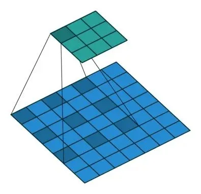
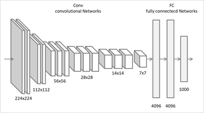
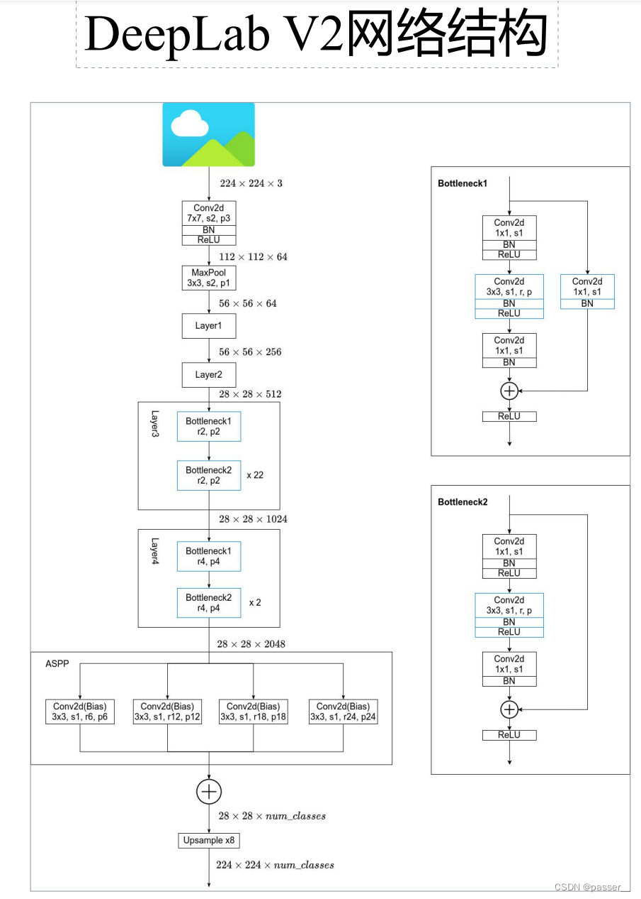
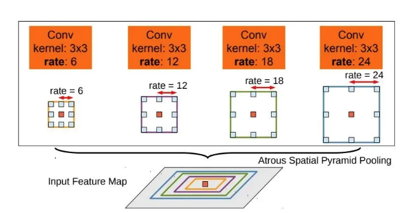
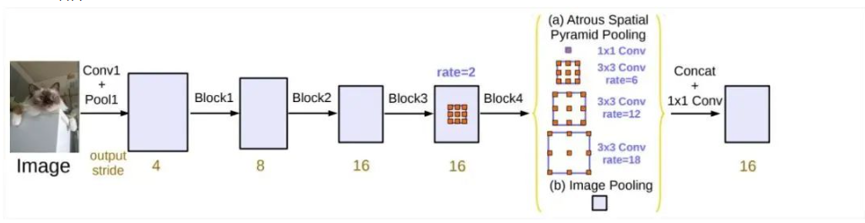

# 0 前置

> 参考:
>
> https://blog.csdn.net/passer__/article/details/127973143
>
> https://github.com/rulixiang/deeplab-pytorch/blob/master/v1/test_deeplabv1.py
>
> 

> 论文1：
>
> Semantic Image Segmentation with Deep Convolutional Nets and Fully Connected CRFs
>
> 于2014年12月22日提交到Arvix
>
> [https://arxiv.org/abs/1412.7062](https://link.zhihu.com/?target=https%3A//arxiv.org/abs/1412.7062)
>
> 论文2：
>
> DeepLab: Semantic Image Segmentation with Deep Convolutional Nets, Atrous Convolution, and Fully Connected CRFs
>
> 于2016年6月2日提交到Arxiv
>
> [https://arxiv.org/abs/1606.0091](https://link.zhihu.com/?target=https%3A//arxiv.org/abs/1606.00915)
>
> 主要贡献：
>
> - 使用了空洞卷积；
> - 提出了在空间维度上实现金字塔型的空洞池化atrous spatial pyramid pooling(ASPP)；
> - 使用了全连接条件随机场。

## 1 是什么

使用用大量空洞卷积, 在增大感受野的同时避免降低图像分辨率的操作，这样更容易恢复到原始分辨率大小。

## 2 为什么

因为传统的增大感受也都是通过加大conv的stride或者pool来实现的, 这会导致图像分辨率下降, pool更是会丢失图像细节

# 1 主要改进

## 1.1 空洞卷积

## 1.2 条件随机场CRF

#### 是什么

#### 为什么

虽然使用空洞卷积，但仍然存在着池化操作，并且卷积本身就会让边缘信息弱化一些，使用传统的CRF条件随机场能让模糊的边界信息更清晰，使图像更加精细化，相当于网络中的Decoder部分的功能。

# 2 网络结构

## 2.1 细节

1 基于VGG改写

2 去掉全连接

3 依旧是FCN网络主结构

# 4 **Deeplab_v2**

## 4.1 主要改进

1. ASPP模块
2. vgg替换为restnet

## 4.2 ASPP

## 4.3 网络结构

# 5 **deeplabv3**

## 4.1 主要改进

1. ASPP模块进行了额外的特征融合
2. vgg替换为了Xception
3. 移除CRF

