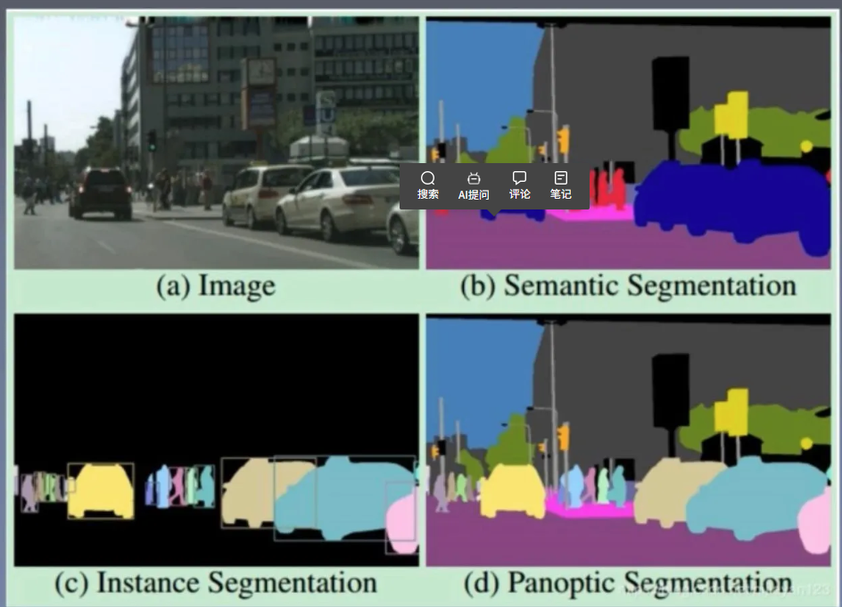
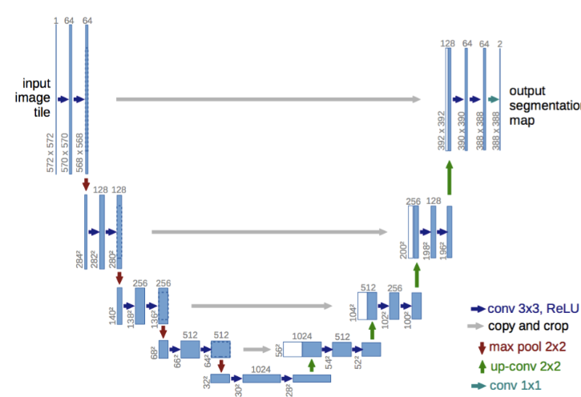
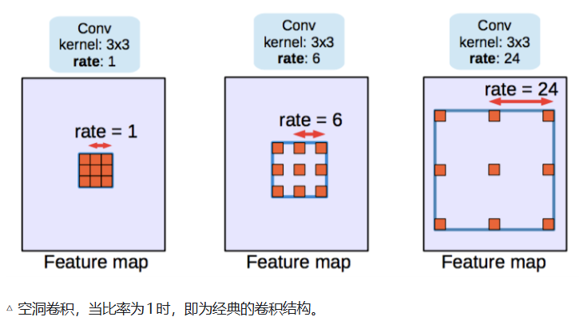
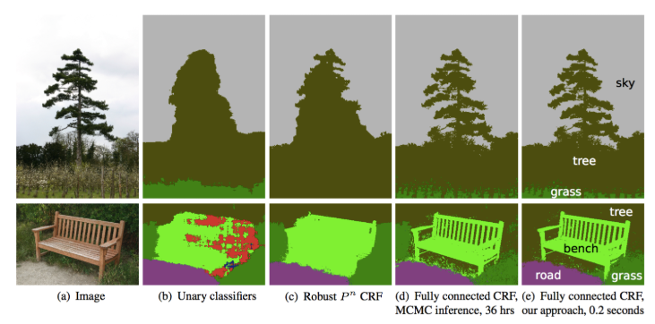

# 0 前置

> https://zhuanlan.zhihu.com/p/27794982
>
> 

## 1 是什么

语义分割是指对图片的像素进行分类. 有别于`实例分割`, 语义分割不能区分同一类的不同个体

- **实例分割**：实例分割就是对同一类的不同对象也要进行分割，比如说，语义分割会将车分为一类，人分为另一类。但是，实例分割不同的是，它会将车继续进行分类，每一辆车都是一个实例类别。
- **全景分割**：简单地来讲，全景分割是实例分割与语义分割的结合。**全景分割中的每一个像素点都会分成对应的语义标签和实例标签**。如果一种类别里有多个实例，会用不同的颜色进行区分，我们可以知道哪个像素属于哪个类中的哪个实例。

## 2 为什么

## 3 有哪些方法

传统的的语义分割采用CNN的全连接, 所以采用**图像块分类**; 但后来基本采用了不带全连接的 **完全卷积网络**. 使得分割图谱可以生成任意大小的图像，且与图像块分类方法相比，也提高了处理速度。

除此之外, **在分割问题中很难使用CNN网络的另一个问题是存在池化层。** 因为池化层会聚合背景, **丢弃位置信息**, 增大下一次卷积的感受野. 然而，语义分割方法需对类别图谱进行精确调整，因此需保留池化层中所舍弃的**位置信息**。

> **池化层放大感受野的代价**：通过把特征图缩小（例如 $256 \times 256 \rightarrow 128 \times 128$）来让后面的 3x3 卷积看清更大的范围，代价是**丢失了 75% 的空间细节**，导致边界模糊。

所以产生了两种不同的方法

### 3.1 **encoder-decoder结构**

编码器使用池化层逐渐缩减输入数据的空间维度，而解码器通过反卷积层等网络层逐步恢复目标的细节和相应的空间维度。从编码器到解码器之间，通常存在直接的信息连接，来帮助解码器更好地恢复目标细节。在这种方法中，一种典型结构为U-Net网络。

### 3.2  空洞卷积结构

不采用池化操作

### 3.3 条件随机场(Conditional Random Field，CRF)

**通常在后期处理中用于改进分割效果。**CRF方法是一种基于底层图像像素强度进行“平滑”分割的图模型，在运行时会将像素强度相似的点标记为同一类别。加入条件随机场方法可以提高1~2%的最终评分值。

