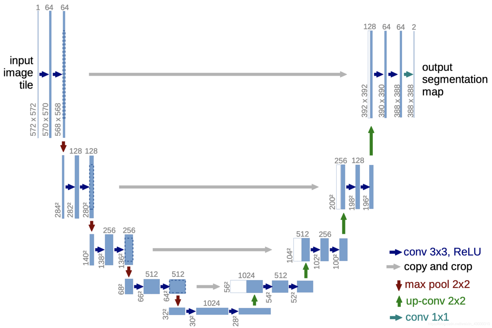
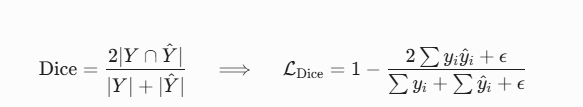
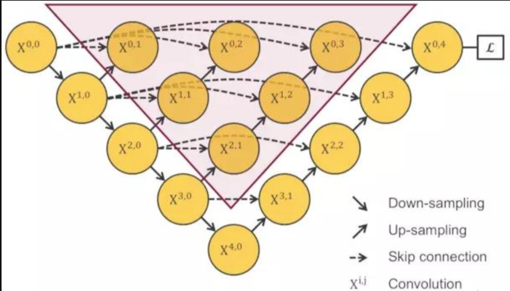

# 0 前置

> https://blog.csdn.net/AggressiveYu/article/details/151256739

## 1 是什么

Unet是一个U形的深度学习网络, 主要由卷积层, 下采样, 上采样和连接组成

## 2 为什么

1 为图像分割而生

2 不想传统分类模型得出结论,而是需要与原图一直的mask分割掩码图

3 


# 1 网络结构

整个像一个英文字母“U”。**左侧的编码器（收缩路径）** 和 **右侧的解码器（扩张路径）**。




三大核心组件:

1. 左侧的encoder: 负责特征提取
2. 右侧的decoder:  利用特征
3. 中间的跳跃连接: 

## 1.1 encoder

负责特征提取: 

主要是由: 

1. 两个3X3的卷积层和激活函数组成
2. 一个2X2的最大池化层, stride=2, size减半

**目的:**

1. 提取特征, 
2. 高级语义信息

**实现:** 

```python
class Encoder(nn.Module):
    def __init__(self, in_channels, out_channels):
        super(Encoder, self).__init__()
        self.doownConv1 = Conv(in_channels, out_channels, kernel_size=3, padding=1)
        self.doownConv2 = Conv(out_channels, out_channels, kernel_size=3, padding=1)
        self.maxpool = nn.MaxPool2d(kernel_size=2, stride=2)

    def forward(self, x):
        convOuput = self.doownConv2((self.doownConv1(x)))
        print(convOuput.shape)
        x = self.maxpool(convOuput)
        print(x.shape)
        return x, convOuput
```


## 1.2 decoder

将编码器提取的高级但粗糙的特征图**恢复到原始图像的尺寸**，并在此过程中实现像素级的精确定位。

主要由:

1. 2x2的上采样, 转置卷积
2. 3x3的卷积层+激活函数
3. 跳跃连接进行concat

**目的**

1. 恢复分辨率
2. 类似任务头

**实现**

```python
class Decoder(nn.Module):
    def __init__(self, in_channels, out_channels):
        super(Decoder, self).__init__()
        self.upTranConv = nn.ConvTranspose2d(in_channels, out_channels, kernel_size=2, stride=2, padding=0)
        self.upConv1 = Conv(out_channels*2, out_channels, kernel_size=3, padding=1)
        self.upConv2 = Conv(out_channels, out_channels, kernel_size=3, padding=1)

    def forward(self, x, encoderOutput):
        x = self.upTranConv(x)
        x = torch.cat((x, encoderOutput), dim=1)
        x = self.upConv2(self.upConv1(x))
        return x
```


> ### 1.2.1  转置卷积
>
> 普通卷积是通过滑动窗口把大图“变小/提炼”；转置卷积则是通过**插值填充（Padding）** 和 **重叠累加** 把小图“放大”。
>
> 第一步:  插值和填空
>
> 1. stride: 对像素的相邻元素之间进行填充0. stride-1
> 2. padding: 普通卷积是整体边缘填充0; 转置卷积是裁剪去padding个0
>
> 第二步: 移动
>
> 1. 用卷积核（Kernel）按 `stride=1` 进行标准的 2D 卷积运算。


## 1.3 跳跃连接 (Skip Connections) - U-Net 的精髓

**Encoder中、下采样之前的特征图**，直接“跳跃”到Decoder中，与**对应层级上采样之后的特征图进行拼接**。

**为什么:**

1. 获取来自**高分辨率**的encoder的特征和局部细节
2. 获取来自decoder的**高纬度特征**和全局细节


## 1.4 完整代码

```python
import torch

from torch import nn

class Conv(nn.Module):
    def __init__(self, in_channels, out_channels, kernel_size, padding):
        super(Conv, self).__init__()
        self.conv = nn.Conv2d(in_channels, out_channels, kernel_size=kernel_size, padding=padding)
        self.relu = nn.ReLU()

    def forward(self, x):
        x = self.relu(self.conv(x))
        return x

class concatNet(nn.Module):
    def __init__(self, in_channels, out_channels):
        super(concatNet, self).__init__()
        self.linear = nn.Linear(in_channels, out_channels)
        self.relu = nn.ReLU()

    def forward(self, x):
        x = self.relu(self.linear(x))
        return x


class Encoder(nn.Module):
    def __init__(self, in_channels, out_channels):
        super(Encoder, self).__init__()
        self.doownConv1 = Conv(in_channels, out_channels, kernel_size=3, padding=1)
        self.doownConv2 = Conv(out_channels, out_channels, kernel_size=3, padding=1)
        self.maxpool = nn.MaxPool2d(kernel_size=2, stride=2)

    def forward(self, x):
        convOuput = self.doownConv2((self.doownConv1(x)))
        # print(convOuput.shape)
        x = self.maxpool(convOuput)
        # print(x.shape)
        return x, convOuput

class Decoder(nn.Module):
    def __init__(self, in_channels, out_channels):
        super(Decoder, self).__init__()
        self.upTranConv = nn.ConvTranspose2d(in_channels, out_channels, kernel_size=2, stride=2, padding=0)
        self.upConv1 = Conv(out_channels*2, out_channels, kernel_size=3, padding=1)
        self.upConv2 = Conv(out_channels, out_channels, kernel_size=3, padding=1)

    def forward(self, x, encoderOutput):
        x = self.upTranConv(x)
        x = torch.cat((x, encoderOutput), dim=1)
        x = self.upConv2(self.upConv1(x))
        return x


class Unet(nn.Module):
    def __init__(self, in_channels, out_channels):
        super(Unet, self).__init__()
        self.encoder1 = Encoder(in_channels, 64)
        self.encoder2 = Encoder(64, 128)
        self.encoder3 = Encoder(128, 256)
        self.encoder4 = Encoder(256, 512)

        self.bottleConv1 = Conv(512, 1024, kernel_size=3, padding=1)
        self.bottleConv2 = Conv(1024, 1024, kernel_size=3, padding=1)

        self.decoder1 = Decoder(1024, 512)
        self.decoder2 = Decoder(512, 256)
        self.decoder3 = Decoder(256, 128)
        self.decoder4 = Decoder(128, 64)

        self.outputConv = Conv(64, out_channels, kernel_size=1, padding=0)
        
    def forward(self, x):
        x, encoderOutput1 = self.encoder1(x)
        x, encoderOutput2 = self.encoder2(x)
        x, encoderOutput3 = self.encoder3(x)
        x, encoderOutput4 = self.encoder4(x)

        x = self.bottleConv2(self.bottleConv1(x))

        print("shape of x: ", x.shape)
        print("shape of encoderOutput4: ", encoderOutput4.shape)
        x = self.decoder1(x, encoderOutput4)
        print("shape of x: ", x.shape)
        print("shape of encoderOutput3: ", encoderOutput3.shape)
        x = self.decoder2(x, encoderOutput3)
        print("shape of x: ", x.shape)
        print("shape of encoderOutput2: ", encoderOutput2.shape)
        x = self.decoder3(x, encoderOutput2)
        print("shape of x: ", x.shape)
        print("shape of encoderOutput1: ", encoderOutput1.shape)
        x = self.decoder4(x, encoderOutput1)

        x = self.outputConv(x)
        return x

if __name__ == "__main__":
    model = Unet(in_channels=3, out_channels=2)
    dummy_input = torch.randn(1, 3, 256, 256)
    output = model(dummy_input)
    print(output.shape)
```


# 2 训练

## 2.1 数据标签

U-Net 处理的是**像素级的预测**，因此其数据标签不是简单的分类标签（如 class_id），而是**与输入图像空间尺寸（H, W）完全一致的掩码图（Mask/Ground Truth）**。

- **二分类分割（Binary Segmentation）**：如背景 vs 前景（肿瘤、车道线、建筑物）。
  - **标签形状**：`[H, W]` 或 `[1, H, W]`
  - **像素取值**：`0`（背景）和 `1`（目标）的二值图（非 0 即 255 的单通道图片转化而来）。
- **多类别语义分割（Multi-Class Segmentation）**：如背景、器官A、器官B、器官C（共 N 类）。
  - **标签形状**：`[H, W]`
  - **像素取值**：每个像素位置的值为类别的类别索引号，取值范围为 `[0, N-1]`（例如 0 代表背景，1 代表肝脏，2 代表肾脏）。
- **多标签/多重重叠分割（Multi-Label Segmentation）**：一个像素可以同时属于多个类。
  - **标签形状**：`[N, H, W]`（$N$ 为类别数）
  - **像素取值**：每个通道是一个独立的二值 Mask（取值为 0 或 1）。

## 2.2 损失函数

| **损失函数**                                   | **适用场景**        | **说明与公式特点**                                           |
| ---------------------------------------------- | ------------------- | ------------------------------------------------------------ |
| **BCEWithLogitsLoss** *(Binary Cross Entropy)* | **二分类 / 多标签** | 将每个像素看作独立的二分类。内置 Sigmoid 激活函数，数值稳定性高。 |
| **CrossEntropyLoss**                           | **多类别**          | 将每个像素看作多分类问题。内置 Softmax 激活函数。输入模型预测 `[B, C, H, W]`，标签为 `[B, H, W]`（元素值为类索引）。 |

#### Dice Loss（Dice 损失）

基于 Dice 相似系数（Dice Coefficient），直接优化模型预测区域与 Ground Truth 的交并重叠度。




# 3 改进思路

> https://zhuanlan.zhihu.com/p/684221454
>
> https://zhuanlan.zhihu.com/p/1886374767931655663

## 0 改进方向

1. 替换卷积结构
2. 降低复杂度
3. 模型结构



