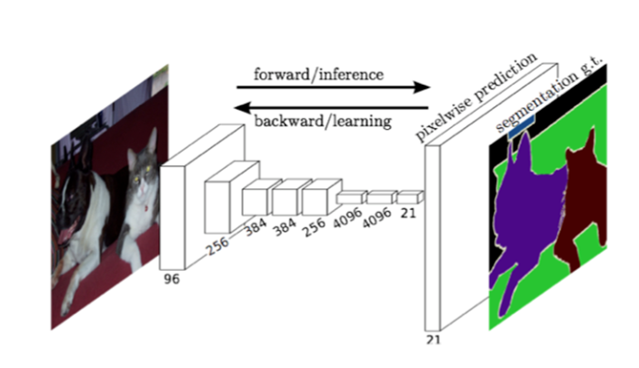
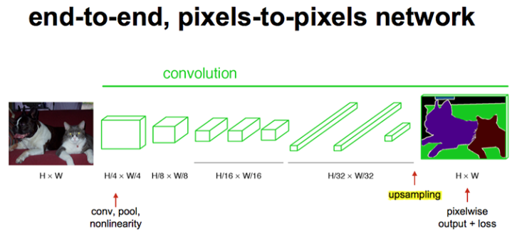
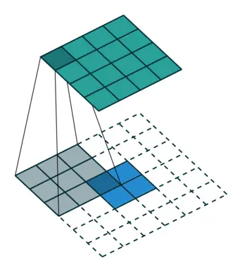
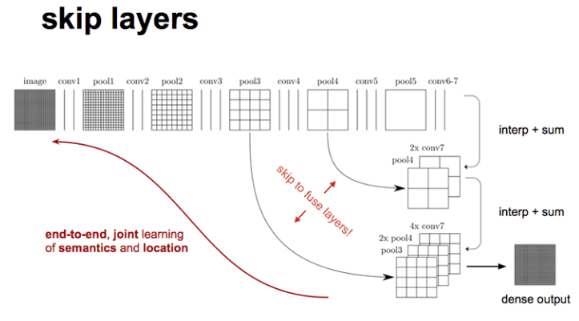

# 0 前置

> https://blog.csdn.net/wzk4869/article/details/129702031
>
> https://zhuanlan.zhihu.com/p/27794982

## 1 是什么

FCN主要实现采用CNN的方法, 实现对图像进行像素级的分类. 

经典的CNN图像分类是在卷积层后添加全连接网络+Softmax输出固定长度的特征向量, 进行分类
而FCN并没有采用全连接的方式, 而是使用对最后一层卷积的特征向量进行反卷积操作, 生成与输入图像相同尺寸(任意)的图像, 从而对每一个像素进行预测. 

这种操作, 既保留的全局的空间信息, 又对每一个像素进行了分类

## 2 为什么

**语义分割的主要矛盾:** 既需要全局信息的搞基语义信息进行语义分类, 有需要低级的是视觉信息进行准确分割

## 3 怎么做

1. 用全卷积替代了全连接
2. 为了弥补下采样操作造成的损失，使用了**反转卷积**的操作来恢复信息
3. 用**下采样之前的特征图与上采样之后的图片进行融合**这样可以指引上采样过程恢复到比较好的效果。即高低通道特征融合。恢复低级视觉信息。

# 1 网络结构

## 1.1卷积部分

FCN输入的图像是H*W大小，第一层pooling后变为原图大小的1/4，第二层变为原图大小的1/8，第五层变为原图大小的1/16，第八层变为原图大小的1/32（勘误：其实真正代码当中第一层是1/2，以此类推）。

经过多次卷积和pooling以后，得到的图像越来越小，分辨率越来越低。其中图像到 H/32∗W/32 的时候图片是最小的一层时，所产生图叫做heatmap热图 , 也就是我们需要的**高维特征图**

## 1.2 反卷积部分

得到高维特征的heatmap之后就是最重要的一步也是最后的一步对原图像进行**upsampling**，把图像进行放大、放大、放大，到原图像的大小。

最后的输出是1000张heatmap经过upsampling变为原图大小的图片，为了对每个像素进行分类预测label成最后已经进行语义分割的图像，

> 为什么是1000张?
>
> 最大数值描述（概率）作为该像素的分类

## 1.3 反卷积

## 1.4 skip layer

限于精度问题不能够很好地还原图像当中的特征，因此在这里向前迭代。把conv中的卷积核对上一次upsampling之后的图进行反卷积补充细节（相当于一个差值过程）

