> 参考:https://zhuanlan.zhihu.com/p/667801207

# 0 前置

## 1.1 主要贡献

1. prompt输入
2. 解决歧义的问题: 能够对含糊的指令做出响应，产生多个可能的分割结果
3. 数据标注策略
4. 多模态输入

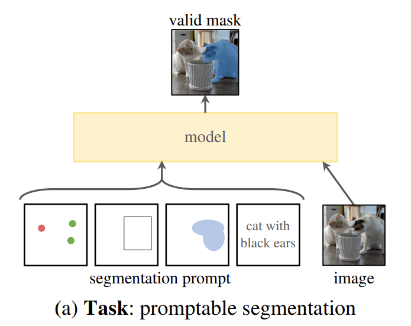

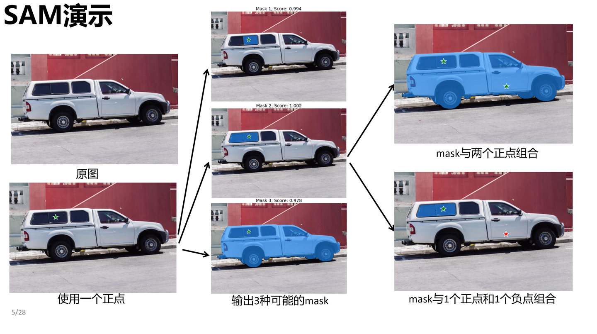

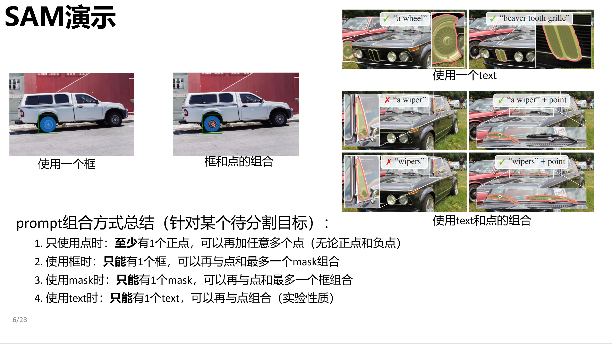

## 1.2 整体结构

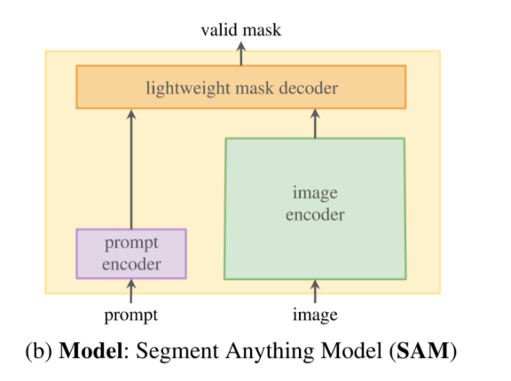

SAM的内部结构。模型由3个主要部分组成：提示词编码器、图像编码器和一个轻量级的掩码解码器。

# 2 细节

## 2.1 prompt encoder

### 1 prompt处理

这里的提示信息可以是mask、points、box或者是text，

如果是mask的话则使用卷积来进行表示，
如果是其余的三种提示词则使用位置编码的形式来进行表示，其中text可以通过clip一类的模型获取词嵌入

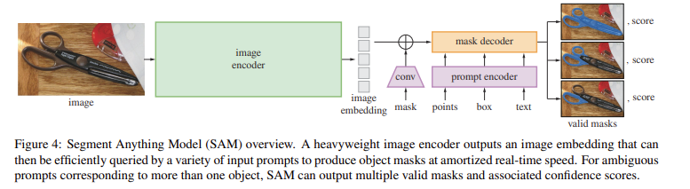

### 2 encoder

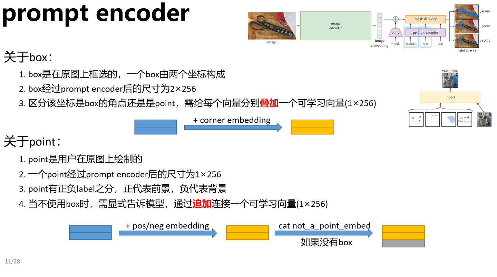

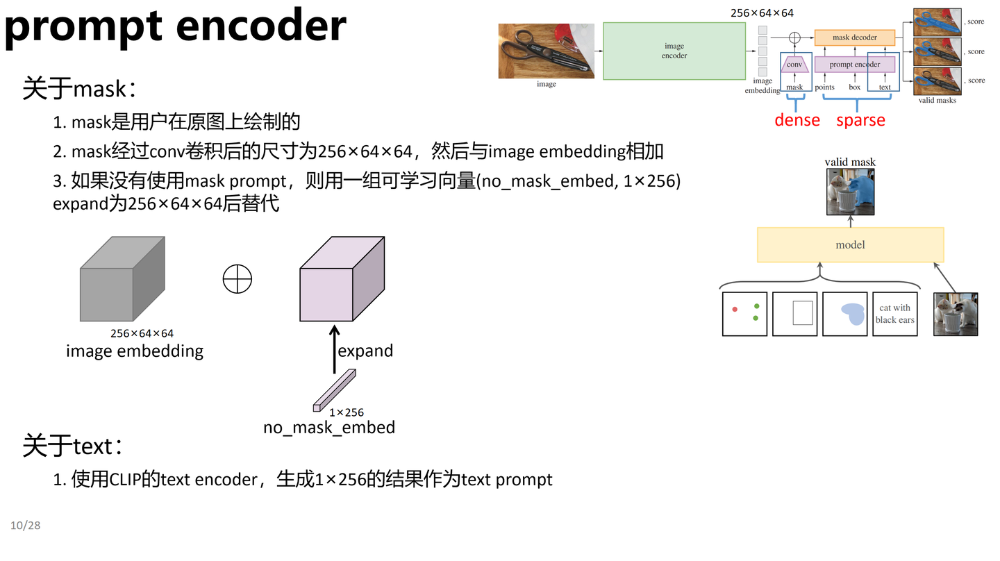

首先，mask提示允许我们直接在原像上指示感兴趣区域来引导模型。这些mask通过卷积操作被转换为与图像嵌入空间相匹配的特征，然后与图像嵌入相加结合，为模型提供分割的精确位置信息。如果没有使用mask提示，则用一组可学习向量(no_mask_embed, 1×256) expand为256×64×64后替代。

而文本提示，利用了CLIP的文本编码器，将描述性的语言输入转换为模型可以理解的嵌入向量。比如输入“黑耳朵的猫”，文本编码器就能将这些词转换为一个强大的特征描述，引导模型聚焦于具有这些特征的图像区域。

## 2.2 image encoder

### 1 图像预处理

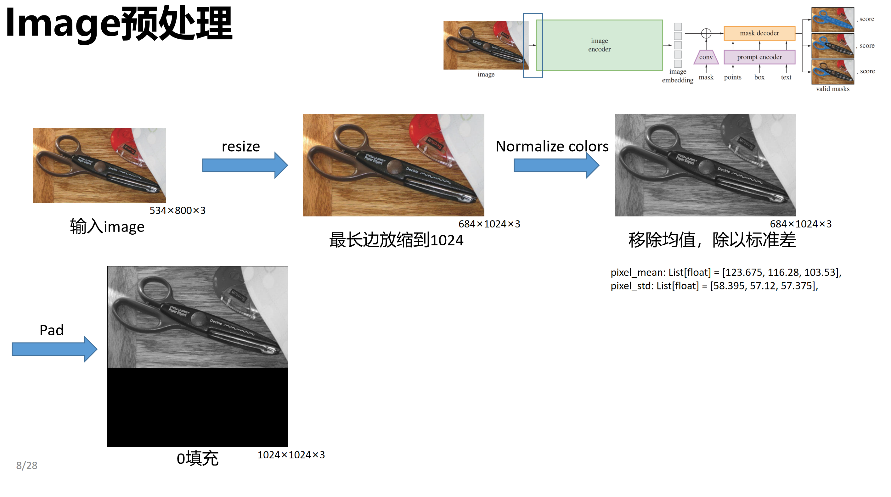

首先，我们以保持图像的宽高比的方式将图像最长边放缩到1024。

接下来是颜色归一化。通过从每个像素中减去平均值并除以标准差，颜色归一化的目的是为了统一不同图像的颜色范围，减少照明条件和设备差异对模型训练的影响，从而提高模型的泛化能力和加快训练速度。

最后，我们会应用填充（Padding），以确保所有的图像都有相同的维度即1024*1024.

### 2 image encoder

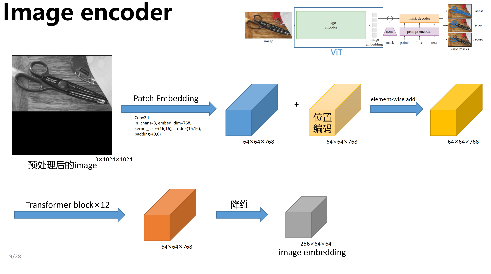

这部分使用VIT, 主要是SAM理解图像的重要部分

**2.1 path embedding**

使用一个kernel size且stride为16的卷积核, 将1024的图像提取为64x64x768的深度特征向量; 

并加上位置标明

**2.2 element-wise add**

**2.3 transformer**

使用了12个Transformer块来处理这些向量，每个块都在维持序列信息的同时，增强了特征的表示。

**2.4 降维**

## 2.3 mask decoder

### 1 decoder

Mask decoder的职责是整合来自图像嵌入的丰富视觉信息和提示词编码器提供的表征信息，其最终目的是解码出精确的语义分割掩码。

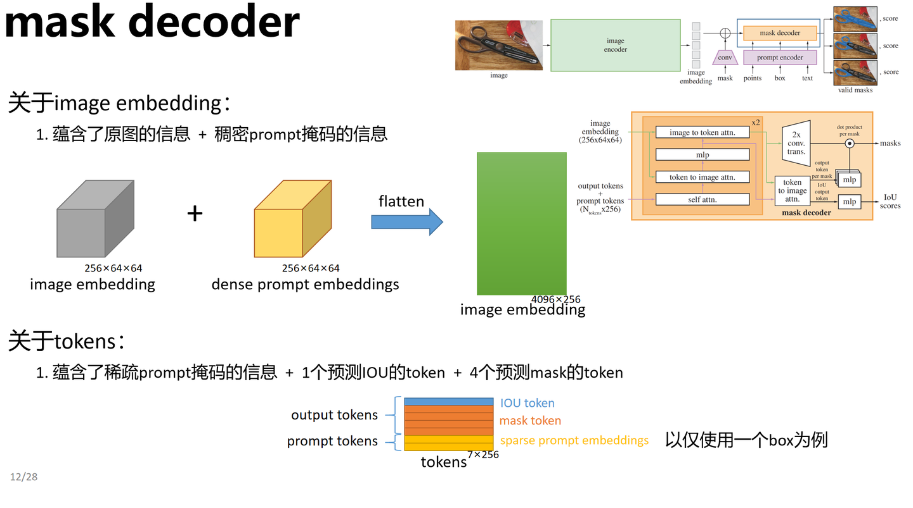

mage embedding。它不仅包含了原始图像的信息，还融入了稠密的prompt掩码信息。通过这样的融合，我们得到了一个增强的图像表征，它更全面地捕捉了图像内容和用户指示的分割意图。

tokens不只是承载了稀疏的prompt掩码信息，它们还包括用于未来预测的特殊token——一个预测交并比（IOU）的token和四个预测掩码的token。
mask tokens的角色是作为预测具体分割掩码的占位符，之所以有四个，是因为SAM模型的灵活性允许它在模糊语义下生成多达三个掩码，或者在需要时只生成一个特定掩码。

### 2 attention

mask decoder的内部机制，以及数据是如何在这一复杂结构中流动和转换的。

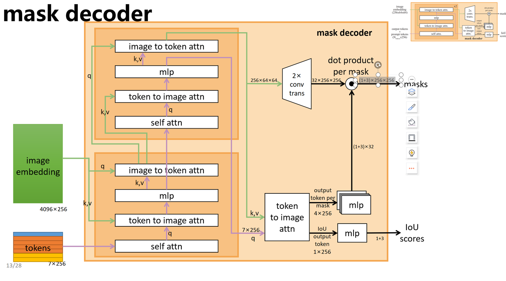

首先，tokens被送入mask decoder，并进行**自我注意力**（self-attention）处理。自我注意力机制的作用是让模型学会在tokens内部寻找和放大重要的关系

经过自我注意力处理的tokens作为查询（query），与图像嵌入的键（key）和值（value）结合进行图像到token的注意力（token to image attention）操作(**不再是自注意力机制**)
目的是将经过**提示词处理的信息与原始图像的丰富上下文信息结合**起来，从而为解码过程引入了视觉信息。

结果通过一个多层感知器（MLP）层，产生新的特征表征。

最后, 这些新特征表征随后被用作键K和值V，图像嵌入作为查询Q，执行另一轮图像到token的注意力（image to token attention）操作，进一步精炼模型对图像的理解。

> 这里有点精妙的, 既把prompt作为Q, 又让image作为Q; 既融合和自注意力, 有又prompt和image的注意力

### 3 output

在模型的输出阶段，有两个分支。

一分支通过两次转置卷积操作，将维度从256×64×64提升至32×256×256，这样做是为了将特征映射回原始图像的尺寸。

另一分支则使用前面MLP的输出作为查询，执行token到图像的注意力（token to image attention）操作，生成两个输出流：一个是IoU输出token（1×256），它经过一个MLP层后，可以预测每个预测掩码与真实掩码间的交并比（IoU）；另一个输出是每个掩码的输出token（4×256），经过四个MLP层后得到(1+3)×32的张量。

## 2.4 output

### 1 mask postprocess

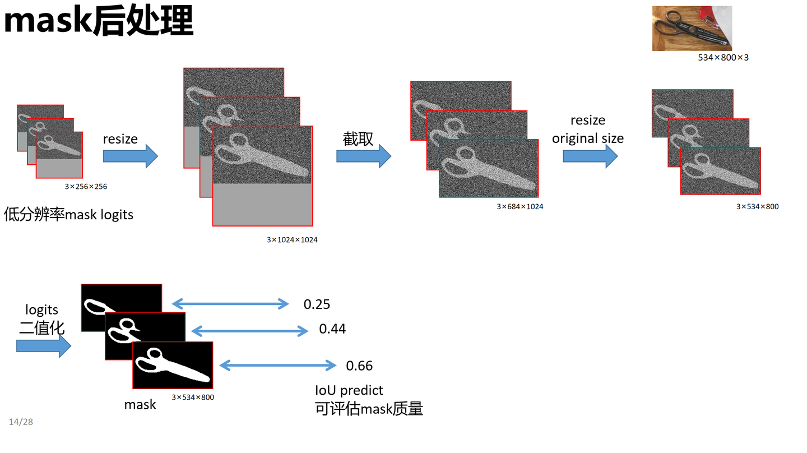

### 2 anything

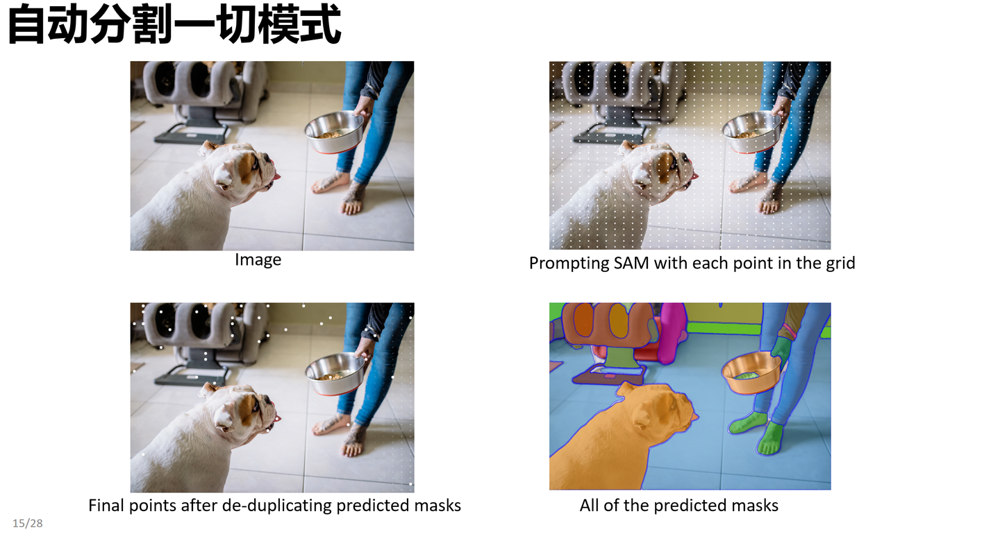

预先在图像上均匀分布32×32个点; 点是并行处理, 每个点的处理都是独立的, 每个点都独立地引导SAM去理解和解析图像的不同部分.  最后，去重保留剩下的mask，作为模型的最终输出。

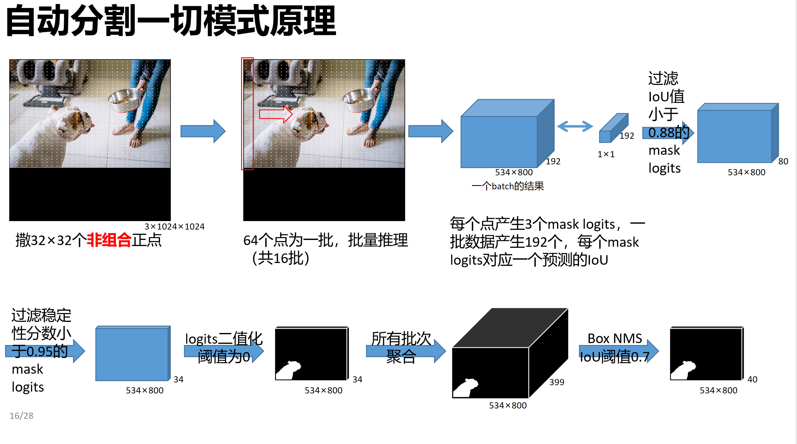

# 3 训练与推理

## 3.1 模型参数

不同参数主要在image encoder上, 其次是mask decoder，而prompt encoder参数量最少。

## 3.2 训练数据

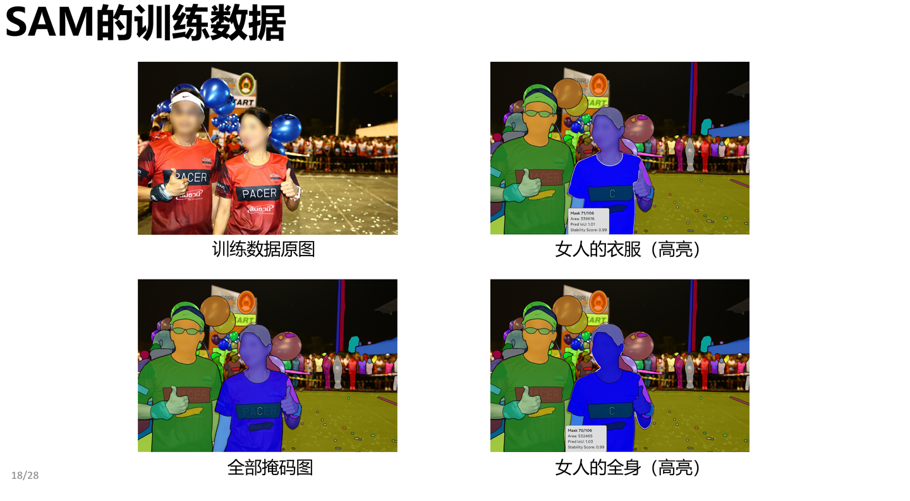

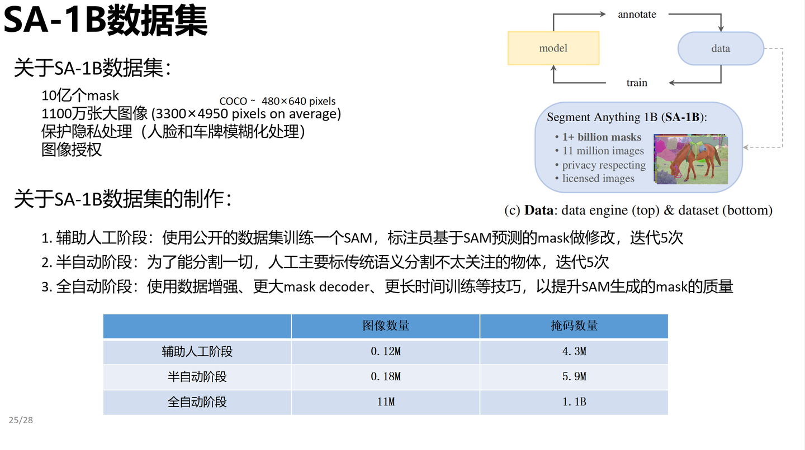

SA-1B数据集的制作过程可以分为三个主要阶段。首先是辅助人工阶段，在这个阶段，使用公开的数据集训练了一个SAM模型。然后，标注员基于SAM预测的掩码进行修改，这个过程经过了5次的迭代，以确保数据的准确性。接下来是半自动阶段，主要用于标注传统语义分割不太关注的物体。同样，这个阶段也经过了5次的迭代，以提高数据的质量。最后是全自动阶段，采用了一系列技巧，如数据增强、更大的掩码解码器、更长时间的训练等，以进一步提升SAM生成的掩码的质量。

## 3.3 模型训练

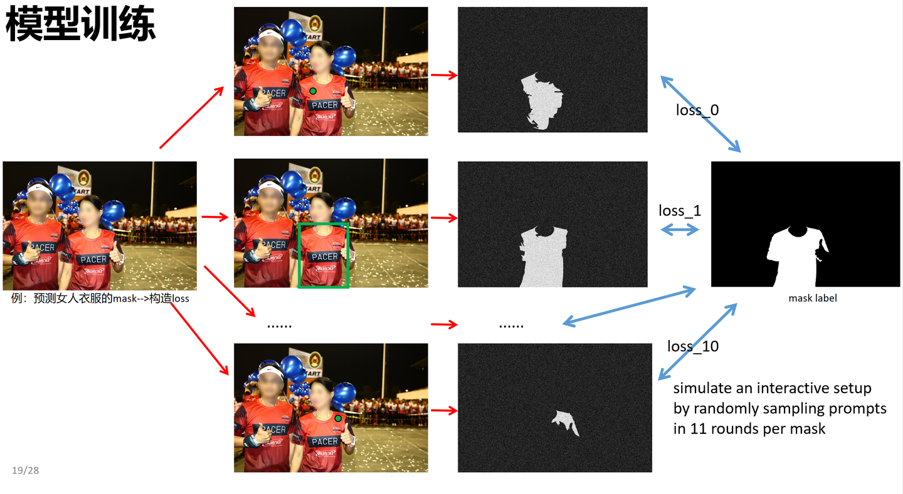

采用了“通过在每个掩码上随机采样提示词进行11轮模拟交互设置”的方法来自动化构造提示词。

随后，每一种构造的提示词都会与原图一起被送入解码器。解码器对每种提示进行处理，生成相应的掩码logits。每个掩码logits都会与真实的掩码标签进行比较，计算出一个损失值。

这个损失值是模型学习过程中的关键反馈，它告诉模型预测的掩码与实际标注之间的相似度。通过这样的训练过程，SAM模型逐步学会如何更准确地预测掩码，即使在缺乏确切指示的情况下也能做出正确的分割。这种训练方法不仅提高了模型对用户输入的敏感性，也增强了模型处理不确定性的能力。

## 3.24 损失函数

### 1. focal loss

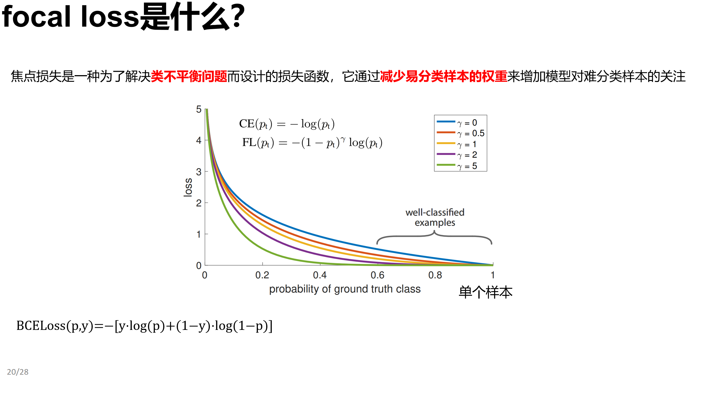

在图中，我们研究单个样本。横坐标表示预测正确的概率（前景预测为前景的概率，背景预测为背景的概率），纵轴表示在不同概率下的损失值。我们首先看到了交叉熵损失（Cross Entropy Loss，CE），它是常用的分类损失函数。然后，我们引入了焦点损失（Focal Loss，FL），其中γ表示一个控制焦点损失下沉程度的超参数。

当γ等于0时，焦点损失等同于交叉熵损失，如图中最上面的蓝色曲线所示。但随着γ的增加，曲线逐渐下沉, 这种下降导致GT值在高位时(>0.6), 此时的 Loss 被**剧烈压低**（衰减了约 99%），使得大量容易分类的背景样本产生的梯度被大幅抑制, loss下降不会那么明显; 
而小于0.6部分loss值受到抑制较小，保留了大部分 Loss, 梯度会更加明显, 而这一部分往往都是难样本所在位置

因此，焦点损失的关键在于它能够聚焦于难以分类的样本，帮助模型更好地应对类别不平衡问题，从而提高了模型的性能。

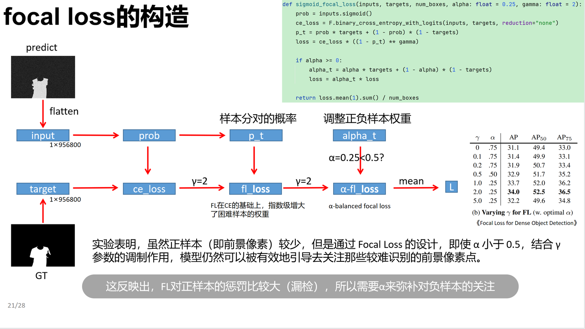

### 2 dice loss

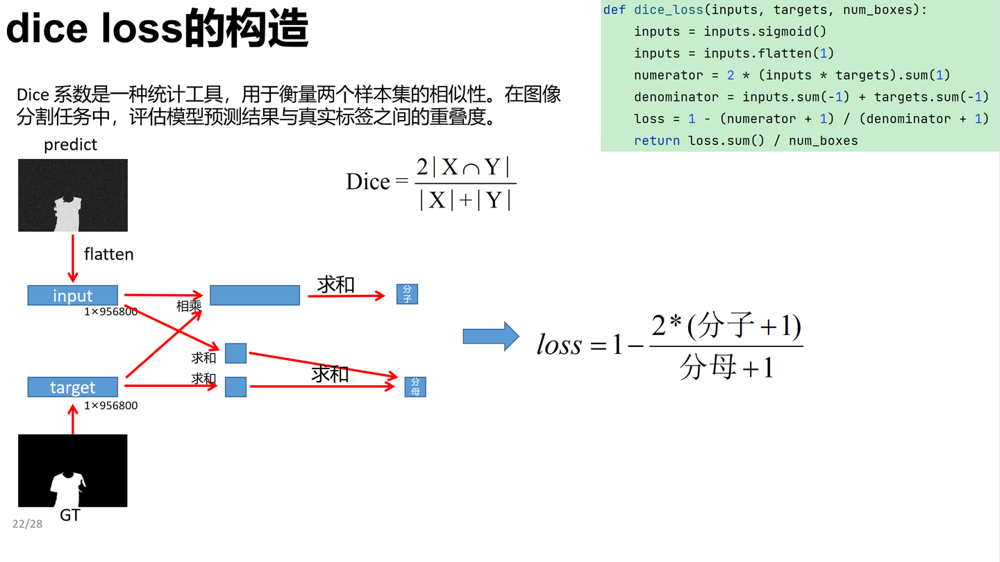

## 3.5 多模态

### 1  clip

实现文本和图片的嵌入到特征空间, 实现对齐. 从而衡量文本和图像的相似性

在训练过程中，我们使用CLIP的图像编码器（CLIP image encoder）来获得图像嵌入（image embeddings）。然后，将这些图像嵌入作为文本的提示词（prompt）

在SAM的推理阶段，当用户提供一个文本输入，比如"cat"，SAM会使用CLIP的文本编码器（CLIP text encoder）来生成文本嵌入（text embeddings）。然后，将这些文本嵌入作为文本提示词传递给SAM的提示词编码器

# 4 sam2

> https://zhuanlan.zhihu.com/p/718534459
>
> https://zhuanlan.zhihu.com/p/1934197096749208793
>
> https://blog.csdn.net/weixin_52694742/article/details/156659534

主要是添加视频支持以及工程推理优化

## 4.1 主要改进

1. 增视频/动态序列分割能力，支持帧间掩码跟踪与增量推理；
2. 优化推理效率，ViT-B backbone在消费级GPU上可达10+ FPS，满足机器人实时性要求；
3. 增强交互性，支持“时序提示”（如前一帧的掩码作为后一帧提示），适配机器人自主修正分割结果的需求；
4. 支持全景分割、实例分割、语义分割的统一输出，覆盖机器人视觉的多维度场景需求。

## 4.2 细节

### 1 Prompt Encoder

核心功能：将多模态提示（点、框、掩码、文本、时序掩码）编码为与图像特征对齐的向量；

关键创新（时序提示）：

- 支持“历史掩码提示”：机器人视觉中，前一帧分割的掩码可作为后一帧的提示，避免重复标注，提升跟踪分割的稳定性；
- 提示优先级机制：工程上可自定义“框>点>时序掩码”的优先级，适配机器人抓取场景中“先框选目标，再用点修正边缘”的交互逻辑。

### 2 Image Encoder

基础架构：基于改进的Vision Transformer（ViT），提供ViT-H/L/B三种backbone（分别对应高/中/低精度，工程上机器人视觉常用ViT-B平衡速度与精度）；

改进：

- **新增动态patch embedding：**支持可变输入分辨率（如机器人相机常见的640x480、1280x720），无需强制缩放至1024x1024，减少无效计算；
- **轻量化分支：**针对边缘设备（如Jetson Nano/Xavier），提供裁剪版ViT-B（减少注意力头数），算力需求降低40%。

### 3 Mask Decoder

核心重构：SAM1的掩码解码器仅支持单帧静态推理，SAM2新增**循环掩码解码器（Recurrent Mask Decoder）** 和**记忆缓存（Memory Cache）**

- 循环注意力层：建模帧间特征关联，仅**更新帧间变化的区域特征**，而非全帧重算，推理速度提升2-3倍；
- 记忆缓存：缓存前N帧的关键特征（N可配置，默认5），机器人视觉中可根据帧率调整（如10 FPS场景下N=3），平衡内存占用与跟踪精度；

输出优化：新增掩码质量评分（0-1），工程上可设置阈值（如0.7）过滤低质量掩码，避免机器人抓取错误目标。

## 4.3 memory attention

这是实现**跨帧信息融合**的关键。它是一个 Transformer 模块，能够让当前帧的特征与记忆库中存储的过去帧的特征进行交叉注意力计算。通过这种方式，模型在处理当前帧时，能够“回顾”目标对象在过去的样子和位置，从而更好地处理遮挡、形变等挑战。

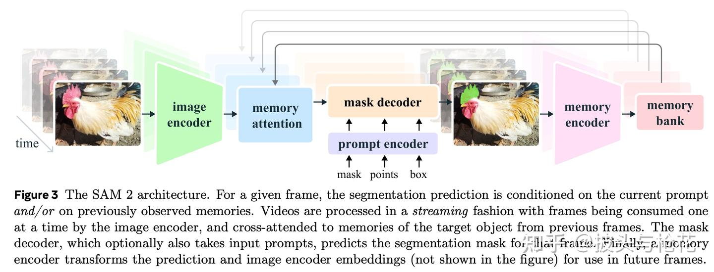

**记忆编码器 (Memory Encoder)：**

负责将当前帧的预测结果和图像编码器的特征进行融合，生成新的记忆，并存入记忆库中。

**记忆库 (Memory Bank)：**

SAM 2 的“长期记忆”与“短期记忆”中心。它以先进先出（FIFO）队列的形式，存储着两种关键信息：包含用户提示的历史帧 和 近期处理过的历史帧
这些记忆不仅有空间特征图，还包括从掩码解码器输出中提取的、代表对象高级语义的轻量级“对象指针”。
将**时间位置信息**嵌入到近期处理过的历史帧中，允许模型表示短期物体运动，但**不包含到提示帧**的记忆中，因为提示帧更稀疏且时间步也不一致 。
当处理单张图像时，记忆库为空，该模型就退化为与初代 SAM 类似的工作模式，从而实现了图像和视频任务的统一。

**目标指针Object pointers:** 

# 5 sam3

> https://arxiv.org/abs/2511.16719
>
> https://zhuanlan.zhihu.com/p/1975890913717940797
>
> https://zhuanlan.zhihu.com/p/1982454759479862342

**SM3 (Segment Anything with Concepts)** 则是一次**语义与视觉的深度融合**。从 **可提示视觉分割（PVS）** 到 **可提示概念分割（PCS）** 的转型

## 5.1 主要改进

1. 传统的 SAM 模型虽然能分割“一切”，但它往往不知道分割出来的是“什么”。SAM3 引入了**Concept** 的概念，旨在解决“在这个类别下，分割出所有实例”的难题。
2. 设计了一个统一的模型，同时作为**检测器 (Detector) 和 跟踪器 (Tracker)。**
3. SAM3 对**文本提示 (Text Prompt)** 的理解能力大幅提升与**处理歧义**
4. 跟踪能力提升: **周期性再提示（periodic re-prompting）** 的机制

## 5.2 细节

### **0 共享骨干网络（感知编码器 Perception Encoder）**

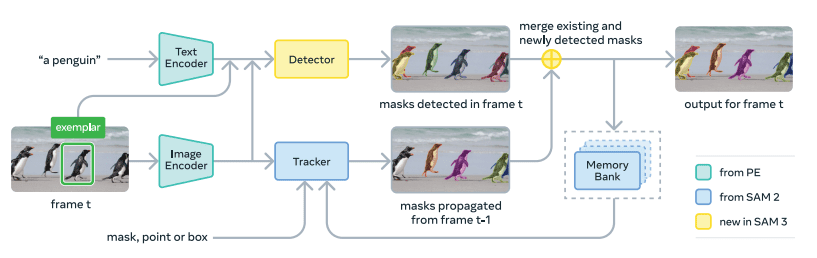

### 1 **共享视觉编码器 (Shared Vision Encoder)**

检测和跟踪任务共享同一个强大的视觉 Backbone，大幅减少了计算冗余，提升了推理效率。

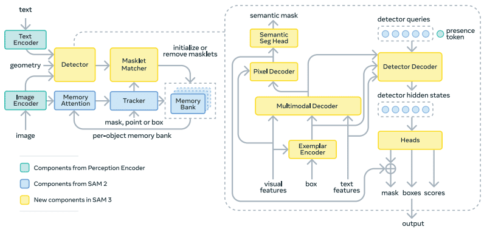

### 2 视频跟踪器（Video Tracker）

### 3  **Presence Token**

引入了一个新的 token 机制，专门用于判断目标物体“是否存在”于当前画面中。这对于处理视频中的遮挡、消失与重现（Re-identification）至关重要。

