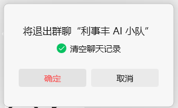

## 利事丰公司

### 0. 前言

> 离职前两个星期, 放假了, 因为竟还剩下86个小时的加班时长, 可以放9天了 放到月底了. 但这不是很好, 应该早点去看看有没有加班时长的, 之前也是问了年假但是要从一月份开始算才算一年. 但是加班时长没想到有这么多, 大概是之前偷摸锻炼之后无赖晚点回公司打卡的加班时长或者是其他比如每一个月的盈余, 因为之前为了弥补请假, 基本上每个月都会强制加班和请假时长相抵消. 

和老板说的一样, 第一家公司多多少少还是有点感情的, 而且我也是一个多愁善感的人. 

### 1. 如何评价这家公司呢?

​	首先是, 我很感谢公司能够接纳和包容我, 一个考研落榜, 没有实习经历, 没有比赛, 甚至没有拿手的项目的应届实习生, 甚至工资都比较不错, 工作强度几乎没有. 
​	其次是, 因为是个50人左右的小公司,而且员工属我学历最高了, 所以公司视觉方面基本上都是从零开始的, 而且只有两个人. 又是后会因为工作内容很杂(传统的前后端: dashboard; webtrc; 一体机环境; 硬件部署; 运维维护甚至工人培训也要, 还有公司人力帮忙). 多少次都因为很杂的工作内容想要跑, 但是架不住公司的工作强度真的很低很低和不错的工资; 
​	这种环境确确实实很适合养老, 但是我不是一个甘愿躺平和止步于此的人, 所以我自己利用空闲时间学习了很多: 从前后端知识-> 到agent开发-> 到读开源仓库渐渐理解代码设计规范 -> 到接触真正意义上的机器视觉, 做了相机内外参和手眼标定; 甚至是在8~12月的时候, 利用下班+那段时间公司非常非常清闲备战了考研, 考回了本校. 

### 2. 工作内容（我到底做了什么）

> 完成的项目: 
>
> 901D包装缺漏件检测 -->   haoyi NG产品数量检测  --> AI adboard 前后端  -->  WebRTC 部署bug  -->   Pose员工行为分析  -->  OCR按键检测 -->  AI基础设施相关的训练标注+数据回传+模型回测+模型迭代系统 -->  adboard后端agent更新 -->  双皮奶项目+煮饺子项目+便利店项目(本质都只是简单的area区域目标识别+出餐口空位为模版匹配)  --> 相机标定  -->  水果项目的深度相机的小孔成像定位  -->  水果项目的手眼标定定位  -->  打螺丝的螺丝孔九点标定精定位  --> 打螺丝的平面标定产品螺丝孔初定位

从一开始入职我还以为自己会只是训练模型, 修改模型架构, (因为这是我在学校所能接触到的, 就像新来的两个应届生一样. ) 但是公司没有自己的服务器, 没有标注人员, 小公司, 一切都得自己来完成AI的所有pipeline. 

后来才发现, 真正的AI落地其实是比较困难的, 即便是很成熟的工业AI视觉. 模型只是其中的一小部分, 更多还是要做兼容性处理, 就比如in_area, require_frame, conf等等, 更多的是要满足生产环境, 满足甲方的要求

在这里，我接触到了从算法到部署的一整套流程。除了视觉算法之外，还需要处理前端 Dashboard、FastAPI 服务、WebRTC 视频流、一体机部署、Modbus 通讯、数据库设计、Linux 环境、Docker、现场调试等等。

很多时候，一个问题可能不是算法，而是环境、网络、驱动、相机或者 PLC。真正花时间的往往不是写模型，而是把整个系统跑起来。

### 3. 我真正学到的东西（成长）

> 真的要感谢AI, 感谢cursor, 如果没有AI辅助编程和学习, 感觉我真的很难会干这么久, 至少不会干满一年, 大概会提前离职结束了, 太多太多没接触过甚至是不感兴趣不相关不想干的东西了

首先是git 现在还能回想起当初刚刚入职时对git操作一窍不通, 只能马不停蹄的学习了解命令和操作, 但是现在使用也是轻车熟路了, 虽然日常只会add commit和push

其次完整的后端开发, 虽然到现在还没写test, 或者说没用test, 甚至我都不知道ai视觉应该pytest什么? 不可能是输入图片或者视频给出预料中的detection result? 那我不如直接跑test数据完整后端流程. 至于数据库什么的? 似乎之后写入保存而已

再者就是接触了AI agent, 写了完整的dashboard管理平台, 也让我从LLM到agent进行了学习, 看了open_manus等等的开源仓库, 真正意义上的动手尝试了agent loop的设计并进行了改进, 最后开发出了属于自己的 `weakagent`!

还有就是工程思维, 以前：能跑就行。后来：会考虑接口设计。会考虑：可维护性,可扩展性,日志,配置,异常处理,部署. 甚至开始写：Agent框架, Task Processor等等

### 4. 公司的不足

首先就是人太少了, 视觉只有两个人。很多东西没人带。扬哥也是只提供了前期的git review和难点帮忙解决, 更多的是需要自己摸索(`webrtc`, 手眼标定)

其次就是项目深度很浅很浅, 很少有机会长期打磨一个算法和AI模型, 更多是在:修Bug,改需求,部署. 视觉比例其实没那么高, 项目也没那么复杂. 甚至很多项目其实都是没有完善的结尾的(虽然我不知道to B是不是就是这样, 需要一直有工程师来进行优化). 截止目前: 最稳定的就是`biyi`的缺漏件和老化END, 但是依旧有很多问题没有解决(`modbus`延迟, 新产品需要手动训练模型等等, 但是也解决很很多工程问题: 推理延迟, 网络摄像头延迟, 前端UI更合理的显示, plc连接下等等). 还有就是milk, 虽然已经不做了. 更多的是像person的pose以及digital glue一样, 都是半桶子水,会有很多问题没有去解决, 只是现场验证的时候会配合着去优化和修改,  最终依旧没有真正用起来. 

最后就是成长天花板, 对于刚毕业的人来说，公司很好。但是如果想继续往算法或者AI方向深入，就会遇到瓶颈。因为：没有：大规模数据,GPU服务器,成熟算法团队,Code Review,技术分享.所以最后还是决定离开。

### 5. 最让我难忘的事情

首先就是Webrtc的线上部署. 因为当时已经干满了试用期三个月,加上搞了一个月和AI不相关的dashboard,  加上对webrtc真的真的了解甚少, 以及需要和一个摆烂的网络工程师进行联调(不想多干事的那种, 多点事给他做就感觉很不爽)所以真的有点想跑的想法了. 虽然最后还是翻阅了很多资料(本身资料就少+自己没有经验), 最后真的就给我搞定了, 虽然如何搞定还是蒙蒙的. 但依旧就作出来了. 怎么说呢? 其实很多时候, 做一些自己没有接触过的事, 开头真的很困难很困难, 你既不了解, 也不知道如何下手. 从头开始学习又基本不可能, 即花时间, 又很难学习透. 更多的找现有的教程和经验, 跟着做, 跟着弄. 如果能很顺利做下来和完成, 那真的就是万事大吉了; 倘若最终没有效果, 那真的很折磨了, 又得排查问题重新搞一遍, 又得分析一下什么原因, 为什么不对,还得找新的方法从头再来...

还有就是独自写一个task_detection, 当时真的写了又写, 改了又改, 到现在才有了比较不错的模样. 比如什么上帝类, 什么管全局的类, 什么太耦合, 什么给基础类写基本功能操作, 真就很多开发坑都被我从零踩了一遍, 又独自发现和修改进行重构.(没有导师的弊端)

### 

### 6. 对自己的评价

回头看这一年，这是我第一次真正意义上的工作，也是我成长最快的一年。

最大的变化，其实不是学会了多少技术，而是心态上的转变。

刚进入公司的时候，我更像一个学生。我希望做自己擅长、喜欢的事情，一旦遇到和自己方向不相关、不会做或者觉得没有意义的工作，就会下意识地抗拒，觉得"为什么又是我""这和算法有什么关系"。

后来慢慢发现，真正的工作并不会按照你的兴趣安排任务。一个项目从需求到落地，算法只是其中的一环。后端、前端、数据库、部署、网络、硬件、现场调试，很多事情都需要有人去完成。如果每一件不会的事情都选择逃避，那永远只能停留在舒适区。

于是，我开始不再抱怨，而是主动去查资料、阅读文档、请教别人、不断实验和验证。虽然很多工作依旧不是我最喜欢的内容，但至少我不会再因为"不会"而拒绝去做，而是想着"怎么才能把它做好"。

这一年里，我接触了模型训练、后端开发、简单的前端页面、工业相机部署、WebRTC、硬件调试、服务器环境等许多以前从未接触过的内容。现在回头看，它们未必都会成为我未来的主方向，却让我拥有了更完整的工程视角。

除了技术之外，我觉得自己还有一个需要反思的地方。

公司的管理相对宽松，我也曾利用这种宽松，做过一些投机取巧的事情，例如利用考勤规则"摸鱼加班"、偶尔提前离开公司等。虽然没有影响工作的完成，但现在回头看，这更多反映的是当时自己的职业意识还不够成熟。

后来我越来越意识到，职业素养并不仅仅体现在技术能力上，也体现在是否能够对自己的时间、工作和行为负责。制度可以宽松，但不能因此降低对自己的要求。这也是这一年里，我觉得自己仍然需要继续改进的地方。

------

### 7. 对下一份工作的期待

说实话，我现在依然没有一个百分之百确定的答案。

这一年里，我接触了很多东西：计算机视觉、后端开发、前端、Agent、大模型、部署、运维……每一样都了解了一些，却又都谈不上精通。有时候我也会怀疑，在 AI 发展这么快的今天，这样广而不精到底是不是一件好事。

不过，至少我已经知道自己不希望成为什么样的人。

我希望下一份工作能够进入一家规模更大一些的公司，拥有更成熟的研发流程、更规范的代码管理、更完善的 Code Review，以及愿意指导新人的导师和团队，而不是所有事情都只能靠自己摸索。

在技术方向上，我还是希望以计算机视觉作为自己的核心能力。它是我最早接触、也是最感兴趣的领域。未来希望继续深入学习三维视觉、多模态以及医学影像等方向，同时逐步接触 Embodied AI 所涉及的机器人、感知与决策，以及 AI Infra 相关的工程能力。

我不希望一直做一个什么都会一点的人，而是希望先把一个方向做到足够扎实，再慢慢向周围扩展。广度很重要，但深度才是真正的竞争力。

****

### 8. 最后的结尾

如果让我重新选择一次，我还是会来这家公司。

它不是一家技术最强、发展最快的公司，但它给了一个几乎没有经验的应届生一次真正进入行业的机会。

它让我知道了机器视觉真正落地是什么样子，也让我认识到自己的不足，明确了未来想走的方向。

接下来，也该去看看更大的世界了。
