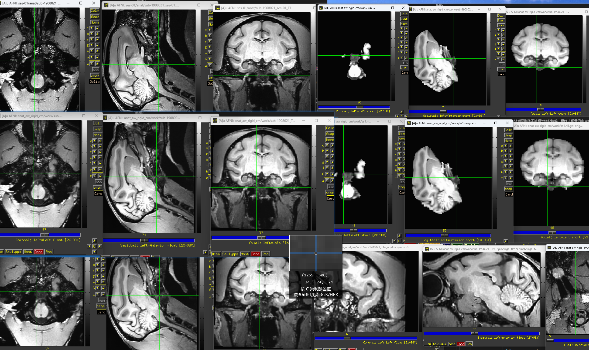
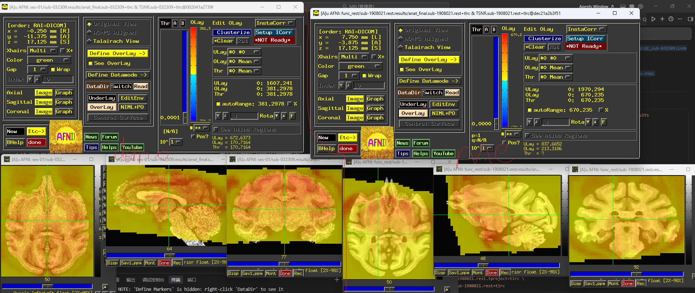
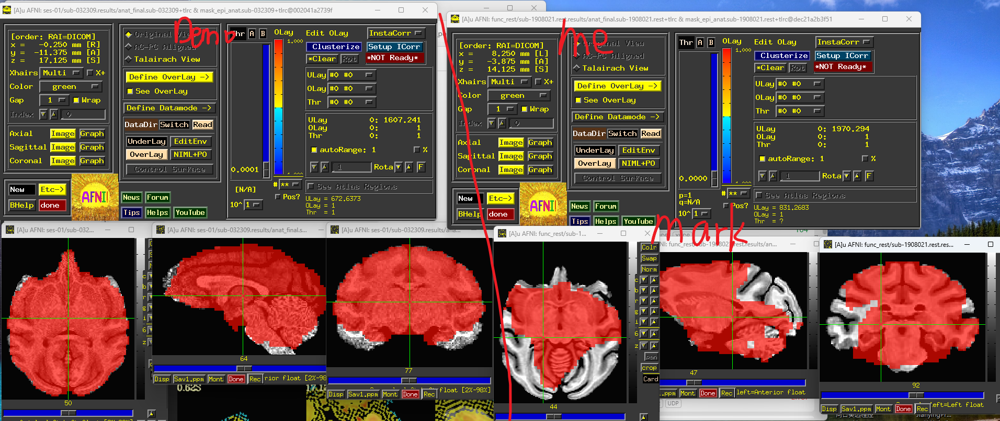
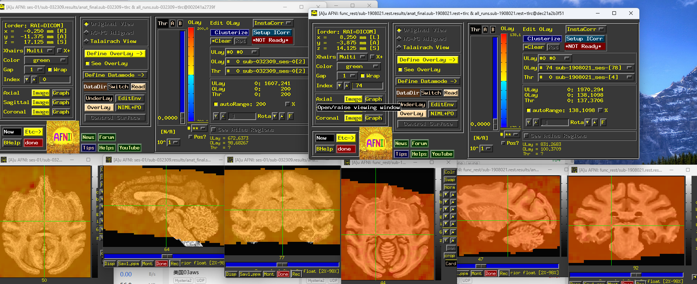

# 功能连接


## 3dinfo

### 1. 它能查看哪些关键信息？

磁共振扫描文件（如 `.nii`、`.nii.gz`、`+orig`、`+tlrc`）内部存储了大量关于像素和物理坐标的元数据，`3dinfo` 可以精准提取：

- **图像维度 (Dimensions)：** $X, Y, Z$ 轴的体素数量（如 $256 \times 256 \times 176$），以及时间轴 $T$ 的帧数/时间点数（如 300 帧）。
- **体素分辨率 (Voxel Size)：** 每个小方格在物理空间中的实际大小（单位 mm，如 $0.8 \times 0.8 \times 0.8\text{ mm}^3$）。
- **时间参数 (TR)：** 采集每一帧图像所消耗的时间（Repetition Time，单位秒）。
- **解剖空间与朝向 (Orientation & Space)：** 图像在三维空间中的朝向（如 `RPI`、`LPI`、`RAI`）以及所属的标准空间（如 `ORIG` 原始空间、`TLRC` / `MNI` / `NMT` 模板空间）。
- **倾斜度 (Obliquity)：** 检查扫描时坐标系是否相对于磁共振主场轴有倾斜角度。
- **统计学元数据 (Sub-brick Info)：** 如果是 GLM 分析结果文件，可以查看里面包含了哪些统计量（如 $t$ 值、$Z$ 值、$F$ 值或回归系数 $\beta$）。

```
150     160     192     1       0.500000        0.500000        0.500000        LPI     1.834
```

> 我们将它们与你传入的参数逐一对应分析：
>
> #### ① 图像维度 `150  160  192  1`（对应 `-n4`）
>
> - **矩阵大小 ($X \times Y \times Z$)**：$150 \times 160 \times 192$ 个体素（Voxels）。
> - **时间帧数 ($T$)**：`1`。确认这是一张 **3D 静态结构像**（T1w），没有时间维度。
>
> #### ② 体素分辨率 `0.500000  0.500000  0.500000`（对应 `-ad3`）
>
> - **物理尺寸 ($dx, dy, dz$)**：$0.5 \text{ mm} \times 0.5 \text{ mm} \times 0.5 \text{ mm}$。
> - **分析判断**：
>   - 这是典型的**高分辨率 / 超高分辨率** T1 结构像（通常来自动物扫描，如非人灵长类/猕猴，或者人脑的高场强 7T 扫描）。
>   - 相比于常见的 $1.0\text{ mm}$ 人脑 T1，该数据分辨率非常高，非常适合做精细的解剖结构分割或与 NMT 模板匹配。
>
> #### ③ 空间坐标朝向 `LPI`（对应 `-orient`）
>
> - **存储朝向**：**L**eft-to-Right（左到右）、**P**osterior-to-Anterior（后到前）、**I**nferior-to-Superior（下到上）。
> - **分析判断**：
>   - 这是 AFNI / DICOM 体系中很常见的物理坐标存储顺序。
>   - **质控注意**：在后续做 EPI 与 T1 的配准（`align`）以及模板配准时，需要确保 EPI 的朝向与 T1 匹配（或由 AFNI 自动转换），防止左右颠倒或前后反转。
>
> #### ④ 倾斜角度 `1.834`（对应 `-obliquity`）
>
> - **倾斜角**：`1.834 deg`。
> - **分析判断**：
>   - 存在大约 $1.83^\circ$ 的倾斜角度（Obliquity），说明磁共振扫描时定位框（FOV）相对于磁场主坐标系有微小的旋转。
>   - **处理建议**：$1.83^\circ$ 属于**非常微小**的倾斜（通常 $< 5^\circ$ 都算小倾斜）。在 AFNI 的 `afni_proc.py` 中，程序会自动通过 `3dWarp -deoblique` 或在对齐阶段合并处理倾斜，一般无需额外人工干预，直接传给 `@animal_warper` 即可。

> ```
> cd /opt/workspace/demo/MACAQUE_DEMO_REST
> 3dinfo -n4 -ad3 -orient -obliquity \
>   data_00_basic/sub-032222/ses-007/anat/sub-032222_ses-007_run_1_T1w.nii.gz
> ```
>
> ```
> cd /opt/project_1
> 3dinfo -n4 -ad3 -orient -obliquity \
>   data/sub-1908021/ses-01/anat/sub-1908021_ses-01_T1w.nii.gz
> ```
>
> ```bash
> afni_user@dec21a2b3f51:/opt/workspace/demo/MACAQUE_DEMO_REST$ 3dinfo -n4 -ad3 -orient -obliquity \    
> >   ${SUB}/anat/sub-032222_ses-007_run_1_T1w.nii.gz
> 150     150     101     1       0.600000        0.600000        0.600000        RPI     0.000
> 
> 
> afni_user@dec21a2b3f51:/opt/project_1$ 3dinfo -n4 -ad3 -orient -obliquity \
> >   data/sub-1908021/ses-01/anat/sub-1908021_ses-01_T1w.nii.gz
> ** AFNI converts NIFTI_datatype=512 (UINT16) in file /opt/project_1/data/sub-1908021/ses-01/anat/sub-1908021_ses-01_T1w.nii.gz to FLOAT32
>      Warnings of this type will be muted for this session.
>      Set AFNI_NIFTI_TYPE_WARN to YES to see them all, NO to see none.
> 150     160     192     1       0.500000        0.500000        0.500000        LPI     1.834
> ```
>
> 




## 3dWarp 


### -deoblique

> 1. Oblique 1.834°
>    Demo 已经摆正（README 里还做过 `@Align_Centers`）。你的联影 T1 带斜面。AFNI 更稳妥的做法是先 `3dWarp -deoblique`。你们 `03`/`04`/`05` 都做了这一步。


# 分析

## 01 Info


## 02: AW配准 


### 2 afni 里看效果

在 NMT 模板空间。AFNI 里第一个是底图（underlay），其余用 OLay 切换。真正用来判断“这只猴配上没有”的，主要是三份 `warp2std*`。

```
cd /opt/workspace/output_v3/sub-16093/ses-01/anat_aw/sub-16093_aw
afni \
  NMT_v2.1_sym_05mm_SS.nii.gz \
  sub-16093_anat_warp2std_nsu.nii.gz \
  CHARM_in_NMT_v2.1_sym_05mm.nii.gz \
  D99_atlas_in_NMT_v2.1_sym_05mm.nii.gz
```

建议：底图用 NMT，overlay 用 nsu，透明度约一半，或反复开关 overlay 看边缘是否重合。

------

`NMT_v2.1_sym_05mm_SS.nii.gz`
去颅骨的 NMT 模板，是配准目标。固定当底图，不评判它。确认三视图是正常猕猴姿势（左右没反）即可。

`sub-16093_anat_warp2std_nsu.nii.gz`（主检查）
这只猴的 T1 变到模板空间：去颅骨 + 强度均匀化。后面 AP 用的就是它。
好看：轮廓、中线、侧脑室、小脑、颞极贴住 NMT；开关 overlay 时像同一只脑；左右不反。
差：整体平移/旋转、半脑错位、小脑悬空、左右翻转。

`..._warp2std_ns.nii.gz`
同上，去颅骨但没做 unifize，几何和 nsu 相同。用来看去颅骨：脑缘应贴 NMT，不应剩头皮/下颌。nsu 对比看起来怪时改看这个。

`..._warp2std.nii.gz`
还带着颅骨。只确认头也变过去了，不要用头皮齐不齐当配准好坏。脑子内部仍应对上 NMT。

`NMT_v2.1_sym_05mm_brainmask.nii.gz`
模板脑的二值 mask。叠在 nsu 上：脑组织应填满 mask；mask 外不该有大脑，mask 内不该有大块头皮。缺口 = 覆盖不足。

`CHARM_in_NMT_v2.1_sym_05mm.nii.gz`
CHARM 皮层层级图谱，本来就在 NMT 空间，不是这只猴变出来的。叠在 NMT 上没有意义。要叠在 `warp2std_nsu` 上：STS、距状沟等沟回应落在对应 ROI 边上。只看大结构，不必每块都严丝合缝。

`D99_atlas_in_NMT_v2.1_sym_05mm.nii.gz`
D99，分区更细，同样已在 NMT 空间。看法同 CHARM。额极/眶额常因个体差异对不齐；中线、中央沟、距状沟对上即可。

------

检查顺序：`nsu` vs NMT（整体）→ `ns`（去颅骨）→ `brainmask`（覆盖）→ CHARM/D99 叠在 nsu 上（标志）。


## 03：`afni_proc.py`（预处理）

**作用：** 把原始 BOLD 洗干净，对齐到 NMT，得到每个体素的残差 `errts`。这是后续任何功能分析的原料。

**做了什么：**

1. 去掉前 4 个 TR、去尖峰、层时校正  
2. EPI 对齐到 02 的去颅骨 T1（`lpc+ZZ`、`giant_move`）  
3. **不重算** T1→NMT，直接用 02 的 warp 三件套把 EPI 变到 NMT（1.5 mm）  
4. 头动校正、2 mm 平滑、缩放到百分信号  
5. 回归掉运动及其导数；位移 >0.2 mm 或 outlier >5% 的时间点 censor  
6. 写出 HTML QC  

**核心产物：** `derivatives/v2/func_rest/sub-1908021.rest.results/`  
里面是 `errts*+tlrc`、`anat_final`、`TSNR`、`QC_*/`。

03 **不算**“视觉网络长什么样”，只保证时序能分析。

---

03 是“把功能像放到和解剖同一套 NMT 上并去噪”；04 是“用这份去噪数据画两张种子相关图”。没有 03，04 没有 `errts` 可算。

---

### 1. 先看 HTML QC（最省事）

用浏览器打开：

`F:\MRI\project_1\derivatives\v2\func_rest\sub-1908021.rest.results\QC_sub-1908021.rest\index.html`

（你开过的 `nvcan_anat_container.html` 是其中一页；入口一般是 `index.html`。）

重点看：

| QC 项           | 好的样子                            |
| --------------- | ----------------------------------- |
| 原始 EPI / 对齐 | 脑在框内，没有左右翻转              |
| 头动 enorm      | 曲线低、少尖峰（这次几乎没 censor） |
| TSNR            | 脑内高、边缘低                      |
| `errts` 相关图  | 不应整块花成运动伪影                |
| 解剖 vs EPI     | T1 和功能像轮廓大致贴合             |

---

### 2. AFNI 里看

GUI 容器里：

```bash
cd /opt/project_1/derivatives/v2/func_rest/sub-1908021.rest.results

afni \
  anat_final.sub-1908021.rest+tlrc \
  mask_epi_anat.sub-1908021.rest+tlrc \
  TSNR.sub-1908021.rest+tlrc \
  errts.sub-1908021.rest.tproject+tlrc \
  all_runs.sub-1908021.rest+tlrc \
  pb03.sub-1908021.rest.r01.volreg+tlrc
```

建议切换：

1. **Underlay** = `anat_final`（NMT 空间解剖）  
2. **Overlay** = `TSNR`（信噪比）或 `mask_epi_anat`（分析用的脑掩膜）  
3. `errts`：残差 4D。右键 **Graph** 看某个体素时序是否还在跳、有没有明显运动残留  
4. `all_runs` / `pb03.volreg`：对齐平滑后的 EPI，和解剖叠着看轮廓

不需要打开 `postproc/zcorr_*`、`seed_*`。

**TSNR**



> ### 3. 时间信噪比（TSNR Map）
>
> **检查目的**：评估全脑信号质量，找出磁场伪影或信号衰减区。
>
> - **AFNI 设置**：
>   - **Underlay**: `anat_final`
>   - **Overlay**: `TSNR`
>   - **Color Bar**: 建议设为 `Spectrum:yb`，阈值设为 `Thr = 0`（查看全脑 TSNR 连续分布）。
> - **怎么看**：
>   - **数值范围**：皮层区域 TSNR 越高越好（通常 30～80+ 属于良好；高场强磁共振下可能更高）。
>   - **异常区域**：靠近耳朵（鼻窦/听道附近）的基底节或下颞叶区域由于磁不均匀性，TSNR 普遍较低（冷色/深蓝色）。只要皮层主体呈高亮暖色（黄/红），说明数据信噪比合格。

**mask**



> 效果好像一般般啊
>
> ### 2. 脑掩膜与有效分析区域（Brain Masking）
>
> **检查目的**：确认分析掩膜是否完整覆盖全脑皮层，且没有包含颅外空气或骨骼。
>
> - **AFNI 设置**：
>   - **Underlay**: `anat_final`
>   - **Overlay**: `mask_epi_anat`
> - **怎么看**：
>   - 将 Overlay 的透明度调半透，观察彩色的 Mask 区域。
>   - **合格标准**：Mask 应该**完整包裹整个大脑皮层与小脑**，没有盲区/缺块；同时**不能延伸到颅骨外或眼球**区域。缺块会导致后续分析丢失部分脑区。

**Alignment & Normalization**



> ### 1. 解剖与功能图像配准（Alignment & Normalization）
>
> **检查目的**：确认猴脑 EPI（功能图）是否准确对齐到了 Anat（解剖图）以及 NMT 标准空间。
>
> - **AFNI 设置**：
>   - **Underlay**: `anat_final`（NMT 空间解剖底图）
>   - **Overlay**: `all_runs` 或 `pb03...volreg`（配准后的 EPI 数据）
> - **怎么看**：
>   - 键盘按 **`u`** 键（切换 Underlay 透明度/半透明）或按 **`o`** 键（切换 Overlay 显隐）。
>   - **关键观察点**：看脑外侧轮廓、脑室边缘（Ventrikles）、胼胝体和沟回。EPI 的组织边缘应该与解剖底图**高度重合**。如果 EPI 明显比解剖图大一圈或拉伸变形，说明 `-tlrc_NL_warp` 非线性配准失败。

**errts**


> ### 4. 残差时间序列与去噪效果（Residual Time Series Check）
>
> **检查目的**：查看剔除头动、生理噪声后的残差信号 `errts` 是否平稳。
>
> - **AFNI 设置**：
>   - **Underlay**: `anat_final`
>   - **Overlay**: `errts`
> - **操作与观察**：
>   1. 在 AFNI 主界面点击 **`Graph`** 按钮，打开 4D 时间序列曲线窗口。
>   2. 任意点击皮层上的体素，观察弹出的黑色波形图：
>      - **合格状态**：曲线围绕 0 上下**均匀波动**（基线平稳），没有整体向上/向下的漂移（Trend），也没有突然出现的巨大尖峰（Spike）。
>      - **头动残留**：如果在某个时间点，全脑几乎**所有体素同时出现极大的同向剧烈跳变**，说明该时间点存在严重的头动突变，且未被 `regress_censor_motion` 成功剔除。


---

### 3. 文字摘要

`out.ss_review.sub-1908021.rest.txt`  
里面有头动、censor 比例、TSNR。这次大约是：296 TR 全保留、平均位移 ~0.009 mm、TSNR ~226。

---

**03 单独就算完整 AP。** 04 只是额外的种子相关演示；不做视觉/听觉，流程在 03 结束即可。后面 DTI 的 05–07 和 AP 无关。


## 04：pp

