# DWI

## 1. 数据查看

```
sub001/
├── dwi/
│   ├── sub001_dwi.nii.gz
│   ├── sub001_dwi.bval
│   └── sub001_dwi.bvec
└── anat/
    └── sub001_T1w.nii.gz
```

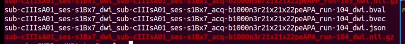

> 这一组是真正的 **DTI100 DWI 数据**：
>
> - `.nii.gz`：DWI 图像本体，约 **74 MB**
> - `.bval`：每个 volume 的 **b-value**
> - `.bvec`：每个 volume 的 **扩散梯度方向**
> - `.json`：DWI 的 **扫描参数元数据**

**.bval**

弥散梯度下收集的数据

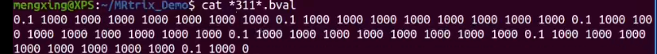

**.bvec**

施加的弥散梯度方向

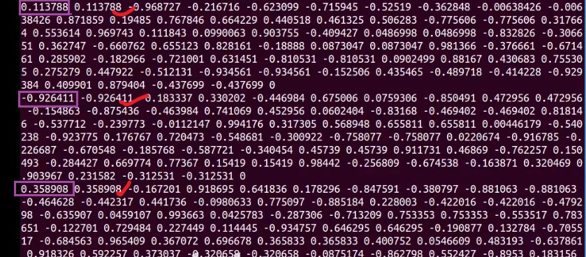

**.json**

相位编码方向


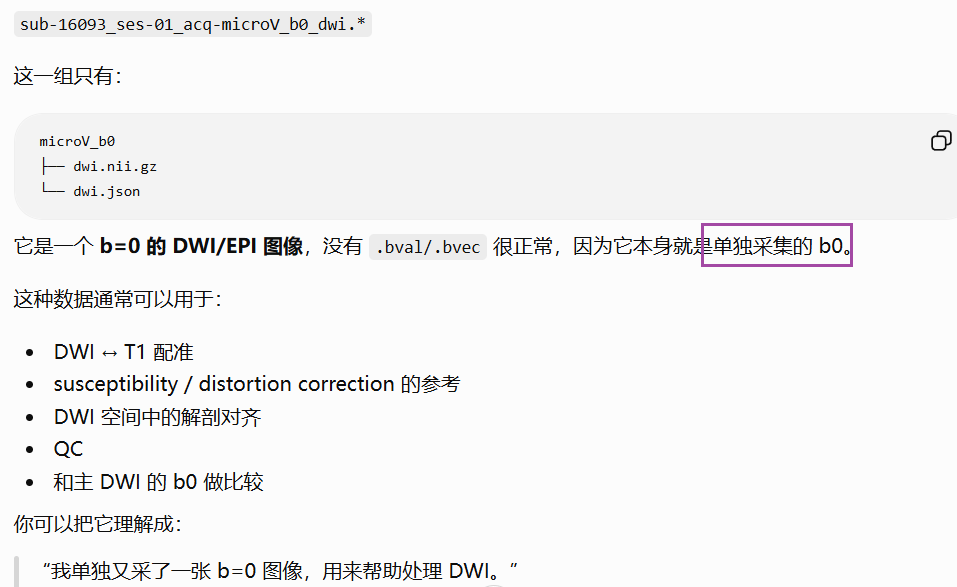

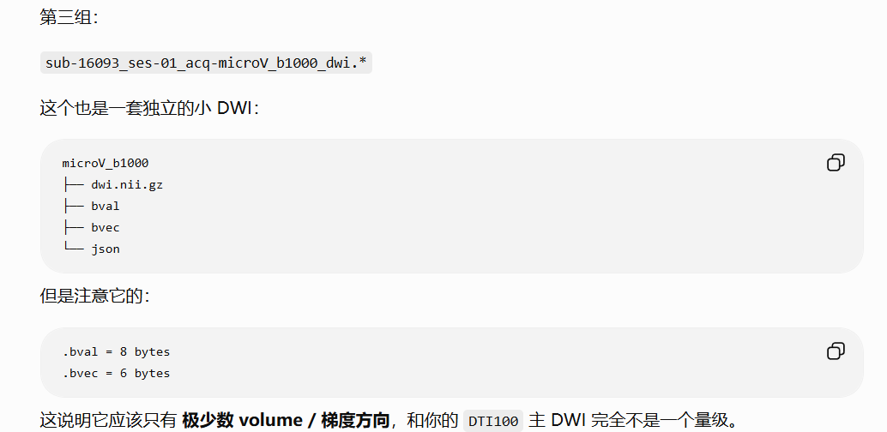

> 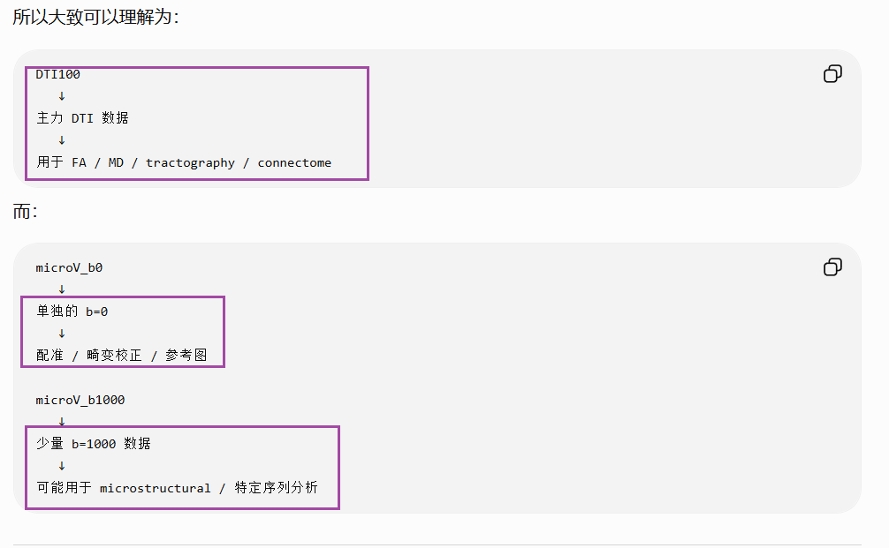


****

## 2. mif格式

包含所有文件

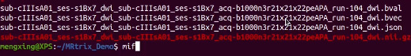


## 3.


# 原理

## 1.弥散张量

**DWI** = 原始扩散信息

**DTI = 对 DWI 做“张量建模”**

 **CSD** = 从 DWI 反推出纤维方向分布的方法
 **FOD** = CSD 得到的纤维方向分布结果
 **Tractography** = 根据 FOD 的方向一路追踪出纤维。

**FA/MD/AD/RD = 从张量中计算出来的指标**

### 0.DWI


### 1.**DTI** （Diffusion Tensor Imaging，弥散张量成像）

描述水分子...

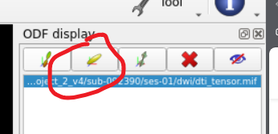

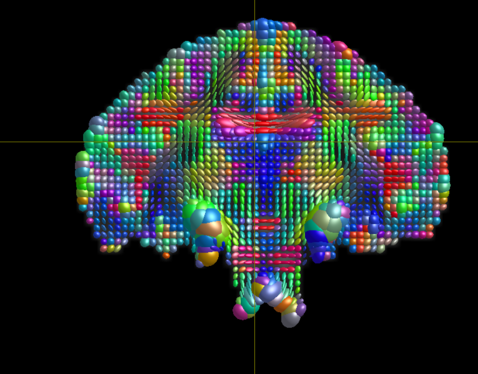

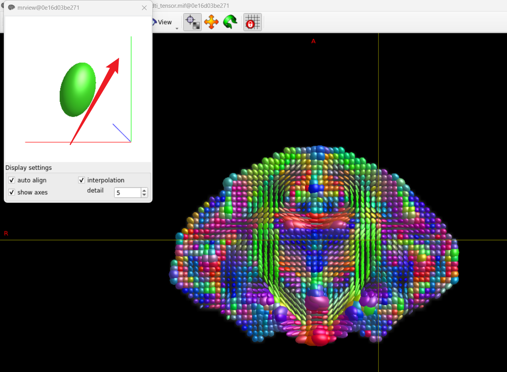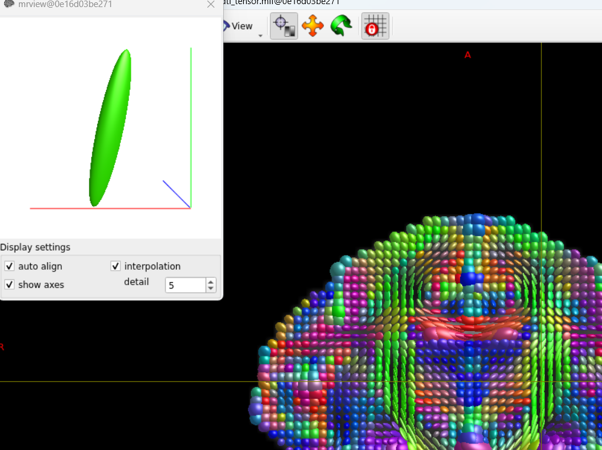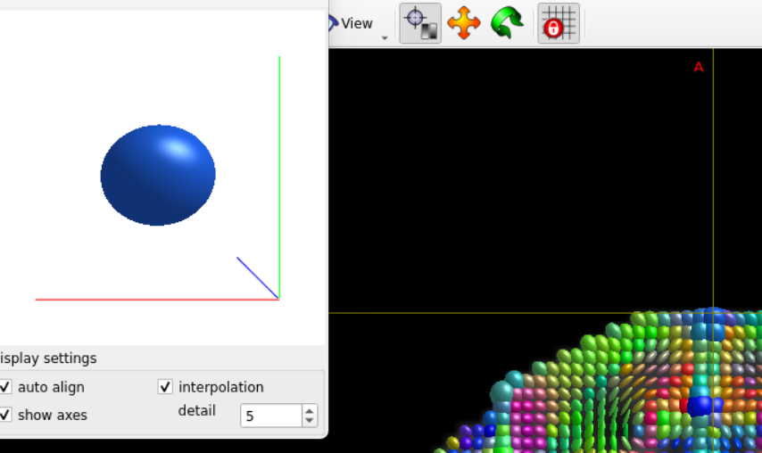

> 各项同性和各项异性


### 1.CSD

一个体素有多个纤维束, 所以更多使用CSD


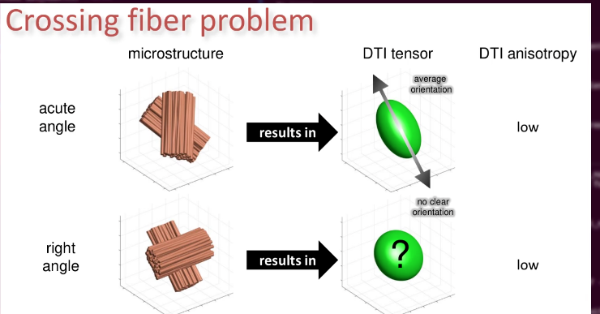

#### 1 dwi2response

白质 b=0, 1000, 2000

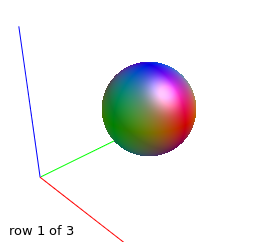 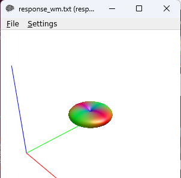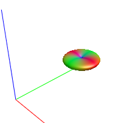>

> 高B值各向异性


灰质

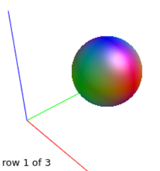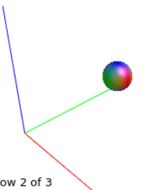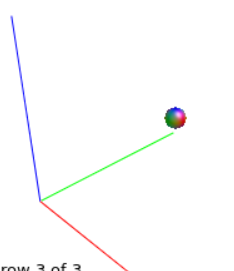

> 灰质下都是各项同性的


脑脊液csf

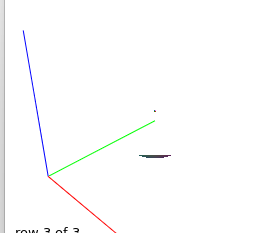

> 幅度很小--> 区分脑脊液和灰质

### 2.FOD

### 1 dwi2fod

纤维走向分布

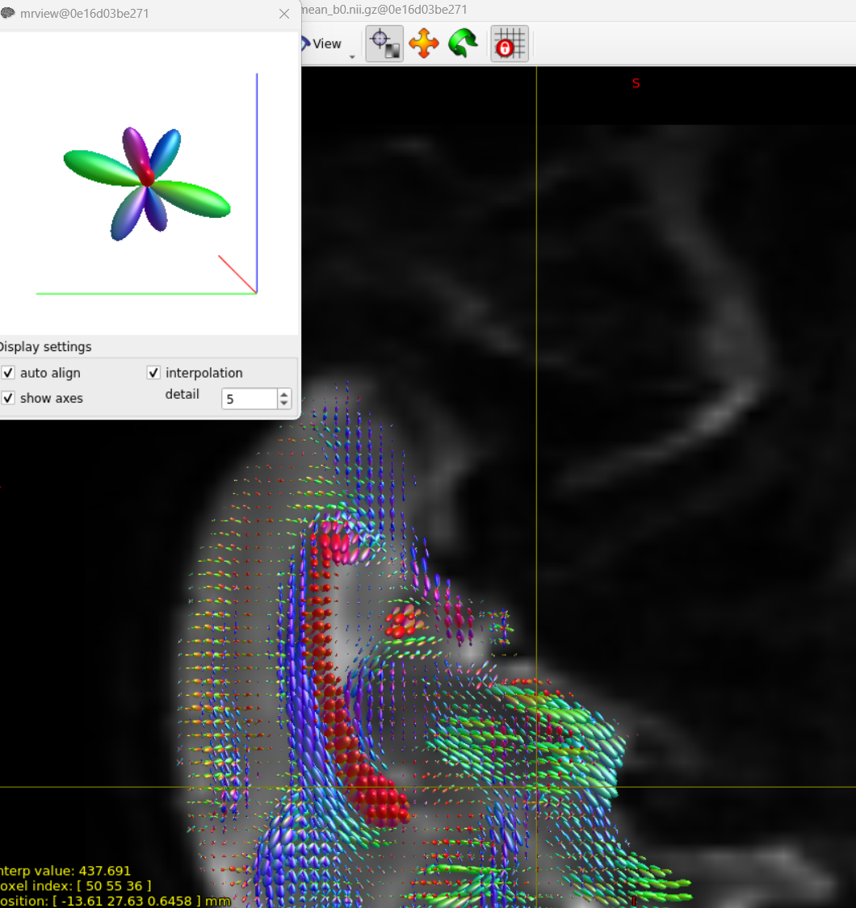 

>  交叉纤维


> 


## 3.纤维束追踪

### 1 tckgen

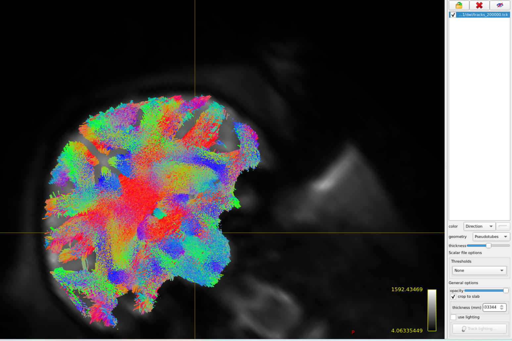


### 2 roi 追踪

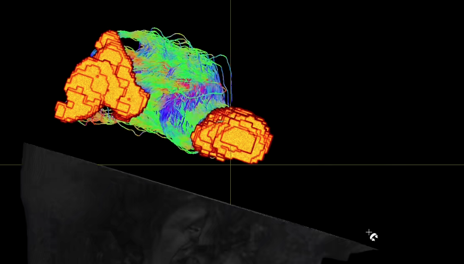


## 3.分区连接

**分区模版**

1. atlas模版
2. ...


### 1 labelconvert

### 2 tck2connectome

### 3 tcksample

> 使用强度或者平均值sample进行连接

### 

### 4 python 画图

### 


# 命令


### mrinfo

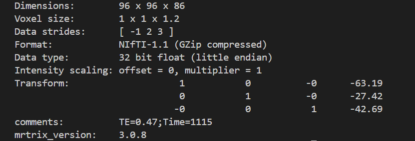


# 流程

## 0.流程图

```
原始 DWI
   ↓
DWI 预处理
   ↓
去噪 / 去 Gibbs / 偏置场校正 / eddy 等
   ↓
得到“预处理后的 DWI”
   │
   ├──────────────→ DTI → FA / MD / AD / RD
   │                         ↓
   │                    配准到 T1
   │                         ↓
   │                    配准到 NMT
   │                         ↓
   │                    ROI统计
   │
   └──────────────→ CSD → FOD → Tractography
                              ↓
                         纤维束追踪
```


## 1.预处理步骤?


| **步骤**                       | **执行命令**                                               | **做了什么？**                                               | **目的与关键产物**                                           |
| ------------------------------ | ---------------------------------------------------------- | ------------------------------------------------------------ | ------------------------------------------------------------ |
| **[1/8] 格式转换**             | `mrconvert`                                                | 将 NIfTI 格式转换为 MRtrix 专用的 MIF 格式，并将 `.bvec` / `.bval` 写入文件头。 | 产出 `dwi_raw.mif`。MIF 格式处理弥散梯度信息更高效、不易丢失方向信息。 |
| **[2/8] 热噪声去除**           | `dwidenoise`                                               | 使用 MP-PCA（Marchenko-Pastur 随机矩阵理论）算法评估并去除图像中的热噪声。 | 产出 `dwi_denoised.mif` 和 `dwi_noise.mif`（噪声图）。在不损失空间分辨率的前提下显著提升信噪比（SNR）。 |
| **[3/8] 吉布斯环状伪影去除**   | `mrdegibbs`                                                | 利用亚像素偏移算法去除 k-空间截断导致的吉布斯环状伪影（Gibbs Ringing）。 | 产出 `dwi_unring.mif`。主要消除组织交界处（如脑脊液与脑组织边缘）的明暗相间条纹。 |
| **[4/8] 偏置场校正**           | `dwibiascorrect ants`                                      | 调用 ANTs N4 算法，去除 MRI 磁场不均匀导致的低频信号强度不均（Bias Field）。 | 产出 `dwi_bias.mif` 和 `bias_field.mif`。保证全脑同类组织的信号强度具有可比性。 |
| **[5/8] 脑掩膜提取与 b0 均值** | `dwi2mask` `dwiextract` + `mrmath`                         | 自动剥离颅骨建立脑掩膜；提取所有 $b=0$ 图像并计算平均 $b_0$ 图。 | 产出 `dwi_mask.mif`（颅脑掩膜）和 `mean_b0.mif`（结构参考图）。 |
| **[6/8] 弥散张量拟合 (DTI)**   | `dwi2tensor` `tensor2metric`                               | **核心分析一**：拟合传统 DTI 张量模型，计算常用标量指标。    | 产出经典 DTI 指标（同时导出 `.nii.gz`）： • **FA** (`dti_fa`)：各向异性分数 • **MD/ADC** (`dti_md`)：平均弥散率 • **AD** (`dti_ad`)：轴向弥散率 • **RD** (`dti_rd`)：径向弥散率 • **VEC** (`dti_vec`)：主扩散方向矢量 |
| **[7/8] 多壳 CSD & FOD 拟合**  | `dwi2response dhollander` `dwi2fod msmt_csd` `mtnormalise` | **核心分析二**：采用无监督算法估算白质/灰度/CSF 的响应函数，做**多壳约束球面反演 (MSMT-CSD)**，并做多组织归一化。 | 产出 **FOD（纤维方向分布）** 文件：`fod_wm_norm.mif`。 为下一步（如 `06_tractography.sh` 纤维追踪）提供克服交叉纤维（Crossing Fibers）难题的高级方向数据。 |
| **[8/8] 导出与统计**           | `mrconvert` `mrstats`                                      | 将关键 MIF 文件转回标准的 `.nii.gz`（方便 AFNI/FSL/ITK-SNAP 查看），并输出全脑 FA/MD 统计值。 | 产出 `stats_fa.txt`、`stats_md.txt` 等日志，并在控制台直接打印全脑 FA/MD 平均值。 |


### 其他操作

> **Bias correction：修“亮度不均”。**
>  **Eddy：修“每个 DWI volume 动了/被涡流拉了”。**
>  **Topup：修“整个 EPI 被磁场扭曲了”。**
>
> | 方法             | 修什么                    | 主要改变                  |
> | ---------------- | ------------------------- | ------------------------- |
> | `dwibiascorrect` | Bias Field                | **信号强度**              |
> | `eddy`           | 运动 + 涡流               | **volume之间的位置/形状** |
> | `topup`          | susceptibility distortion | **EPI整体几何形变**       |

1 偏置场校正


2 运动/涡流校正


3 susceptibility 畸变校正


## 2.DTI（Diffusion Tensor Imaging，弥散张量成像）


## 3.纤维束追踪操作

```
fod_wm_norm.mif
      │
      │ WM FOD
      ↓
FA > 0.2
      +
DWI mask
      ↓
seed_wm.mif
      │
      ↓
    tckgen
    iFOD2
      │
      ↓
200,000 条 streamlines
      │
      ├── tracks_200000.tck
      │
      ├── tdi.mif
      │
      └── tracks_view.tck
```


## 4. 连接组步骤


# 分析

## 1. 评估指标

---


## 2. 预处理分析

```bash
cd /opt/project_1/derivatives/v2/dwi

afni mean_b0.nii.gz dti_fa.nii.gz dti_md.nii.gz dti_ad.nii.gz dti_rd.nii.gz dwi_mask.nii.gz tdi.nii.gz
```

Underlay 用 `mean_b0`，Overlay 用 `dti_fa`（白质亮、脑室暗）。`tdi` 是 06 的纤维密度图。

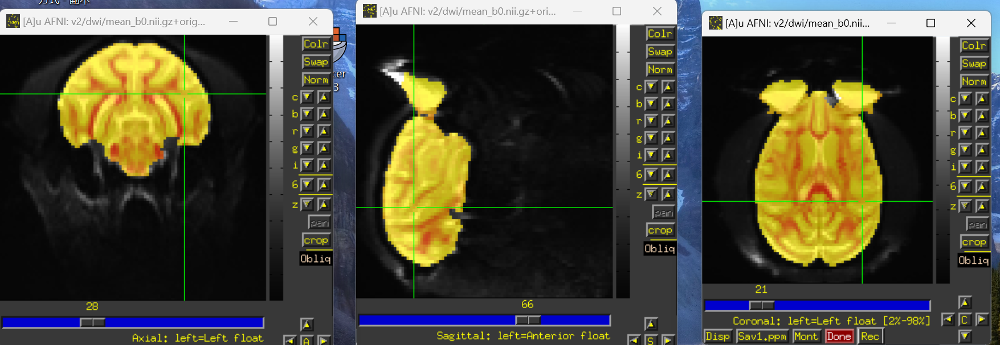


#### 1. 查看mask

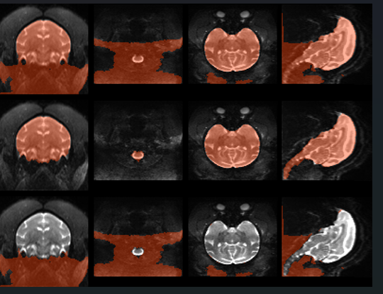


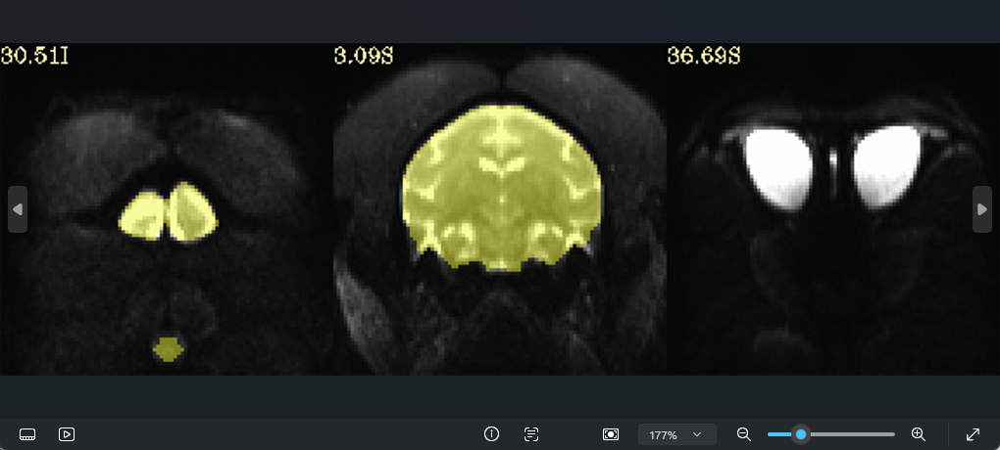

> qc_mask_tight_on_b0.axi


#### 2. DWI 本身：有没有明显伪影

#### **3. b0：空间和解剖结构是否合理**

#### 4. DTI：下游结果是否合理

#### 5.FOD / Tractography：纤维方向和追踪是否合理

****

## 3.DTI

### 3.1评估指标

                 DTI
                  │
        ┌─────────┼─────────┐
        ↓         ↓         ↓
       FA         MD        AD
    方向性强弱   平均扩散程度   主方向扩散程度

FA 看“扩散有没有方向性”，MD 看“总体扩散得厉不厉害”。 `AD` 沿着主要扩散方向的扩散程度。

#### FA

FA 衡量的是**水分子扩散方向性的强弱**。

范围：理论上 `0 ~ 1`

`FA ≈ 0`：扩散接近各向同性，各个方向差不多

`FA ≈ 1`：扩散高度集中在某一个方向

白质纤维束通常具有较高 FA，因为轴突结构限制水分子的扩散方向


```
      volume       mean     median        std        min        max      count
       [ 0 ]   0.229889    0.14668    0.22685 0.00586111    1.22474     112687
```

> 1. FA 出现大于 1 的值
>    多个 session 的 FA 最大值在 1.15–1.22 左右。理论上 FA 应该在 0–1 之间，因此这些属于异常张量拟合结果。


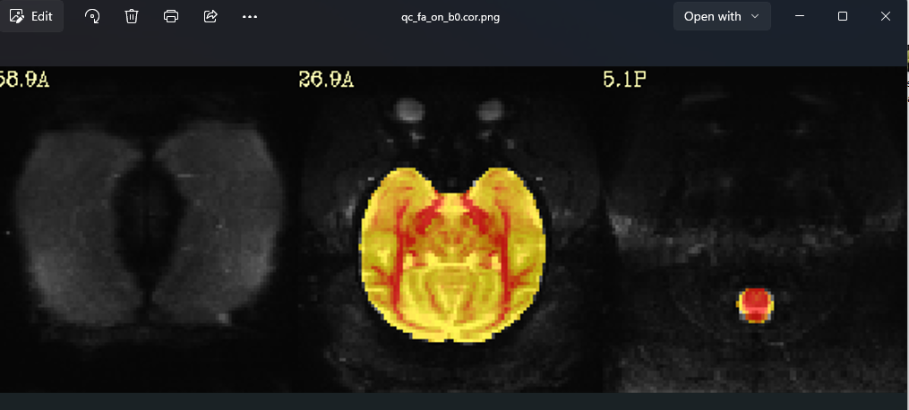

> qc_fa_on_b0.sag

****

#### MD

MD 衡量的是**水分子整体扩散能力的平均水平**。**不考虑方向，只看水分子总体扩散得有多快。**

```
      volume       mean     median        std        min        max      count
       [ 0 ] 0.000362655 0.000352555 0.000305895 -0.000270287  0.0026579     112687
```

> 1. MD 出现负值
>    `sub-16093 ses-01/02/03` 等结果中 MD 最小值约为 `-0.00025`，扩散率不应为负值。


#### AD

AD 描述的是**沿主要扩散方向的扩散能力**。可以简单理解为：**水沿着纤维主方向扩散得有多快。**


#### RD

**垂直于主要扩散方向的扩散能力**。


### 3.2 方法

#### 1.FA, MD, AD, RD指标分析

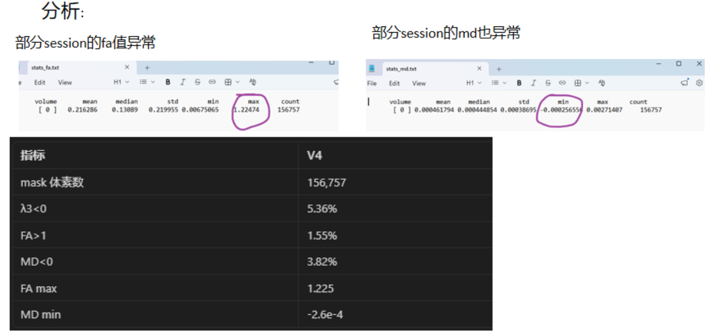


#### 2. 查看异常值位置

```
# 并集异常（推荐先看这个）
mrview mean_b0.mif \
  -overlay.load outlier_fa_or_md.mif \
  -overlay.colourmap 1 \
  -overlay.intensity 0,1 \
  -overlay.opacity 0.6

# 只看 FA>1
mrview mean_b0.mif \
  -overlay.load outlier_fa_gt1.mif \
  -overlay.colourmap 1 \
  -overlay.intensity 0,1 \
  -overlay.opacity 0.6

# 只看 MD<0
mrview mean_b0.mif \
  -overlay.load outlier_md_lt0.mif \
  -overlay.colourmap 2 \
  -overlay.intensity 0,1 \
  -overlay.opacity 0.6

# 同时叠 FA 图 + 异常点（更直观）
mrview dti_fa.mif \
  -overlay.load outlier_fa_or_md.mif \
  -overlay.colourmap 1 \
  -overlay.intensity 0,1 \
  -overlay.opacity 0.7
```

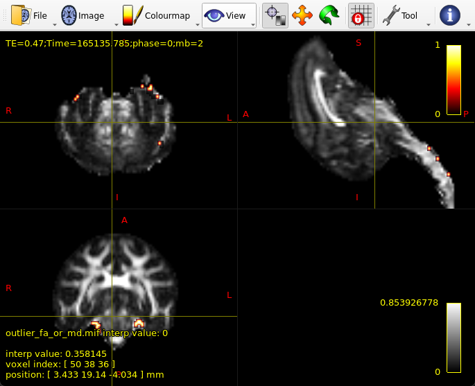

## 


****

## 4.配准到T1质检

资源管理器直接打开：

`F:\MRI\project_1\derivatives\v2\dwi\qc_aw\`

| 图                       | 看什么                      |
| ------------------------ | --------------------------- |
| `qc_fa_on_t1.*.png`      | FA 叠在 T1 上，白质应贴解剖 |
| `qc_b0_on_t1.*.png`      | mean b0 和 T1 轮廓          |
| `qc_fa_on_nmt.*.png`     | FA 已经变到 NMT             |
| `qc_dwimask_on_t1.*.png` | DWI 掩膜有没有切脑          |
| `qc_WMmask_on_b0.*.png`  | SEG 白质是否落在 b0 上      |

### 4.1

### 4.2 方法

> 
>
> **第一层：看原始 DWI / 预处理前后有没有明显问题**
>
> 首先看：
>
> ```
> mean_b0
> ```
>
> 检查：
>
> - 有没有明显信号缺失
> - 有没有严重运动伪影
> - 有没有条纹
> - 有没有脑外大量噪声
> - 左右、前后方向有没有异常
> - 脑是否完整
>
> 如果你的 `05_dwi_mrtrix.sh` 里面做了：
>
> ```
> denoise
> degibbs
> bias correction
> eddy
> topup
> ```
>
> 最好比较：
>
> ```
> raw b0
>     ↓
> preprocessed b0
> ```
>
> 看看预处理之后有没有明显改善。
>
> 特别是猴脑数据，头动和 EPI 畸变都值得注意。
>
> ------
>
> **第二层：检查 Brain Mask**
>
> 你现在已经有：
>
> ```
> dwi_mask.nii.gz
> ```
>
> 这个要看：
>
> ```
> mean_b0
>     +
> dwi_mask
> ```
>
> 也就是你脚本里的：
>
> ```
> qc_WMmask_on_b0
> ```
>
> 以及：
>
> ```
> qc_dwimask_on_t1
> ```
>
> 重点观察：
>
> > mask 有没有把整个脑包住？
>
> 比如正常：
>
> ```
>        _________
>      /           \
>     |   ███████   |
>     |  █████████  |
>     |   ███████   |
>      \___________/
> ```
>
> 不应该出现：
>
> ```
>        _________
>      /           \
>     |   █████     |
>     |  ████       | ← 少了一块脑
>     |             |
>      \___________/
> ```
>
> 或者：
>
> ```
>     mask
>      ↓
> ██████████████
>       脑
> ```
>
> mask 大量跑到脑外。
>
> ------
>
> **第三层：DWI → T1 配准**
>
> 这个是你现在最需要关注的。
>
> 你的：
>
> ```
> Dice = 0.9093
> ```
>
> 说明：
>
> > DWI mask 和 T1 mask 的整体重叠很好。
>
> 这是一个很好的指标。
>
> 但还需要看：
>
> ```
> qc_b0_on_t1
> ```
>
> 也就是：
>
> ```
> T1
>  +
> mean b0
> ```
>
> 看脑轮廓是否一致。
>
> 然后看：
>
> ```
> qc_fa_on_t1
> ```
>
> 这个更加重要。
>
> 因为：
>
> ```
> T1
>  +
> FA
> ```
>
> 可以检查：
>
> > **DWI 的扩散结构是不是落在正确的解剖位置。**
>
> 例如：
>
> ```
> T1：
> 
> 皮层
> ██████████████
> 
> 白质
>  ▓▓▓▓▓▓▓▓▓▓▓▓
> 
> 
> FA：
> 
> 低 FA
> ██████████████
> 
> 高 FA
>  ▓▓▓▓▓▓▓▓▓▓▓▓
> ```
>
> 如果位置基本一致，就很好。
>
> ------
>
> **第四层：看 FA / MD 的组织差异**
>
> 你已经做了：
>
> ```
> WM FA ≈ 0.37
> GM FA ≈ 0.15
> ```
>
> 这其实是非常有意义的 QC。
>
> 可以继续看：
>
> ```
> WM
> GM
> scGM
> CSF
> ```
>
> 分别的：
>
> ```
> FA mean
> FA median
> FA std
> 
> MD mean
> MD median
> MD std
> ```
>
> ------
>
> **第五层：看 FA 图本身**
>
> 你可以把 FA 当成一张“白质质量地图”。
>
> 例如：
>
> ```
> FA
> 
> 0 ─────────────────── 低
>       灰质
> 
>       白质
>        ↑
>        │
>      高 FA
> 
> 1 ─────────────────── 高
> ```
>
> 重点观察：
>
> > 高 FA 是否主要位于白质。
>
> 你现在：
>
> ```
> WM ≈ 0.37
> GM ≈ 0.15
> ```
>
> 已经说明这一点。
>
> 但是还要看有没有：
>
> ```
> 异常高 FA
> ```
>
> 比如脑外突然出现：
>
> ```
> FA = 0.8
> ```
>
> 那通常就不太正常。
>
> ------
>
> **第六层：看 MD**
>
> MD 和 FA 是互补的。
>
> FA：
>
> > **水扩散是否具有方向性**
>
> MD：
>
> > **总体扩散程度有多大**
>
> 所以：
>
> ```
> FA
>  ↓
> 方向性
> 
> MD
>  ↓
> 扩散大小
> ```
>
> 你的脚本已经计算：
>
> ```
> dti_md.nii.gz
> ```
>
> 所以也应该：
>
> ```
> MD + T1
> ```
>
> 看看有没有异常区域。

#### 1. FA 叠在 T1 上，白质应贴解剖

> 看着还可以

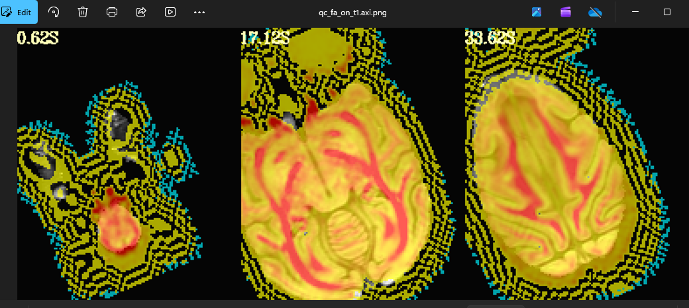

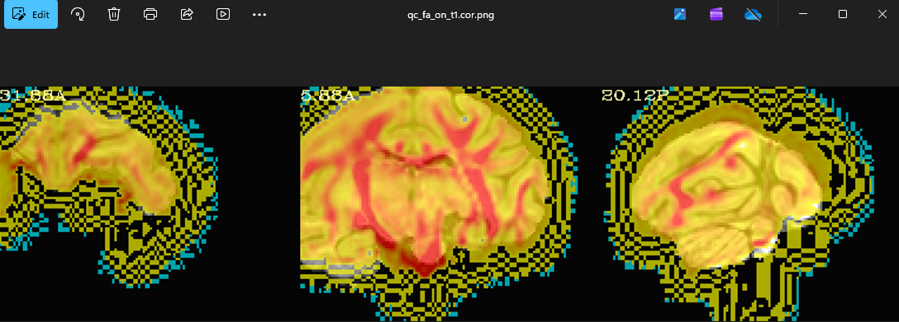

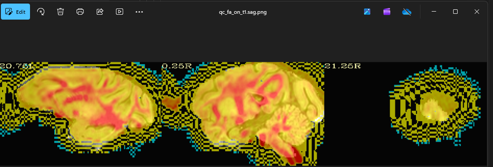

把 07 配到 T1 的图画在一起：

```bash
AW=/opt/project_1/derivatives/v2/anat_aw/sub-1908021_aw
QC=/opt/project_1/derivatives/v2/dwi/qc_aw

afni \
  ${AW}/sub-1908021_anat_ns.nii.gz \
  ${QC}/mean_b0_in_t1.nii.gz \
  ${QC}/dti_fa_in_t1.nii.gz \
  ${QC}/dti_md_in_t1.nii.gz \
  ${QC}/dwi_mask_in_t1_bin.nii.gz \
  ${QC}/dti_fa_in_nmt.nii.gz
```

Underlay：`sub-1908021_anat_ns`；Overlay：`dti_fa_in_t1`。

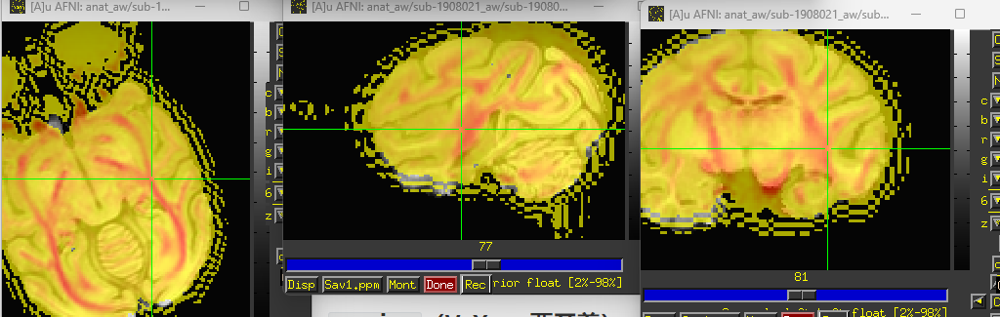

****

#### 


#### 2. mean b0 和 T1 轮廓

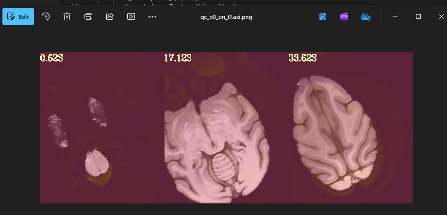

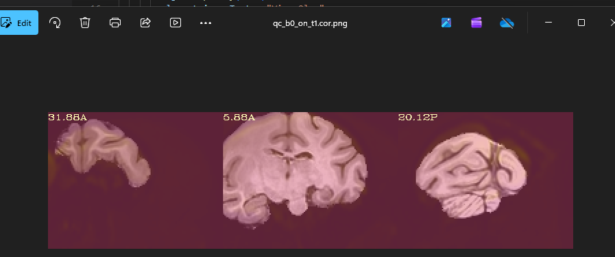

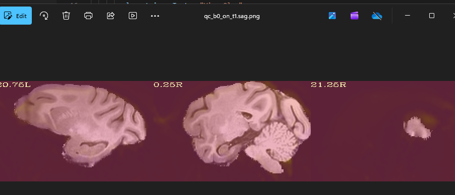


#### 3. FA 已经变到 NMT

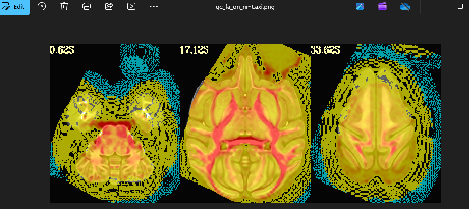

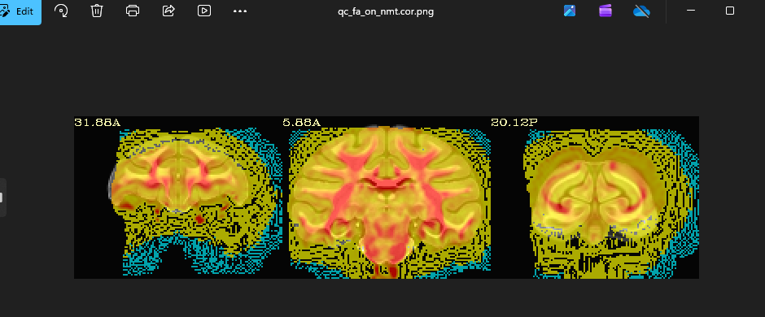

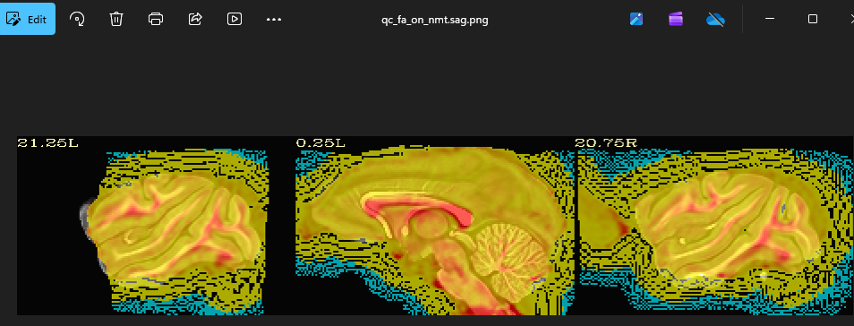


#### 4. DWI 掩膜有没有切脑

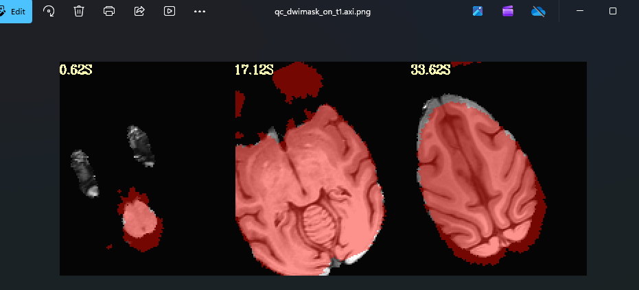

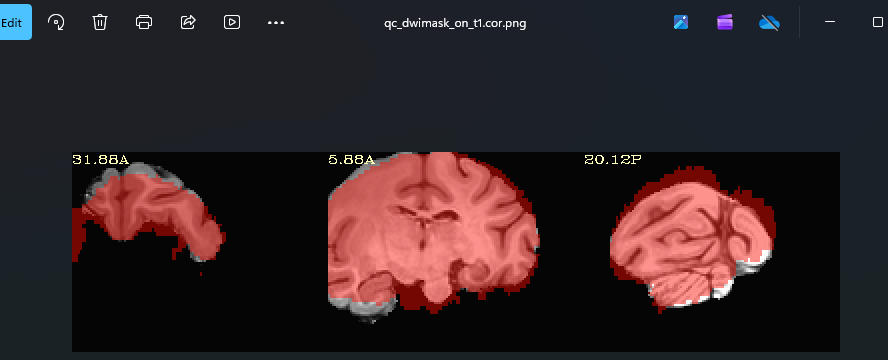

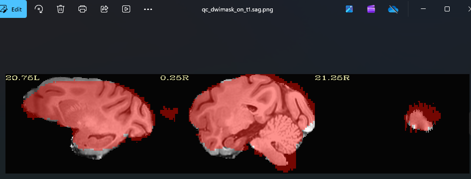

#### 5. SEG 白质是否落在 b0 上

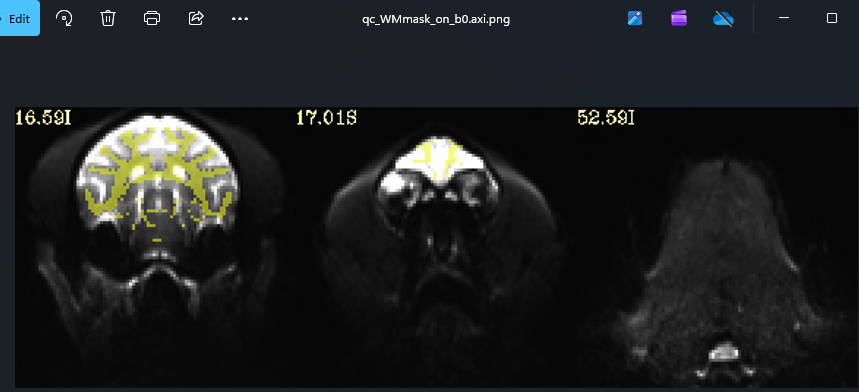

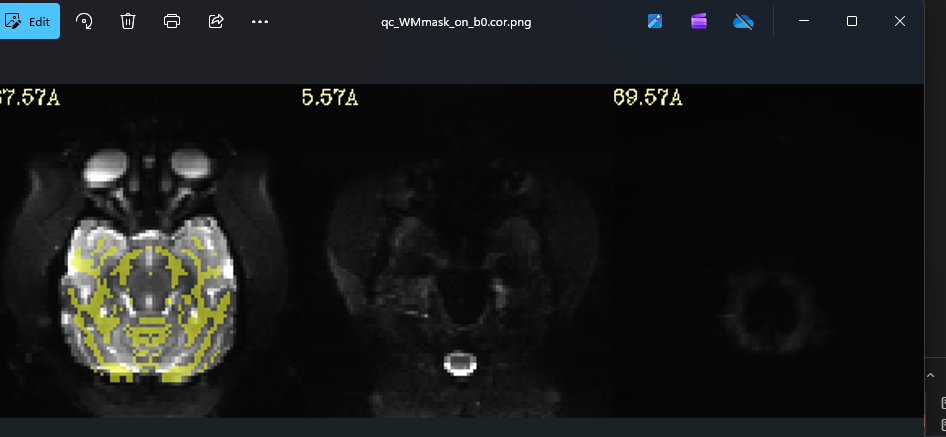

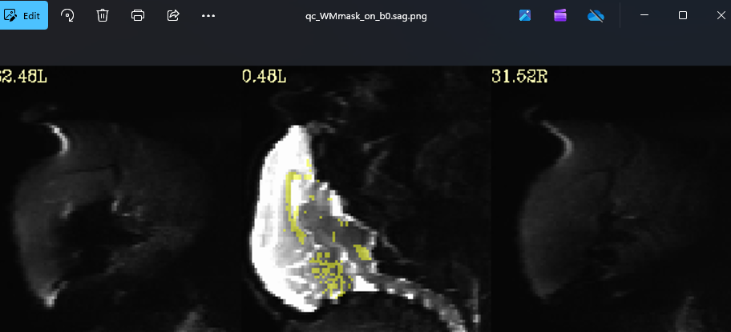


---

## 4.纤维追踪 — `mrview`

**看子集** `tracks_view.tck`（2 万条），不要一上来开 20 万条的 `tracks_200000.tck`。

新开一个 Git Bash（不要用已经在跑 AFNI 的那个）：

```bash
export MSYS_NO_PATHCONV=1

docker run --rm -it \
  -e DISPLAY=host.docker.internal:0.0 \
  -v "F:/MRI:/opt/workspace" \
  -w /opt/workspace/project_2_v4/sub-092390/ses-01/dwi \
  mrtrix3/mrtrix3:latest \
  mrview dti_fa.nii.gz -tractography.load tracks_view.tck
```

```bash
export MSYS_NO_PATHCONV=1

docker run --rm -it \
  -e DISPLAY=host.docker.internal:0.0 \
  -v "E:/MRI/project_2_v4:/opt/workspace" \
  -w /opt/workspace/sub-092390/ses-01/dwi \
  mrtrix3/mrtrix3:latest \
  mrview dti_fa.nii.gz -tractography.load tracks_view.tck
```

底图是 FA，纤维应沿白质走，不要大量穿出脑外。

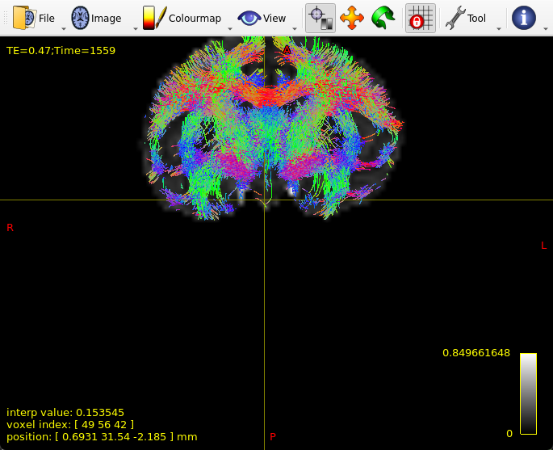

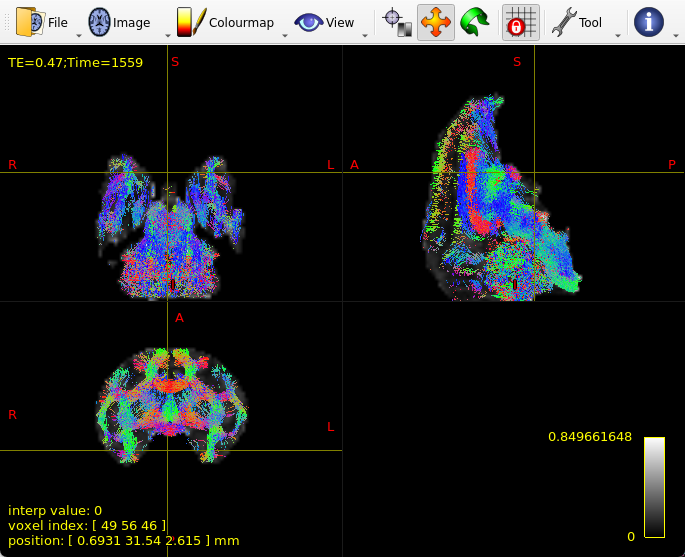

****
