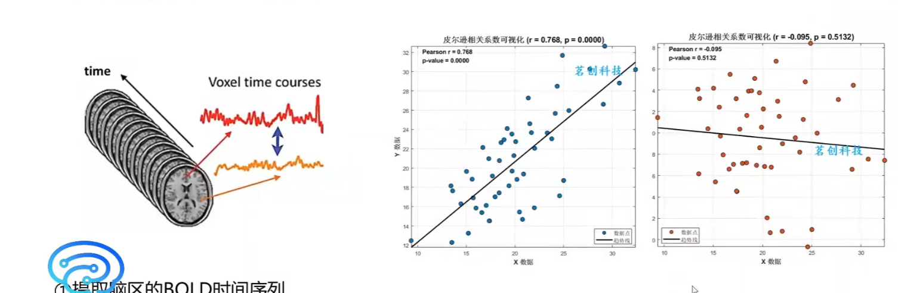
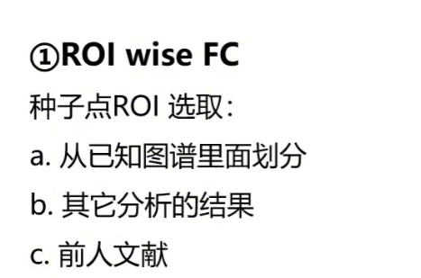
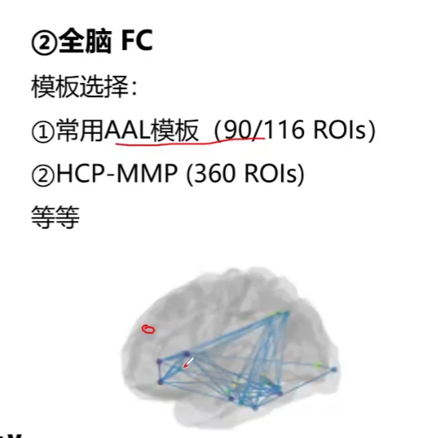

# 标准图谱

是什么?

这里说的**猕猴标准图谱（Macaque Standard Atlas）**，实际上就是**猴脑的标准坐标系和脑区地图**，它在人脑研究中的作用相当于人类 MRI 使用的 **MNI152 标准模板**。


为什么?

每只猴子的：

- 脑大小不同
- 脑形状不同
- 脑沟脑回位置略有差异

因此：

猴A的大脑坐标

```
(20,35,18)
```

和

猴B的大脑坐标

```
(20,35,18)
```

并不是同一个脑区

把所有猴脑都变形成统一的大脑。


怎么做? 

**NMT v2（Template）**：理解猴脑标准空间，以及为什么所有数据都要配准到这里。

**D99 Atlas**：学习猴脑主要解剖区域，这是最常用的精细解剖图谱。

**CHARM**：用于皮层 ROI 分析，特别适合功能连接研究。


## 流程

                    T1
                    │
                    ▼
             @animal_warper
                    │
              ┌─────┴─────┐
              ↓           ↓
          brain mask     NMT
              │
              └─────┬─────┘
                    ↓
                 afni_proc.py
                    ↑
                    │
                  EPI
                    ↓
             fMRI preprocessing


## 实现

rigid 预对齐 + -align_centers_meth cm

```
#!/usr/bin/env bash
# rigid 预对齐 + @animal_warper (-align_centers_meth cm)
set -euo pipefail

# ========== 路径与被试（按需修改）==========
PROJ="$(cd "$(dirname "${BASH_SOURCE[0]}")/.." && pwd)"
SUBJ="sub-1908021"
SES="ses-01"
ANAT="${PROJ}/data/${SUBJ}/${SES}/anat/${SUBJ}_${SES}_T1w.nii.gz"
OUT="${PROJ}/derivatives/anat_aw_rigid_cm_min"
NMT_ROOT="${PROJ}/atlas/NMT_v2.0_sym/NMT_v2.0_sym_05mm"   # 按实际路径调整
BASE="${NMT_ROOT}/NMT_v2.0_sym_05mm_SS.nii.gz"
BMASK="${NMT_ROOT}/NMT_v2.0_sym_05mm_brainmask.nii.gz"

mkdir -p "${OUT}/work"
cd "${OUT}/work"

# ========== 1. 方向统一 ==========
3dWarp -overwrite -deoblique -prefix T1_deob.nii.gz "${ANAT}"
3dresample -overwrite -orient LPI -prefix T1_LPI.nii.gz -input T1_deob.nii.gz

# ========== 2. 颅骨剥离（供 rigid 用）==========
3dSkullStrip -overwrite -input T1_LPI.nii.gz -prefix T1_ss.nii.gz -monkey -no_avoid_eyes

# ========== 3. rigid 预对齐（只平移+旋转）==========
3dresample -overwrite -dxyz 1 1 1 -prefix nmt1.nii.gz -input "${BASE}"
3dresample -overwrite -dxyz 1 1 1 -prefix ss1.nii.gz  -input T1_ss.nii.gz

3dAllineate -overwrite \
  -base nmt1.nii.gz -source ss1.nii.gz \
  -prefix ss1_rigid.nii.gz \
  -1Dmatrix_save rigid_to_nmt.aff12.1D \
  -cost lpc+ZZ -warp shift_rotate -cmass \
  -twopass -twoblur 3 -fineblur 1 \
  -maxrot 90 -maxshf 50 -source_automask+2

# 把 rigid 变换应用到完整 T1
3dAllineate -overwrite \
  -base "${BASE}" -source T1_LPI.nii.gz \
  -1Dmatrix_apply rigid_to_nmt.aff12.1D \
  -prefix T1_rigid.nii.gz -master BASE -final wsinc5

# ========== 4. @animal_warper ==========
@animal_warper \
  -input T1_rigid.nii.gz \
  -input_abbrev ${SUBJ}_anat \
  -base "${BASE}" \
  -base_abbrev NMT2 \
  -skullstrip "${BMASK}" \
  -align_centers_meth cm \
  -outdir "${OUT}/${SUBJ}_aw" \
  -ok_to_exist

echo "完成 → ${OUT}/${SUBJ}_aw"
```


# 功能连接

就是计算种子区域ROI/体素与不同体素区域的相关系数

# 1 计算类型

### 1 皮尔逊相关





### 2 偏相关


### 3 相干分析


## 2 连接类型

1. roi FC

 

1. 全脑FC

 


# 纤维束追踪

## 追踪方法

1. ### 1 纤维束方向估计方法

2. ### 2 连接方法

3. ### 3 纤维束起点和结束

4. ### 4  概率和确定性方法

5. 


