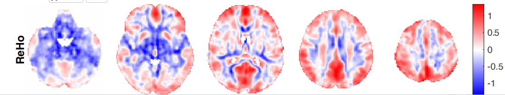
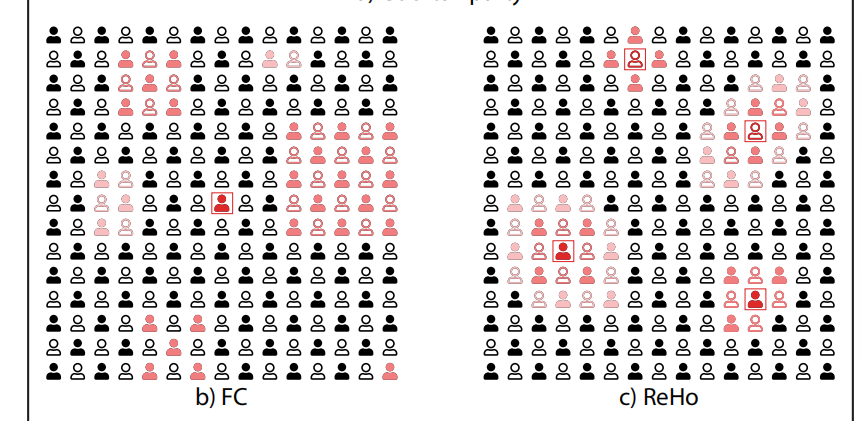
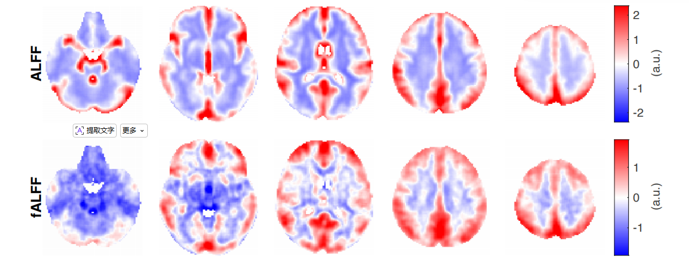
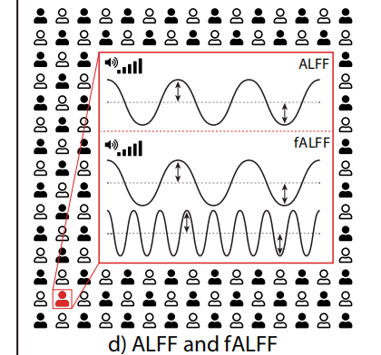

# 1. nii.gz python


# 2. resting analysis

```
ReHo / fALFF
      ↓
得到每个 session 的 3D map
      ↓
QC：看图是否正常
      ↓
标准化到 NMT
      ↓
按 CHARM / D99 脑区提取 ROI 数值
      ↓
正常 vs 卒中后
      ↓
随时间变化
      ↓
和 lesion / DTI / 结构连接联系起来
```


## 1 ReHo 

看“这个体素和它周围邻居的时间序列是不是同步”。

经典方法是 **Kendall's coefficient of concordance (KCC)**。





## 2 ALFF

> ALFF 用于测量特定频率范围（通常位于 LFF 频段，如0.01–0.08 Hz）内的BOLD信号频谱功率（Zang 等，2007）。该功率值反映了某一频率成分对BOLD信号的总体贡献度

**ALFF：这个脑区的低频波动有多强？**


#### 那低频波动强能说明什么呢?

可以把它理解成：**低频波动强，说明这个脑区在静息状态下，自发 BOLD 信号的低频成分比较明显。**

但要特别注意：**它不能直接等价于“这个脑区更活跃”或者“功能更强”。**

比如一个脑区的 fALFF 较高，可以比较谨慎地描述为：

> 该脑区的静息态 BOLD 信号中，低频自发波动所占比例较高。

```
PrCO BOLD
    │
    ├── 0.01–0.08 Hz 的低频波动
    │
    ↓
   曲线 A

M1 BOLD
    │
    ├── 0.01–0.08 Hz 的低频波动
    │
    ↓
   曲线 B

A ↔ B
相关性
 ↓
FC
```


## 3 fALFF

**fALFF：这个脑区的低频波动，在它自己的整体波动中占多大比例？**

用于表征给定体素及其周围邻域体素的区域功能相干性


> ALFF 和 fALFF 图谱在靠近大脑皮层的区域显示出较高的数值，而在皮层下区域则显示出较低的数值，这一结果与既往研究（H. Yang 等，2007；Zuo 等，2010）相符。在针对 H 的研究中也观察到了大脑皮层与皮层下区域之间类似的数值变化趋势（Campbell 等，2021；Campbell 与 Weber，2022）





