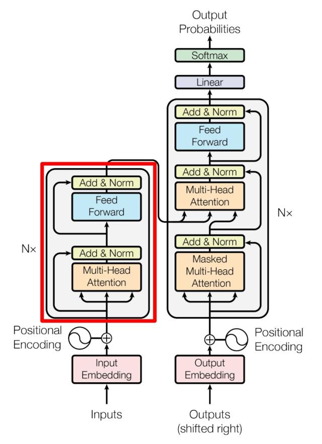
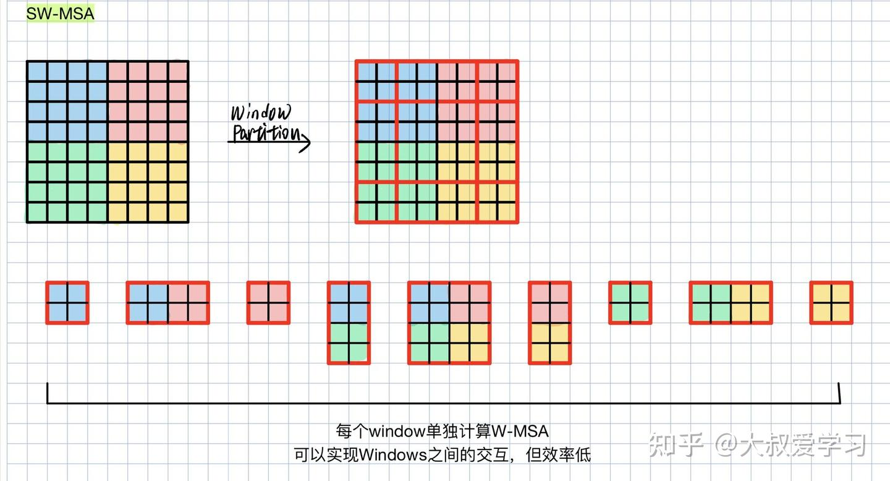
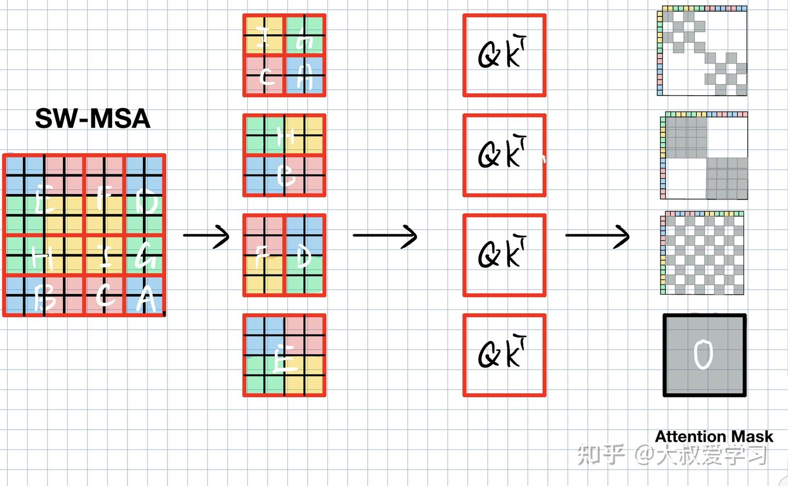

> 补充对Transformer的理解

# Transformer

## 一 前言

### 1 是什么

 

组成:

1. **MHA**: 进行自注意力(token间交流)
2. **LayerNorm**: 让网络更容易训练
3. **FFN **: 进行非线性特征变换(token自己加工一下)
4. **ADD(Residual Connection)**: 残差连接,让网络更容易训练


### 2 为什么要堆叠? 

> 类比Conv进行堆叠

堆叠实现不断做 token 之间的信息交互 + 特征变换。

```
第1层：
局部 token 之间直接交流

第2层：
融合更复杂的上下文

第3层：
形成更高级的语义关系

第N层：
得到高度抽象的全局表示
```

**例如:**

**第一层：**

```
A ──Attention──→ B、C、D
B ──Attention──→ A、C、D
C ──Attention──→ A、B、D
D ──Attention──→ A、B、C
```

第一层结束以后：

```
A → A₁
B → B₁
C → C₁
D → D₁
```

这里，**A₁ 已经融合了 B/C/D 的信息**。比如：

```
A₁ = A + 0.2B + 0.5C + 0.3D
```


**第二层：**

```
A₁ ──Attention──→ B₁、C₁、D₁
B₁ ──Attention──→ A₁、C₁、D₁
C₁ ──Attention──→ A₁、B₁、D₁
D₁ ──Attention──→ A₁、B₁、C₁
```

第二层结束以后：

```
A₁ → A₂
B₁ → B₂
C₁ → C₂
D₁ → D₂
```

这里: 第一层之后：A₁ 虽然直接看到了 B，

但因为：B₁(第一层后) 里面已经包含了 C 的信息，而 C₁ 又可能包含 E 的信息。第二层再交互的时候：A 就可以**间接获得更远、更复杂的上下文信息**, 得到新的A2, 从而多层让这些已经混合过的信息再次交互, 逐渐形成更高层次的表示。

```
第1层

A ←→ B
A ←→ C
A ←→ D

        ↓

A₁ = “我知道周围是什么了”


第2层

A₁ ←→ B₁
     ←→ C₁
     ←→ D₁

        ↓

A₂ = “我知道周围的信息，以及这些周围信息之间的关系了”
```

```
A₀
 ↓
A₁  第一次上下文融合
 ↓
A₂  更复杂的上下文融合
 ↓
A₃  更高级语义
 ↓
...
```


### 3 FNN

1 是什么

**一个 token 内部的特征维度之间全连接。**不是token间的连接


## 改进


### 1swin

#### 1. 

#### 2. Shift 之后出了什么问题？

> Shift 是为了让不同窗口之间能交换信息；Mask 是为了防止「被 shift 硬凑进同一窗、但在原图上并不相邻」的 token 互相 attention。
>
> 因为原本会被分割更小块,9个大小不同的Windows
>
> 
>
> 不同的Windows，对不同大小的Window计算Attention计算并不高效, 所以进行了torch.roll的操作, 所以需要添加掩码, 使得原本不是同一块的不能相互计算, 比如左上4x4和右下4x4, 它们在原图空间上并不相邻（是被 shift「硬凑」进同一窗的）(8x8的window)




- A 区的 token 和 B 区的 token 被放进同一个窗口
- 若不做限制，A 会和 B 做 self-attention
- 但它们在原图空间上并不相邻（是被 shift「硬凑」进同一窗的）
- 这种 attention 没有真实的空间邻域意义，还会引入错误关联
