> ### 状态空间表示
>
> 状态空间模型由两个主要部分组成：
>
> 1. **[状态方程](https://zhida.zhihu.com/search?content_id=245006245&content_type=Article&match_order=1&q=状态方程&zhida_source=entity)（State Equation）**：描述系统的状态如何从一个时刻转移到下一个时刻。 
>    其中：
>
> -  是在时刻t的状态向量
> -  是[状态转移矩阵](https://zhida.zhihu.com/search?content_id=245006245&content_type=Article&match_order=1&q=状态转移矩阵&zhida_source=entity)
> -  是控制输入向量
> -  是控制输入矩阵
> -  是过程噪声，通常假设为[高斯噪声](https://zhida.zhihu.com/search?content_id=245006245&content_type=Article&match_order=1&q=高斯噪声&zhida_source=entity)
>
> 
>
> 1. **观测方程（Observation Equation）**：描述如何从系统的状态生成观测数据。
>     其中：
>
> -  是在时刻t的观测向量
> -  是观测矩阵
> -  是观测噪声矩阵
> -  是观测噪声，通常假设为高斯噪声


# 一 前言

> RNN是非线性递归模型，通过利用隐藏状态中存储的历史知识有效地捕获时间模式。

> 

> SSMs通过一组隐藏变量，即“状态”，来体现系统的行为，使其能够有效地捕获时间数据依赖性。与RNNs不同，SSMs是线性模型，具有关联属性。


## 1 状态空间模型

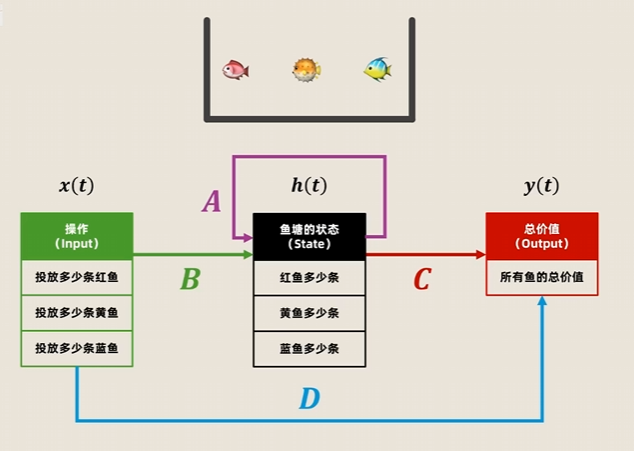

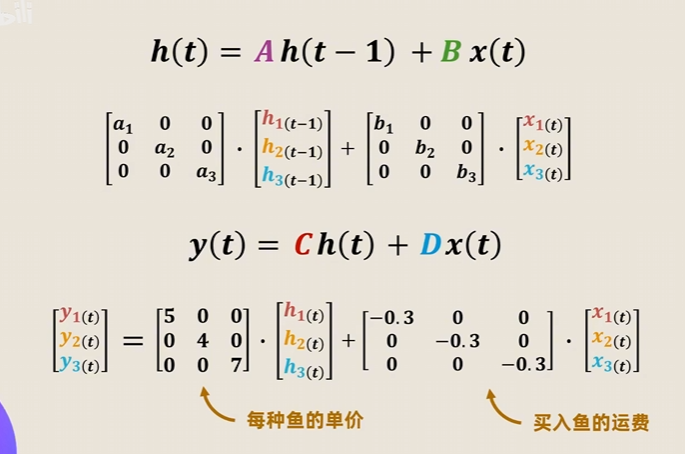


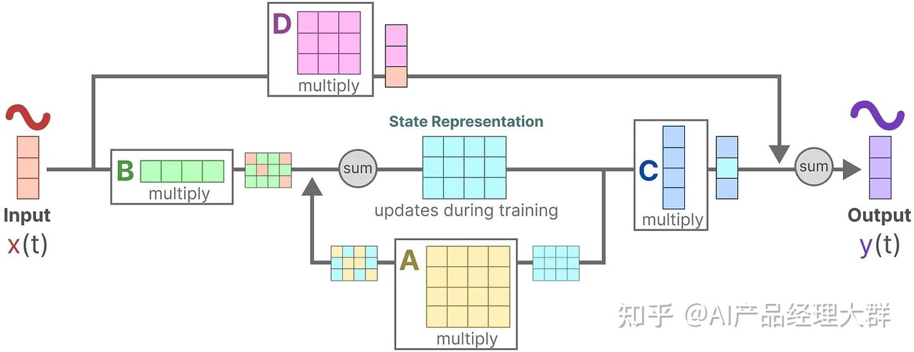


时不变

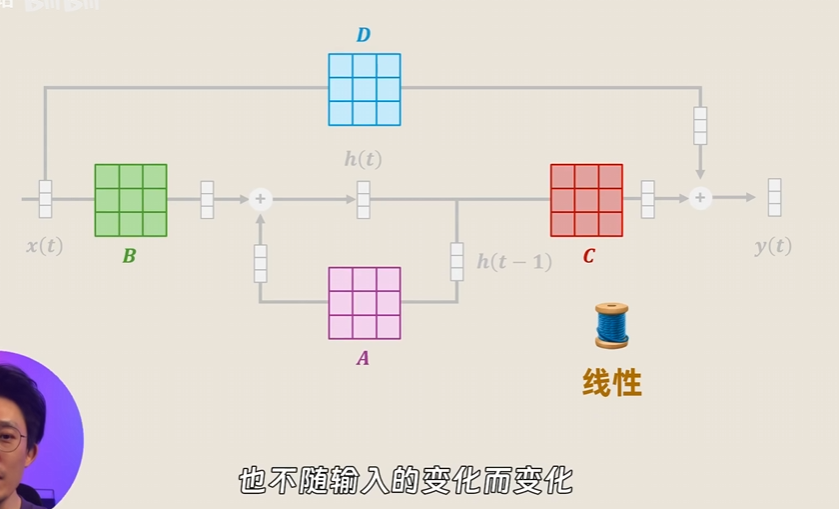

1. 不随时间和输入变化而变化


## 2. 离散状态空间模型

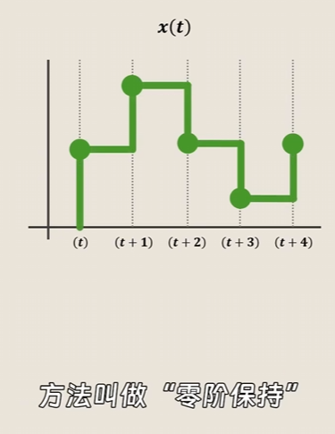

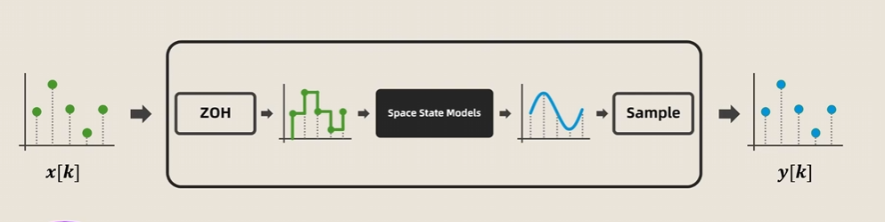

> 输入零阶保持器变成连续数据, 输出重采样变成离散数据


AB变化离散数据

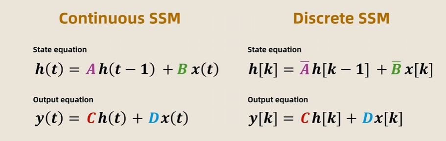

1. 零阶保持器
2. 

### 扩展为卷积核

因为时不变的性质

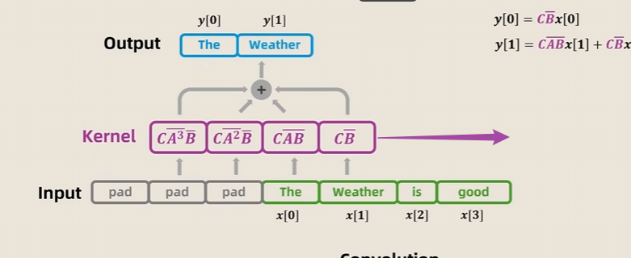

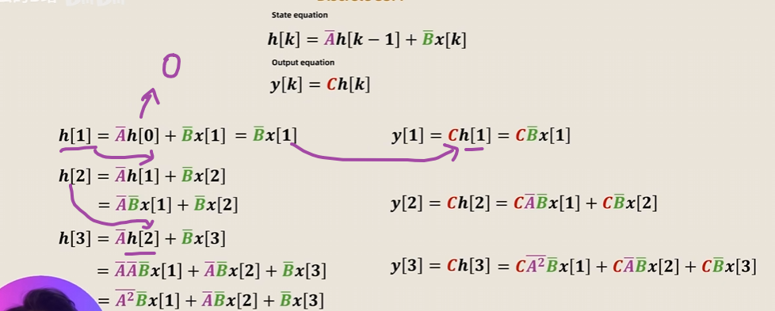

最终

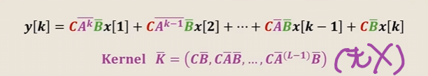

> 训练用CNN, 推理用RNN


## 4 结构化状态空间模型S4

1 解决长序列遗忘问题

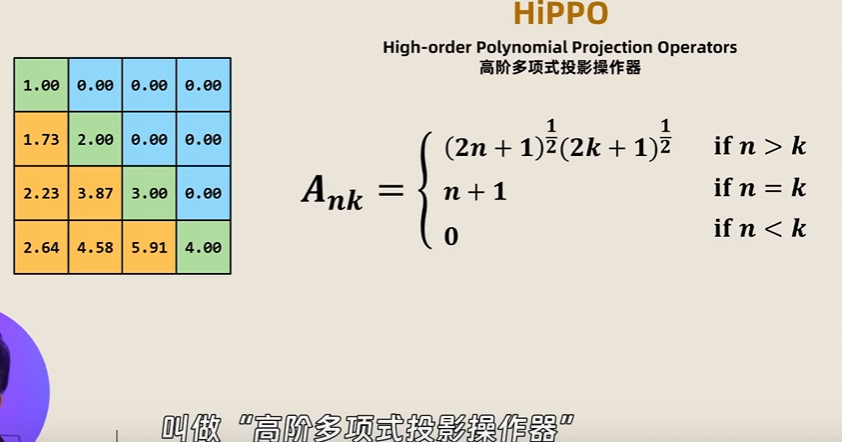

1.   初始化A方法
2. 初始化B方 法


## 5 mamba选择性

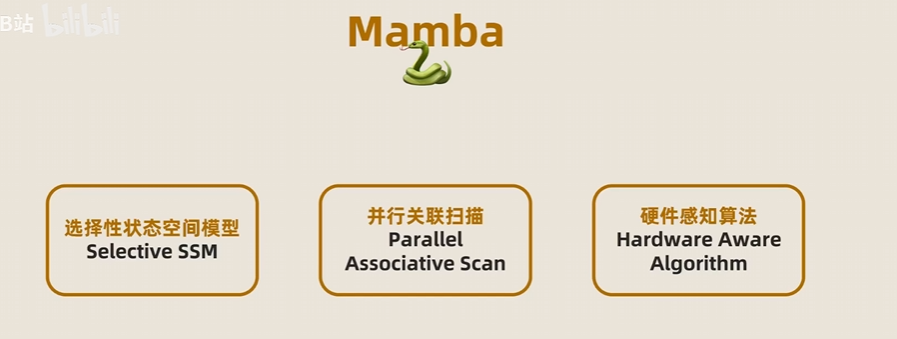

1. ABC固定后无法动态更新语义信息, 无法动态计算和更新


### 1 BC维度升级

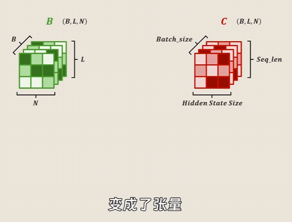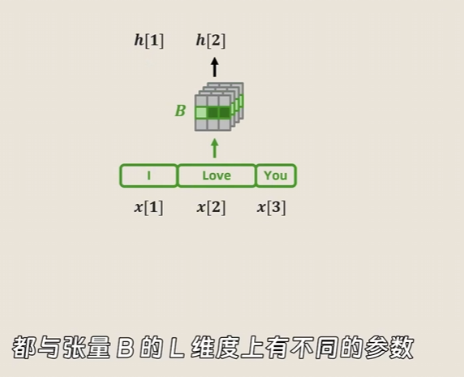


### 2 并行关联扫描算法

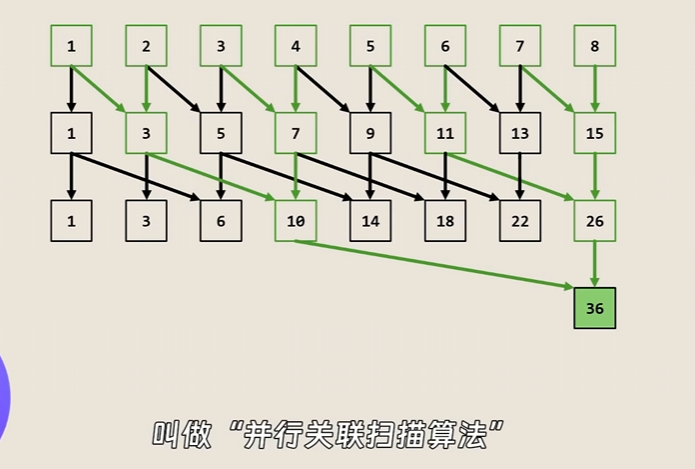


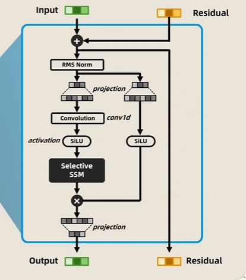


# 三 Vim

> https://github.com/hustvl/Vim
>
> https://blog.csdn.net/qq_50645064/article/details/146078396

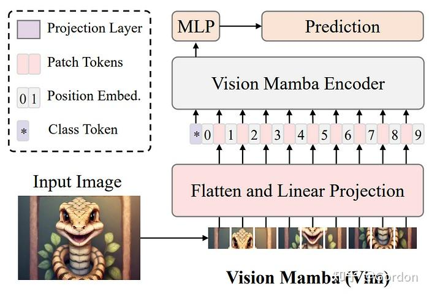

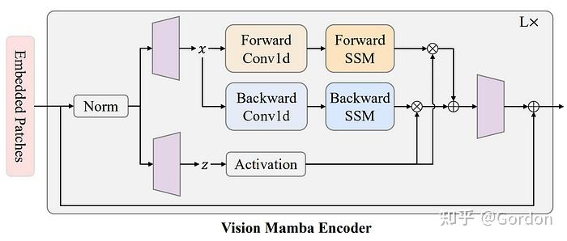

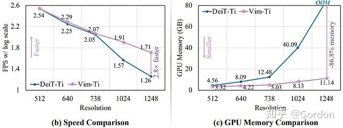

ViM 的编码器可以向前和向后方向处理标记


##  VMamba 

> https://zhuanlan.zhihu.com/p/678809370
>
> https://blog.csdn.net/v_JULY_v/article/details/134923301

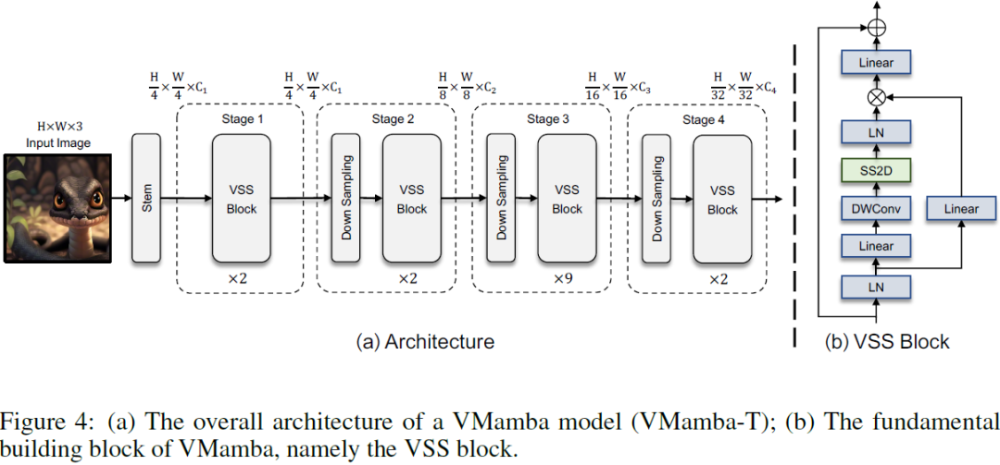

### 1 CSM

交叉扫描模块（Cross-Scan Module，CSM）。我们选择沿行和列展开图像补丁成序列（扫描扩展），然后沿四个不同方向进行扫描：从左上到右下，从右下到左上，从右上到左下，从左下到右上。这样，任何像素（如图 2 中的中心像素）都会从不同方向的所有其他像素中集成信息。然后，我们将每个序列重新整形成单个图像

> 这个模块主要代替了Transformer中的注意力机制，在保留全局感知的情况下保持了线性的计算复杂度。
>
> 四向扫描就是把 2D 特征图 `(H, W)` 用 4 种不同顺序 展成长度为 `L = H×W` 的 1D 序列，分别跑一遍 SSM，再把结果 对齐回同一像素坐标 后相加
>
> ### 1. SSM 天然是 1D 因果的
>
> 单向扫描时，像素 A 能影响 B，但 B 影响不了 A（取决于谁先谁后）。单方向会有 方向偏差——左上影响右下，反之不行。
>
> ### 2. 四向 = 从四个方向聚合上下文
>
> 单向 HW：  像素 15 能看到 ← 左边、上边来的信息
>
> 反向 HW：  像素 15 能看到 → 右边、下边来的信息
>
> WH + 反向 WH：补上「列方向」的上下左

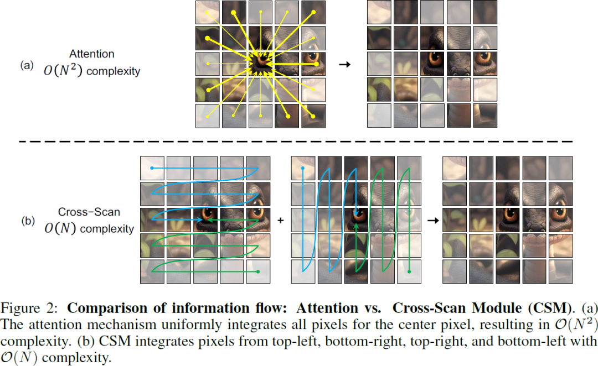

### 2 SS2D

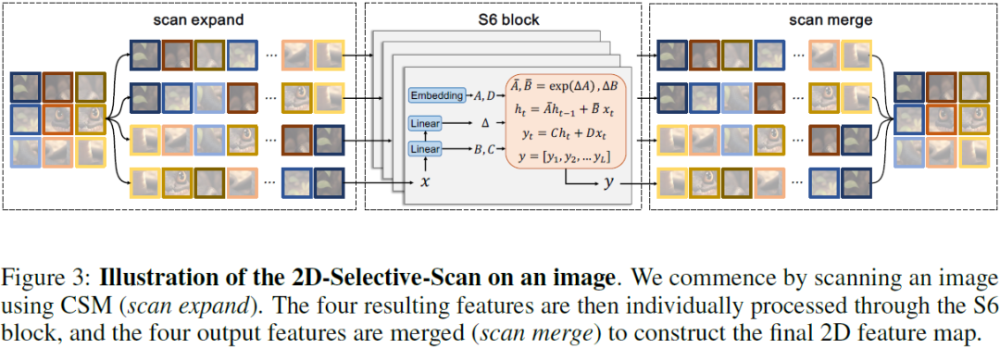

> 最大的区别就在于将Attention替换成了SSD二维选择性扫描CSM。
>
> ```
> Transformer Block:
>   MultiHeadAttention  ← 全局交互
>   FFN                 ← 逐 token 变换
> 
> Mamba Block:
>   S6 (selective scan)  ← 替代 Attention，全局/长程交互
>   门控 MLP            ← 替代 FFN
> 
> VMamba VSSBlock:
>   SS2D (2D S6 + 四向扫描)  ← 替代 Attention
>   MLP                       ← 替代 FFN
> ```
>
> 


## VM UNet

> 

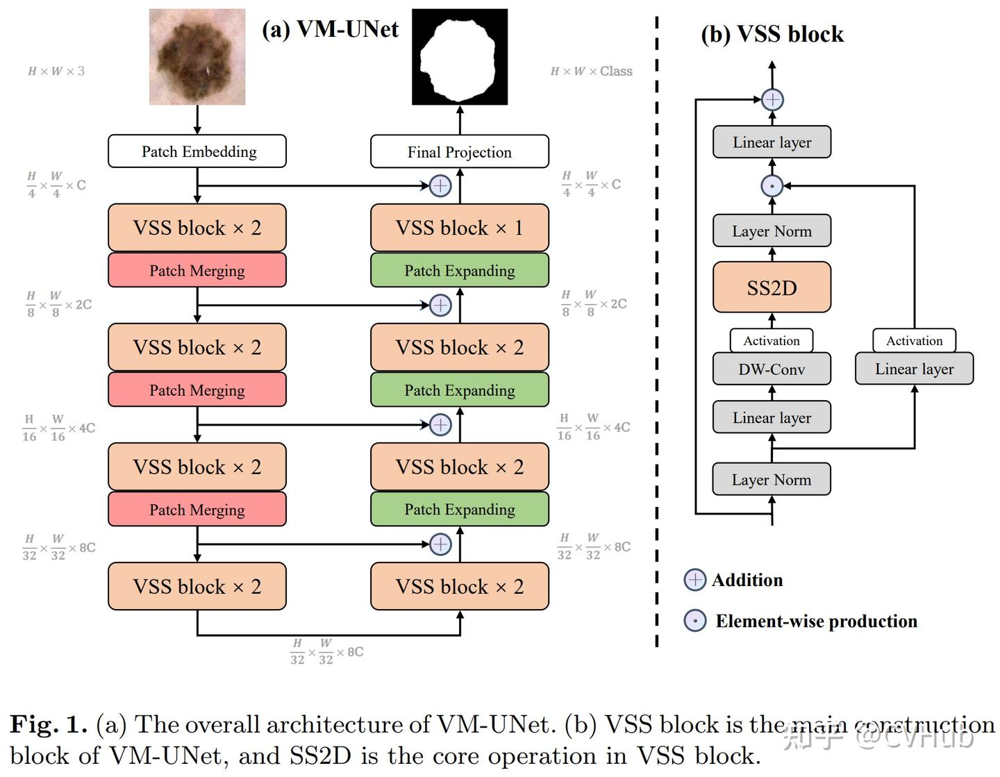


## U-Mamba

> https://github.com/bowang-lab/U-Mamba/tree/main
