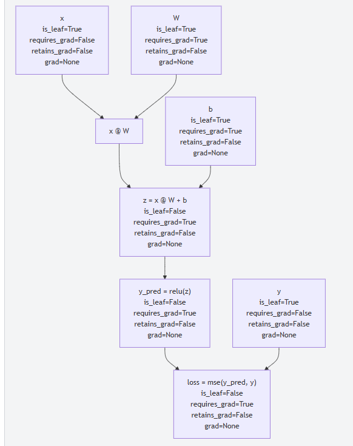
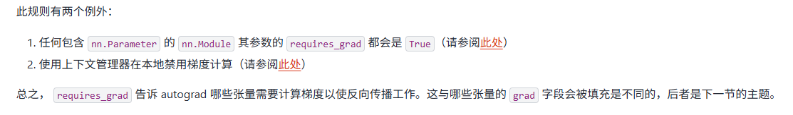
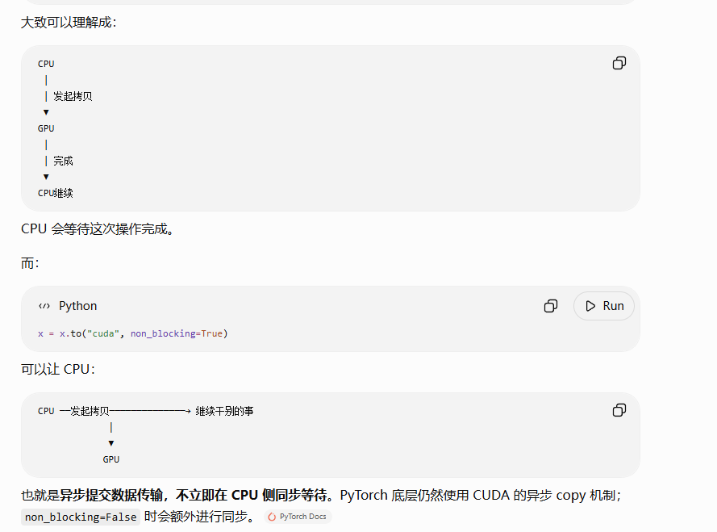
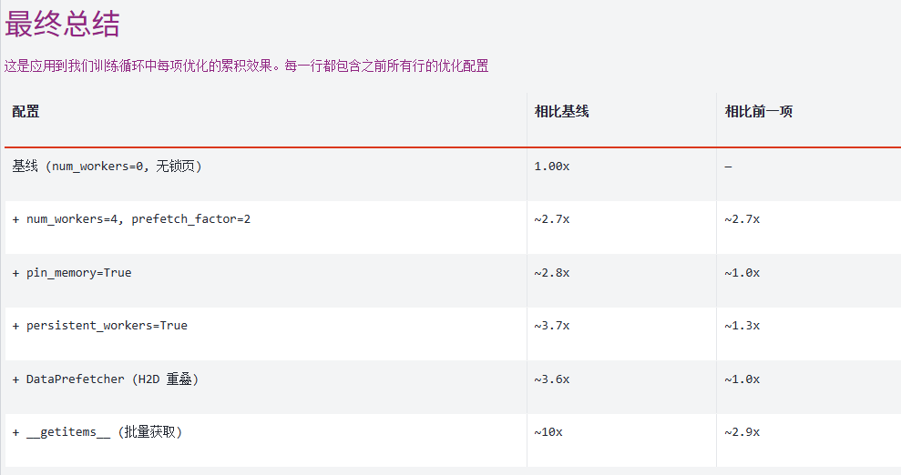

## 使用 `torch.autograd` 进行自动微分

1. 设置这些张量的 `requires_grad` 属

2. 构建计算图的函数实际上是类 `Function` 的一个对象

   ```
   z = torch.matmul(x, w)+b
   loss = torch.nn.functional.binary_cross_entropy_with_logits(z, y)
   ```

   torch.matmul是一个`Function`, +也是`Function`, 都有自己的forward和backward,

   同理, loss 也是, 所以loss.backward() 会一步步计算到matmul和`+`的grad

   

# 优化器

1. 注册优化器, 传入model参数, optimizer = torch.optim.SGD(model.parameters(), lr=learning_rate)
2. 使用`zero_grad` 进行梯度清零, 
3. 使用loss.backward()计算梯度, 
4. 之后使用optimizer.step()来调整参数

> `optimizer.step()` 能知道每个参数的 `grad`，核心在于**每个参数在 PyTorch 中都是一个 `torch.Tensor` 对象，且 Gradient（梯度）被直接绑定到了参数对象本身的 `.grad` 属性上**。
>
> 整个过程的协同机制如下：
>
> ### 1. 参数绑定：初始化时的“注册”
>
> 当你执行：
>
> Python
>
> ```
> optimizer = torch.optim.SGD(model.parameters(), lr=learning_rate)
> ```
>
> 优化器传入了 `model.parameters()`，这实际上是一个包含了模型所有可训练参数 (`Tensor`) 的**引用列表**。优化器会在内部维护这些 Tensor 的内存引用，而不是拷贝一份值。
>
> ### 2. 梯度计算：自动填充 `.grad`
>
> 在执行优化器更新之前，你会先调用：
>
> Python
>
> ```
> loss.backward()
> ```
>
> PyTorch 的反向传播引擎（Autograd）会根据计算图反向计算每一个设置了 `requires_grad=True` 的参数的偏导数。计算完成后，Autograd 会**直接将梯度值写入该 Tensor 对象的 `.grad` 属性中**（即 `param.grad = gradient_value`）。
>
> ### 3. 梯度更新：读取 `.grad` 并修改原内存
>
> 当执行：
>
> Python
>
> ```
> optimizer.step()
> ```
>
> `optimizer.step()` 的内部实现逻辑简化后如下：
>
> Python
>
> ```
> # SGD 内部的 step() 简化实现
> for param in self.param_groups[0]['params']:
>     if param.grad is not None:
>         # 1. 直接通过 param.grad 获取该参数的梯度
>         # 2. 原地更新参数内存: param = param - lr * param.grad
>         param.data.add_(param.grad, alpha=-self.lr)
> ```


## 叶子节点




如果一个节点不是由带有 `requires_grad=True` 的输入张量进行的操作而生成的（例如 `x`、`W`、`b` 和 `y`），PyTorch 就会将其视为*叶子*（leaf）；其他所有节点都是*非叶子*（non-leaf）（例如 `z`、`y_pred` 和 `loss`）。您可以通过探查张量的 `is_leaf` 属性来以编程方式验证这一点。




`retain_grad()`

现在让我们看看一个中间非叶子节点

```
print(f"{z.grad=}")
```

PyTorch 返回梯度的 `None`，并警告我们正在访问一个非叶子节点的 `grad` 属性。虽然 autograd 必须计算中间梯度以使反向传播工作，但它默认您在事后不需要访问这些值。若要更改此行为，我们可以在张量上使用 `retain_grad()` 函数。这会告知 autograd 引擎在调用 `backward()` 后填充该张量的 `grad`。


## 异步



# 数据加载优化

数据加载往往是深度学习流水线中的关键瓶颈。虽然 GPU 可以极快地处理批次，但低效的数据加载可能会导致昂贵的硬件闲置，等待下一批数据。本教程涵盖了优化数据加载配置以最大化训练吞吐量的最佳实践和一些技术。




## 工作进程数量 (`num_workers`)

The `num_workers` 参数控制用于数据加载的子进程数量。这对于并行化高开销的数据变换至关重要。

**工作原理**

- 每个工作进程都维护一个批次队列（由 `prefetch_factor` 控制）
- 工作进程并行准备批次，并将其传输给主进程
- 如果 `in_order=True`（默认），批次将按顺序返回

**何时增加 ``num_workers``**

- 当变换的计算开销很大时（如数据增强、解码）
- 当数据从慢速存储器（网络驱动器、机械硬盘）加载时
- 当您观察到由于数据加载导致的 GPU 闲置时间时

**何时 ``num_workers=0`` 可能会更快**

- 当变换的开销很低时（如简单的张量操作）
- 当数据已经存在于内存中时
- 进程间通信 (IPC) 的开销超过了并行化的收益


## 理解 `pin_memory`

The `pin_memory` 参数通过使用锁页（pinned）内存来实现更快的 CPU 到 GPU 数据传输。

**最佳实践**

1. 在 DataLoader 中使用 `pin_memory=True`（推荐方法）
2. 在将数据移动 to GPU 时结合使用 `non_blocking=True`
3. 避免手动调用 `tensor.pin_memory()` 接着调用 `.to(device, non_blocking=True)` - 这样更慢，因为 `pin_memory()` 是阻塞的

## 持久化工作进程 (Persistent Workers)

默认情况下，工作进程会在不同的 epoch 之间关闭并重新启动。这会在每个 epoch 边界上引入启动开销（导入模块、分支进程、重新初始化数据集）。

将 `persistent_workers=True` 设置为 True 可以使工作进程在多个 epoch 之间保持活动状态，从而消除重复的启动成本。

**在什么情况下最有效**

- 在较小的数据集上训练许多 epoch
- 当数据集 `__init__` 开销很大时（例如加载元数据）
- 当与较高的 `num_workers` 结合使用时

让我们对比在多个 epoch 中使用和不使用持久化工

> 然后看 `__next__()`。
>
> ```
> torch.cuda.current_stream().wait_stream(self.stream)
> ```
>
> 这一句特别重要。
>
> 它的意思不是：
>
> > 等整个 GPU 空闲。
>
> 而是：
>
> > **当前计算 stream 必须等 prefetch stream 把下一个 batch 搬完。**
>
> 因为你马上要用：
>
> ```
> data = self.next_data
> ```
>
> 如果 Batch 2 还没传完，当然不能开始计算 Batch 2。
>
> **不是用了这个 Prefetcher 就一定更快。**
>
> 如果你的情况是：
>
> ```
> GPU计算：100 ms
> H2D：2 ms
> ```
>
> 那么最多也就隐藏约 2 ms。
>
> 收益非常小。
>
> 但如果：
>
> ```
> GPU计算：10 ms
> H2D：8 ms
> ```
>
> 那就可能明显有价值。
>
> 甚至如果：
>
> ```
> GPU计算：2 ms
> H2D：8 ms
> ```
>
> 数据传输就很可能成为瓶颈。

## 数据集级别的优化：`__getitems__`

除了调整 DataLoader 参数，您还可以优化数据集本身。PyTorch 的 DataLoader 支持通过 `__getitems__` 机制进行批量获取协议：如果您的数据集定义了此方法，获取器会使用索引列表对其进行一次调用，而不是针对每个样本重复调用 `__getitem__`。

**工作原理**

- 默认获取器的操作是：`[dataset[idx] for idx in batch_indices]`
- 使用 `__getitems__`：`dataset.__getitems__(batch_indices)`

**在什么情况下会有帮助**

- 当单样本的开销很大时（例如打开连接、解析标头、获取锁）
- 当能够更高效地批量获取数据时（例如，使用一次 SQL 查询获取 N 行，而不是执行 N 次查询；或者向量化张量生成）
- 当变换具有可以分摊到整个批次中的固定设置成本时


# Dropout 

## **共适应（Co-adaptation）**

 是指在深度神经网络中，**某些神经元过度依赖其他特定的神经元来共同完成特征提取，导致它们“绑定”在一起工作，无法独立发挥作用的现象。**

你可以把它理解为“团队里的依赖症”**或**“抱团偷懒”。

### 1. 为什么会出现共适应？

神经网络本质上是通过梯度下降来“找捷径”的。如果在训练过程中没有任何干预：

- **神经元 A** 学习到了一个非常强的特征（比如识别狗的耳朵）。
- **神经元 B** 发现：“只要我每次都顺着 A 的输出做微调，就能把 Loss 降下去，那我干脆不用自己去学新特征了。”
- 结果：**B 变成了 A 的附庸**。B 并没有学会独立识别“狗的眼睛”或“狗的鼻子”，它只是学会了“如何纠正 A 的微调误差”。

一旦进入测试阶段，输入的图片稍微有些噪点，导致神经元 A 识别失误，依赖 A 的神经元 B 会瞬间跟着崩溃，整个网络的泛化能力大幅下降（即产生了过拟合）。

### 3. Dropout 是如何消除共适应的？

正如你引用的这段话所描述的：

> - 在训练期间，以概率 $p$ 随机将输入张量中的一些元素归零。
> - 在每次前向传播调用中，被清零的元素都是独立选择的。

当 Dropout 随机把某些神经元的输出清零（杀掉）时：

1. **阻断依赖链条：** 神经元 B 无法预测每一个 Step 神经元 A 是否还在。它不能再寄希望于“抱 A 的大腿”，必须自己学习具备独立表达能力的特征。
2. **解耦特征组合：** 迫使网络中的每一个神经元与周围不同的神经元随机组合（Form randomized ensembles）。每个神经元都被要求在各种不同的“残缺上下文”中都能正常工作。
