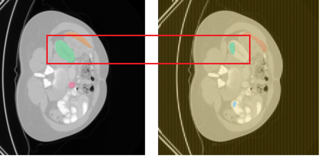

## 


## 1 怎么区分过拟合还是欠拟合

```

```

过拟合就是 train比较高0.7但是val低0.4, 主要看是不是相差大. 然后train还很低(不是0.8, 0.9),还说明模型有提升空间,, 如果说Val 先升后降，那就非常支持过拟合。

欠拟合就是train和val都比较低

> 1.  小目标没检测到不属于欠拟合吗?
>
>    > 可能是
>    >
>    > 也可能是类别不平衡导致的
>    >
>    > ```
>    >                  Train       Val
>    > Liver             0.95       0.90
>    > Gallbladder       0.35       0.30
>    > ```
>    >
>    > 这才是类别层面的欠拟合


总结: 

```
                 Train高       Train低
Val高            正常/很好      可能欠拟合但泛化不错
Val低            过拟合        欠拟合/数据或任务问题
```


## 有误识别的


# 训练

## 2 为什么attunet训练比PSC训练慢那么多


## 类别崩塌（class collapse

这是典型的 类别崩塌（class collapse）：模型几乎学不会胰腺，却把大量背景/不确定区域都判成胰腺。


## predict指标

> 给test在添加+ IoU + Precision + Recall相关的测试和可视化
>
> FP ratio = FP / (FP + TN)
>
> FN ratio = FN / (TP + FN)
>
> 以及GT volume / area
>
> Prediction volume / area
>
> Prediction / GT
>
> ​	GT 占比	预测占比
>
> 
>
> 需要总体和个体的指标个体能再叠在png吗


## 4 训练前期lever和spleen的dice很高, 其他的dice一般般, 会不会导致训练后期出现问题

主要还是看是不是难样本, 如果后期other class 也提升了, 那么久没什么问题, 如果上不去, 那可能是数据学习困难, 数据分布的问题


模型先学会了容易分割的大器官，然后梯度和优化逐渐被这些容易类别主导，其他小器官/边界复杂器官学得比较慢。

> 但是如果：
>
> ```
> Epoch 30
> Liver       0.93
> Spleen      0.91
> Others      0.60
> 
> Epoch 60
> Liver       0.97
> Spleen      0.96
> Others      0.61
> 
> Epoch 100
> Liver       0.98
> Spleen      0.97
> Others      0.59
> ```
>
> 那就比较值得警惕了。
>
> 因为这时候可能发生的是：
>
> **模型越来越擅长“把大器官分好”，但没有真正解决困难类别。**


## 5 batch size 也是会有影响的吧, 如果一个batch size 包含的难样本多一些, 或者说包含的class area有大有小, 那么就比较好, 是这样吗>?

一个 batch 内样本的类别/目标面积分布，会影响这一轮梯度的统计和方向

> 你可以把它理解成：
>
> ```
> 一个 batch
>     ↓
> 多个 2D slice
>     ↓
> 计算每张 slice 的 loss
>     ↓
> loss 聚合
>     ↓
> 得到一个 batch gradient
>     ↓
> 更新模型参数
> ```
>
> 所以如果 batch 里的样本构成发生变化，**这一次参数更新的方向也会发生变化**。
>
> 比如你现在的多器官分割：
>
> ```
> Batch A
> ────────────────
> slice 1: liver 很大
> slice 2: liver 很大
> slice 3: spleen
> slice 4: liver
> slice 5: spleen
> slice 6: liver
> ...
> ```
>
> 那么这个 batch 的梯度可能明显偏向：
>
> > “把 liver / spleen 分得更好。”
>
> 而：
>
> ```
> Batch B
> ────────────────
> slice 1: gallbladder
> slice 2: kidney
> slice 3: esophagus
> slice 4: small organ
> slice 5: liver
> slice 6: kidney
> ...
> ```
>
> 这个 batch 对模型的要求就完全不一样。
>
> 所以你说的：
>
> > “一个 batch size 包含的难样本多一些”
>
> 确实会影响训练。
>
> 但这里有一个很重要的区别：
>
> **不是“难样本越多越好”。**
>
> 例如：
>
> ```
> Batch 1:
> 80% 极难样本
> 20% 普通样本
> ```
>
> 可能导致梯度噪声比较大，训练反而不稳定。
>
> 更理想的是 batch 中具有一定的**多样性**：
>
> ```
> 容易样本
>     +
> 中等样本
>     +
> 困难样本
>     +
> 不同器官面积
>     +
> 不同切面位置
> ```
>
> 这样每次更新的 gradient 会更加全面。


****

****

# 数据

## 1 划分问题

**一定要确认你是按照“病例”划分，而不是按照 slice 划分。**

正确应该类似：

```
Case 1 ───── train
Case 2 ───── train
Case 3 ───── train
...
Case 18 ──── val
Case 19 ──── val
...
```

而不是：

```
Case 1
 ├─ slice 1 → train
 ├─ slice 2 → train
 ├─ slice 3 → val
 ├─ slice 4 → train
 └─ slice 5 → val
```

如果后者发生，你甚至可能得到反过来的问题——验证集和训练集高度相关。


## 2 dataloader问题


## 3 难样本只数据粘粘


## 4 分割补全




****

****

# loss

## 1 loss改进

`Cross Entropy (CE)` 更关注：

> **每一个像素分类得对不对。**

`Dice Loss` 更关注：

> **预测出来的整个区域，和 GT 重不重合。**

`Focal Loss` 更关注：

> **那些模型容易错、难分类的像素。**
