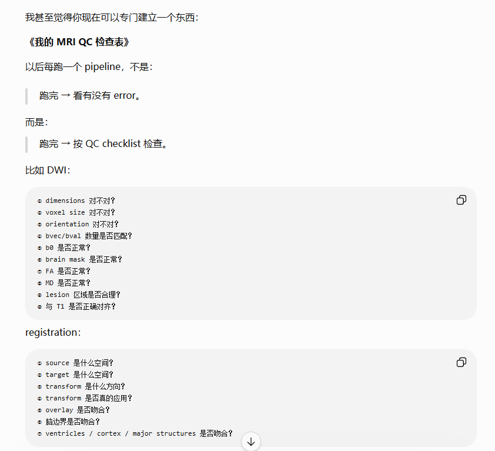

# 1 

### 在干什么

AFNI 朝向用三个字母表示体素数组的 i/j/k 轴 对应解剖方向（如 LPI = Left→Right, Posterior→Anterior, Inferior→Superior）。

两步含义不同：

1. `3drefit -orient RIP`
   只改头文件里的朝向标签，不重排体素。
   相当于告诉 AFNI：“这堆体素其实应按 RIP 理解”，用来纠正采集/转换时标错的朝向（你们数据常见：轴位/冠状对调 + 左右翻转一类问题）。
2. `3dresample -orient LPI`
   按当前标签重排/重采样体素，使数组在存储上也变成标准 LPI，方便和 NMT、后续 EPI/DWI 对齐。

流程：先 deoblique → resample 成 LPI →（可选）用 `3drefit` 把标签改成 RIP → 再 resample 回 LPI。净效果是在“标签纠错”后再统一到

# 2

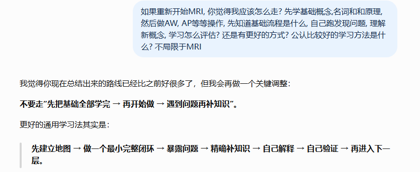

# 3 

**梗死体积 → 水肿 → 脑网络连接 → 纤维束连接**

它们分别回答不同层面的问题：

- **梗死体积（Infarct volume）**：病灶有多大？
- **水肿（Edema）**：病灶周围的组织受影响到什么程度？
- **脑网络连接（Brain network connectivity）**：脑区之间的整体功能/结构网络发生了什么变化？
- **纤维束连接（Tract connectivity）**：具体哪条白质纤维束受损、连接强度怎么变？

# 4

PrCO = 靠近运动皮层、岛叶和躯体感觉区的一块猴脑皮层。

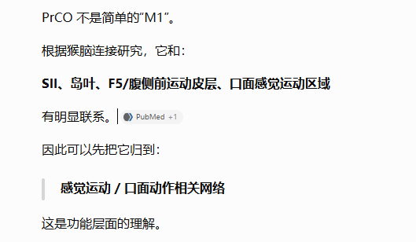

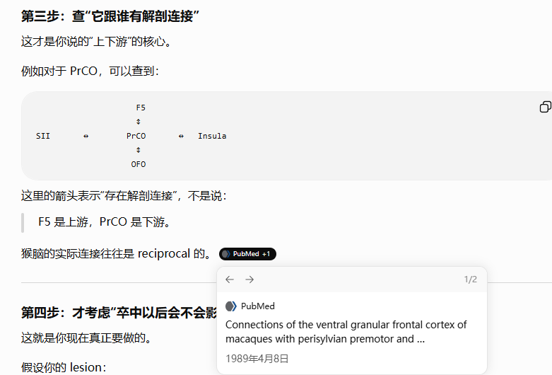

# 5 论文

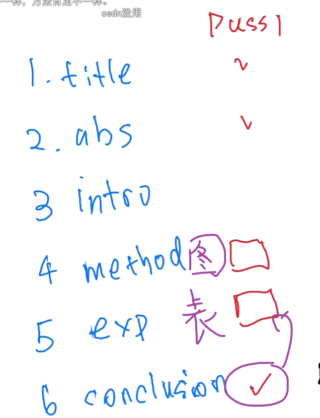

> 1. 看title abs和结论+ 框架图
> 2. 公式证明什么的不用看, 流程图搞懂+看懂方法, 看懂图, 看对比; 圈出intro介绍的重要引用
> 3. 看懂每一句+复现?+如果是我做,我会怎么办?+作者未往下走的方法+

## 1 

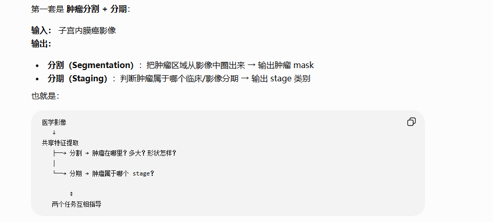

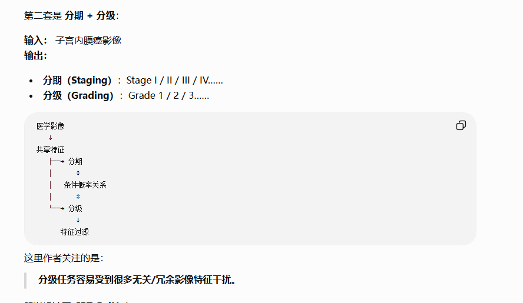

## 2 

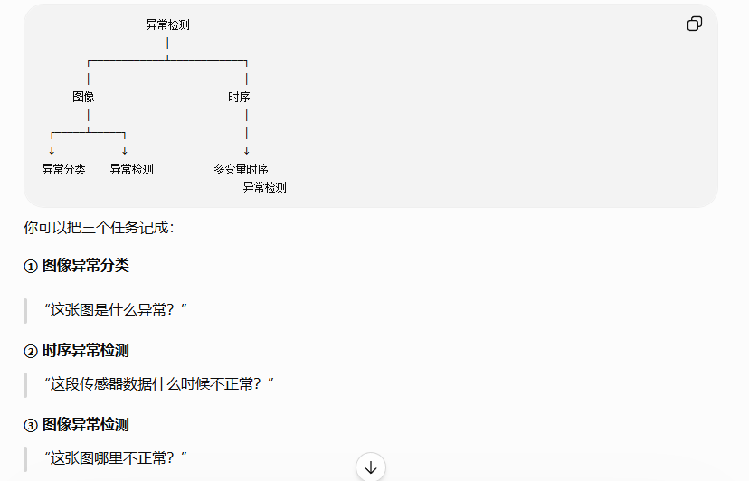

## 3 

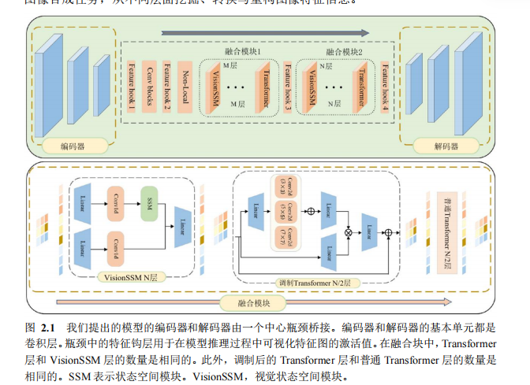

## 4 

# 6

期刊

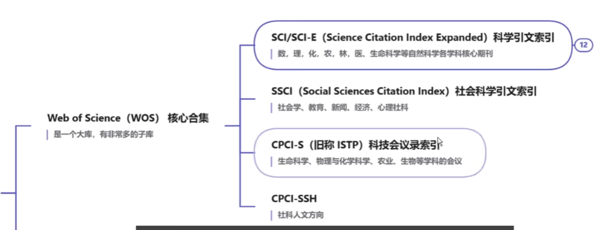

发表SCI杂志的期刊上

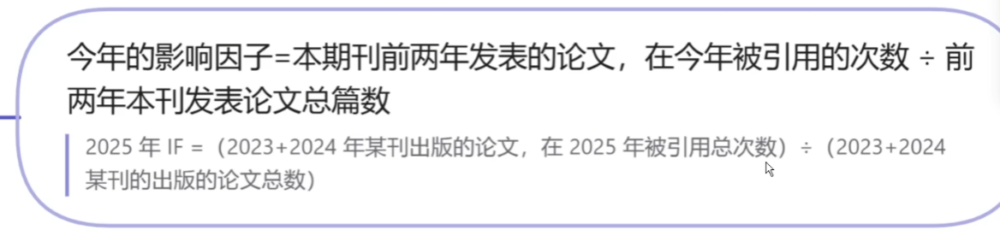

找影响因子在一区的期刊发表

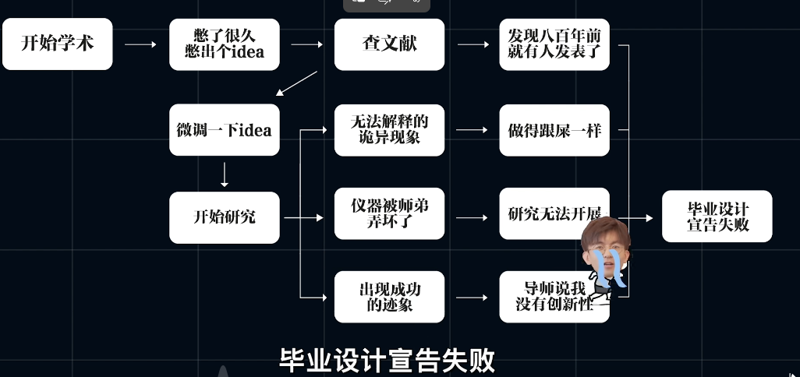
